[Русский](./README.ru.md) | **English**

# An external battery for a Canon 550D camera

**Category:** Misc  
**Original:** https://audiogeek.ru/akkumulyator-fotoapparata/

---

Today the battery of any camera usually has a rather modest capacity. Of course you can buy a second battery for the camera, but there is a more interesting option: external power for the camera. You can buy it or build it yourself.
If you need to use your camera for a long time, the first question is power. Instead of buying a second battery for a Canon, it is much more effective to come up with external power.
There are quite a few options today. As a rule they are a dummy battery with a wire coming out. At the end of the wire is a USB connector that can be plugged into a power bank, and you can shoot with your camera for a very, very long time. It looks like this:
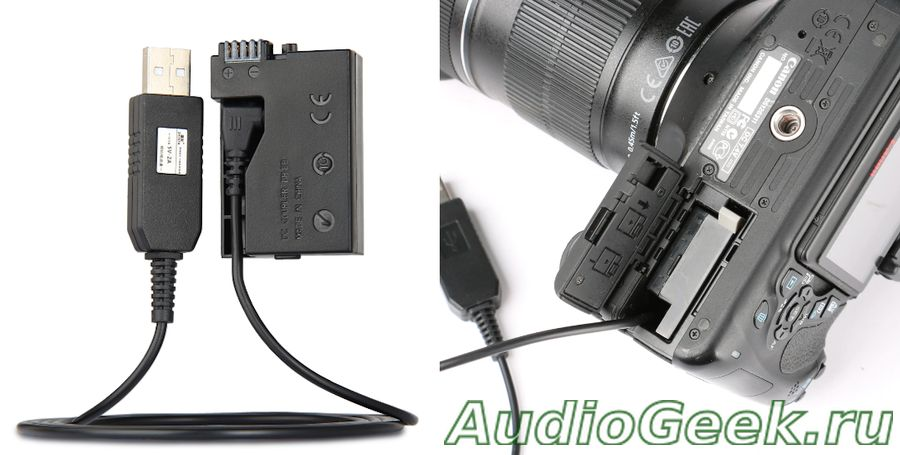
> There is an excellent AliExpress shop that specializes in camera power. There you can find a power solution for almost any camera.

## A small drawback of the ready-made design

For this thing to run from USB and power the camera, a step-up converter is installed in it. In real conditions the efficiency of step-up DC-DC converters is usually around 80%.
But a power bank also has a step-up converter inside. So we end up with two step-up converters in a row. If we take the efficiency of each as 80%, then to get the overall efficiency we multiply 0.8 by 0.8. The result is 0.64.
So it turns out that only a little over 60% of the power bank's capacity actually goes to useful work...

## In favor of an external camera battery

**The capacity is quite enough**

- Yes, the overall efficiency is nothing special, but a 10,000 mAh power bank will last for 5–6 hours of continuous video shooting. That clearly beats using the original battery.

**Cheap and practical**

- This purchase will cost you less than buying a second battery, and you will not have a headache charging two batteries.
- You can connect to any power bank, which means you are no longer tied to specific batteries and chargers.

**The camera runs cooler**

- Because of internal resistance, any battery heats up during operation. So a battery installed in the camera contributes noticeably to the camera's heating. When shooting in hot conditions this is very relevant. So by moving the battery outside we solve this problem completely.

## An external camera battery made by yourself

At first I intended to buy a ready-made device, but thoughts about efficiency and a customs office closed because of coronavirus prompted me to build an external camera battery myself.
I wanted the simplest and most portable design possible, with replaceable cells and charge monitoring. For powering the camera I decided to use the ubiquitous 18650 lithium cells.
> **I showed the whole process in great detail in the video:**

> ▶ **[Watch the video on YouTube](https://www.youtube.com/watch?v=CO7dnXsOGCk)**

### A Canon dummy battery

First we need to make a dummy battery with a wire coming out.
I bought my camera used, and as a bonus I got a swollen battery that worked but went into the camera with great difficulty. Well, let us put it to use.
The construction of a camera battery is very simple. Inside the plastic case there is a charge-control board and two cells connected in series.
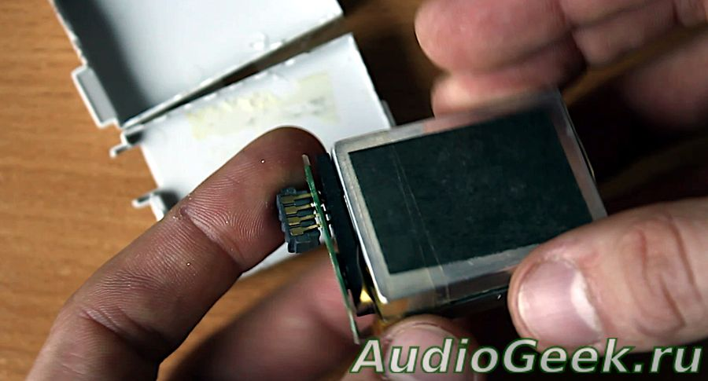
First I tried to bring the cells out without changing the charge-control board. Everything worked, but then a snag showed up.
When the power cells were replaced, the charge-control circuit locked up and gave no voltage at the output until it was connected to a charger. And what if you are outdoors?
So we desolder all the parts from the board and leave only the connector.
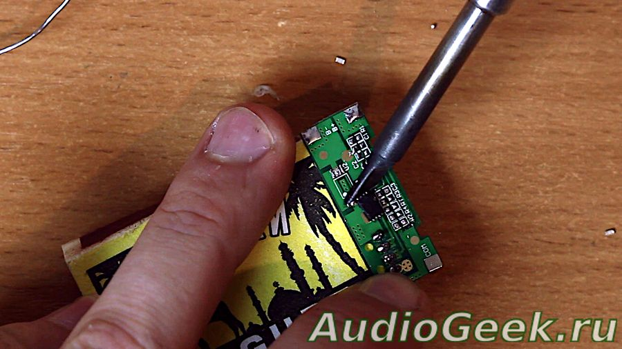
Only the outermost pins of the connector are used for power. The wire must be soldered to them. **The main thing is not to mix up the polarity**! The polarity is marked on the case of the original battery.
The board has no mounting and was simply held in place by the cells. In their place I cut a block of foam plastic. Then the battery case was glued back to its original state.
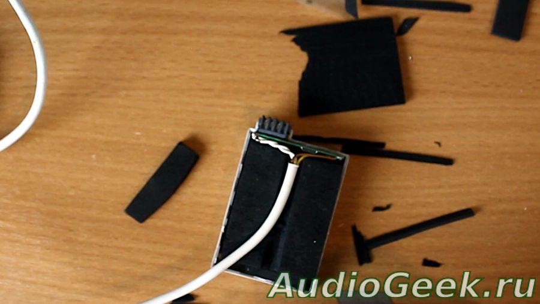
Now solder a connector to the end of our wire.
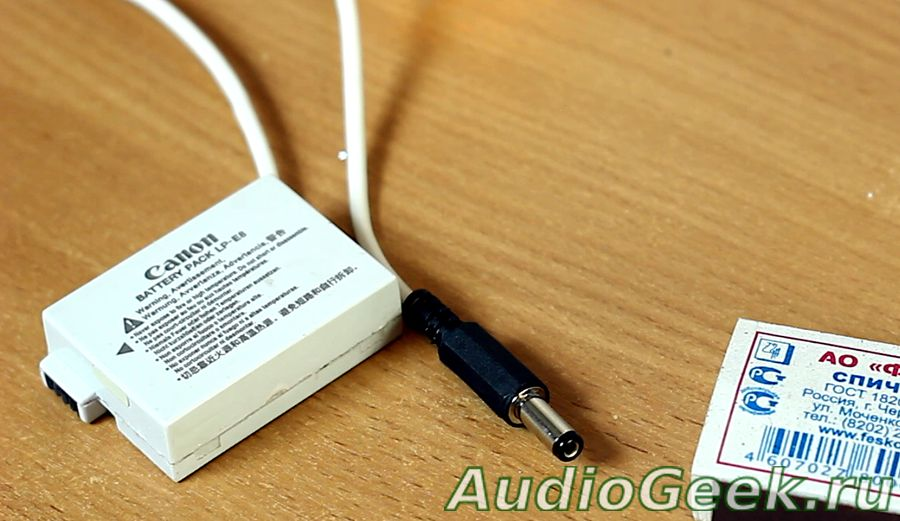
Great, the pseudo-battery is ready; now it is the turn of the external source.

### **The cell wiring circuit**

All that is required of us now is to attach two cells to the end of the protruding wire. But I wanted some ergonomics.… In the end the overall wiring diagram looks as follows:
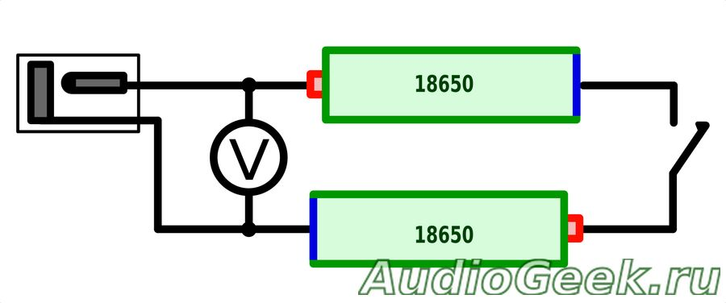
Going through the diagram from left to right, first comes the connector for the dummy battery, followed by a mini voltmeter to monitor the voltage. Then come two Li-ion cells, with a switch placed in the break between them.
The mini voltmeter trick turned out to be very convenient. I bought the mini voltmeter on AliExpress. It works out that after flipping the switch, the voltage immediately reaches the output and is shown by the voltmeter.
Besides being convenient for monitoring the state of charge of the cells, it will also immediately show if you have inserted the camera battery incorrectly.

### An enclosure for the external Canon battery

As always, the greatest difficulty was finding a suitable enclosure. In the end a bicycle repair-kit pouch came in handy for the role. It first had to be washed thoroughly.
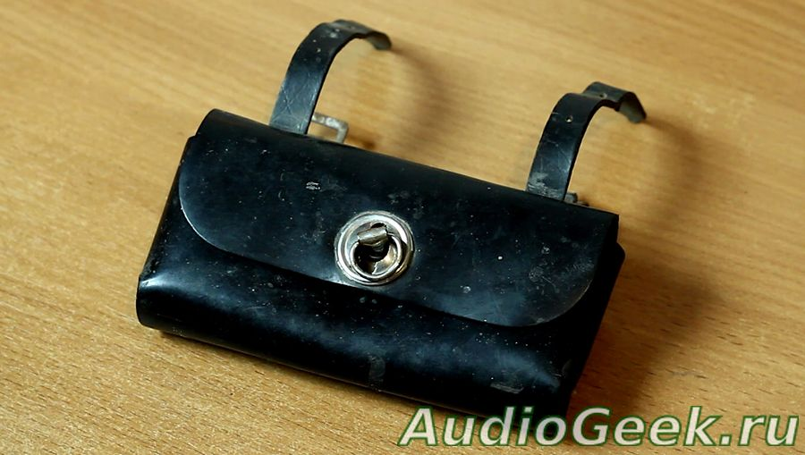
I decided to put all the elements on the sides. For that, glass-fiber laminate inserts were cut and screwed to the side walls, two on each side, so that they clamp the pouch fabric.
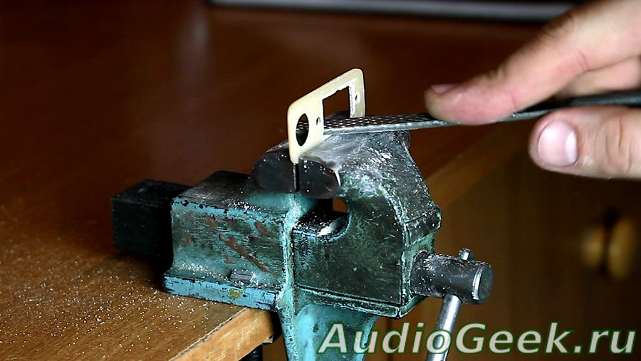
Then the necessary holes were cut with a sharp knife and the parts inserted. The button ended up on the right side.
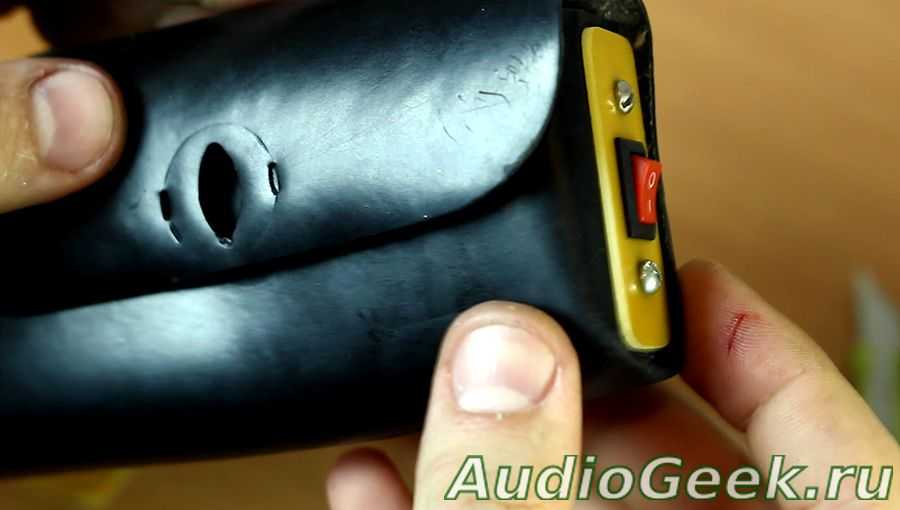
And the connector and voltmeter on the left, accordingly. That turned out to be very convenient.
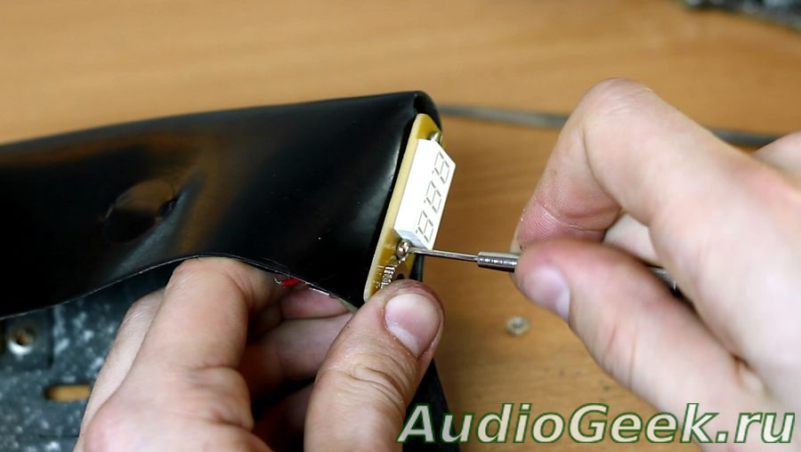
The hardest part was figuring out how to fix the cells in the pouch. Hook-and-loop fastener (Velcro; see [Hook-and-loop fastener](https://en.wikipedia.org/wiki/Hook-and-loop_fastener)) served the purpose. The hook side was sewn to the battery holder.
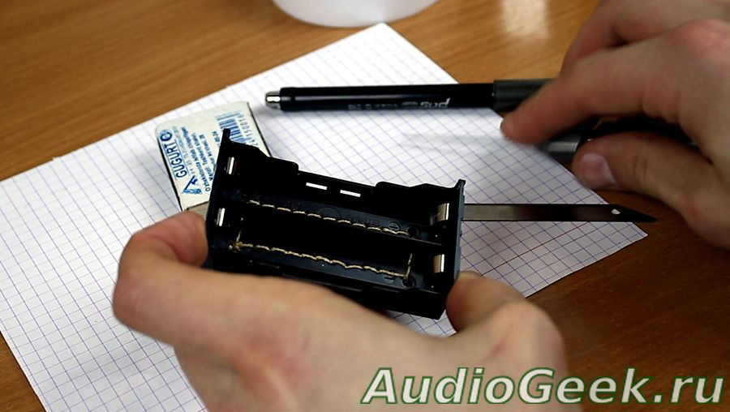
And the mating part to the inner side of the pouch.
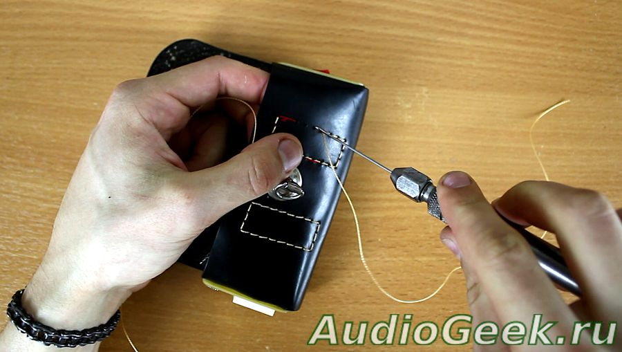
The wires for soldering were taken with a margin of 4–5 cm. This is so that the battery holder can be peeled off and pulled out to replace the cells.
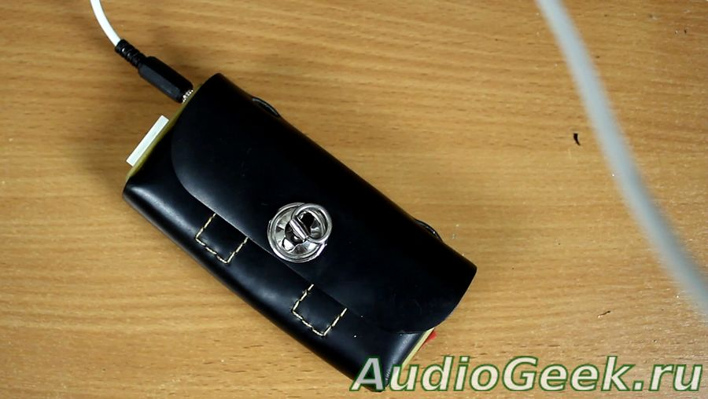

## Conclusion

I am 101% happy with the resulting device. Now I can freely shoot video for several hours at a time. For monitoring charge you can also use [TP4056 modules](../kontroller-zaryada-li-ion-modul/).
I am not urging you to repeat exactly what I made. It is only a demonstration that you can put together something worthwhile, and even working, out of junk and sticks.

*Originally written for [AudioGeek.ru](https://github.com/SkyTrip-13/AudioGeek). Translated from Russian.*
