[English](./README.md) | **Русский**

# Внешний аккумулятор для фотоаппарата Canon 550D

**Рубрики:** Разное  
**Оригинал:** https://audiogeek.ru/akkumulyator-fotoapparata/

---

Сегодня аккумулятор любого фотоаппарата  как правило имеет весьма скромную емкость.  Конечно можно купить второй аккумулятор для фотоаппарата, но есть более интересный вариант - это внешнее питание фотоаппарата. Его можно купить или сделать самому.
Если вам нужно использовать Ваш фотоаппарат продолжительное время, то в первую очередь встает вопрос о питании. Вместо того, чтобы покупать второй аккумулятор для фотоаппарата canon, гораздо эффективнее будет придумать внешнее питание.
На сегодняшний день существует не мало вариантов. Как правило они представляют из себя муляж батарейки, с выведенным наружу проводом. На конце провода имеется USB разъем, который можно воткнуть в повербанк и снимать на свой фотоаппарат ооочень долго. Выглядит это вот так:
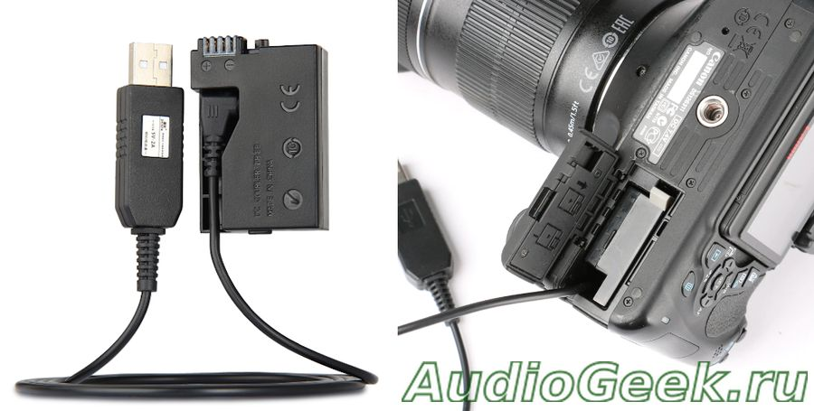
> Вот отличный ***магазин на Алиэкспресс***. Магазин специализируется именно на питании фотоаппаратов. В нем вы сможете найти себе питание под любой фотоаппарат.

## Небольшой минус готовой конструкции

Чтобы эта штука могла работать от USB и питать фотоаппарат, в ней установлен повышающий преобразователь. В реальных условиях, КПД повышающих dc-dc преобразователей обычно лежит в районе 80%.
Но в повербанке тоже стоит повышающий преобразователь В итоге имеем уже два стоящих подряд повышающих преобразователя. Если КПД каждого из них брать равным 80%, то для подсчета итогового КПД необходимо умножить 0.8 на 0.8. В итоге мы получим 0.64.
Получается, что реально на пользу дела будет идти немногим больше 60% емкости павербанка...

## За внешний аккумулятор для фотоаппарата

**Емкости вполне достаточно**

- Да, итоговый КПД не зашкаливает, но повербанк'а емкостью 10'000 мА\*Ч хватит на 5-6 часов непрерывной съемки видео. Это явно круче использования родного аккумулятора.

**Дешево и практично**

- Эта покупка обойдется вам дешевле покупки второго аккумулятора, и у вас не будет болеть голова как заряжать уже два аккумулятора.
- Вы можете подключаться к любому повербанку, а значит вы больше не привязаны к конкретным батарейкам и зарядкам.

**Меньше греется фотоаппарат**

- Из-за наличия внутреннего сопротивления, любой аккумулятор нагревается в процессе работы. Так что аккумулятор, установленный в фотоаппарат вносит приличный вклад в нагрев вашего фотоаппарата. При съемка в жарких условиях это очень актуально. Поэтому вынося аккумулятор на улицу мы полностью решаем эту проблему.

## Внешний аккумулятор для фотоаппарата своими руками

Сначала предполагалось купить готовое устройство, но думки о КПД и закрытая из-за коронавируса таможня, надоумили меня соорудить внешний аккумулятор для фотоаппарата.
Хотелось получить максимально простую и портативную конструкцию. С возможностью замены аккумуляторов и контролем их заряда. В качестве аккумуляторов для питания фотоаппарата было решено использовать вездесущие литиевые банки 18650.
> **Весь процесс я очень подробно показал в видео:**

> ▶ **[Смотреть видео на YouTube](https://www.youtube.com/watch?v=CO7dnXsOGCk)**

### Муляж батарейки canon

Первым делом потребуется сделать муляж батарейки с выведенным наружу проводом.
Свой фотоаппарат я брал с рук и бонусом к нему, мне достался вспухший аккумулятор, который работал, но засовывался в фотоаппарат с большим трудом. Что-ж, его и задействуем.
Устройство аккумулятора для фотоаппарата очень простое. Внутри пластикового корпуса располагается плата контроля заряда и два включенные последовательно аккумулятора.
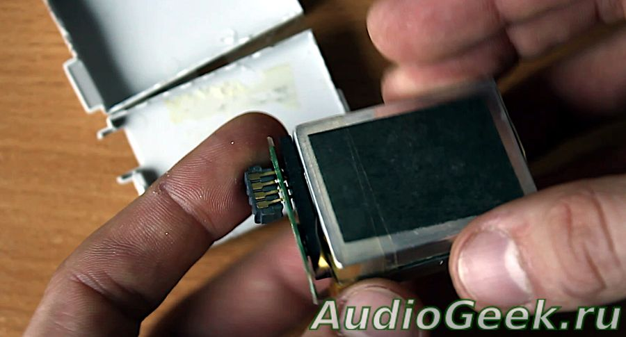
Первым делом я попытался вынести наружу аккумуляторы без изменения платы контроля заряда. Все заработало, но тут же вылезла бяка.
При замене питающих банок, схема контроля заряда запиралась и не выдавала наружу напряжения, пока не подключишь ее к зарядному устройству. А если вы на улице?
Так что выпаиваем все детали с платы и оставляем только разъем.
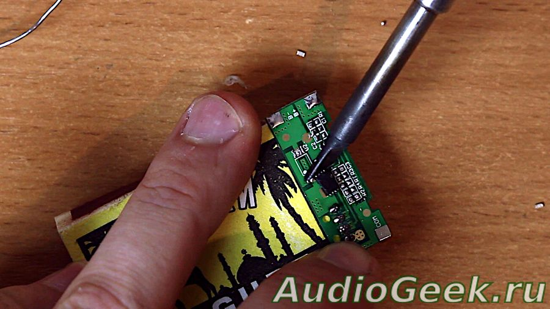
Для питания используются только крайние выводы разъема. К ним и нужно припаять провод. **Главное не перепутайте полярность**! Полярность указывается на корпусе родного аккумулятора.
Плата не имеет какого-либо крепежа и просто подпиралась аккумуляторами. В замен им из пенопласта был вырезан параллелепипед. После чего аккумулятор был склеен в исходное состояние.
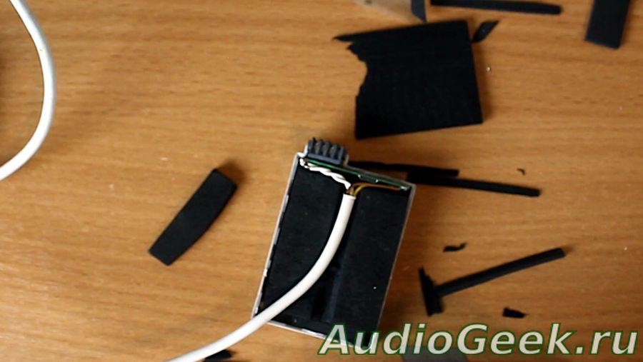
Теперь припаиваем разъем на конец нашего провода.
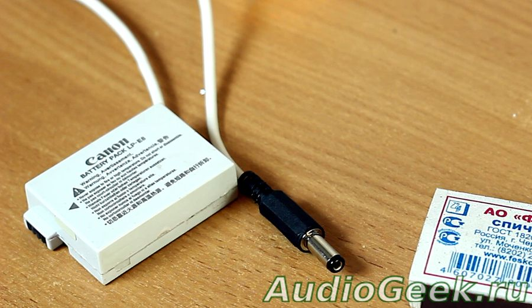
Отлично, псевдо-батарейка готова, теперь дело за внешним источником.

### **Схема включения аккумуляторов**

Все, что от нас теперь требуется - это прицепить на конец торчащего провода два аккумулятора. Но хотелось бы какой-то эргономики.… В итоге общая схема подключения выглядит следующим образом:
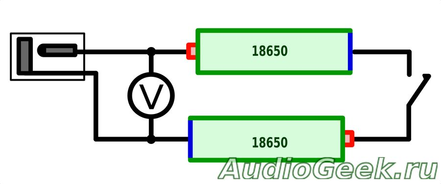
Если двигаться по схеме слева-направо, то первым идет разъем для подключения муляжа батарейки, а за ним мини-вольтметр, для контроля напряжения. Далее идут два литий ионных аккумулятора, в разрыв которым установлен выключатель.
Фишка с мини-вольтметром оказалась очень удобной. ***Мини-вольтметр покупал тут***. Получается что после щелчка выключателем, напряжение уже приходит на выход и отображается вольтметром.
Помимо того, что так удобно следить за состоянием заряда аккумуляторов, так он еще сразу покажет, если вы не правильно установили аккумулятор для фотоаппарата.

### Корпус для внешнего аккумулятора canon

Наибольшую трудность, как и всегда, вызвал поиск подходящего корпуса. В итоге на эту роль пригодился велосипедный чехольчик для ремкомплекта? Который для начала пришлось хорошенько помыть.
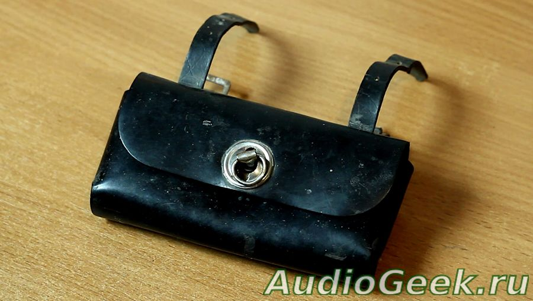
Все элементы было решено размещать по бокам. Для этого, к боковым стенкам были вырезаны и прикручены вставки из стеклотекстолита. По две на каждую сторону, так чтобы они зажимали ткань чехла.
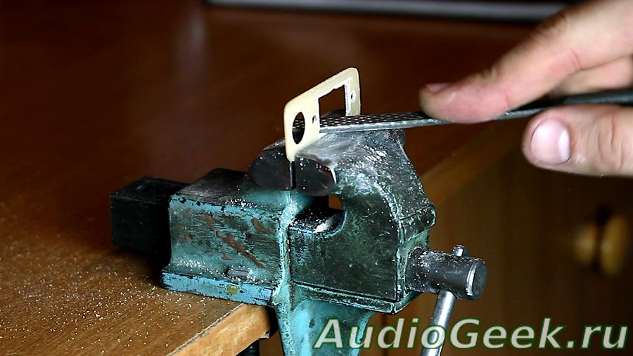
После чего, острым ножом были вырезаны необходимые отверстия и вставлены детальки. Кнопка расположилась с правой стороны.
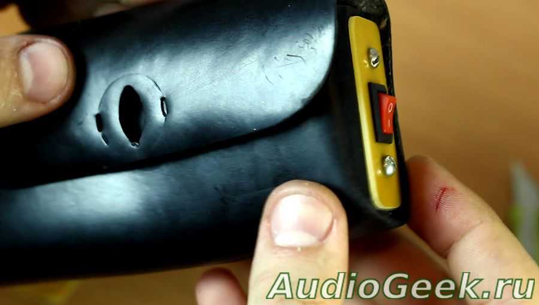
А разъем и вольтметр, соответственно на левой. И это оказалось очень удобно.
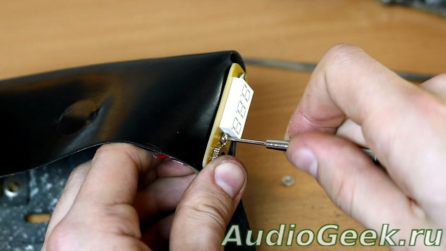
Труднее всего было придумать как закрепить аккумуляторы в чехле. Для этих целей послужила липучка (которая правильнее называется [Текстильная застежка](https://ru.wikipedia.org/wiki/%D0%A2%D0%B5%D0%BA%D1%81%D1%82%D0%B8%D0%BB%D1%8C%D0%BD%D0%B0%D1%8F_%D0%B7%D0%B0%D1%81%D1%82%D1%91%D0%B6%D0%BA%D0%B0)). Так  часть липучки с крючочками была пришита к батарейному отсеку.
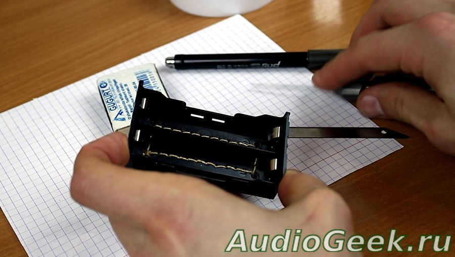
А ответная часть ко внутренней стороне чехла.
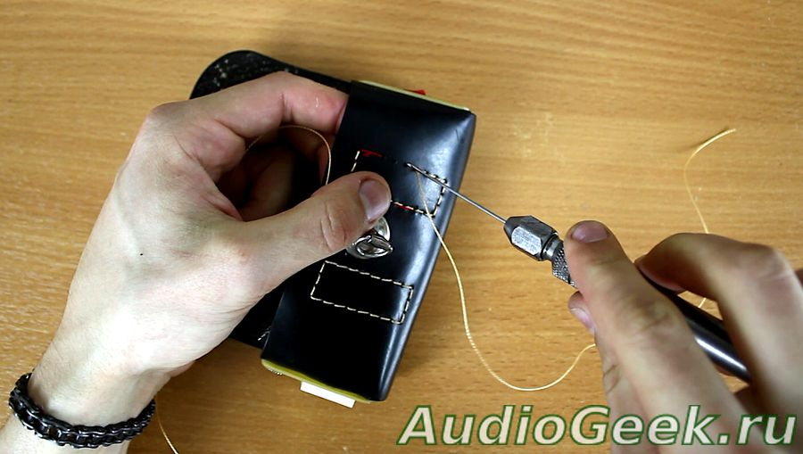
Провода для подпайки брались с запасом в 4-5 см. Это нужно для того, чтобы можно было отлепить батарейный отсек и вынуть его наружу для замены аккумуляторов.
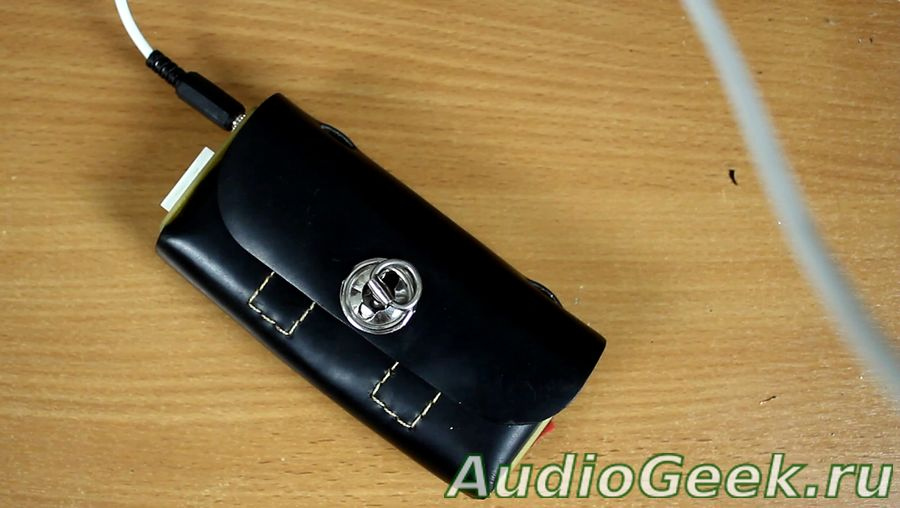

## Заключение

Получившимся девайсом я доволен на все 101%. Теперь можно свободно снимать видео  по несколько часов. Так же для контроля заряда можно использовать [модули на TP4056](../kontroller-zaryada-li-ion-modul/).
Я не призываю вас в точности повторять то, что получилось у меня. Это лишь демонстрация того, что из гов\*а и палок можно собрать что-то стоящее и даже работающее.
> **Купить аккумулятор для фотоаппарата лучше в специализированном магазине на Алиэкспесс.**

**Материал подготовлен исключительно для сайта [AudioGeek.ru](https://github.com/SkyTrip-13/AudioGeek)**
