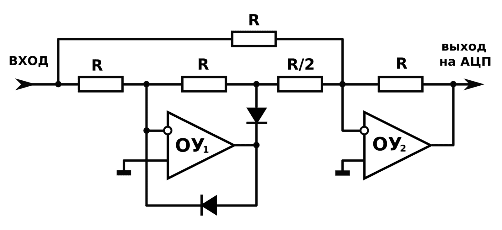
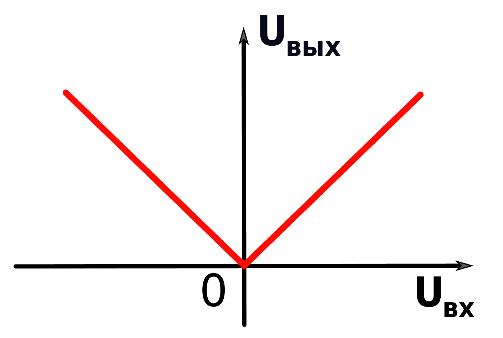
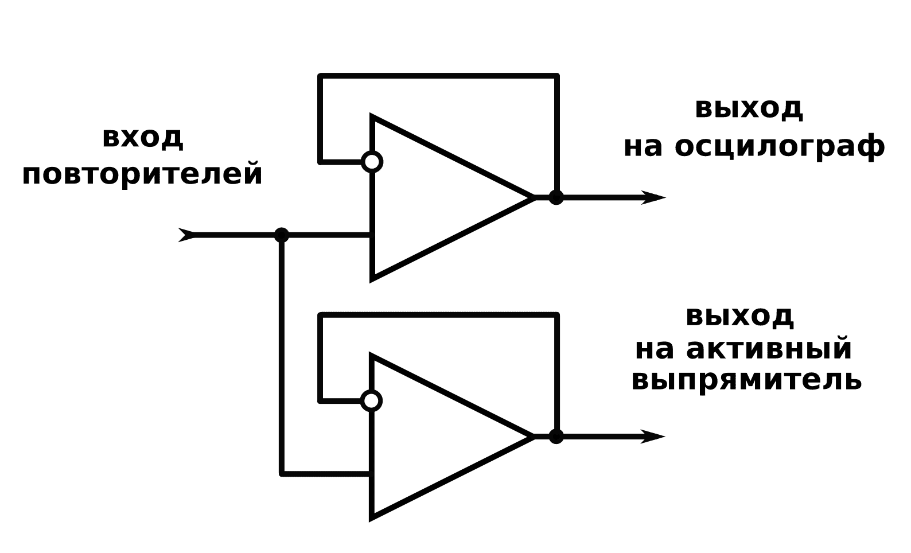
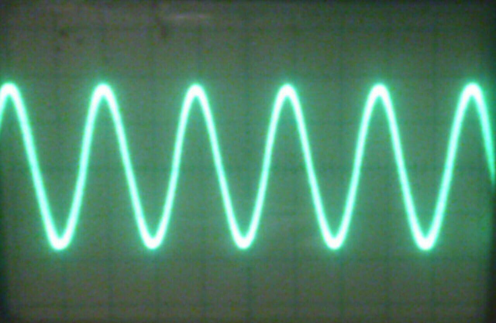
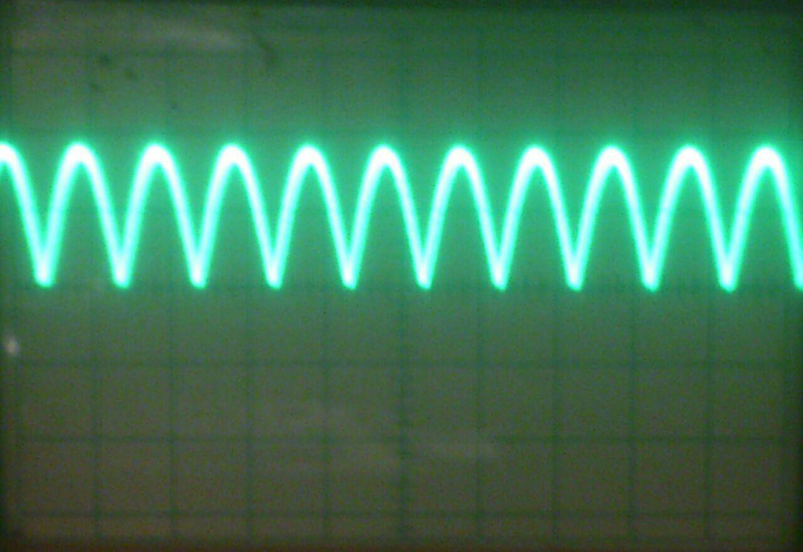
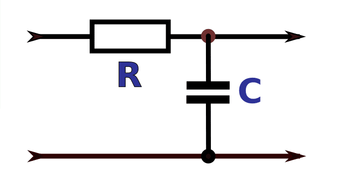

[Русский](./README.ru.md) | **English**

# Active rectifier: precise measurement of AC voltage

**Category:** Useful circuits  
**Tags:** measurements, op-amp circuit  
**Original:** https://audiogeek.ru/aktivniy-vipryamitel/

---

To measure the value of an alternating voltage it has to be rectified, because all measuring systems, whether an analog galvanometer or a microcontroller's ADC, work with DC voltage. The most correct way to do this is with a simple-to-build active rectifier on an op-amp.

Here you will tell me that I am lying and that your multimeter can measure AC voltage by itself. So what is the catch? The catch is that your multimeter also rectifies the AC voltage, and what it actually measures is DC. Besides, a multimeter is usually designed to measure mains voltage at 50 Hz.

Rectifier circuits that convert AC voltage to DC are built on diodes; even the diodes themselves are sometimes called rectifiers. Passive rectifiers, made only of diodes, have serious drawbacks in terms of their suitability for measuring AC voltage.

The most obvious drawback is that when the amplitude of the measured signal is equal to or less than the voltage drop across a diode's p-n junction (0.6 volt for silicon and 0.4 for germanium diodes), such signals cannot be rectified by passive rectifiers; you simply will not see anything.

In high-precision measurements the inability to measure small AC signals is not the only minus of passive circuits. Much more serious drawbacks are the **nonlinear dependence of the output voltage on the input** and the **nonlinear dependence of the output voltage on the input signal frequency**.

For the greatest accuracy in measuring alternating voltages of different frequencies and amplitudes, operational amplifiers (op-amps) are used, with the diodes placed in the feedback loop. With the right choice of circuit and components, all the listed drawbacks of passive rectifiers are compensated by the op-amp.

There are quite a few active rectifier circuits. The circuit presented was chosen because it appears in the books "The Art of Electronics" by P. Horowitz and W. Hill (p. 172) and "Operational Amplifiers" by J. Dostál (p. 203). Solid publications that are today classics of circuit design.

As expected, the circuit **needs no adjustment** and, when assembled correctly, **works right away.**

## **Active rectifier (full-wave)**

## **[or an absolute-value circuit for an AC signal]**

## **Active rectifier: how the circuit works**

The circuit extracts the absolute value of the input voltage and thereby works as a full-wave rectifier. It consists of a diode limiter built on **OA1** and a two-input summing amplifier on **OA2**.

When the input voltage **Uin** is negative, the upper diode is non-conducting. The series resistors **R** and **R/2** do not work, since they are connected between the virtually grounded inputs of amplifiers **OA1** and **OA2**. The output summing amplifier acts as an inverter with unity gain, and:

**Uout = − Uin** at **Uin < 0**

An input voltage **Uin** of positive polarity is converted by the limiter into a voltage of negative polarity **U = −Uin**, and then both voltages are added so that the summing amplifier output gives:

**Uout = − Uin − 2U = + Uin** at **Uin > 0**

Both cases can be formally combined by writing:

**Uout = |Uin|**

That is why such a rectifier is also called an absolute-value circuit.

Graphically, the dependence of the rectified output voltage on the alternating input can be drawn as follows:

This circuit came in very handy when I needed to rectify an alternating voltage at **150 kHz** and then send it to a microcontroller's ADC for transfer to a PC. The rectifier became part of a setup for studying the relaxation properties of MIS structures :-)

## Choosing the parts

The characteristics of this circuit are determined by the parts used.

The op-amp chosen was the **LM833**, which can work at frequencies up to **15 MHz**. Such a margin in bandwidth may even seem excessive, but it guarantees minimal phase distortion up to several MHz. A **±15 V supply** was used, regulated with an L7815 and L7915.

Fast **switching diodes (1N4148)** were used as the diodes.

The **value of R** was chosen as 14.51 kΩ because that value was on hand, but nothing prevents you from choosing it as **10 kΩ** or **20–30 kΩ**.

To avoid introducing additional error, precision resistors of the C2-13 type (a Russian type) were used. These resistors have glass insulation covered with an extra layer of ceramic, which gives considerable temperature stability in measurements. The resistor tolerance is ±0.5%.

## **Buffer stages**

During the measurements a need arose to watch the AC signal visually on an oscilloscope. However, connecting the oscilloscope directly into the signal path before the rectifier distorted the signal. To match impedances, buffer stages were added before the active rectifier.

The installed buffer stages made it possible to split the signal into two channels without changing the signal's characteristics. The stages are built on a similar fast op-amp (LM833), with one output feeding the active rectifier and the other the oscilloscope.

## **Oscillograms**

The oscillogram of the AC voltage fed to the rectifier input while testing the built circuit:

And the oscillogram of the active rectifier's output voltage:

As the oscillograms show, the built active rectifier handles rectification of a 150 kHz sinusoidal AC signal with flying colors.

P.S. To protect the rectifier against possible short circuits it is worth adding a series resistor at the output, and to smooth the rectified signal a capacitor to ground after the resistor is desirable. The resistor and capacitor form an integrating RC network, and by choosing its time constant you can smooth the rectified signal.

The value of R was chosen as 2 kΩ and C as 0.01 µF.

*Originally written for [AudioGeek.ru](https://audiogeek.ru). Translated from Russian.*
