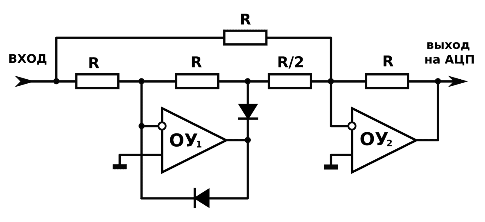
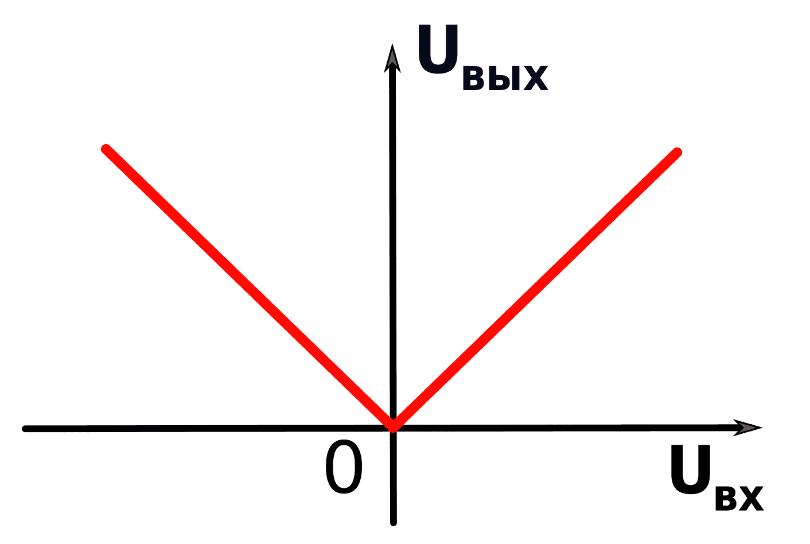
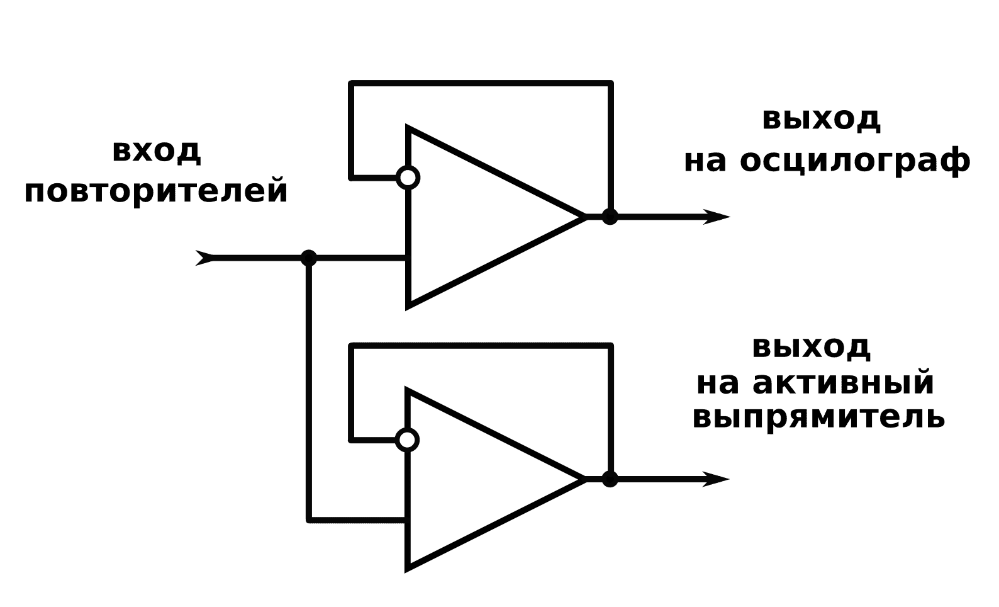
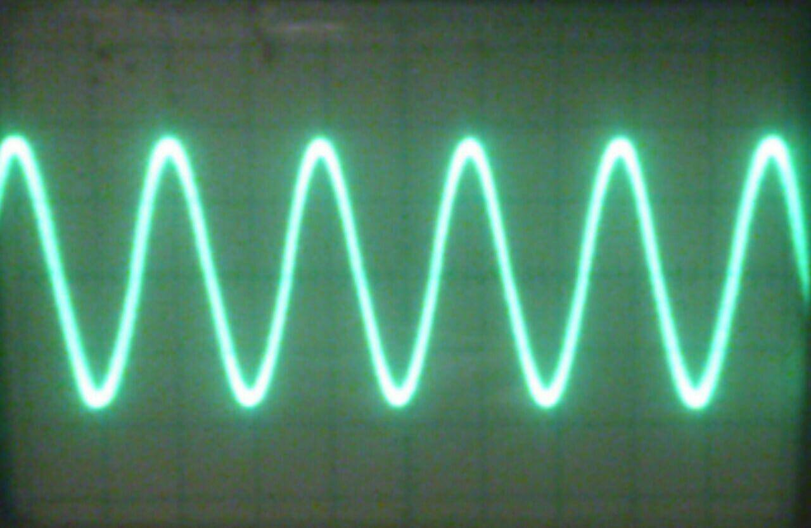
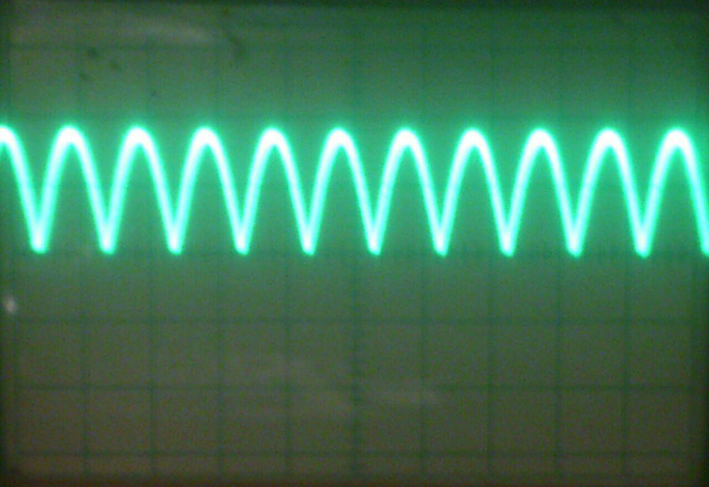
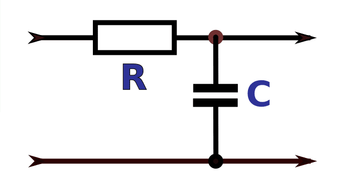

[English](./README.md) | **Русский**

# Активный Выпрямитель - точное измерение переменного напряжения

**Рубрики:** Полезные схемы  
**Метки:** измерения, схема на ОУ  
**Оригинал:** https://audiogeek.ru/aktivniy-vipryamitel/

---

Для измерения величины переменного напряжения, его необходимо выпрямлять, так как все измерительные системы, будь то стрелочный гальванометр или АЦП микроконтроллера, работают с постоянным напряжением. Наиболее правильно это можно сделать используя простой по исполнению активный выпрямитель на ОУ.

Тут вы мне скажете, что я вру и ваш тестер умеет и сам мерить переменное напряжение. В чем же подвох? В том, что ваш тестер  умеет еще и выпрямлять переменное напряжение, а измеряет он на самом деле постоянное. К тому же тестер как правило рассчитан на измерение напряжения сети частотой 50 Гц.

Схемы выпрямителей, преобразующие переменное напряжение в постоянное строятся на диодах, даже сами диоды иногда называют выпрямителями. У пассивных выпрямителей, состоящих только из диодов есть серьезные недостатки в плане их применимости для измерения переменного напряжения.

Самый очевидный недостаток заключается в том, что при амплитудах измеряемого сигнала равных либо меньших величины напряжения падения на p-n переходе диода (0,6 вольта для кремниевых и 0.4 для германиевых диодов), выпрямлять такие сигналы пассивными выпрямителями невозможно, вы попросту ничего не увидите.

При высокоточных измерениях невозможность измерения малых величин переменного сигнала не единственный минус пассивных схем. Гораздо более серьезными недостатками являются **нелинейная зависимость выходного напряжения от входного**, а так же **нелинейная зависимость выходного напряжения от частоты входного сигнала**.

Для наибольшей точности измерения переменных напряжений разных частот и амплитуд прибегают к помощи операционных усилителей (ОУ). При этом диоды включаются в цепи обратной связи. При правильном выборе схемы и комплектующих, все перечисленные недостатки пассивных выпрямителей компенсируются операционным усилителем.

Существует достаточно схем активных выпрямителей. Представленная схема была выбрана по причине того, что она встречается в книгах “Искусство схемотехники” - П.Хоровиц, У.Хилл (стр172) а также “Операционные усилители” - И.Достал (стр203). Солидные издания, которые на сегодняшний день являются классикой схемотехники.

Как и ожидалось схема **не требует никакой наладки** и при правильной сборке **заработает сразу.**

## **Активный** **выпрямитель (****двухполупериодный)**

## **[ или схема выделения модуля переменного сигнала]**

## **Активный выпрямитель - описание работы схемы**

Схема выделяет модуль входного напряжения и тем самым работает как двухполупериодный выпрямитель. Она состоит из диодного ограничителя, реализованного на **ОУ1** и двухвходового суммирующего усилителя на **ОУ2**.

Когда входное напряжение **Uвх** имеет отрицательную полярность, верхний диод находится в непроводящем состоянии. Последовательно включенные сопротивления **R** и **R/2** не работают, поскольку они включены между потенциально заземленными входами усилителей **ОУ1** и **ОУ2** . Выходной суммирующий усилитель действует как инвертор с единичным усилением, и:

**Uвых = − Uвх** при **Uвх < 0**

Входное напряжение положительной полярности **Uвх** преобразуется ограничителем в напряжение отрицательной полярности **U=−Uвх** , и затем оба напряжения складываются так, что на выходе суммирующего усилителя появляется напряжение:

**Uвых = − Uвх − 2U = + Uвх** при **Uвх > 0**

Оба случая можно формально объединить, записав как:

**Uвых = |Uвх|**

Поэтому такой выпрямитель и называется также схемой выделения модуля переменного сигнала

Графически зависимость выпрямленного выходного напряжения от переменного входного можно изобразить в следующем виде:

Данная схема очень пригодилась, когда появилась необходимость выпрямлять переменное напряжение частотой **150кГц** с последующей отправкой на АЦП микроконтроллера для передачи на ПК. Выпрямитель стал частью установки по изучению релаксационных свойств МДП структур :-)

Выбор дета

Характеристики данной схемы определяются применяемыми деталями.

В качестве ОУ была выбрана **микросхема** **LM833**, позволяющая работать на частотах вплоть до **15МГц**. Такой запас по частотной полосе может показаться даже излишним, однако он гарантирует минимум фазовых искажений до нескольких МГц. Использовалось **напряжение питания ±15В**, которое было стабилизированно посредством L7815 и L7915.

В качестве диодов использовались быстродействующие **Диоды Шоттки (4148)**.

**Величина R** была выбрана 14.51 кОм, ввиду наличия данного номинала, однако никто не мешает выбрать ее равной как **10кОм** так и **20-30кОм**.

Для исключения внесения дополнительной ошибки использовались прецизионные резисторы типа (С2-13). Данные резисторы имеют стеклянную изоляцию покрытую дополнительным слоем керамики, что обеспечивает значительную температурную стабильность при измерениях. Ошибка номиналов резисторов +-0.5%.

## **Буферные каскады**

В ходе измерений возникла необходимость зрительного контроля переменного сигнала на осциллографе. Однако подключение осциллографа непосредственно в цепь сигнала перед выпрямителем приводило к искажению сигнала. Для согласования по сопротивлениям перед активным выпрямителем были добавлены буферные каскады.

Установленные буферные каскады позволили разделять сигнал на два канала без изменения характеристик сигнала. Каскады выполнен на аналогичном скоростном операционном усилителе (LM833), с одного выхода которого сигнал поступал на активный выпрямитель, а с другого на осциллограф

## **Осциллограммы**

Осциллограмма переменного напряжения подаваемого на вход выпрямителя в процессе проверки собранной схемы:

И осциллограмма выходного напряжения активного выпрямителя:

Как видно из осциллограмм, собранный активный выпрямитель на ура справляется с выпрямлением 150-ти кГц переменного синусоидального сигнала

P.S Для защиты выпрямителя от возможных КЗ не лишним будет добавить на выход последовательно включенный резистор, а для сглаживания выпрямленного сигнала после резистора желателен включенный на землю конденсатор. Резистор с конденсатором образуют интегрирующую RC цепочку, подбор временной составляющей которой позволит сгладить выпрямленный сигнал.

Величина R была выбрана равной 2кОм, а величина C - 0.01 мкФ. .

*Материал подготовлен исключительно для сайта [AudioGeek.ru](https://github.com/SkyTrip-13/AudioGeek)*
