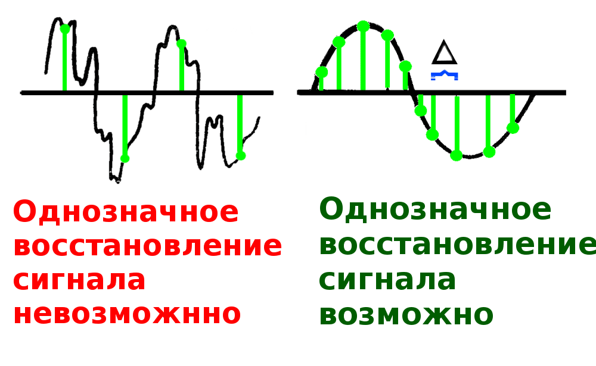
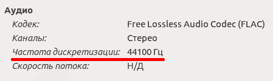
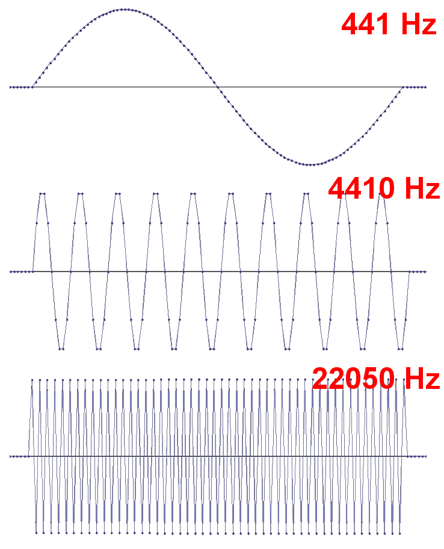
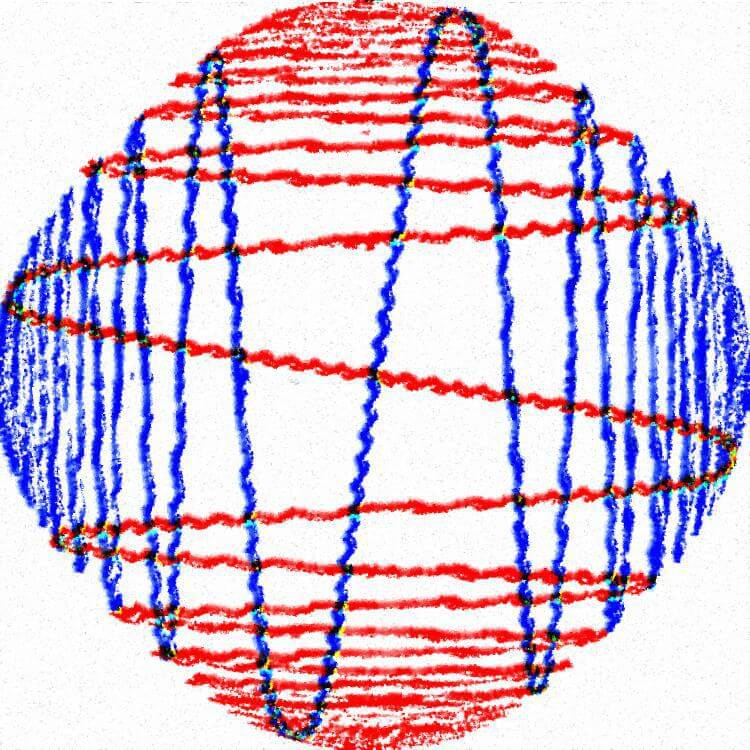
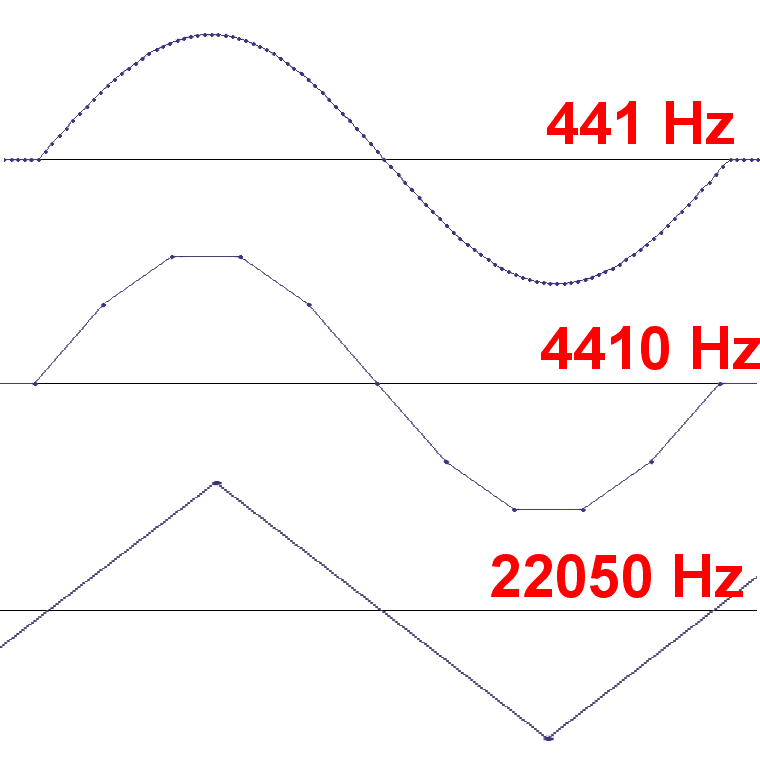
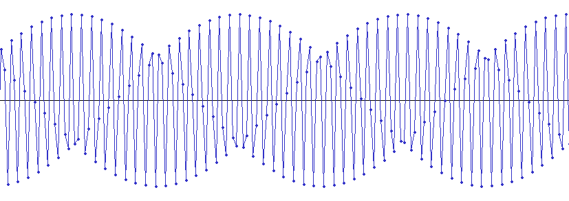
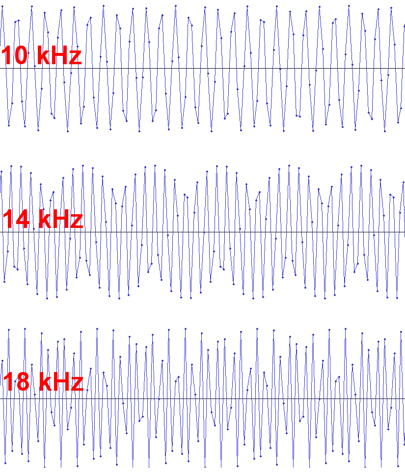

[Русский](./README.ru.md) | **English**

# Is digital sound really that good? Sampling rate and the Nyquist–Kotelnikov theorem

**Category:** Audio formats and quality  
**Tags:** Audacity, sound quality  
**Original:** https://audiogeek.ru/chastota-diskretizacii-teorema-kotelnikova/

---

Audio equipment makers, headphone makers especially, like to promote "crystal clear" sound and a huge frequency range that goes well past 20 kHz and sometimes reaches 100 kHz. That has its merits, even though we cannot hear anything above 20 kHz, and usually quite a bit less. But there are problems tied to the sampling rate and the sampling theorem, which the Russian literature calls the Kotelnikov theorem (in the West it is the Nyquist–Shannon theorem). For me they put a big cross over the word "high-quality" as applied to most audio formats and audio devices.

Every process in nature is continuous. A sound picked up by a microphone and converted into an electrical (analog) signal is continuous too.

> ***The term "analog signal" stresses that such a signal is "analogous", that is, completely similar to the process that produces it, in this case the sound.***

It is continuous not because it lasts forever, but because its value can be measured at any moment in time, and between those moments the signal keeps changing continuously.

> **To better understand how digital sound works, I recommend my video:**
>
> ▶ **[Watch the video on YouTube](https://www.youtube.com/watch?v=PuWp3YmBrc4)**

## What is the sampling rate?

As soon as we need to convert an analog signal to digital, the concept of sampling appears: cutting the continuous signal into pieces in time. This is done during the conversion itself.

At equal intervals, called the **sampling interval Δ**, the analog-to-digital converter (ADC) measures the value of the signal at its input and converts it to digital form. How often the analog signal is measured is called the **sampling rate**.

## What sampling rate is enough?

Back in 1933 Kotelnikov, in his work *"On the capacity of the ether and wire in electrical communications"*, created a theory fundamental to digital technology, usually stated like this:

> **Any continuous signal u(t) with a finite spectrum (with maximum frequency F) can be represented by discrete samples u(kΔt) whose sampling rate must be chosen to be at least twice the maximum frequency of the signal spectrum: f ≥ 2F. The samples can be transmitted over a communication line, and the original analog signal can then be restored.**

**Put simply:** to correctly reproduce (restore) an analog signal from its digital form, it is enough for the sampling rate to be **twice** the highest frequency in the signal.

The upper limit of human hearing is conventionally set at 20 kHz. The theorem says that to reproduce a 20 kHz signal correctly, a sampling rate of 40 kHz is **enough**. If you look at the properties of the vast majority of audio files, you will see this line:

> **Why 44.1 kHz exactly?** [Wikipedia](https://en.wikipedia.org/wiki/44,100_Hz) explains it like this: the rate was chosen by Sony for compatibility with the PAL video standard, by recording 3 samples per picture line × 588 lines per frame × 25 frames per second, and it is sufficient (by the sampling theorem) for high-quality coverage of the whole range of frequencies a person can hear (20 Hz to 20 kHz).

At a 44.1 kHz sampling rate the **sampling interval Δ** is only 0.00002267 = 22.67·10⁻⁶ s, or **22.67 microseconds**. That is the time between two points of the signal.

## It all seems fine, so what is wrong?

Let us start with frequencies that divide evenly into the sampling rate. At 441 Hz, with our 44.1 kHz sampling rate, there are 100 points per period. No complaints here, the sine wave is perfect. If we raise the frequency tenfold, the same 100 points now form 10 periods rather than one, and even then the signal still looks very much like a sine wave.

But at 22,050 Hz, the highest frequency that satisfies the theorem (at a 44.1 kHz sampling rate), 100 points cover 50 periods.

> These signals were generated in Audacity. At first it seemed there were enough points and the scale just did not let me see them, which is why everything looks so angular...
>
> **See also:**
>
> [**A simple way to generate signals of different shapes in the Audacity audio editor**](../generaciya-signalov-audacity/)

Well then... let us zoom in and look at each period separately:

At **4410 Hz** it is a perfectly decent sine wave. You cannot say the same about **22,050 Hz**, with its two points per period. In fact it is no longer a sine wave at all, but a triangle.

> ***Of course, every real DAC has a low-pass filter at its output that cuts the high-frequency content and rounds off this triangle. But the higher the class of your audio device, the more noticeable the angularity of the sound.***

For an experiment you can generate signals of the same frequency but different shapes in Audacity. Triangle and square waves, because of their angularity and sharp edges, produce additional harmonics, while a sine wave sounds much softer and more natural.

But even that is not the worst of it. So far we have only looked at frequencies that divide evenly into the sampling rate.

## And what happens at other frequencies?

Meet a digital sine wave of constant amplitude at 15 kHz. A pretty pattern, isn't it? As you can see, the amplitude varies with a certain frequency. This is intermodulation distortion: our true 15 kHz signal is modulated by a frequency related to 44.1 kHz.

You might object that the pattern is pretty, but maybe it sounds the way it should. To check with your own ears, [generate a signal](../generaciya-signalov-audacity/) whose frequency sweeps from 20 Hz to 20 kHz. You will clearly hear that at some point the pitch stops rising smoothly and begins to wander back and forth.

That is understandable. Here is what sine waves look like at various frequencies above 10,000 Hz:

In defense of the theorem, it is correct, otherwise we could not tell high sounds in music apart, and a cymbal and a maraca would sound equally unconvincing. But it does not guarantee high recording quality at all.

In real life you are unlikely to enjoy listening to a pure sine wave, but it was a very clear illustration of the quality problems of digital audio recordings.

## Sampling rate and Hi-Res audio

Of course today's technology has dealt with this problem. You have probably come across the abbreviation **Hi-Res** (high resolution), which usually means 24-bit audio at a 192 kHz sampling rate.

That is already about 10 points at 22,050 Hz, and such a sine wave can clearly be considered ideal. Here the "crystal clear highs" of your headphones will really pay off.

There are only 3 problems:

- **The price of such devices.** A portable player with such a sampling rate typically costs about $200.
- **Where to get recordings** of that quality.
- **File sizes** are very large. One album by your favorite band in Hi-Res can easily take more than 1.5 GB.

## In conclusion

Of course nobody ever died from poorly reproduced high frequencies, and perhaps I am being overly dramatic in saying that 44.1 kHz is that bad, but as you can see it does not shine at high frequencies.

In my opinion, at home it is much more interesting to listen to vinyl. But you cannot ride the subway with a turntable... so audiophile demands will have to be satisfied by a digital player.

**Good sound to everyone!**

**(P.S. Comments are welcome, don't be shy :-)**

*Originally written for [AudioGeek.ru](https://github.com/SkyTrip-13/AudioGeek). Translated from Russian.*
