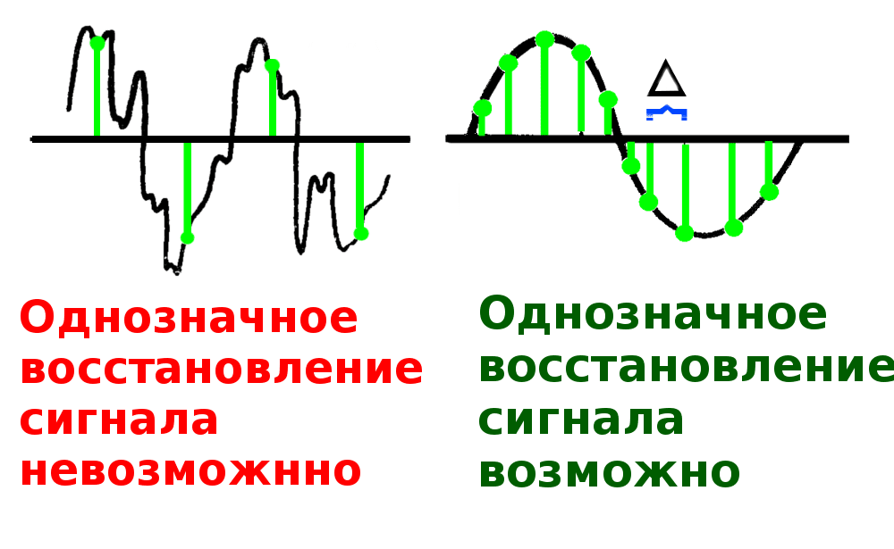
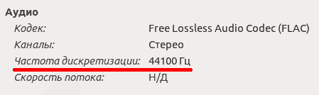
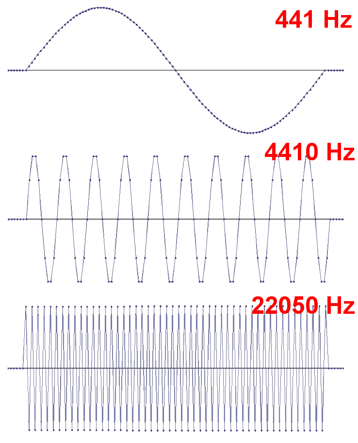
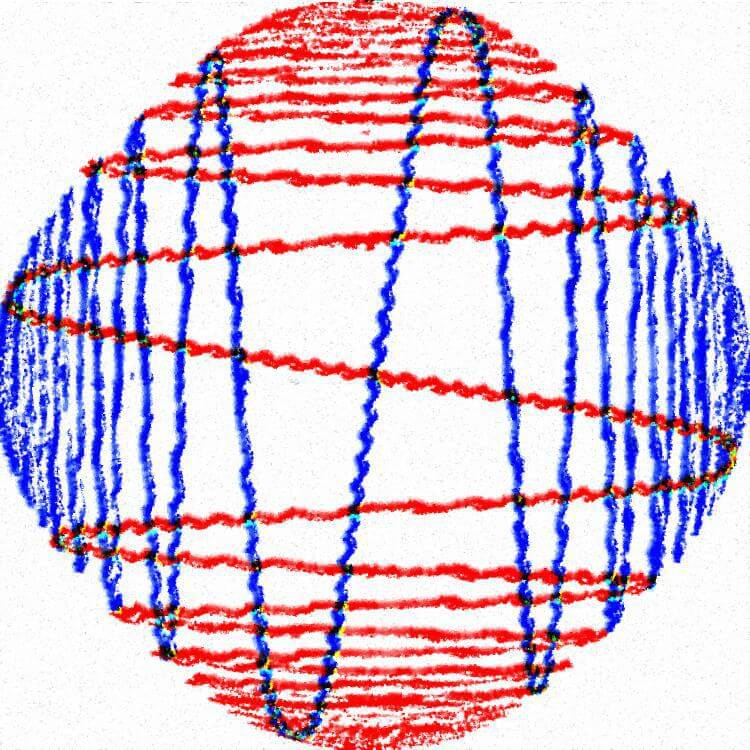
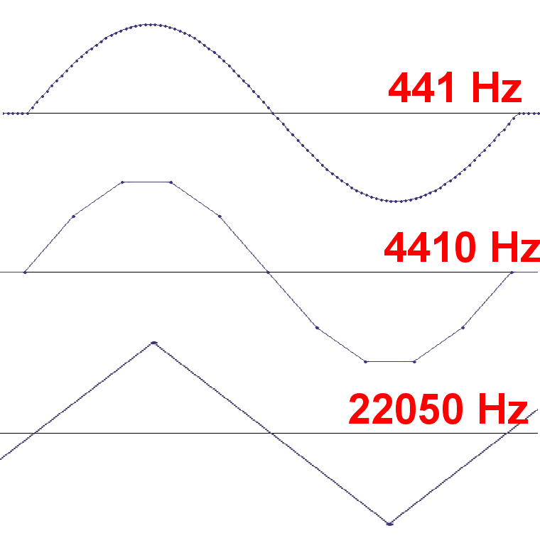
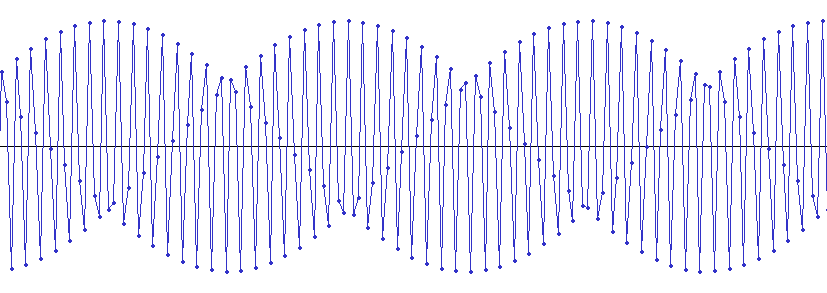
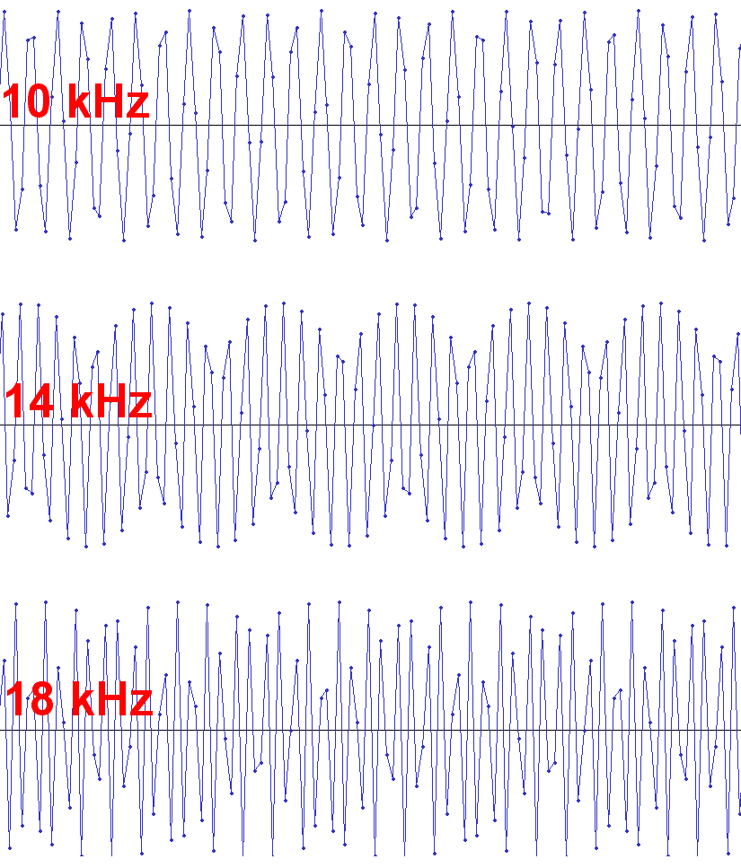

[English](./README.md) | **Русский**

# Так ли хорош цифровой звук - частота дискретизации и теорема Котельникова

**Рубрики:** Форматы и качество звука  
**Метки:** Audacity, качество звука  
**Оригинал:** https://audiogeek.ru/chastota-diskretizacii-teorema-kotelnikova/

---

Часто производители аудио аппаратуры, особенно наушников, в процессе пиара своей продукции активно продвигают “кристальную чистоту” звука и широчайший частотный диапазон, который не только за 20 кГц переваливает, но и в некоторых случаях доходит даже до 100 кГц. Конечно это имеет свои плюсы, даже не смотря на то, что выше 20к Гц мы не слышим, а то и еще меньше. Но есть определенные проблемы, которые связанны с понятием частота дискретизации и вытекающие из теоремы Котельникова. Они в одночасье поставили жирный крест на применении слова “качественно” для большинства аудио-форматов и аудио устройств в моих глазах.

Любой процесс в природе является непрерывным. Например звуковой сигнал принятый микрофоном и преобразованный в электрический (аналоговый) сигнал - непрерывен.

> ***Термин “Аналоговый сигнал” подчеркивает, что такой сигнал “аналогичен”, т.е. полностью подобен порождающему его процессу, или в данном случае звуку.***

И непрерывный он не потому что будет длиться вечно, а потому, что его значение можно измерять в любые моменты времени. А между этими моментами сигнал будет продолжать непрерывно меняться.

> **Для лучшего понимания того, как устроен цифровой звук, советую посмотреть мой видос:**

> ▶ **[Смотреть видео на YouTube](https://www.youtube.com/watch?v=PuWp3YmBrc4)**

## **Что такое частота дискретизации?**

Как только встает вопрос о переводе аналогового сигнала в цифровой, сразу возникает понятие дискретизации, т.е. разбиение непрерывного сигнала на кусочки по времени. Делается это непосредственно в процессе преобразования.

Через равные промежутки времени, называемые **шагом дискретизации Δ**, Аналогово-Цифровой-Преобразователь (АЦП) измеряет значение сигнала, поступающего на его вход и преобразует это значение в цифровой вид. То, как часто осуществляется измерение величины аналогово сигнала и называется **частотой дискретизации****.**

## **Какая частота дискретизации считается достаточной?**

Товарищ Котельников, еще в 1933 в работе **«*О пропускной способности эфира и проволоки в электросвязи*»** создал фундаментальную, для цифровой техники теорию, которая обычно формулируется следующим образом:

> **Лю****бой непрерывный сигнал** **u(t)** **с конечным спектром (имеющим максимальное значение частоты** **F****) можно представить в виде дискретных отсчетов** **u(k****Δ****t)****, частота дискретизации которых должна быть выбрана не менее чем в два раза выше максимального значения спектра сигнала:** **f** **≥ 2F****, передать его по линии связи, а затем восстановить исходный аналоговый сигнал****.**

**Говоря проще,** для того чтобы можно было правильно воспроизвести (восстановить) аналоговый сигнал из цифрового вида, достаточно, чтобы частота дискретизации была **вдвое выше** максимальной частоты в сигнале.

Верхний порог слышимости человека принято ограничивать частотой в 20кГц. Из теоремы Котельникова следует, что для правильного воспроизведения сигнала частотой 20 кГц **достаточно** частоты дискретизации в 40кГц. Если заглянуть в свойства подавляющего большинства аудио файлов, то можно увидеть строчку:

> **Почему именно 44.1 кГц?** **[*Википедия*](https://ru.wikipedia.org/wiki/%D0%A7%D0%B0%D1%81%D1%82%D0%BE%D1%82%D0%B0_%D0%B4%D0%B8%D1%81%D0%BA%D1%80%D0%B5%D1%82%D0%B8%D0%B7%D0%B0%D1%86%D0%B8%D0%B8) *отвечает так*:** *“Эта цифра выбрана компанией* *Sony из соображений совместимости с**о* *стандартом* *телевещания**PAL**, за счёт записи 3 значений на линию картинки кадра* *x**588 линий на кадр* *x**25 кадров в секунду, и достаточности (****по теореме Котельникова****) для* ***качественного покрытия*** *всего диапазона частот, различаемых человеком на слух (20 Гц — 20 кГц).”*

При частоте дискретизации в 44.1 кГц **шаг дискретизации** **Δ** составляет всего 0.00002267=22.67\*10-6 секунды или **22.67 микросекунды**. Это время между двумя точками сигнала.

## **Вроде все нормально, так чего же тут не так?**

Начнем с частот, кратных частоте дискретизации. На частоте 441 Герц при нашей частоте дискретизации (44.1 кГц), на один период приходится 100 точек. Чтож, тут нет никаких претензий, синусоида идеальная. Если же повысить частоту на порядок, т.е. в 10 раз, то эти же 100 точек будут формировать уже не 1, а 10 периодов. И даже в этом случае Будет формироваться сигнал очень похожий на синусоиду.

А вот на частоте 22050, т.е. наивысшей частоте, удовлетворяющей теореме Котельникова (при частоте дискретизации 44.1кГц) на 100 точек приходится 50 периодов колебаний.

> Эти сигналы генерировались в программе Audacity. И по началу создалось впечатление, что точек там достаточно, просто масштаб не позволяет разглядеть и поэтому так все угловато...
>
> **Читайте также:**
>
> [**Простой способ генерации сигналов разной формы в аудио редакторе Audacity**](../generaciya-signalov-audacity/)

Чтож... приблизим и рассмотрим каждый период по отдельности:

Частота в **4410 Гц** вполне себе достойная синусоида, чего никак не скажешь о частоте **22050Гц**, с ее двумя точками на период. По факту это уже и не синусоида, а сигнал треугольной формы.

> ***Конечно в любом реальном ЦАПе на выходе применяется НЧ-фильт, который срезает высокочастотную составляющую и скругляет этот треугольник. Однако чем выше класс вашего аудио устройства, тем заметнее будет угловатость звука***

Ради эксперимента можете попробовать сгенерировать в Audcity сигналы одной и той же частоты но разных форм. У треугольной и прямоугольной форм из-за их “угловатости” и резких фронтов возникают дополнительные гармоники, а вот синусоидальный сигнал звучит гораздо более мягко и естественно.

Но даже и это не самое страшное. До этого момента рассматривались сигналы с частотами кратными частоте дискретизации.

## **- А что же будет, если взять другие частоты???**

Знакомьтесь, цифровая синусоида равной амплитуды и частотой 15 кГц. Красивый узорчик, не правда ли? Как видите амплитуда меняется с частотой. Это уже интермодуляционные искажения. Наш истинный сигнал в 15 кГц промодулирован частотой кратной 44.1 кГц.

Вы можете возразить, мол узорчик то красивый, но может звучит он как ему и положено. Для того чтобы убедиться в этом своими ушами - [сгенерируйте сигнал](../generaciya-signalov-audacity/) частота которого меняется от 20 герц до 20 кГц. И вы отчетливо услышите, что с какого-то момента частота перестанет равномерно расти, а начнет плавать туда-сюда.

Оно и понятно, вот так выглядят синусоиды на разных частотах выше 10’000Гц

В защиту теоремы Котельникова стоит отметить, что да, его теорема верна, иначе бы мы не смогли различать в музыке высокие звуки, и что тарелка что маракас звучали бы одинаково неправдоподобно, но она абсолютно не гарантирует высокого качества записи.

В жизни Вы врядли станете наслаждаться звучанием синусоиды, но это был очень наглядный пример проблем качества цифровых аудио записей.

## **Частота дискретизации и Hi-Res звук**

Конечно сегодняшние технологии уже побороли данную проблему. Вероятно вам встречалось сокращение **Hi-Res** (High Resolution - высокое разрешение), которым обычно обзывают качество звука в 24 бита и частотой дискретизации в 192 кГц.

А это уже 10 точек на частоте 22’050 кГц, такую синусоиду уже явно можно считать идеальной. И вот там "кристально чистые верха" ваших наушников себя точно оправдают.

**Возникает только 3 проблемы:**

- **Стоимость подобных устройств**. Например портативный плеер с такой частотой дискретизации обычно стоит около 200$.
- **Где брать** **записи** в таком качестве.
- **Размеры аудиофайлов** очень велики. 1 альбом вашей любимой группы в Hi-Res легко может занимать более 1,5Гб дискового пространства.

## **В заключение**

Конечно от плохого звучания высоких частот еще никто не умирал и, возможно я излишне драматизирую, говоря, что частота дискретизации в 44.1 кГц так уж плоха, однако, как видите особым качеством на высоких частотах она не блещет. 
На мой взгляд в домашних условиях гораздо интереснее слушать винил. Но с виниловой вертушкой в метро не поездишь... Так что меломанские запросы придется удовлетворять цифровым плеером.
**Всем качественного звука!**
**(P.S. - комментируем, не стесняемся :-)**
