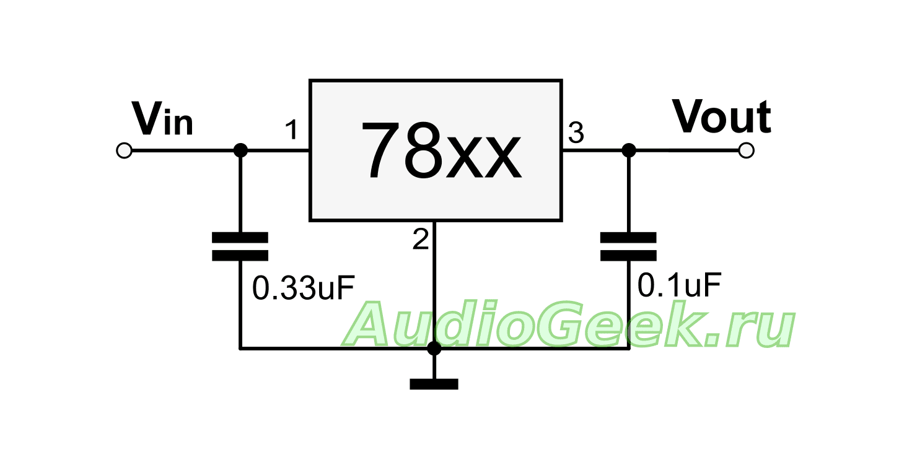
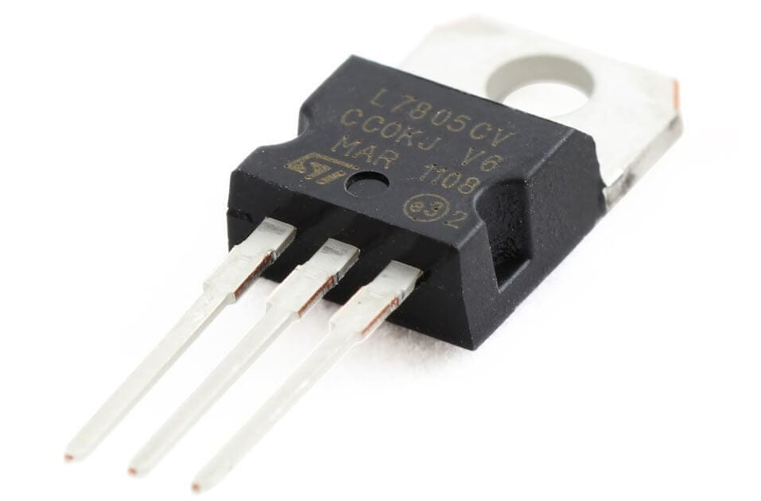
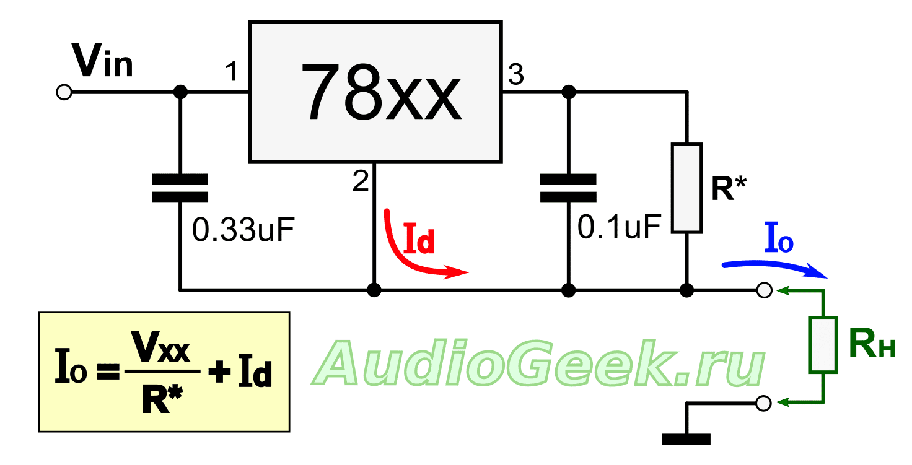
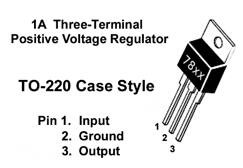

[Русский](./README.ru.md) | **English**

# A current source on the 7805 and other 78xx regulators

**Category:** Useful circuits  
**Tags:** power supply  
**Original:** https://audiogeek.ru/current-source-7805/

---

It is no secret how to build a power supply with 7805, 7809, 7812 and similar regulators. But not everyone knows that the same regulators can be used to build a decent current source. That current source circuit is the hero of this article.

This is the standard voltage regulator circuit using the 78xx series chips. These chips are so popular that every self-respecting manufacturer makes them. In conversation or on a schematic the manufacturer prefix is usually dropped and people simply write 7815. No need to clutter the schematic, and it is clear at once that it is a voltage regulator.

## **Component quality**

In reality the manufacturer matters a lot. Always try to buy regulators, and any parts really, from large manufacturers and trusted suppliers. Personally I prefer STMicroelectronics. They are recognizable by the ST logo in the corner.

No-name regulators, or ones made by Grandpa Chan-Han-Bzdyun, very often have a significant spread of output voltage from part to part. In practice I have seen a 7805 that should give 5 volts output 4.63, while some samples gave up to 5.2 volts.

That alone would be fine, since the voltage is held constant, but the problem is that such parts also have several times stronger spikes and hum, and the regulator itself consumes more. I think you get the idea.

## **Current source circuit on a 78xx**

The current is set by the resistor R\*, which is the load of the regulator. The regulator is not grounded. Grounding happens only through the load RL. This connection forces the chip to try to deliver the set current into the load by adjusting the output voltage.

## **Output current of a current source on the L78**

A small annoyance is the quiescent current Id, which adds to the output current. The value of the quiescent current is given in the datasheet. For most regulators Id = 8 mA. This figure is the lowest possible output current. That is, you cannot get a current source with a current below 8 mA.

[***Download the L78xx datasheet***](./L78_DataSheet.pdf)

Ideally you can squeeze currents from 8 mA to 1 A out of the regulator. However, at currents above 200–300 mA a heatsink is highly advisable. Driving more than 700–800 mA is not recommended at all. The 1 A given in the datasheet is a peak value, and in reality the regulator will most likely overheat. From this we can conclude that the output current range is 10–700 mA.

## **Current accuracy and output voltage**

The instability of the quiescent current is ΔId = 0.5 mA. This value determines the accuracy of setting the output current. The accuracy of the output current also depends on the accuracy of the resistance R\*. It is better to use a resistor with an accuracy of 1% or better.

A certain convenience is the fact that the circuit cannot produce a voltage higher than the regulator's built-in regulation voltage. For example, with a 7805 the output voltage cannot exceed 5 volts. This can be critical.

## **Load resistance**

At the same time you have to consider the load resistance. For example, if you need to provide 100 mA through a load of 100 Ω, Ohm's law gives the voltage

**V = I·R = 0.1 · 100 = 10 volts**

With this simple calculation we obtained the voltage that must be applied to a 100 Ω load to get a current of 100 mA in it. This means that for this task it makes sense to use a 12 V or 15 V regulator (7812 or 7815 respectively) to have some headroom.

But you cannot deliver the same current through a 10 kΩ resistor. That would need 100 volts, which these chips cannot do.

## Conclusion

Of course such a current source has its limitations, but it can be useful for the vast majority of tasks that do not require special accuracy. The simplicity of the circuit and the availability of the components make it possible to throw together a current source on the knee.

*Originally written for [AudioGeek.ru](https://audiogeek.ru). Translated from Russian.*
