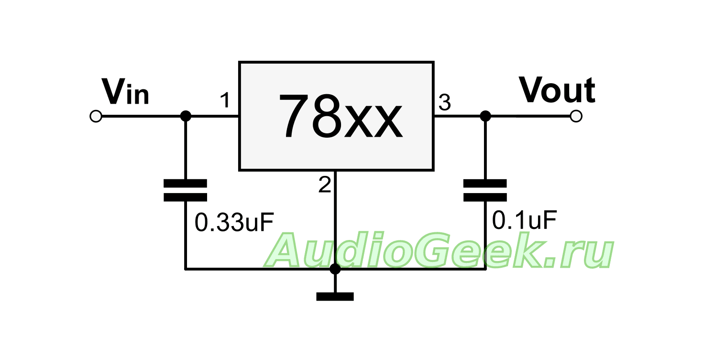
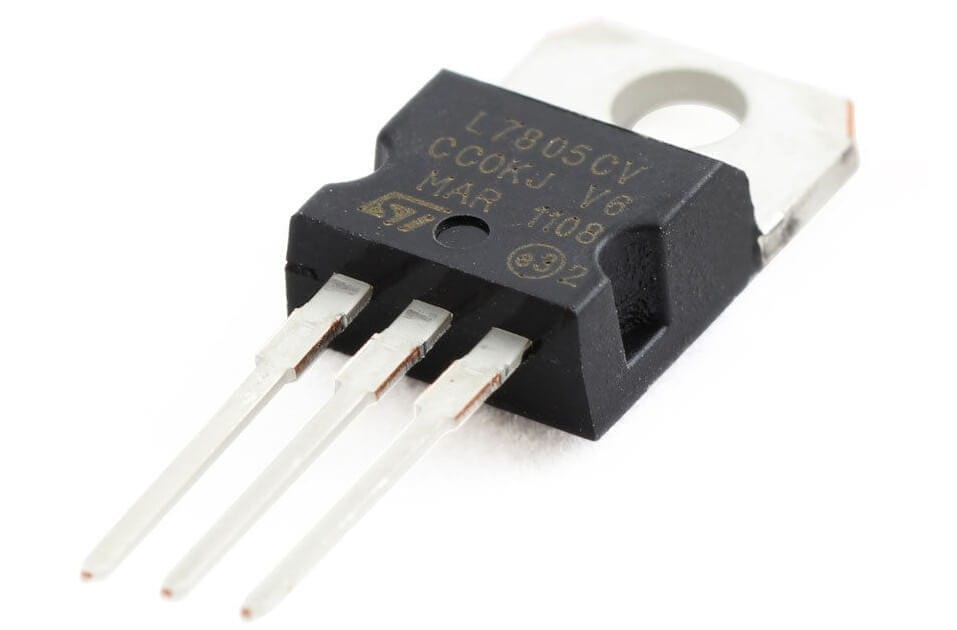
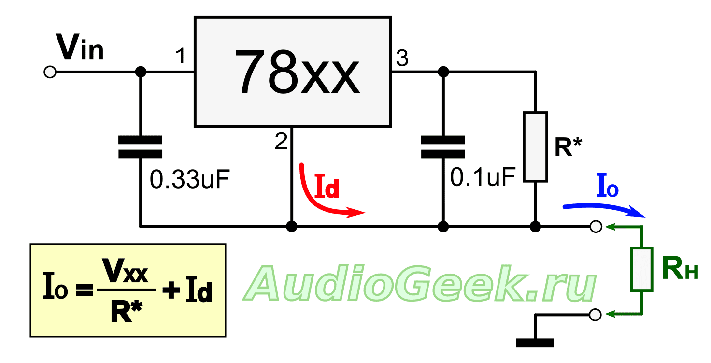
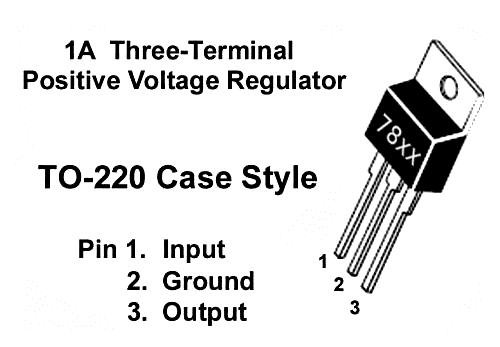

[English](./README.md) | **Русский**

# Стабилизатор тока на микросхеме 7805 и других 78xx стабилизаторах

**Рубрики:** Полезные схемы  
**Метки:** источник питания  
**Оригинал:** https://audiogeek.ru/current-source-7805/

---

Ни для кого не секрет, как собрать блок питания на стабилизаторах 7805, 7809, 7812 и тд. Но не все знают, что на этих же стабилизаторах можно собрать приличный источник тока. Схема источника тока и стала героем этой статьи. 

Так выглядит стандартная схема стабилизатора напряжения на микросхемах серии 78xx. Эти микросхемы настолько популярны, что их выпускает каждая, уважающая себя контора. Обычно в разговоре или на схеме даже опускают первые буквы, характеризующие производителя, указывая просто 7815. Ибо нефиг захламлять схему и сразу ясно, что речь о стабилизаторе напряжения.

Для тех, кто мало знаком с подобными стабилизаторами небольшое видео по сборке "на коленках":

## **Качество компонентов**

В реальности производитель очень важен. Всегда старайтесь покупать стабилизаторы, да и любые детали от крупных производителей и у проверенных поставщиков. Я лично предпочитаю STMicroelectronics. Их отличает эмблема ST в углу.

Ноунейм стабилизаторы или производства дедушки *чань-хань-бздюня* очень часто имеют значительный разброс значений выходного напряжения от изделия к изделию. На практике встречалось, что стабилизатор 7805, который должен давать 5 вольт выдавал 4.63, либо же некоторые образцы давали до 5.2 вольта.

Ладно бы это, напряжение то он держит постоянным, но проблема еще и в том, что в несколько раз сильнее выбросы, фон и больше потребление самого стабилизатора. Думаю вы поняли.

## **Схема источника тока на 78xx**

Величина тока задается резистором R\*, который является нагрузкой для стабилизатора. При этом стабилизатор не заземлен. Заземление происходит только через нагрузку Rн. Такая схема включения вынуждает микросхему пытаться обеспечить в нагрузку заданный ток, путем регулировки напряжения на выходе.

## **Выходной ток источника тока на L78**

Небольшой неприятностью представляется ток покоя Id, который складывается с выходным током. Величина тока покоя указывается в даташите. Для большинства стабилизаторов Id = 8мА. Эта цифра показывает наименьшее значение выходного тока. Т.е. Получить источник тока с величиной тока менее 8 мА не выйдет.

[***Скачать даташит на L78xx***](./L78_DataSheet.pdf)

В идеале из стабилизатора можно выжать токи от 8 мА до 1 А. Однако при токах больше 200-300 мА крайне желателен радиатор. Гнать токи более 700-800 мА в принципе не желательно. Указанный в даташите 1А - это пиковое значение, в реальности стабилизатор скорее всего перегреется. На основании сказанного можно заключить, что диапазон выходных токов составляет 10-700 мА.

## **Точность тока и выходное напряжение**

При этом нестабильность тока покоя составляет ΔId = 0.5мА. Эта величина определяет точность установки выходного тока. Так же точность задания величины выходного тока определяется точностью сопротивления R\*. Лучше использовать резистор, точностью не хуже 1%.

Определенное удобство тут представляет тот факт, что схемы не может выдать напряжение выше заложенного напряжения стабилизации. Например при использовании стабилизатора 7805, напряжение на выходе не сможет превысить 5 вольт. Это бывает критично.

## **Сопротивление нагрузки**

В то же время стоит учитывать сопротивление нагрузки. Например если требуется обеспечить 100 мА через нагрузку сопротивлением 100 Ом, то по закону ома получаем напряжение

**V= I\*R = 0.1 \* 100 = 10 Вольт**

Такими нехитрыми подсчетами мы получили величину напряжения, которую требуется приложить к нагрузке в 100 Ом, чтобы обеспечить в ней ток в 100мА. Это означает, что для данной задачи рационально поставить стабилизатор 7812 или 7815 на 12вольт и 15 вольт соответственно, дабы иметь запас.

А вот обеспечить такой же ток, через резистор в 10кОм уже не выйдет. Для этого необходимо напряжение в 100 вольт, что данные микросхемы уже не умеют.

## Заключение

Конечно такой источник тока имеет свои ограничения, однако он может пригодиться для подавляющего числа задач, где не требуется особая точность. Простота схемы и доступность компонентов, позволяет на коленке собрать источник тока.

*Материал подготовлен исключительно для сайта [AudioGeek.ru](https://github.com/SkyTrip-13/AudioGeek)*
