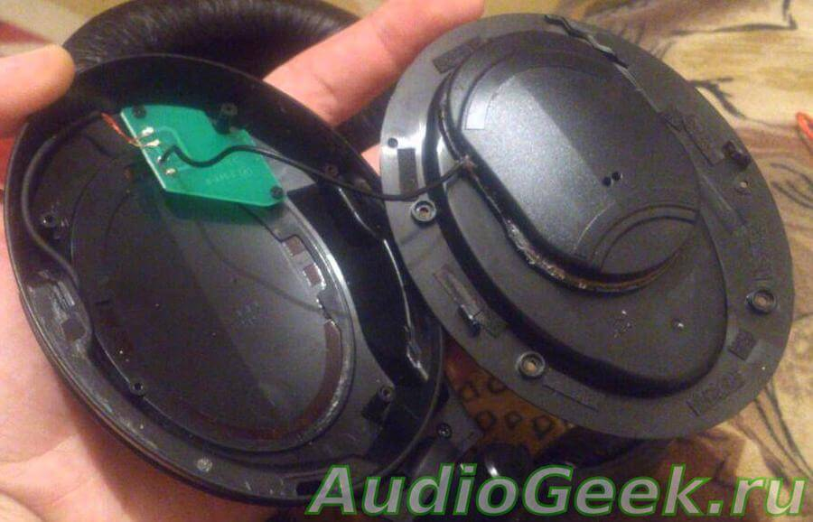
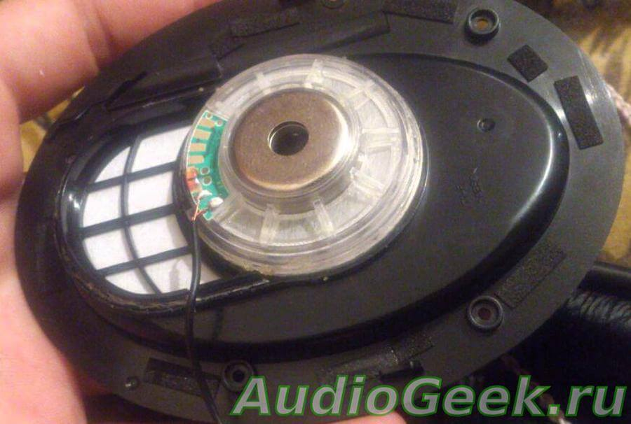
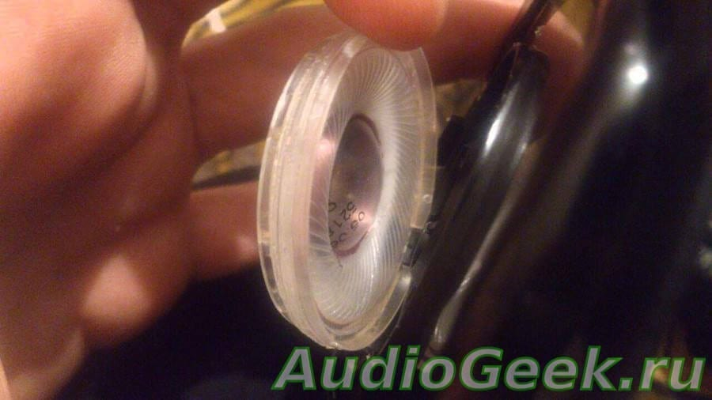
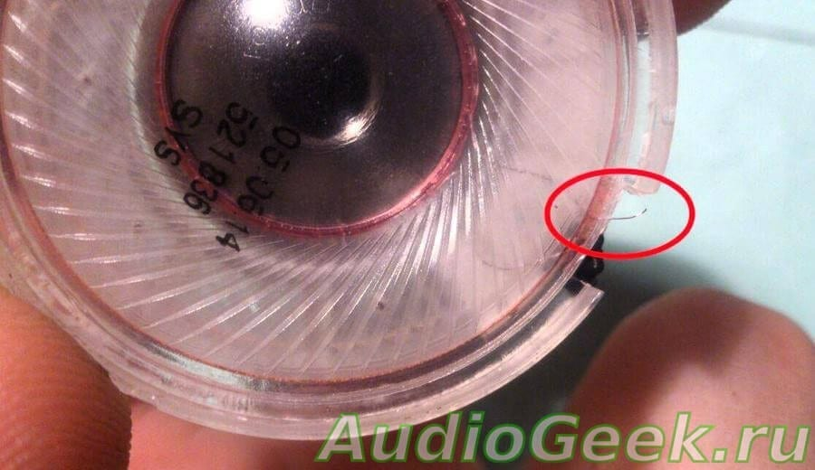
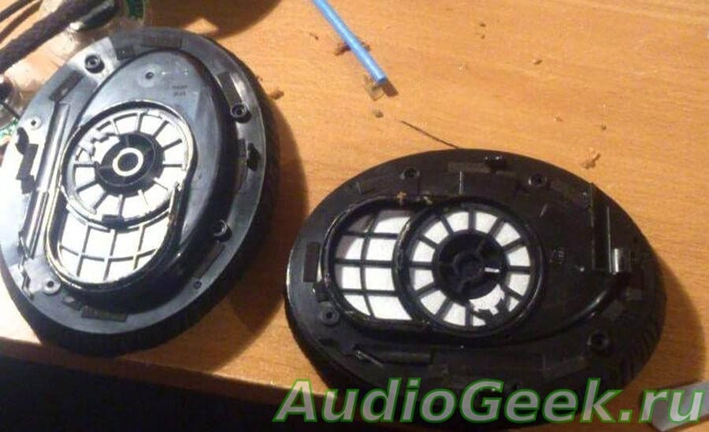
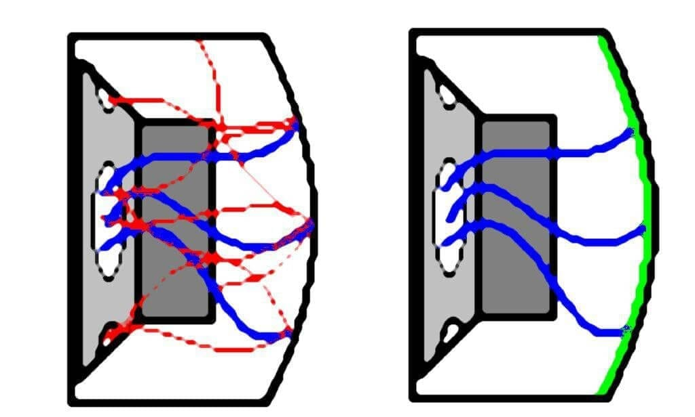
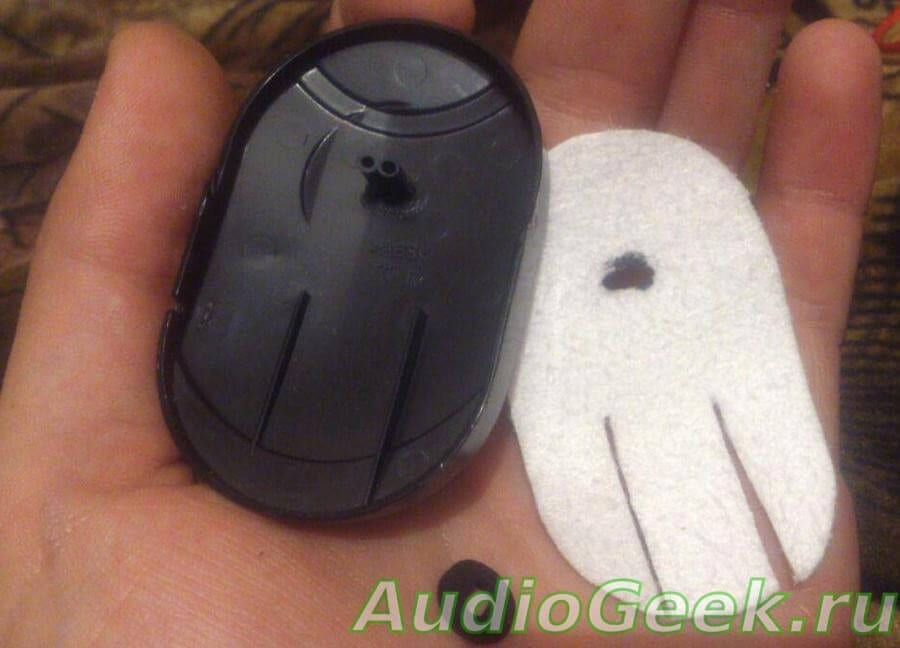
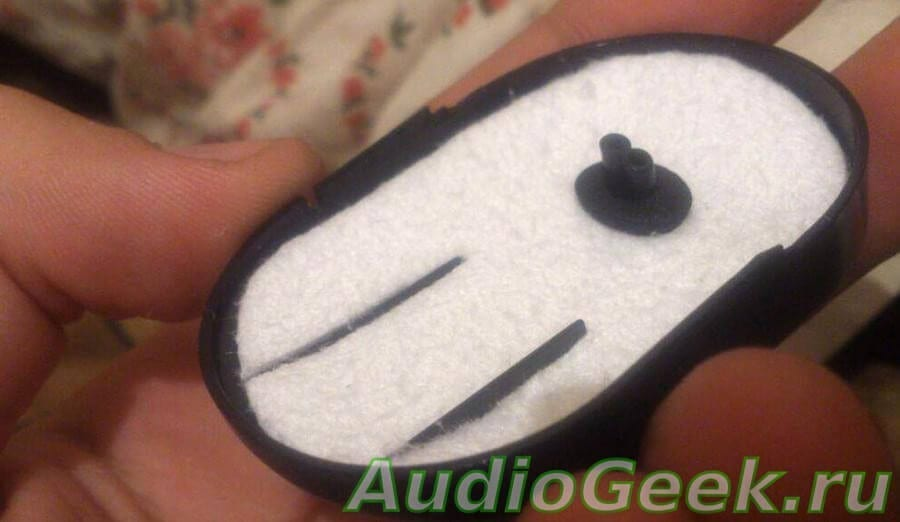

[Русский](./README.ru.md) | **English**

# Taking apart and lightly damping the Sennheiser HD 380 Pro

**Category:** Headphone mods  
**Tags:** Sennheiser HD380 Pro  
**Original:** https://audiogeek.ru/dempf-senhi-hd380pro/

---

Plenty of articles and whole forums with heated discussion have been devoted to damping headphones: how and with what it is best done. I will add my two cents with a story of how to damp my beloved Sennheiser HD 380 Pro :-)

These headphones, recognized as one of the reference monitoring headphones, have a boost in the midrange, which emphasizes vocals and guitar in music, sometimes even too much. I decided to try to overcome this problem by damping.

The **[*vibration damping I recently did*](../vibro-dempfirovanie/)** on the same headphones is also a kind of damping. It is aimed at suppressing vibrations traveling through the housing itself, and gives a decent positive result :-)

## Taking the cups apart

First we need to take the headphones apart. To do that, remove the earpads, unscrew the screws and take out the front wall:

The front wall (on the right in the photo) has a plastic cap under which the driver hides. This cap, let us call it the driver cover, has two tricky holes which on the inner side turn into tubes of different diameters and lengths and work as bass reflex ports. These tubes go into a hole in the driver magnet.

## Removing the driver cover

The driver cover is glued with rubber cement partly to the front wall and partly to the driver, so peel it off very carefully, trying not to pull the driver off with it.

As we can see, this cover covered not only the driver but also a hole in the front wall, which is also a sort of port. A tricky system! The Germans really went to town! :-D

Seeing such a pretty driver, of course I wanted to look at it more closely:

Isn't it beautiful? :)

**But I categorically DO NOT recommend you do this**, because this admiring of beauty ended like this:

I almost died of fright there 8-O. Fortunately I already had ***[experience repairing drivers](../remont-dinamika-naushnikov/)***, so after carefully tinning this wire on an aspirin tablet, I managed to solder it back in place. Disaster averted!

Under the drivers it is not simple either. Even the holes in front of the drivers have a complex shape, and various fabric inserts act as acoustic filters.

## Damping the Sennheiser HD 380 Pro

To be honest, after taking it apart I even doubted that my damping was necessary :-D. I tried to depict the effect of damping in the following picture. Red shows reflected sound waves, green shows the damping material.

In general, in loudspeakers (and headphones too), properly done damping almost always improves the sound. Damping makes the soundstage deeper, because the sounds go into the absorber and do not come back.

It is better to use fibrous materials as absorbers, such as cotton wool, polyester padding, wool, felt and the like. Foam rubber also works, but only the kind that passes air properly. Everyone has their own preferences here, so it is better to try what you like best.

With the Sennheisers the choice was small, because, first, the space around the driver is very limited, and second, with such a complex system with a bunch of ports and acoustic filters, which are very hard to calculate and were most likely tuned by the Germans experimentally, any intervention can upset the whole tuned balance.

Based on that, I chose cloth wipes that have proven themselves as a sound absorber. These are those large white non-woven wipes that you can wash a car with several times and that leave no streaks when washing glass. They come in different thicknesses, by the way. I took the thinnest. And depending on the manufacturer they have different stiffness, and I preferred the softer ones :)

On the tubes sticking out of the cover into the driver (the ports), a foam rubber sealing ring is placed (at the bottom). It is needed for airtightness between the two sound chambers: the center of the driver (the dome), which mainly produces high frequencies, and its perimeter, which produces mid and low frequencies.

I glued the neatly cut wipe with rubber cement. Do not use much glue, to keep the wipe "fluffy", so to speak. A small drop smeared over the plastic surface with a finger is enough.

## Assembling and listening

Now assembly in reverse order. Glue the driver cover with the same rubber cement, so you can pull it off if necessary. Glue it carefully so that it is completely airtight. I smeared the cover around the perimeter, put it in place, smeared again around the outside perimeter, pressed it from above with a stack of books and left it overnight until completely dry.

My biggest fear was that it would get worse, but I was pleasantly surprised to get the effect I wanted :) The mids became less harsh (less prominent). Vocals and guitar became more pleasant, the sound itself became cleaner and the instruments more distinguishable, even on poor quality recordings. In fact our ears are most sensitive in the midrange, and the mids are also the most informative part of the audio range, so their quality matters most. The readability of instruments improved both horizontally and vertically. So if you are not afraid, I recommend doing this :)

I should clarify that I mostly listen to extreme styles of music such as mathcore, deathcore and the like, where technique and the readability of a pile of sounds matter, but I do not shy away from other styles. For instance, with my favorite Infected Mushroom, after damping the bass became slightly deeper, but no less tight, while all their stereo-effect tricks started to sound more interesting.

And if you are still shy of tearing the cover off the driver, you can try **[vibration damping](../vibro-dempfirovanie/)**, which is less hassle and also benefits the sound.

**Good luck and good sound to everyone!**

*Originally written for [AudioGeek.ru](https://audiogeek.ru). Translated from Russian.*
