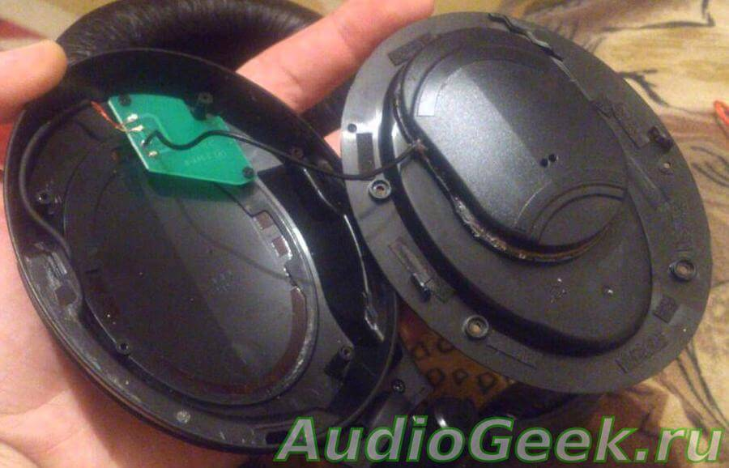
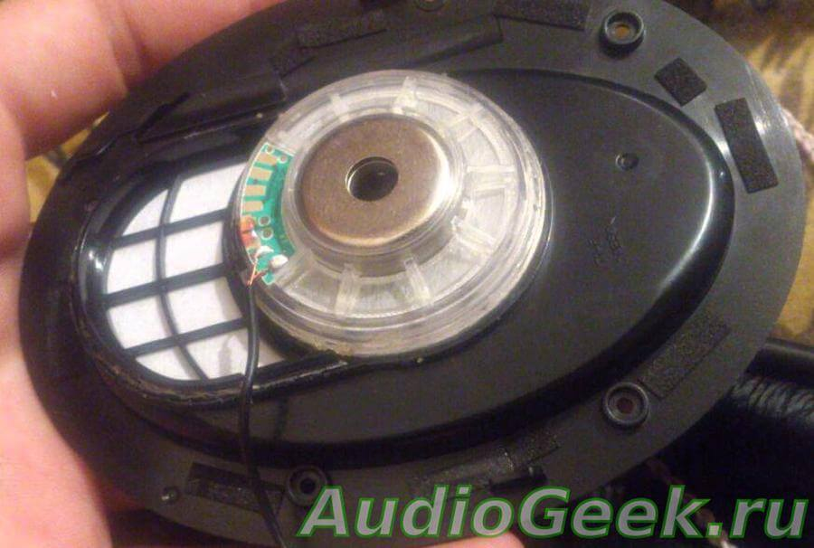
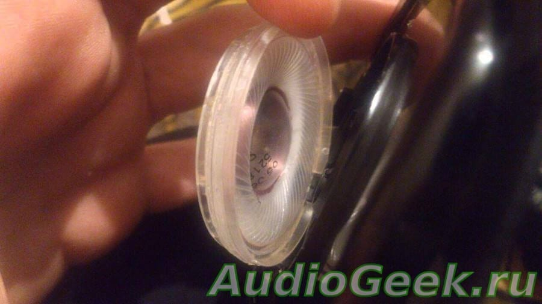
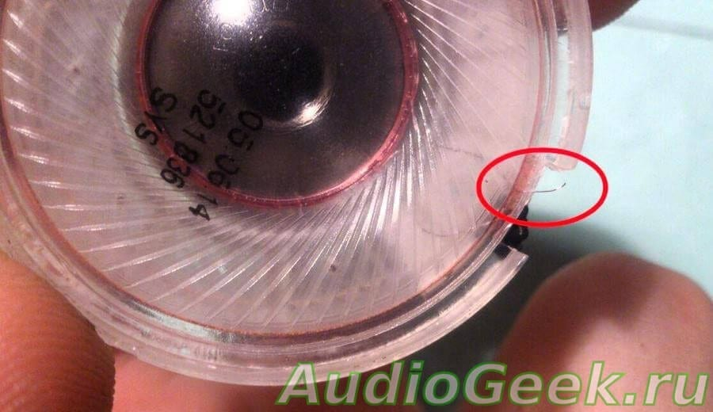
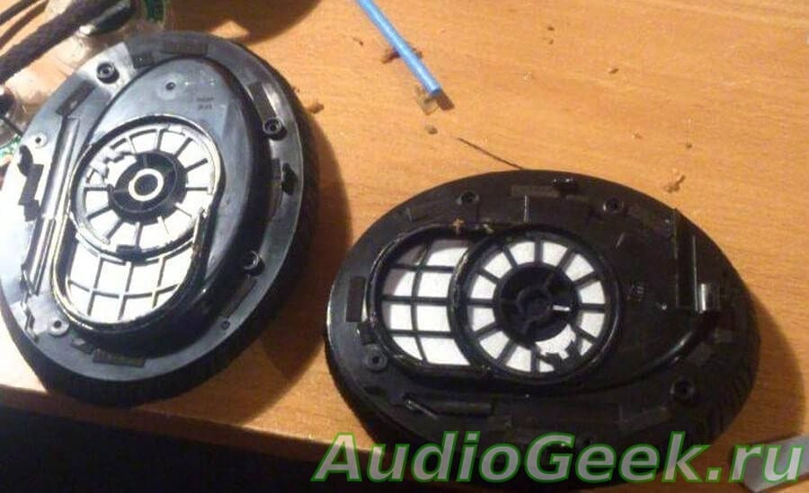
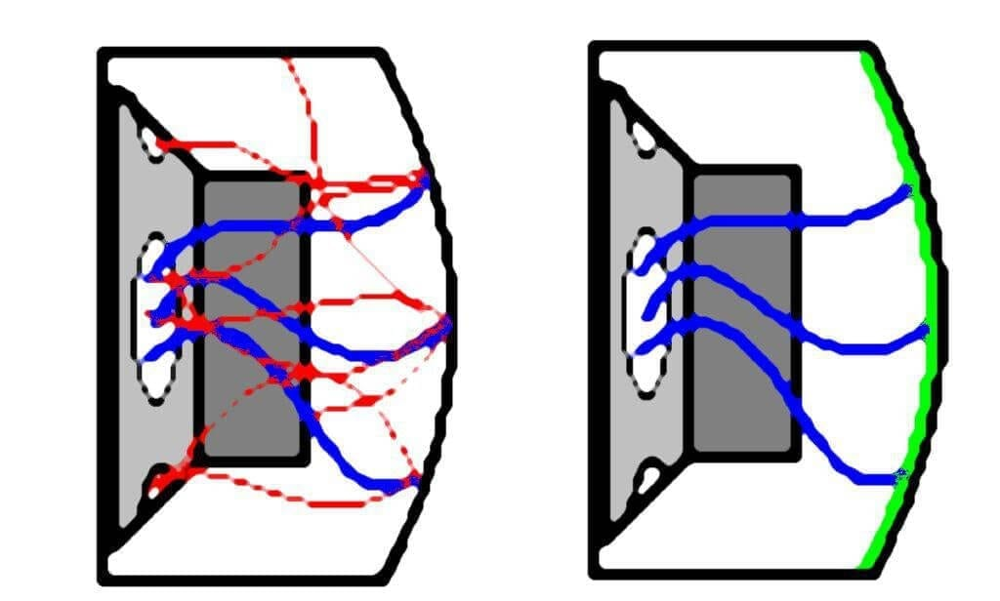
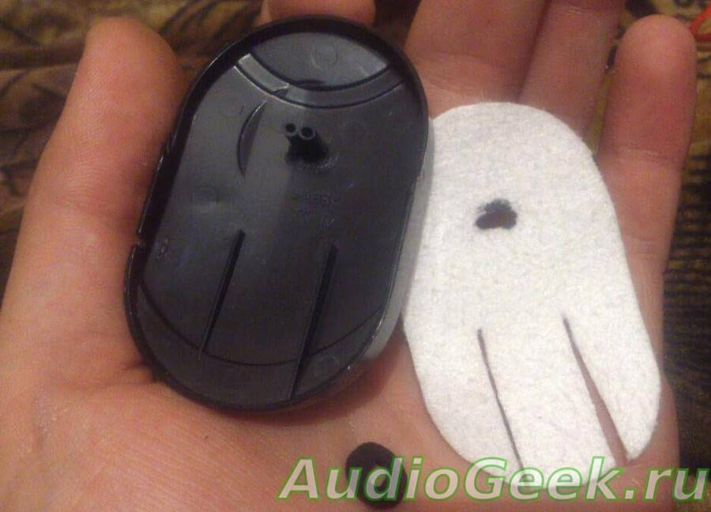
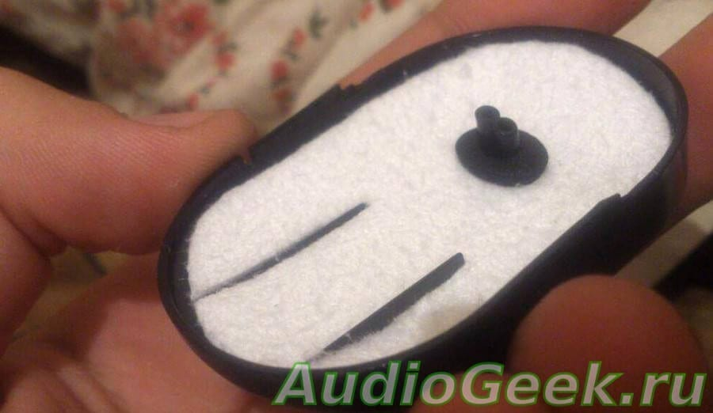

[English](./README.md) | **Русский**

# Разбор и легкое демпфирование Sennheiser HD 380 Pro

**Дата:** 2017-01-05  
**Рубрики:** Доработка наушников  
**Метки:** sennheiser hd380 pro  
**Оригинал:** https://audiogeek.ru/dempf-senhi-hd380pro/

---

Демпфированию наушников посвящено немало статей и целых форумов с жаркими дискуссиями про то как и чем лучше демпфировать. Внесу и я свои 5 копеек рассказом как можно демпфировать мои любимые Sennheiser HD 380 Pro :-) .

Эти наушники, признанные одними из эталонных среди мониторных ушей, имеют подъем в области средних частот, что приводит к выделению вокала и гитары в музыке, иногда даже излишнему. Эту проблему и было решено попробовать преодолеть посредством демпфирования.

**[*Вибродемпфирование, которое я недавно провернул*](../vibro-dempfirovanie/)** с этими же наушниками, также относится к демпфированию, оно направлено на подавление колебаний, распространяющихся по самому корпусу, и дает неплохой положительный результат :-) .

## **Разбираем чаши**

Итак для начала нам потребуется наушники разобрать. Для этого нужно снять амбушюры, открутить винтики и изъять переднюю стенку :

Передняя стенка (на фото справа) имеет пластиковую нашлепку, под которой скрывается динамик). Эта нашлепка, назовем ее крышкой динамика, имеет две хитрые дырочки, которые с внутренней стороны переходят в трубочки имеющие разные диаметры и длины и выполняют функцию фазоинверторов (ФИ). Эти трубочки входят в отверстие в магните динамика.

## **Снимаем крышку динамика**

Крышка динамика приклеена резиновым клеем частично к передней стенке, а частично к динамику, Поэтому отклеивать её стоит очень аккуратно, стараясь не отклеить при этом динамик.

Как видим эта крышка закрывала не только динамик а еще и отверстие в передней стенке, которое тоже является своеобразным ФИ. Мудреная система! Немцы сильно заморочились! :-D

Увидев такой красивенький динамик мне конечно же захотелось рассмотреть его повнимательней:

Неправда ли красивый?))

**Во только Вам я этого делать категорически НЕ СОВЕТУЮ**!, ибо закончилось это любование красотой вот чем :

Я там чуть жизнь суицидом не покончил  8-O. К счастью, у меня уже были ***[опыты с ремонтом динамиков](../remont-dinamika-naushnikov/)***, так что аккуратненько залудив этот проводок, на таблетке аспирина, мне удалось припаять его на место, и поканчивать с собой не пришлось, не дождетесь!)

Под динамиками все тоже не так просто, даже отверстия перед динамиков имеют непростую форму, а различные тканевые вставки выполняют функции звуковых фильтров.

## **Депфирование Sennheiser HD 380 Pro**

Честно говоря разобрав, я даже засомневался в надобности моего демфирования :-D. Последствия демпфирования я попытался изобразить на следующей картинке. Красным указанны отраженные звуковые волны, зеленым - демпфирующий материал.

Вообще в акустических системах (и в наушниках в том числе) правильно сделанное демпфирование практически всегда улучшает звук. Демпфирование приводит к тому, что сцена становится глубже, т.к. Звуки уходят в поглотитель и не возвращаются.

В качестве поглотителей лучше использовать волокнистые материалы, такие как вата, синтепон, шерсть, войлок и тому подобное, можно и поролон, но только тот который нормально пропускает воздух. На этот счет у всех свои предпочтения, так что лучше пробовать что больше нравится именно Вам.

В случае с Сенхайзерами выбор был не велик, т.к. Во первых сильно ограничено пространство вокруг динамика, во вторых при такой сложной системе с кучей фазоинверторов и акустических фильтров, которые весьма сложно рассчитываются и скорее всего подбирались немцами опытным путем, любое вмешательство может перекосить всё настроенное равновесие.

Исходя из этого выбор пал на зарекомендовавшие себя в качестве звукопоглотителя тканевые салфетки. Это те самые большие нетканые белые салфетки которыми можно машину несколько раз помыть и которые не оставляют разводов при мойке стекол. Они кстати бывают разной толщины. Я брал самые тонкие. И в зависимости от производителя обладают разной жесткостью, я предпочел те, что были мягче)

На трубочки торчащие из крышки в динамик(те которые ФИ) одевается уплотнительное колечко(снизу) из вспененной резины. Оно необходимо для герметичности между двумя звуковыми камерами - центром динамика(куполом) дающим в основном высокие частоты и его периметром дающим средние и низкие частоты.

Аккуратно вырезанную салфетку я приклеивал резиновым моментом. Не стоит лить много клея, чтобы сохранить “пушистость” салфетки, если можно так выразиться, достаточно небольшой капельки, размазанной пальцем по поверхности пластика

## **Собираем - слушаем**

Ну а теперь сборка в обратном порядке. Крышку динамика клеем все тем же резиновым моментом, чтоб в случае чего иметь возможность ее отодрать. Проклеивать нужно тщательно, чтобы была полная герметичность. Я промазывал крышку по периметру, ставил на нужное место, промазывал еще раз по периметру снаружи, после чего прижав сверху стопкой книг оставил на ночь до полного высыхания.

Больше всего я боялся, что станет хуже, но был приятно удивлен, тем что я все же добился желаемого эффекта) средние стали не такими резкими(выделяющимися). Вокал с гитарой стали приятнее, сам звук стал более стерильным а инструменты, даже на записях плохого качества, более различимыми. На самом деле наши уши обладают наибольшей чувствительностью именно в среднечастотном диапазоне, и к тому же “середина” - самая информативная часть звукового диапазона, и ее качество наиболее важно. Улучшилась читаемость инструментов как по горизонтали так и по вертикали. Так что если не боитесь, то рекомендую это провернуть)

Стоит уточнить, я преимущественно слушаю экстремальные стили музыки, такие как маткор, дэдкор, дезкор и тому подобное, где важна техника и читаемость кучи звуков, но не брезгую и другими стилями. Скажем у моих любимых Infected Mushrums после демпфирования бас стал слегка глубже, но не менее плотный, зато всякие их фишечки со стереоэффектами стали звучать интереснее.

А если все же стесняетесь отрывать крышку с динамика, можете попробовать сделать **[виброизоляцию](../vibro-dempfirovanie/)**, мороки меньше, а на звуке также положительно сказывается)

**Всем успеха и хорошего звука!))**
