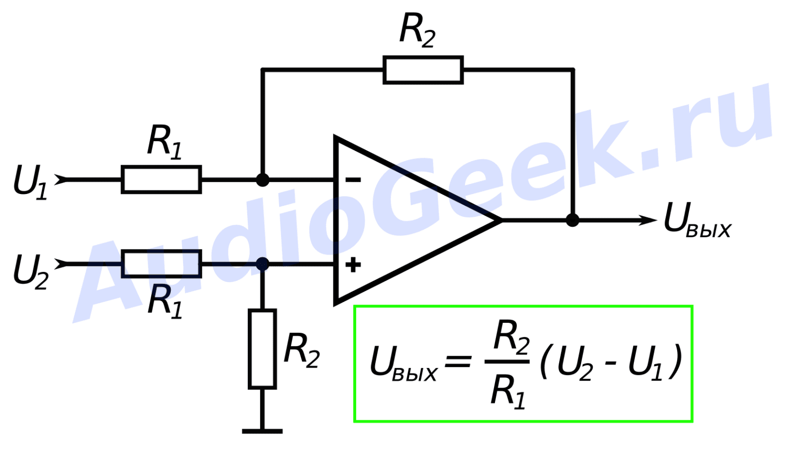
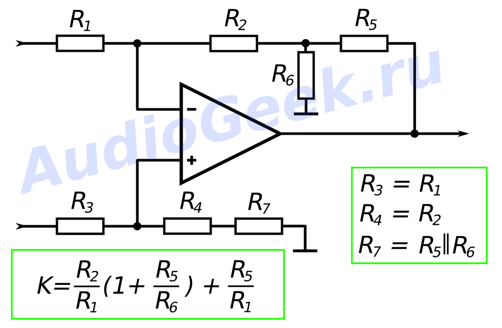
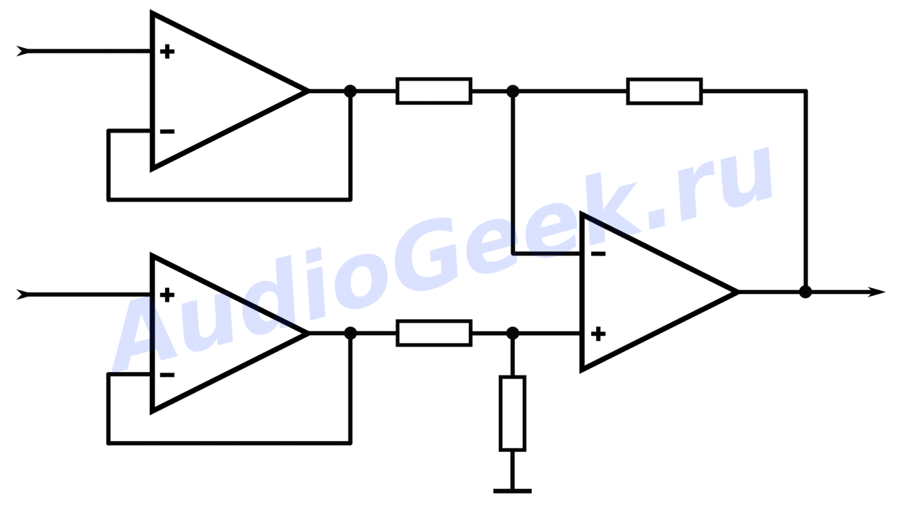

[Русский](./README.ru.md) | **English**

# Differential amplifier: an op-amp circuit and what it is for

**Category:** Useful circuits  
**Tags:** measurements, op-amp circuit  
**Original:** https://audiogeek.ru/diff-amp/

---

When you need not the absolute voltage at some point (relative to ground) but the voltage difference between two points, a **differential amplifier** is used. This need most often comes up when working with sensors and also with microphones.

A **differential amplifier** is an amplifier with two inputs whose output signal equals the difference of the input signals multiplied by a constant. The constant here is the gain of the differential amplifier.

The point of this type of amplifier is that a signal arriving at both inputs at once is not amplified. That is, if common-mode interference or DC levels are mixed into the useful signal, only the useful signal is amplified. In addition, such amplifiers have high gain, high input impedance and a large **C**ommon-**M**ode **R**ejection **R**atio (**CMRR**).

These properties make the differential amplifier incredibly useful, even indispensable, for amplifying very small signals, for example from various sensors.

A differential amplifier is also used in balanced data transmission lines, for example when a microphone is connected in balanced mode. Since a microphone cable can be quite long (more than 50 m), it picks up all kinds of interference very well. With a balanced microphone connection, the interference arrives at both inputs of the differential amplifier in phase and is not amplified by it.

## **The classic op-amp differential amplifier circuit**

The gain of this circuit is K = R2/R1. To get a high CMRR the resistors must be matched precisely. For that, resistors with 0.01% accuracy are desirable.

Resistors of such accuracy are quite expensive, and not always available. So at the first opportunity it is better to buy 100 kΩ resistors of that accuracy for use in such circuits.

If all the resistors have the same value, which is perfectly acceptable, the gain of the differential amplifier will be 1. Further gain can be added with extra stages if needed, and the common-mode interference will already have been eliminated.

## **A differential amplifier with high gain**

When a very high gain from the differential amplifier is needed, a T-type feedback network is used, shown in the figure.

The advantage of this circuit is that it lets you use convenient resistor values and avoids the risk of the stray capacitance that always has to be taken into account when working with large resistors.

So if **R2 = R5 = 100 kΩ** and **R6 = 1 kΩ**, the circuit shown works like a single resistor of **10 MΩ.**

## **Buffers to raise the input impedance of a differential amplifier**

For both differential amplifier circuits, the source resistance must be below 25 Ω to get a CMRR of 100 dB. However, this is an unacceptable requirement for most sources. In particular, a standard microphone capsule has a resistance of 600 Ω, and a strain gauge has an internal resistance of about 350 Ω.

To solve this problem, buffers are placed at the inputs, as shown in the next diagram.

With this connection and modern op-amps you can get an enormous input impedance, so large that the source impedance should no longer worry us. However, this is true only at low frequencies, because at high frequencies the input capacitance combined with the source resistance forms a voltage divider.

To solve this problem the instrumentation amplifier circuit is used, which has its own ***[separate article](../instrumental-amp/)***. The instrumentation amplifier itself is effectively a ready-made microphone preamp.

*Originally written for [AudioGeek.ru](https://github.com/SkyTrip-13/AudioGeek). Translated from Russian.*
