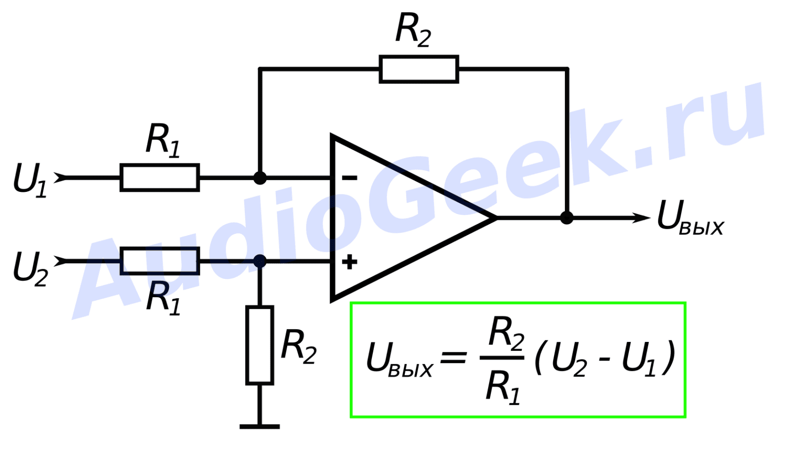
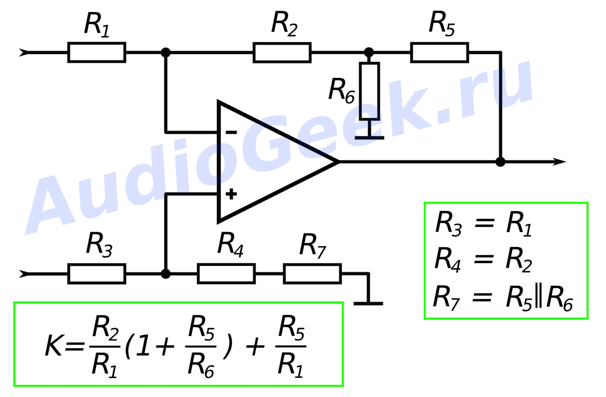
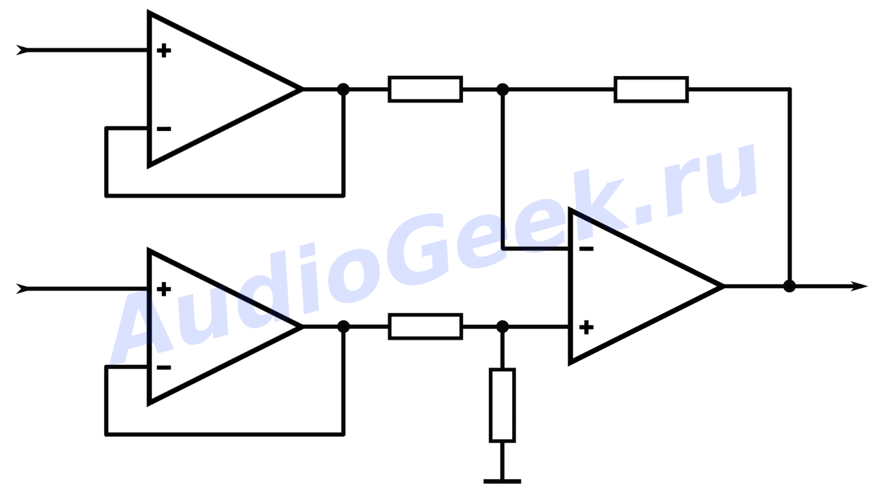

[English](./README.md) | **Русский**

# Дифференциальный усилитель - схема на ОУ и его предназначение

**Дата:** 2017-09-03  
**Рубрики:** Полезные схемы  
**Метки:** измерения, схема на ОУ  
**Оригинал:** https://audiogeek.ru/diff-amp/

---

В тех случаях, когда требуется получить не абсолютное значение напряжения в некоторой точке (относительно уровня земли), а требуется разность напряжений между двумя точками, применяется **дифференциальный усилитель**. Чаще всего такая необходимость возникает при работе с датчиками, а так же микрофонами.

**Дифференциальный усилитель** - это усилитель, обладающий двумя входами, выходной сигнал которого равен разности входных сигналов, умноженный на константу. Константа в данном случае - это коэффициент усиления дифференциального усилителя.

Фишкой данного типа усилителей является то, что сигнал приходящий на оба входа одновременно не усиливается. Т.е. если к полезному сигналу примешаны синфазные помехи или постоянные уровни, то усилен будет только полезный сигнал. Помимо этого такие усилители обладают высоким коэффициентом усиления, высоким входным полным сопротивлением и большим **К**оэффициентом **О**слабления **С**инфазного **С**игнала (**КОСС**).

Эти свойства делают дифференциальный усилитель невероятно полезным и даже незаменимым при усилении очень маленьких по величине сигналов, например, от различных датчиков.

Помимо этого дифференциальный усилитель используется в симметричных линиях передачи данным, например, при симметричном подключении микрофона. Т.к. длина микрофонного кабеля может быть значительной (более 50м), на него отлично наводятся различные помехи. В случае применения симметричного включения микрофона помехи приходят на оба входа дифференциального усилителя в фазе, и не усиливаются им.

## **Классическая схема дифференциального усилителя на ОУ**

Коэффициент усиления такой схемы равен К=R2/R1. Для обеспечения высокого значения КОСС необходимо обеспечить точное согласование резисторов. Для этого желательно применение резисторов точностью 0.01%.

Резисторы такой точности достаточно дороги, и не всегда их можно найти в продаже. Поэтому при первой возможности лучше закупить 100 кОм резисторы указанной точности для применения в подобных схемах.

Если все резисторы будут одного номинала, что вполне допустимо, то коэффициент усиления дифференциального усилителя будет равен 1. Дальнейшее усиление при необходимости можно произвести дополнительными каскадами, зато наличие синфазной помехи было уже устранено.

## **Дифференциальный усилитель с большим коэффициентом усиления**

При необходимости получения очень большого коэффициента усиления дифференциального усилителя применяется Т-образная обратная связь, показанная на рисунке.

Достоинство этой схемы состоит в том, что она позволяет использовать удобные сопротивления резисторов, и не создает опасности присутствия паразитной емкости, которую всегда нужно учитывать при работе с большими резисторами.

Так в случае, если **R2=R5=100 кОм**, а **R6=1 кОм**, то представленная цепь работает как один резистор с сопротивлением **10 МОм.**

## **Повторители для повышения входного сопротивления дифференциального усилителя**

Для обоих схем дифференциальных усилителей сопротивление источника должно быть меньше 25 Ом для обеспечения КОСС 100дБ. Однако это неприемлемые требования для большинства источников, в частности стандартная головка микрофона обладает сопротивлением в 600Ом, а тензодатчик имеет внутреннее сопротивление около 350 Ом.

Для решения этой проблемы прибегают к использованию повторителей, устанавливаемых по входам, как это изображено на следующей схеме.

При таком включении и использовании современных ОУ можно получить колоссальное значение входного полного сопротивления, такое, что вопросы полного сопротивления источника уже не должны нас волновать. Однако это справедливо лишь для низких частот, т.к. для высоких частот входная емкость в комбинации с сопротивлением источника образуют делитель напряжения.

Для решения этой проблемы применяется схема инструментального (измерительного) усилителя, которому посвящена ***[отдельная статья](../instrumental-amp/)***. Сам по себе инструментальный усилитель - это готовый микрофонный предусилитель.
