[Русский](./README.ru.md) | **English**

# The perfect earpads for the Koss Porta Pro

**Category:** Headphone accessories  
**Tags:** AliExpress, earpads  
**Original:** https://audiogeek.ru/earpads-koss-porta/

---

For some reason, when it comes to **earpads for the Koss Porta**, their effect on the sound is often neglected. Neither the original foam pads nor the various aftermarket earpads shine in sound. The high-frequency range suffers most. Let us face the truth and, instead of drilling extra holes in the headphones, make perfect earpads for the Koss Porta.

## What holes, and what is wrong?

Having joined the owners of the KOSS Porta PRO, the first thing that struck me, or rather my ears, was the high-frequency rolloff. The highs are there and quite good, but there are too few of them. This becomes especially noticeable after ***[studio monitor headphones](../monitoring-headphones/)***.
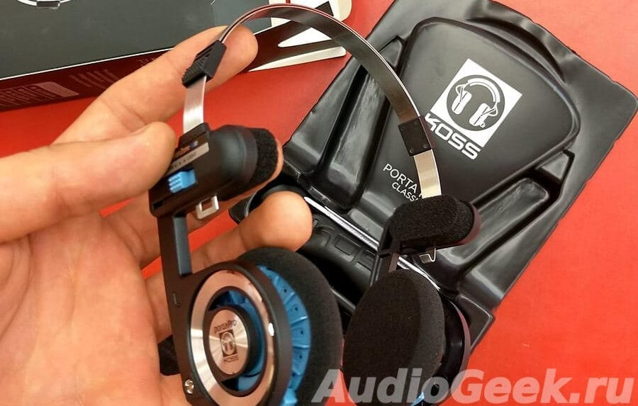
To raise the highs, a radical measure is to make additional holes in the plate in front of the driver. This "technology" is called the **Kramer Mod**.
Despite its apparent logic and positive reviews from many modders, the mod gives no significant change in measurements. It is hard to draw conclusions from frequency response; you need to try it.
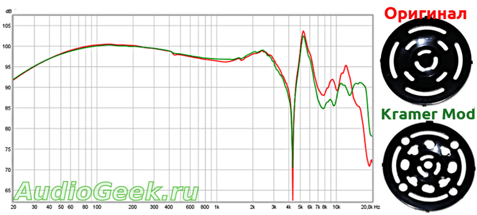

[***[Source]***](https://diyaudioheaven.wordpress.com/headphones/%20measurements%20/%20koss%20/%20portapro%20/)

## **The humane way: earpads for the Koss Porta**

In fact the main culprit for the lack of highs in the Koss Porta is their foam earpads. It is very easy to check: just take them off.
The headphones sound much better without the foam, more detailed and more even. Try to get used to it, and then put the foam pads back on. Most likely you will not want to use them any more.
As an alternative, hair ties are used. Despite their availability and pennies price, it is hard to call them earpads.
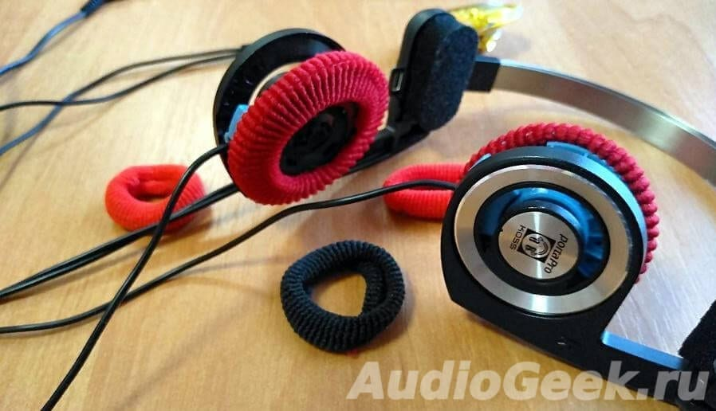
They create no softness or comfort and tire the ears in less than half an hour. Also, owners of hair longer than average will have to adjust the headphones regularly because of the diaphragm rustling against hair that gets into the slots.

## Proper earpads for the Koss Porta

Of course you can try to ***[sew earpads yourself](../earpads/)***. Though at these sizes it would be a good torture for the nerves. To avoid spending on sedatives, it is cheaper and faster to find a ready-made option.
There are quite a few options today, so before looking it is worth understanding what we need. And we need the following:

- ***All the driver's slots must be as open to sound as possible***
- ***The earpads must not be thick***
- ***Build quality and comfort have not been canceled***

AliExpress is full of earpads for the Koss Porta priced under $2 and looking roughly like this:
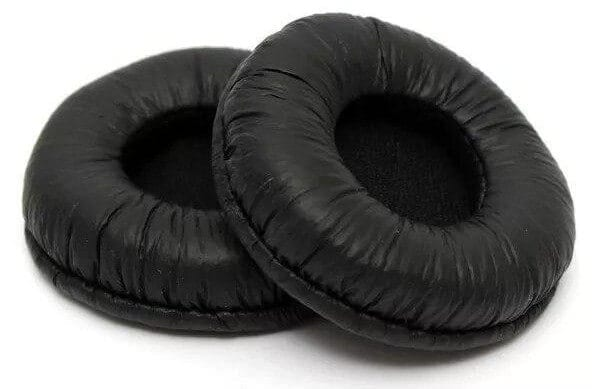
In my opinion the Koss Porta look a bit comical with such earpads. But the bigger problem is that they are quite thick. That will create a boost in the lows and a boominess will appear. Also, because of the thickness the headphones will not sit snugly against the ears.

## Happiness is near

After a long search I found earpads in a less common but very interesting form factor. With positive experience of Sony headphones with similar pads behind me, I had no doubts.
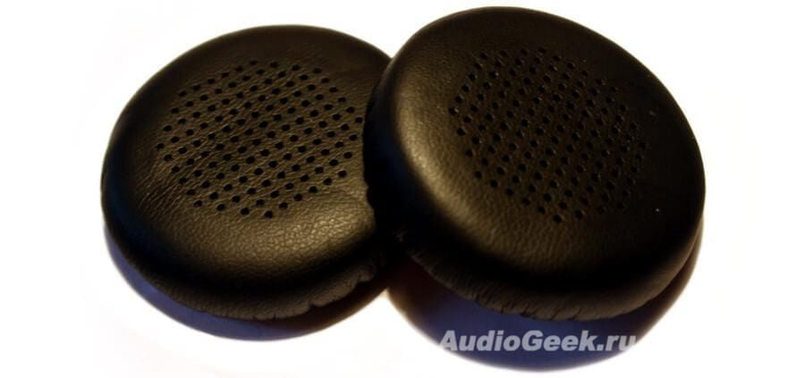
I found a shop ready to let them go for $4.6. The other sellers ruined themselves with greed and price tags above $8–9. By the way, they come in both black and beige. And that was a truly hard choice :)

## First impression

Having received the coveted little package at the post office, I rushed to try them on right away. The quality of the earpads was excellent. For that money everything was simply perfect. And the comfort was in perfect order too.
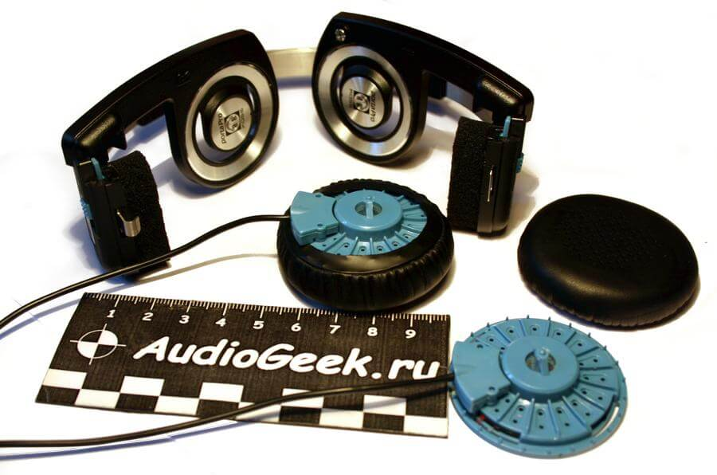
As for the sound, I frankly **did NOT like** it. The bass drones, the sound is plasticky and cramped...

But this site would not be called what it is called if I said something like "***guys, everything is OK, buy them!***". So now let us bring the sound to perfection. It turned out to be very easy.

## How to tune the sound

The main problem with the purchased earpads is hidden in the pretty pink foam. There is frankly a lot of it. First, it overlaps the outermost slots of the driver, and second, it creates a large volume in front of the driver.
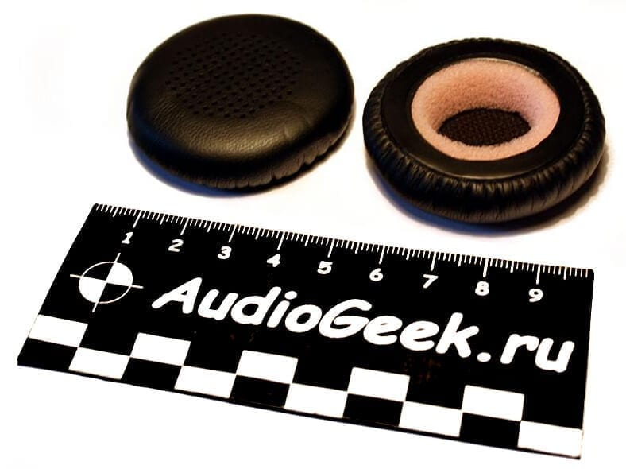
First I removed the protective fabric mesh glued on the inside in front of the openings. There is no particular need for it, just an extra barrier for the sound.
As for the foam, a slightly better result came after trimming it along the plastic ring glued to it.
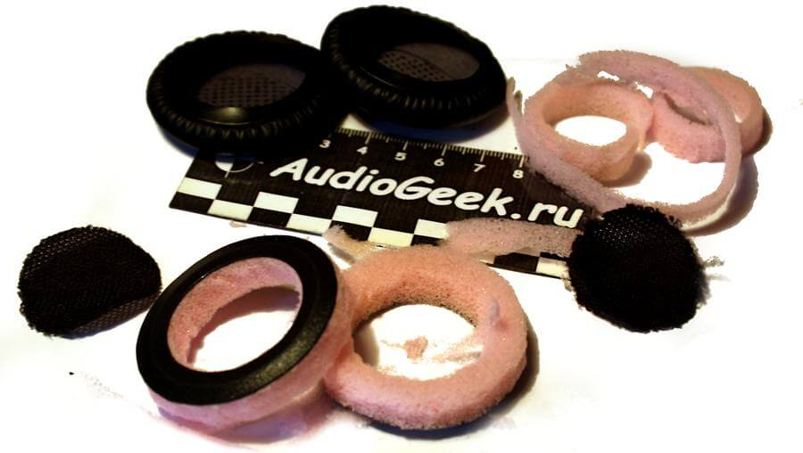
But even that was not enough. The boominess went away, but now the midrange suddenly jumped out....

## This is not the end

I will not burden the article with the details of all the attempts made, and will show right away the final variant, which turned out to be the most successful and simple.
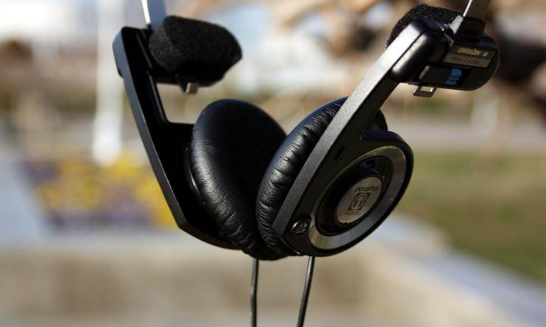

### So, from the new earpads we need:

- ***The outer leatherette part with the fabric filter removed***
- ***The plastic rings torn off the foam.***

You will also need a pair of the original foam earpads for the Koss Porta. They will have to be cut up in the name of sound.
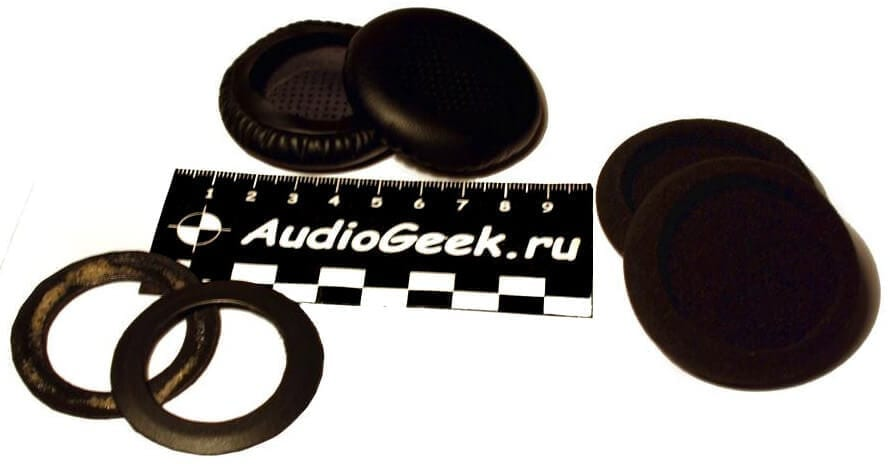
If you do not want to cut up the originals or they are already far from ideal, there are shops on AliExpress where for just 140 rubles you get three pairs of decent foam earpads at once for experiments.

## Assembling the perfect earpads for the Koss Porta

So, we have everything necessary. First, cut a hole in the center of the foam earpads. For convenience it is better to insert the plastic rings into them and cut along the inner diameter.
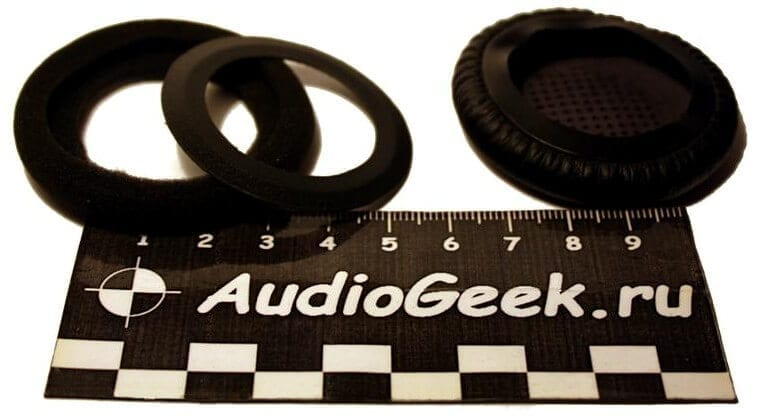
However hard I tried, I could not cut a perfectly round circle. Luckily for me, it is not so noticeable in the photo. But overall it does not matter.
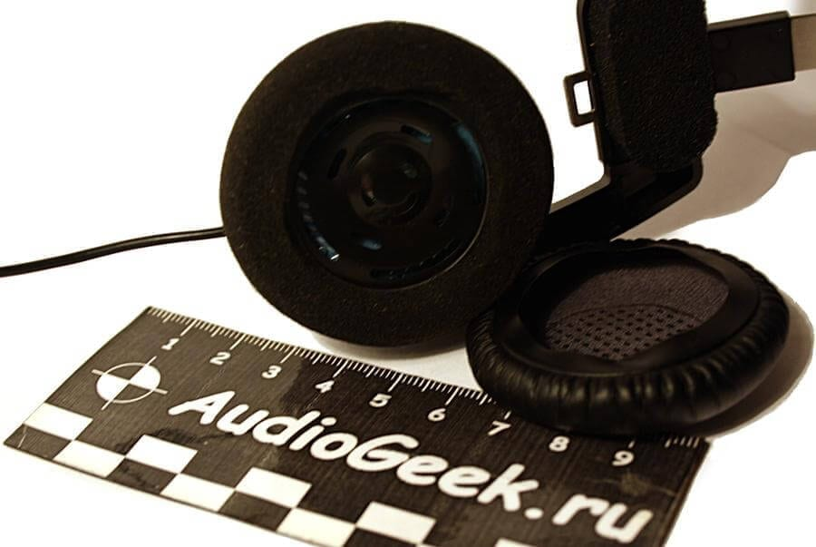
Place the plastic ring on the front face of the driver, convex side out, and put on the foam earpad, cut as required. All that remains is to pull the leatherette skin over the resulting construction.
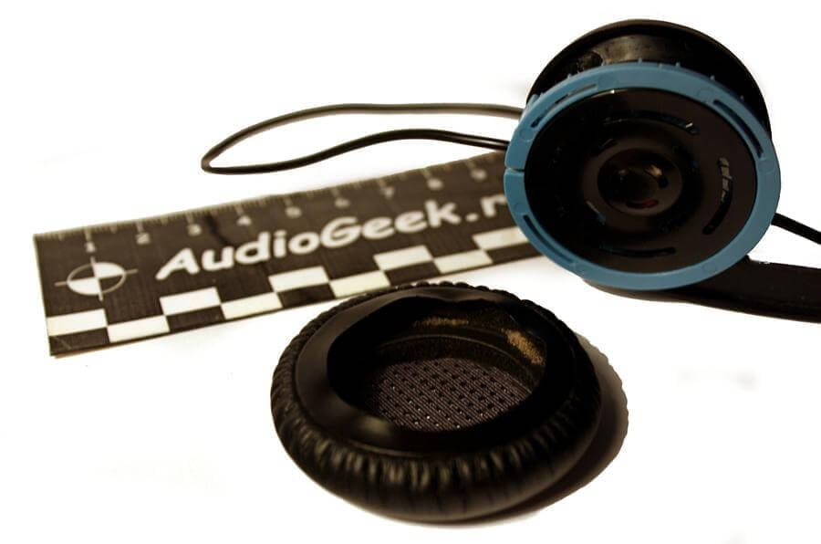

## What about the sound?

The beauty of earpads of this form factor is that they prevent sound from spreading in all directions. The sound goes out in a directed way through the openings into the ear canal.
So, despite the [***open design***](../open-close-headphones/) of the headphones and the sidelong glances of people around, it was quite comfortable to listen to music even in the subway. Of course you hear the subway itself, but it does not interfere with the music.
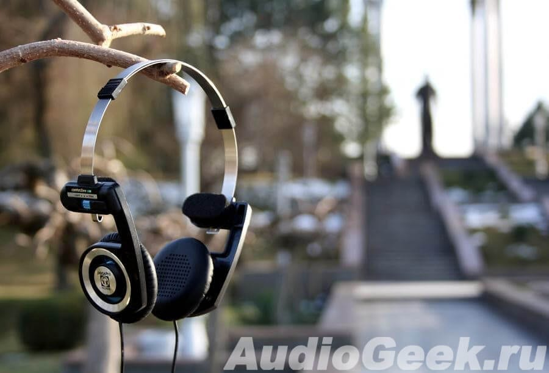
The sound of the headphones is quite balanced. Thanks to the damped volume in front of the drivers, the bass became deeper. And thanks to all the driver's slots now being open, the highs became much more readable. Overall the sound became denser, without noticeable skews and spikes.

## Conclusion

Paying about as much as for a cup of coffee at Starbucks, we got comfortable earpads for the Koss Porta with excellent sound and a striking look that adds solidity to the whole headphone.
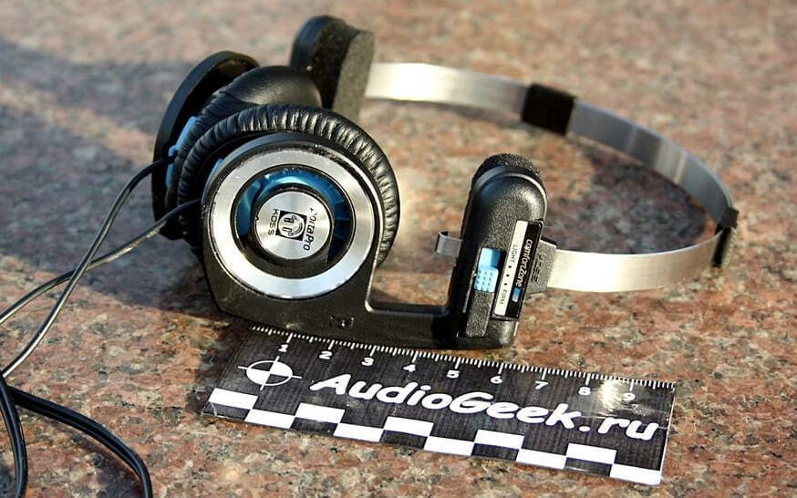
Yes, the earpads were initially very disappointing. But what came out in the end is, in my opinion, a perfect solution. The sound of the Koss Porta drivers themselves has appeared, without filtering through foam. So I boldly recommend buying these earpads and modifying them, if it can be called that :)
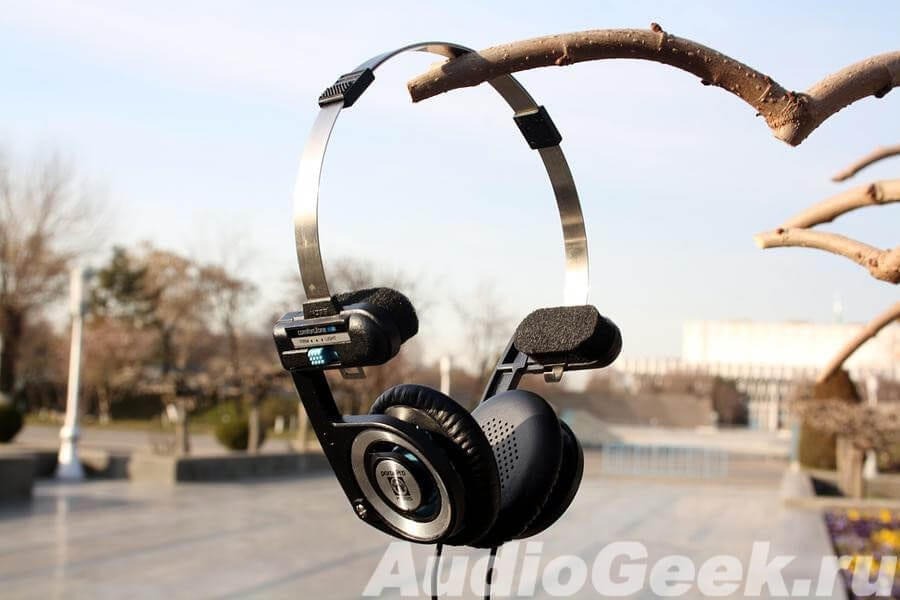

*Originally written for [AudioGeek.ru](https://audiogeek.ru). Translated from Russian.*
