[English](./README.md) | **Русский**

# Идеальные амбушюры для Koss Porta Pro

**Рубрики:** Аксессуары для наушников  
**Метки:** AliExpress, амбушюры  
**Оригинал:** https://audiogeek.ru/earpads-koss-porta/

---

Почему-то, когда речь заходит про **амбушюры для Koss Porta**, их влиянием на звук зачастую пренебрегают. При этом не блещут звуком как родные поролоновые, так и различные покупные амбушюры. Больше других страдает ВЧ диапазон. Посмотрим правде в глаза и вместо сверления лишних дырок в наушниках сделаем идеальные амбушюры для Koss Porta.

## Какие еще дырки и что не так?

Присоединившись к обладателям KOSS Porta PRO, первое, что бросилось в глаза, а вернее в уши - это завал по высоким частотам. Высокие есть и они вполне хороши, но их мало. Особо заметно это становится после ***[мониторных наушников](../monitoring-headphones/)***.
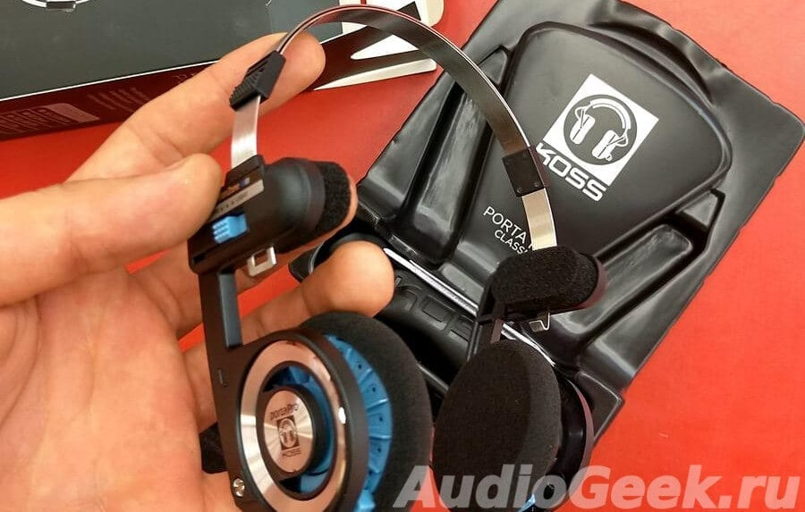
Для поднятия ВЧ, в качестве радикальной меры, прибегают к созданию дополнительных отверстий в пластинке перед динамиком. Называется такая “технология” **Kramer Mod**.
Несмотря на кажущуюся логичность и положительные отзывы многих модернизаторов, мод не дает значимых изменений при замерах. Трудно делать выводы по АЧХ - нужно пробовать.
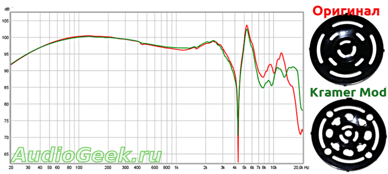

[***[Источник]***](https://diyaudioheaven.wordpress.com/headphones/%20measurements%20/%20koss%20/%20portapro%20/)

## **Гуманный путь - амбушюры для Koss Porta**

На самом деле главной виной нехватки высоких частот у Koss Porta являются их поролоновые амбушюры. Убедиться в этом проще простого - достаточно просто снять их.
Звучание наушников без поролона намного лучше, детальнее и ровнее. Попробуйте привыкнуть, а потом одеть поролонки обратно. Больше использовать их вы скорее всего уже не захотите.
В качестве альтернативы используют резинки для волос. Несмотря на доступность и копеечную стоимость резинок, назвать их амбушюрами сложно.
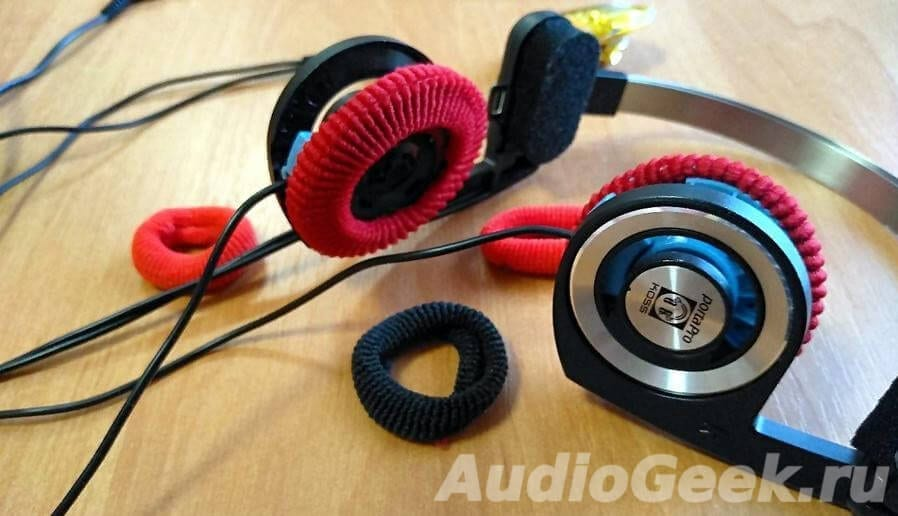
Они не создают мягкости и комфорта, утомляя уши за менее полу часа. Так же обладателям прически, длиннее средней, придется регулярно поправлять наушники из-за шуршания мембраны о попавшие в прорези волосы.

## Нормальные амбушюры для Koss Porta

Конечно можно попытаться ***[сшить амбушюры самостоятельно](../earpads/)***. Правда при таких размерах это будет хорошая пытка для нервов. Чтоб не тратиться на Корвалол, дешевле и быстрее - найти готовый вариант.
Вариантов сегодня не мало, поэтому перед тем как искать, стоит понят, что нам нужно. А нужно следующее:

- ***Все прорези динамика должны быть максимальна открыты для звука***
- ***Амбушюры не должны быть толстыми***
- ***Качество изготовление и комфорт никто не отменял***

На AliExpress полно амбушюр для Косс Порта с ценником меньше 2$ и выглядящих примерное так:
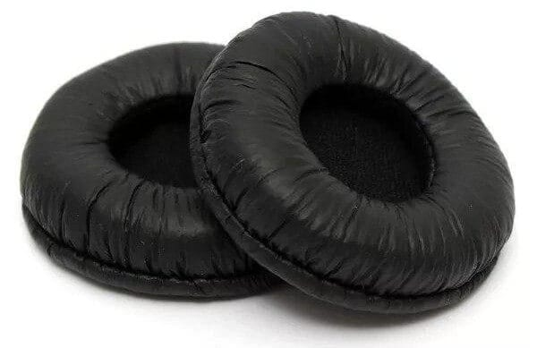
**Купить такие за 110 рублей можно в *этом магазине***
На мой взгляд Koss Porta с такими амбушюрами смотрятся немного комично. Но проблема больше в том, что у них довольно приличная толщина. Она создаст подъем на низких частотах и появится гул. Так же из-за толщины получится, что наушники не плотно прилегают к ушам.

## Счастье рядом

После долгих поисков были найдены амбушюры в менее распространенном, но весьма интересном форм-факторе. Имея за плечами положительный опыт использования наушников Sony с аналогичными подушками, сомнений не возникло.
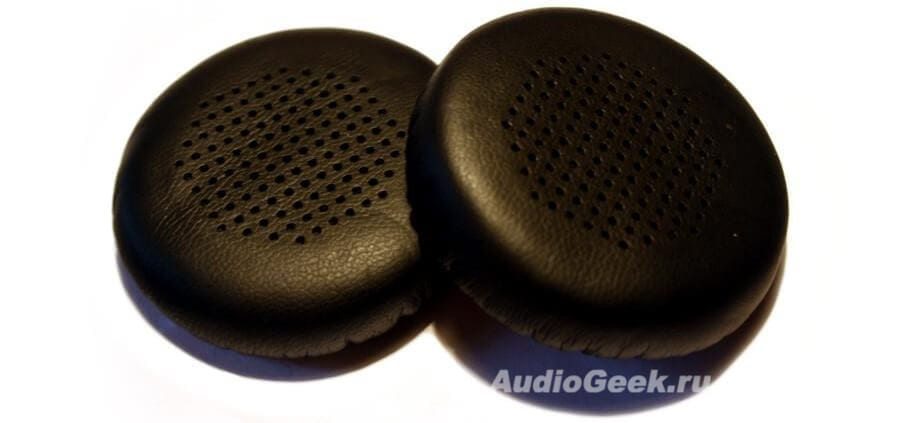
Был найден ***магазин*** готовый отдать их за 4.6$. Остальных продавцов погубила жадность и ценник выше 8-9$. Кстати доступны они как в черном, так и бежевом исполнении. И вот это уже был по-настоящему трудный выбор)

## Первое впечатление

Получив на почте заветный пакетик, тут же ринулся примерять. Качество амбушюр было отменным. За такие деньги все было сделано просто идеально. Да и с комфортом полный порядок.
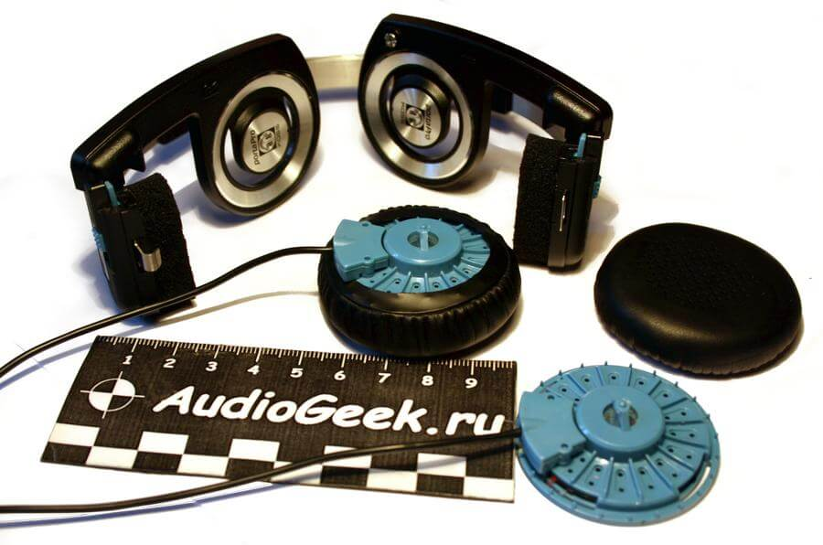
Что касается звука, то он мне откровенно **НЕ понравился**. Бас гудит, звук пластмассовый и зажатый...

Но сайт не назывался бы так, как называется, если бы я сказал что-то вроде "***ребят, все О'Кей, покупайте!***". Так что теперь займемся доведением звука до идеала. Это оказалось очень просто.

## Как нарулить звук

Основная проблема купленных амбушюр кроется в красивом розовом поролоне. Его тут откровенно много. Во первых он наезжает на крайние прорези динамика, а во вторых создает большой объем перед динамиком.
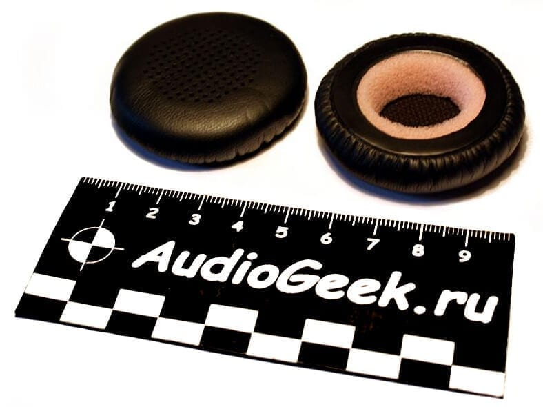
В первую очередь была удалена тканевая защитная сеточка, приклеенная с внутренней стороны перед отверстиями. Особой необходимости в ней нет, только лишняя преграда для звука.
Что касается поролона, то немного лучший результат получился после его обрезания по наклеенному на него пластмассовому колечку.
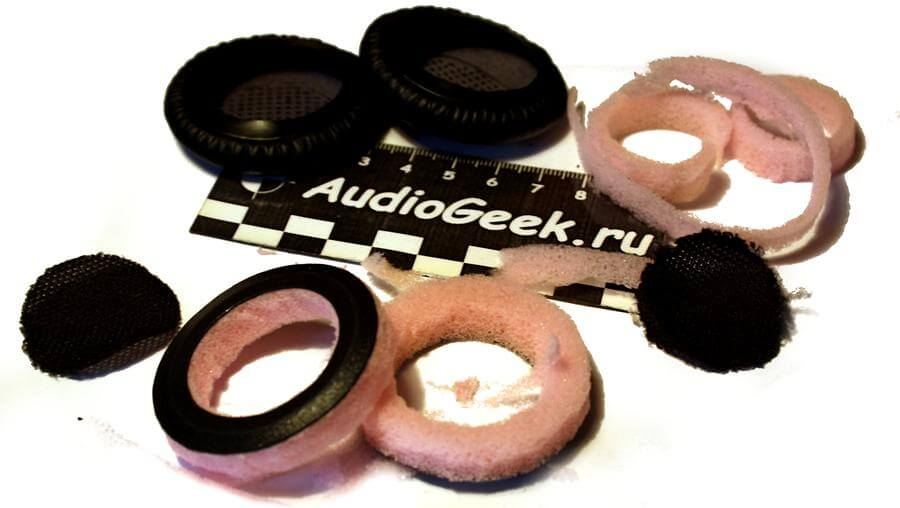
Однако и этого оказалось мало. Гулкость прошла, но теперь резко вылезли средние частоты....

## Это не конец

Не буду грузить статью деталями всех проделанных попыток и сразу покажу окончательный вариант, который оказался самым удачным и простым.
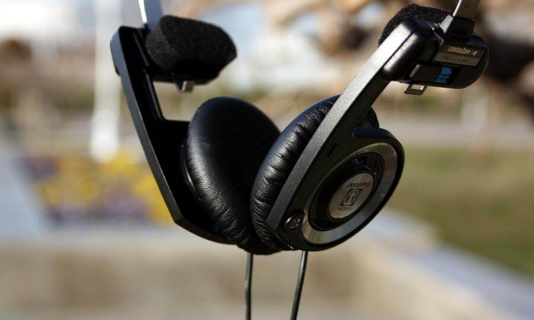

### Итак, от новых амбушюр нам понадобится:

- ***Наружная дерматиновая часть с удаленным тканевым фильтром***
- ***Пластиковые колечки, оторванные от поролона.***

Так же понадобится пара родных поролоновых амбушюр для Koss Porta. Их придется зарезать во имя звука.
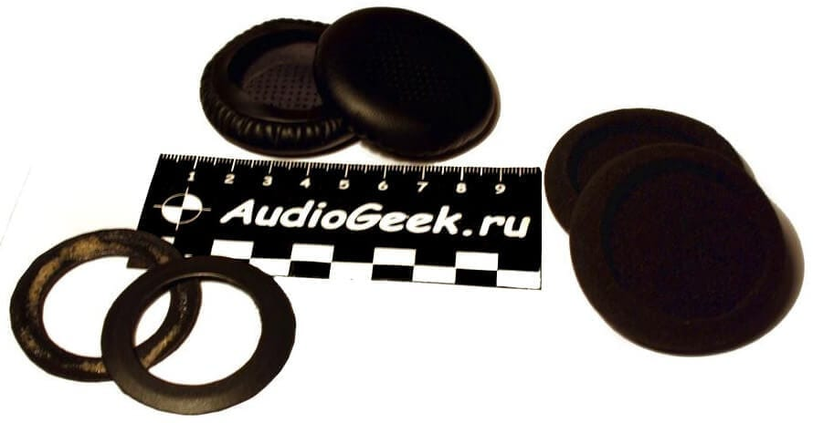
Если вам жалко резать родные амбушюры или они уже далеки от идеала, то в ***этом магазине*** всего за 140 рублей вы получите сразу три пары хороших поролоновых амбушюр для экспериментов.

## Собираем идеальные амбушюры для Koss Porta

Итак, всем необходимым обзавелись. Первым делом потребуется вырезать отверстие по центру поролоновых амбушюр. Для удобства лучше вставлять в них пластиковые кольца и вырезать по внутреннему диаметру.
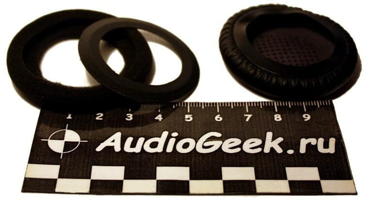
Как ни старался, вырезать ровную окружность у меня не получилось. К счастью для меня, на фото это не так заметно. Но в целом это не важно.
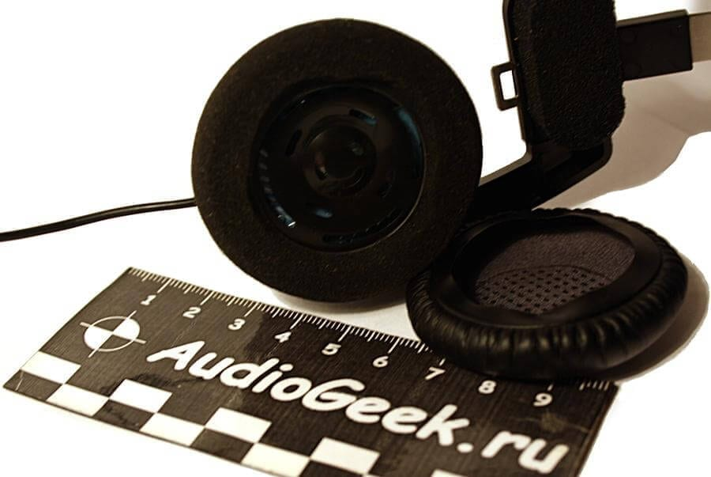
Кладем на лицевую сторону динамика пластиковое кольцо, выпуклой стороной наружу, и надеваем, как и положенно зарезанный поролоновый амбушюр. Остается только натянуть дерматиновую шкурку поверх получившейся конструкции.
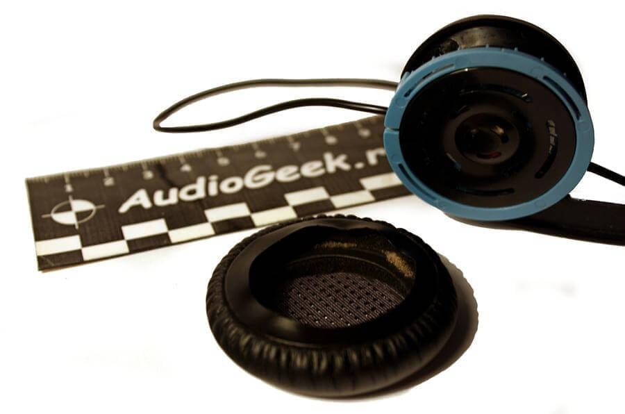

## Что со звуком?

Прелесть амбушюр такого форм-фактора состоит в том, что исключается распространение звука во все стороны. Звук направленно выходит через отверстия в канал ушной раковины.
Так, несмотря на [***открытую конструкцию***](../open-close-headphones/) наушников и косые взгляды окружающих, было вполне комфортно слушать музыку даже в метро. Конечно и само метро слышно, но оно не мешает музыке.
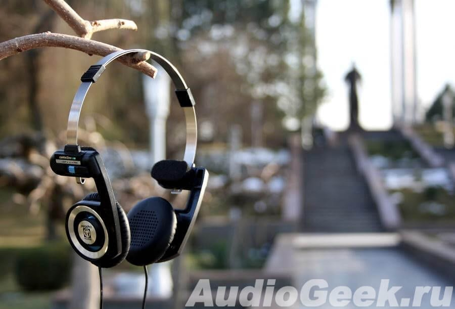
Звучание наушников весьма сбалансированное. При этом, благодаря демпфированному объему перед динамиками, басс стал более глубокий. А благодаря тому, что теперь все прорези динамика открыт, высокие стали гораздо более читаемыми. В целом же звук стал плотнее и без заметных перекосов и выбросов.

## Заключение

Заплатив как за стаканчик кофе в Старбакс мы получили удобные амбушюры для Koss Porta с отличным звуком и потрясающей внешностью, придающей солидности всем наушникам.
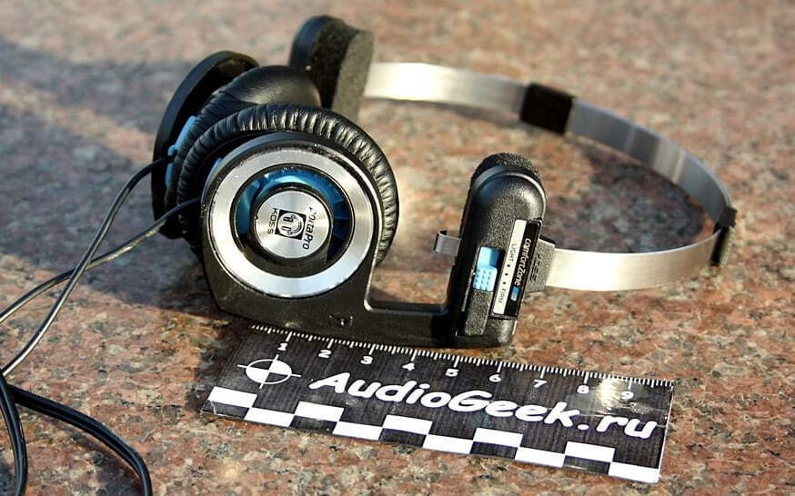
Да, исходно амбушюры очень опечалили. Но то что получилось в итоге - на мой взгляд идеальное решение. Появился звук самих динамиков Koss Porta, без фильтрации через поролон. Так что смело рекомендую эти амбушюры к покупке и доработке, если ее можно так назвать)
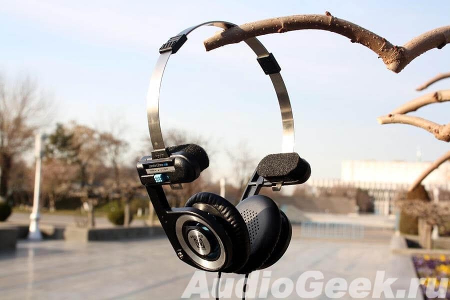
 

***Материал подготовлен исключительно для сайта* [AudioGeek.ru](http://audiogeek.ru)**
