[Русский](./README.ru.md) | **English**

# Making your own earpads: a TDS-5 example

**Published:** 2017-08-14  
**Category:** Headphone accessories, Headphone mods  
**Tags:** earpads, DIY  
**Original:** https://audiogeek.ru/earpads/

---

Owners of full-size and on-ear headphones sooner or later find that the earpads lose their original look and consistency. Often it is impossible to find or buy new ones. So today we will look at how to sew earpads yourself.

> ***This article is a rewrite of my first article, written specially for the audio forum [lossy.ru](http://www.lossy.ru/forums/showthread.php?t=3499). I decided to rewrite it after finding it on other websites too. That is copyright on the Russian internet for you :)***

The size and shape of the earpads affect how the headphones sound. If you decide to sew your own as a replacement for worn ones, choose the dimensions based on the originals.

I sewed these for TDS-5 headphones (Soviet isodynamic, that is, planar magnetic, headphones) that I was restoring, so I chose the dimensions based on recommendations from various sources. I tried to make them as thin as possible, with as large an inner diameter as possible.

## What you need to sew earpads yourself

- A piece of thin leather or leatherette
- Foam, which you can take from the earpads of other headphones. A washing-up sponge will not do: the foam must let air through freely. The best way to check is to try blowing through it
- Sewing supplies
- Cardboard for making a pattern
- A compass, for marking the cardboard

***More about the material***

When choosing the material, try to find the thinnest possible. In my opinion leatherette is easier to sew with. It is also easier and cheaper to buy. It is better to pick one with a fabric backing. You can also sew from velour, it all depends on your taste and what you can get.

Both leather and leatherette are usually sold by the meter. The leatherette I used was sold on a roll about a meter wide. I bought 20 centimeters and still had about half left over. The whole thing cost about 2 dollars.

## About the foam

In case you have no donor earpads, cut the foam with an allowance. It must compress by one and a half to two times, otherwise the earpad will be either too loose or too firm. Both are bad for comfort. The best option in my opinion is to add 0.5–1 cm to the outer radius and subtract the same from the inner one. As for thickness, make it 1.5–2 times what you plan.

## Making the pattern, tracing, cutting

First, mark the future pattern on thick cardboard with a compass.

For clarity, the seam allowance is colored yellow. As you can see, I left 2.5 mm on each edge. If you use leather, it is better to leave 4–5 mm.

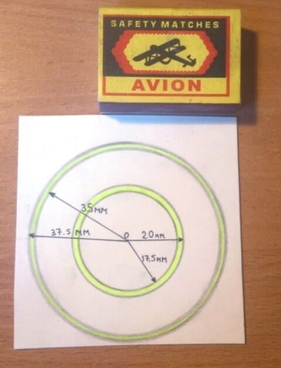

Now take a piece of soap and mark the leatherette on the back side, then cut out two circles for each earpad.

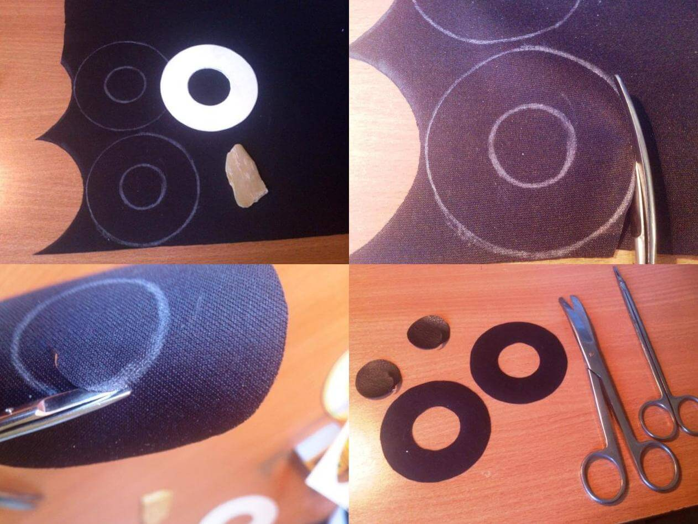

## Time to sew

Put the cut rings together and stitch them with small stitches along the inner edge. To hold them, the rings were taped together. You can use clothes pegs, the main thing is to prevent them from shifting relative to each other.

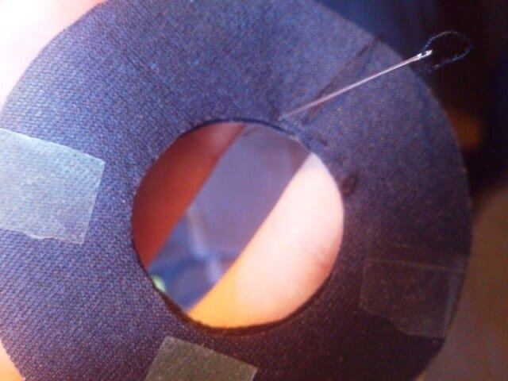

If you have a sewing machine, it is a good idea to use it.

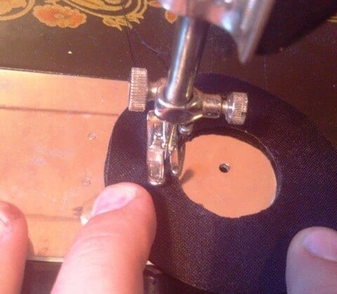

Going by the presser foot of my sewing machine, I stitched a bit farther from the edge than I did by hand. That is fine: the inner diameter just comes out a little larger and the earpad a little thinner.

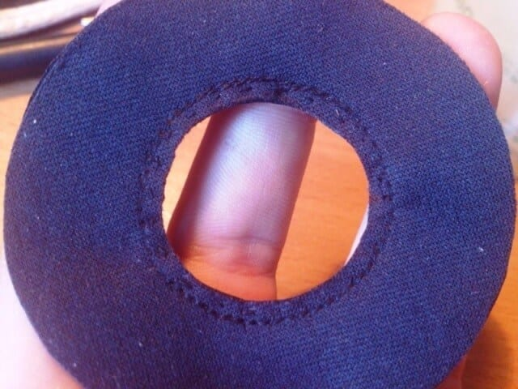

If you have no machine, you can stitch by hand a couple of times. The main thing is that the seam is even and has no gaps when stretched.

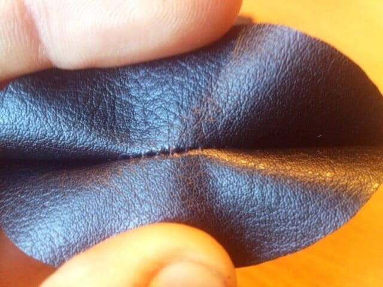

Since the sewn piece will be turned inside out, it is better to trim the excess along the inner edge.

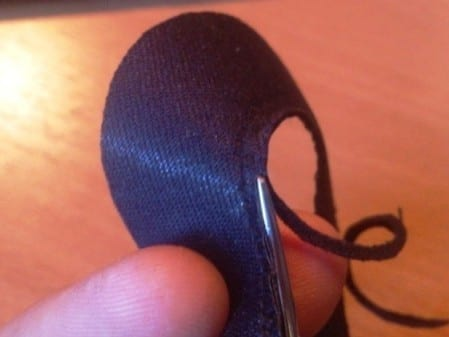

## Adding thickness

To give the earpads thickness we need to cut one more strip, whose width will determine the future thickness. As before, leave 2–3 mm for the seam.

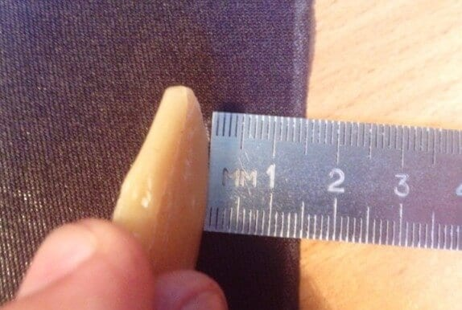

I chose a thickness of about a centimeter based on recommendations, and left the other half centimeter for the seams.

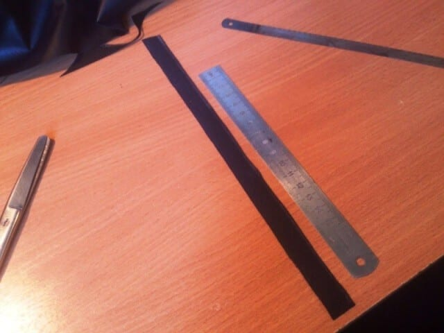

I cut the strip generously long, by eye. For a more precise calculation, pick up a calculator and remember your school days, in particular that

> **Circumference = 2 × 3.14 × outer radius of the earpad**

For a radius of 37.5 mm that comes to about 23.5 cm. So I cut 25 cm and did not worry about it.

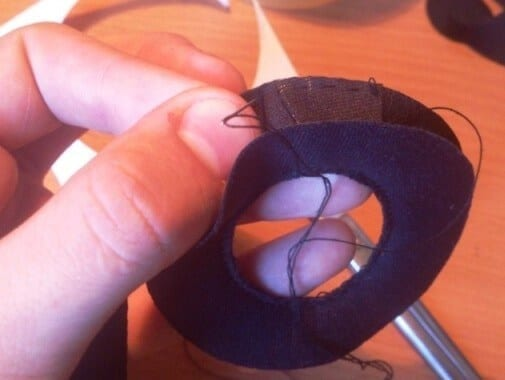

Sew the edge of the strip to the edge of one of the rings.

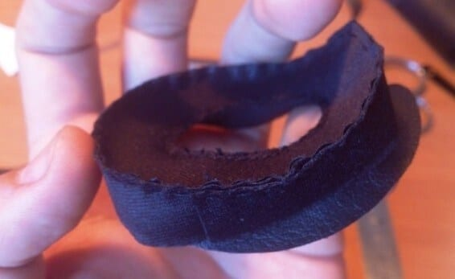

When you have gone all the way around, leave an overlap of 0.5–1 cm and cut off the extra part of the strip. This is how it looks after machine stitching.

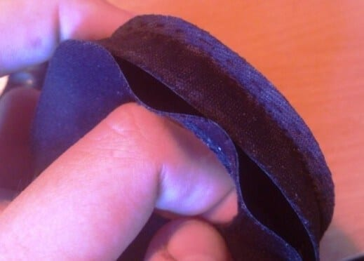

## Inserting the foam

Our piece is looking more and more like an earpad. Now it is the foam's turn.

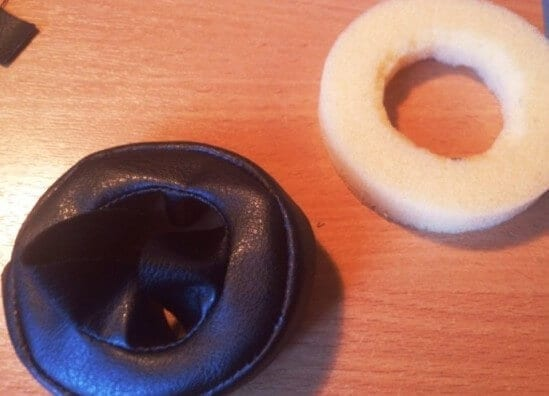

Slip the piece onto the foam ring and admire what you have done. Only a little is left.

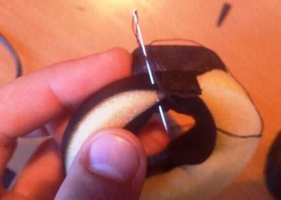

The second seam will be on the outside. So when sewing the strip to the second ring, put them together with their wrong sides facing each other. Do not let the seam pass through the foam.

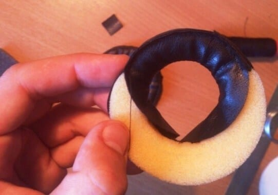

After you have gone all the way around, knead the earpad in different directions. This makes the foam distribute evenly inside.

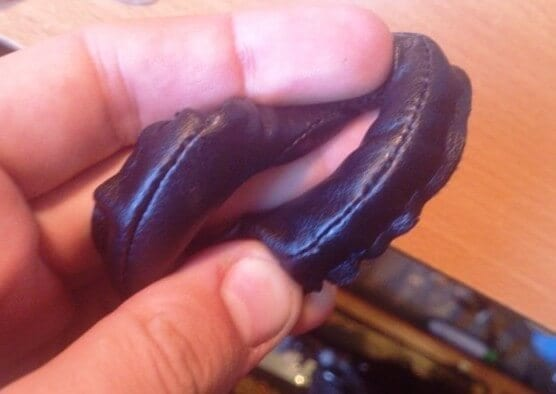

## Finishing the edge

On the TDS-5 the earpad is attached with glue, so I decided to simply bind the edge with a decorative ribbon.

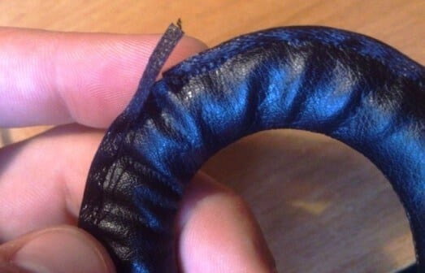

It clearly made the edge neater.

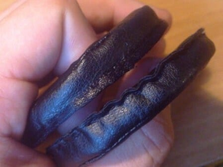

If your headphones have a rim, sew one more ring onto the earpad, which will be used to attach it, and only then bind it with decorative ribbon.

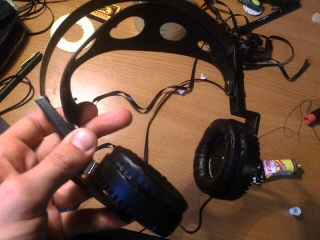

That is all, the goal is achieved. The earpads were sewn by hand and are a fine complement to the wonderful Soviet isodynamic TDS-5.

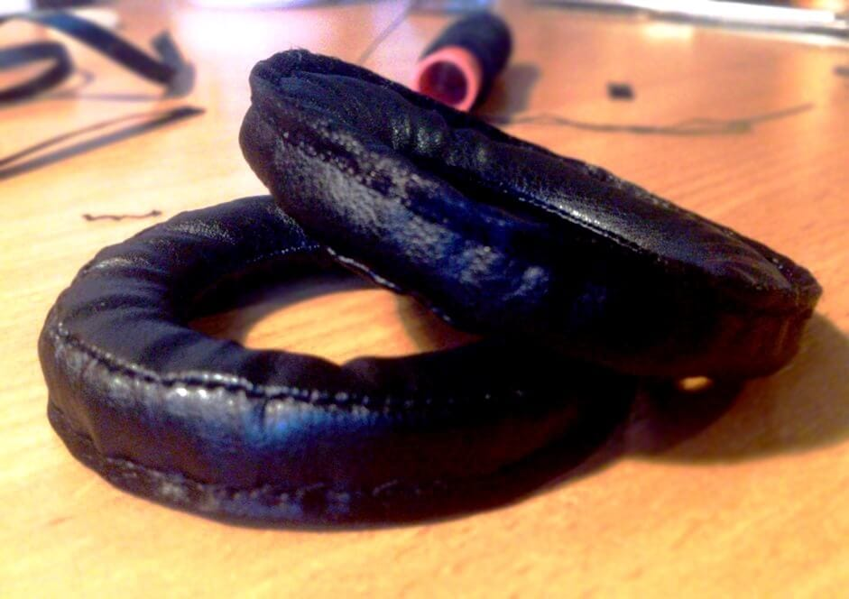

*Originally written for [AudioGeek.ru](https://audiogeek.ru). Translated from Russian.*
