[English](./README.md) | **Русский**

# Амбушюры своими руками на примере ТДС-5

**Рубрики:** Аксессуары для наушников, Доработка наушников  
**Метки:** амбушюры, своими руками  
**Оригинал:** https://audiogeek.ru/earpads/

---

Обладатели полноразмерных и накладных наушников рано или поздно обязательно сталкиваются с тем что амбушюры теряют первозданный вид и консистенцию. Так случается, что зачастую нету возможности найти либо купить новые амбушюры. Поэтому сегодня рассмотрим как сшить амбушюры своими руками.

> ***Данная статья - рерайт моей первой статьи, написанной специально для аудио форума [lossy.ru](http://www.lossy.ru/forums/showthread.php?t=3499) . Переписать ее было решено, после обнаружения ее и на других интернет ресурсах. Вот они, авторские права в рунете))***

Размеры и форма амбушюр влияют на характер звучания наушников. Если вы решили сшить амбушюры своими руками в качестве замены износившимся, то размеры стоит выбирать исходя из оригинальных.

Мной амбушюры шились для восстанавливаемых ТДС-5, поэтому размеры были выбраны исходя из рекомендаций с разных источников. Я старался сделать их максимально тонкими и с как можно бОльшим внутренним диаметром

## *Чтобы сшить амбушюры своими руками понадобится:*

- **К**усочек тонкой кожи либо дерматин
- **П**оролон, который можно изъять из амбушюр других наушников. Губка для мытья тут увы не подойдет, поролон должен свободно пропускать воздух. Лучший способ проверить - попробовать через него подуть
- **Ш**вейные принадлежности
- **К**артон для создания лекала
- **Ц**иркуль, для разметки картона

***Подробнее об используемом материале***

При выборе материала стоит стараться найти как можно тоньше. Шить из дерматина на мой взгляд проще. Собственно и найти его в продаже проще и дешевле. Выбирать лучше тот, который обладает тканевой основой. Можно и из велюра шить - все упирается в ваш вкус и возможность достать материал.

И кожа и дерматин чаще всего продаются метражом. Использованный дерматин продавался рулоном, шириной около метра. Я купил 20 сантиметров и даже при этом осталось около половины материала. Что касается цены вопроса, то обошлось такое счастье около 2 долларов.

## ***Про поролон***

На случай если ушей – доноров не нашлось, поролон должен быть вырезан с запасом. Он должен стягиваться в полтора-два раза, иначе амбушюр будет либо рыхлым либо излишне плотным. Оба варианта отрицательно скажутся на его удобстве.Оптимальный вариант, на мой взгляд - это прибавить 0.5-1см к внешнему радиусу, и отнять столько же от внутреннего. А по толщине раза в 1.5-2 толще планируемого.

## ***Делаем лекало, обводим, вырезаем***

Первым делаем размечаем циркулем будущее лекало на плотном картоне.
 Для большей наглядности запасы оставленные на швы закрашены желтым. Как видно было оставил по 2.5 мм с каждого края. Если вы используете кожу, то лучше сделать запас в 4-5 мм.

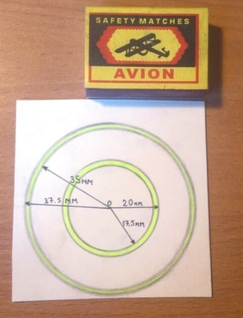

Теперь вооружившись кусочком мыла размечаем наш дерматин по тыльной стороне и вырезаем по два круга для каждого из амбушюр.

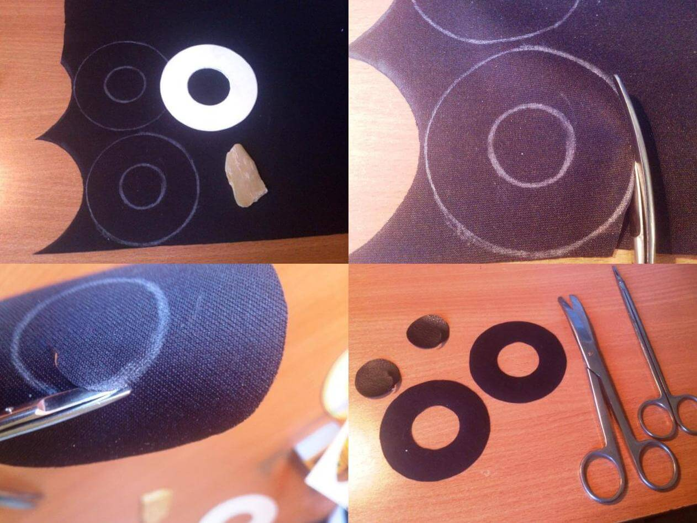

## ***Пора шить!***

Совмещаем между собой вырезанные кольца и прошиваем их мелкими стежками по внутреннему краю. Для пущей фиксации кольца были склеены скотчем. Можно воспользоваться прищепками, главное исключить смещение относительно друг друга.

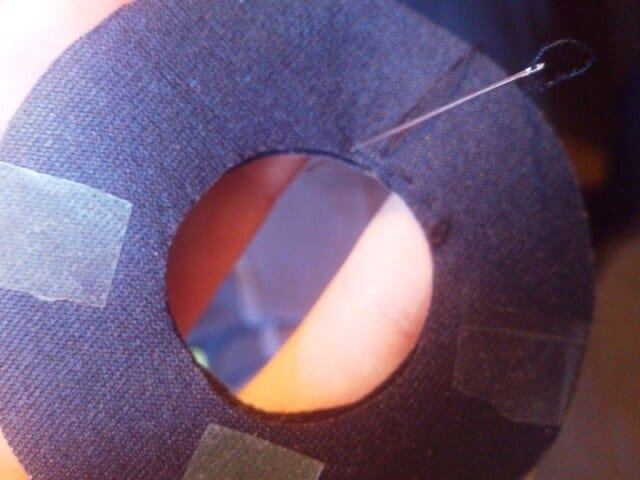

Если в хозяйстве имеется швейная машинка, то неплохо было бы ей воспользоваться.

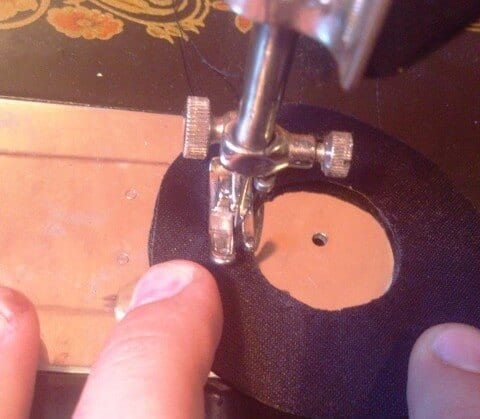

Ориентируясь по лапке на моей швейной машинке,я прошил немного дальше от края чем руками. Ничего страшного в этом нет, просто внутренний диаметр будет еще немного больше, а сам амбушюр тоньше.

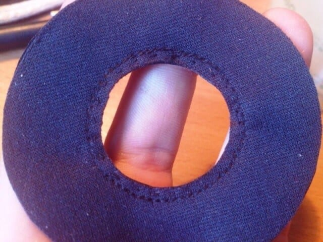

Если же машинки у вас нет, то можно и вручную прошить пару раз. Главное чтобы шов был равномерный и при растяжении не было просветов.

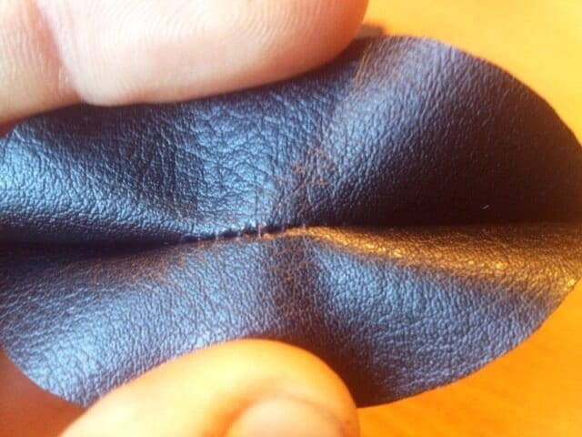

Т.к сшитая заготовка будет выворачиваться, то будет лучше срезать лишнее по внутреннему краю.

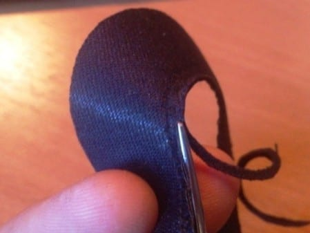

## ***Придаем толщины***

Для того, чтобы амбушюры обладали толщиной нам потребуется вырезать еще полоску, ширина которой будет определять будущую толщину. Так же как и прежде оставляем 2-3 мм на шов.

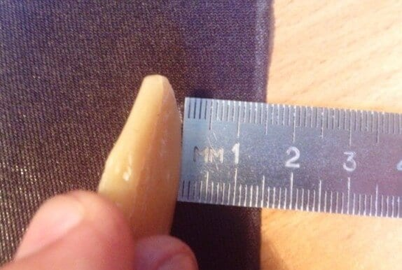

Из рекомендаций мной была выбрана толщина около сантиметра, остальные пол сантиметра были оставлены на швы.

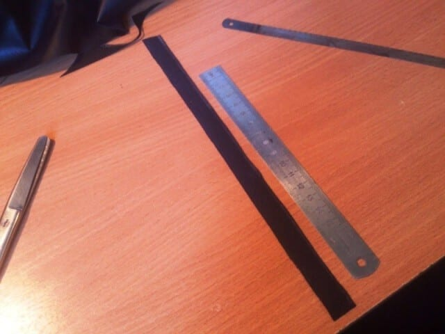

По длине полоска была вырезана с запасом, на глаз. Для более точного расчета стоит взять в руки калькулятор и вспомнить школьные годы ,в частности то,что

> **Длина окр = 2 \* 3.14 \* внешний радиус амбушюра**

Для радиуса 37.5 получилось около 23.5 см. Так что вырезаем 25 см и не паримся.

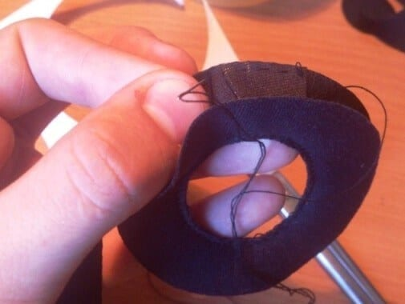

Сшиваем край полоски с краем одного из колец.

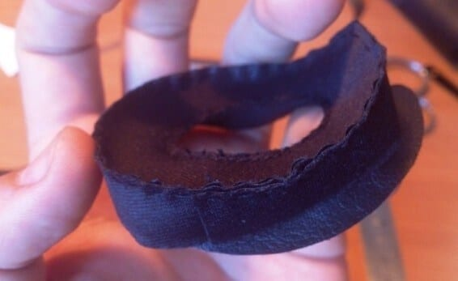

Когда круг будет пройден - оставляем нахлест 0.5-1 см и отрезаем лишнюю часть полоски. Вот так это выглядит после прошивки на швейной машинке.

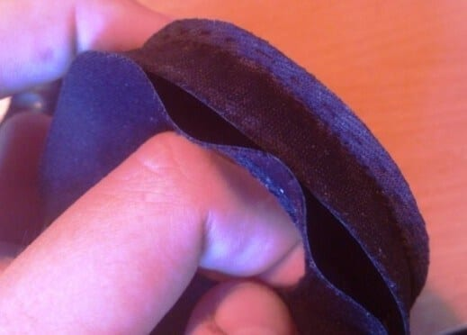

## ***Вставляем поролон***

Наша заготовка все больше начинает напоминать амбушюр. Теперь дошло дело и до поролона.

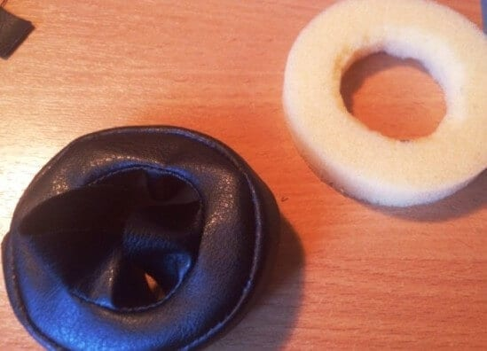

Вдеваем заготовку в поролоновое кольцо и насаждаемся проделанным. Дело осталось за малым.

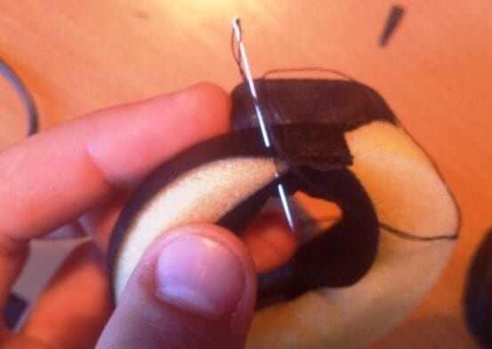

Второй шов будет с наружней стороны. Поэтому сшивать полоску со вторым кольцом стоит приложив их изнаночными сторонами друг к другу. Не допускайте, чтобы шов проходил через поролон.

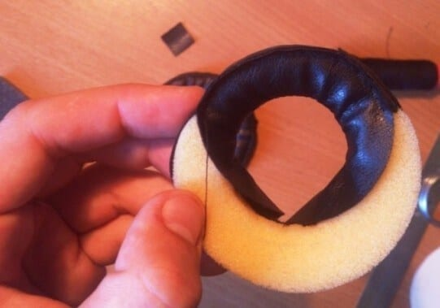

После того, как очередной круг будет пройден - мнем амбушюр в разные стороны. Нужно это для того, чтобы поролон равномерно распределился внутри.

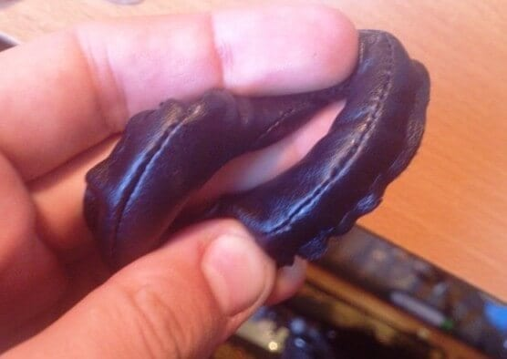

## ***Отделка края***

У ТДС-5 крепление амбушюра осуществляется приклейкой. Поэтому было решено просто обшить край декоративной ленточкой

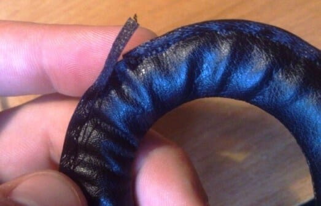

Она явно сделала край более аккуратным.

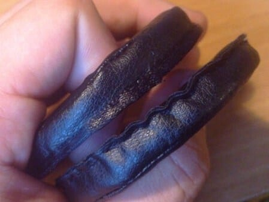

Если же у ваших наушников имеется бортик, то к амбушюрам следует пришить еще одно кольцо, которым оно и будет крепиться, а уже после обшивать декоративной ленточкой.

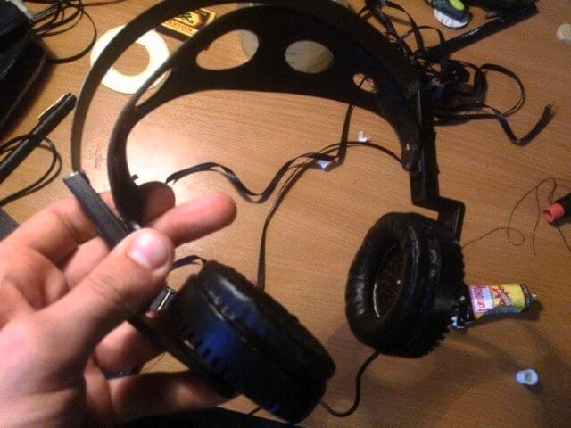

Вот собственно и все, цель достигнута. Амбушюры своими руками были сшиты и прекрасно дополнили Прекрасную советскую изодинамику в лице ТДС-5.

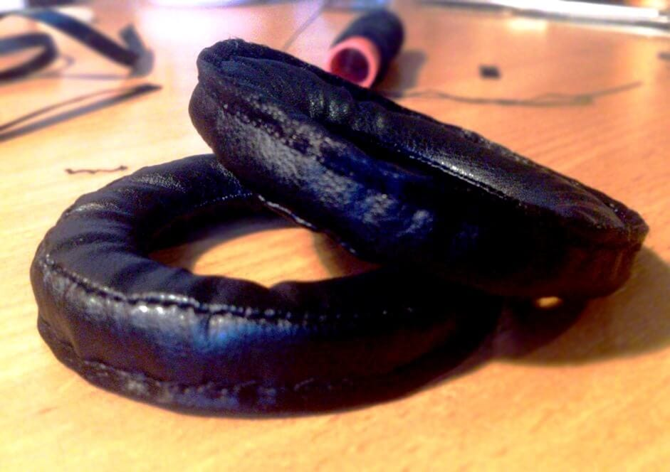

*Материал подготовлен исключительно для сайта [AudioGeek.ru](https://github.com/SkyTrip-13/AudioGeek)*
