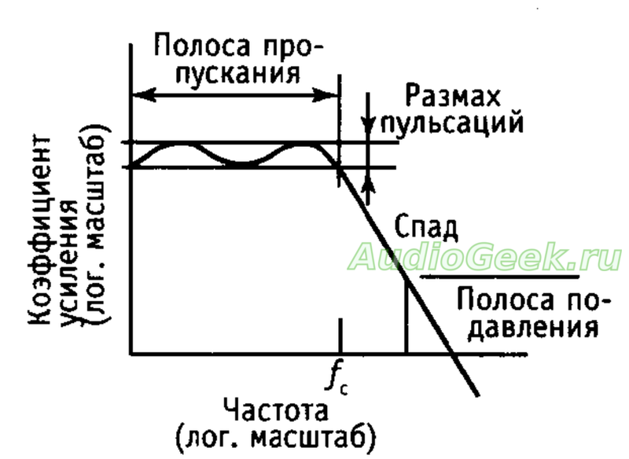
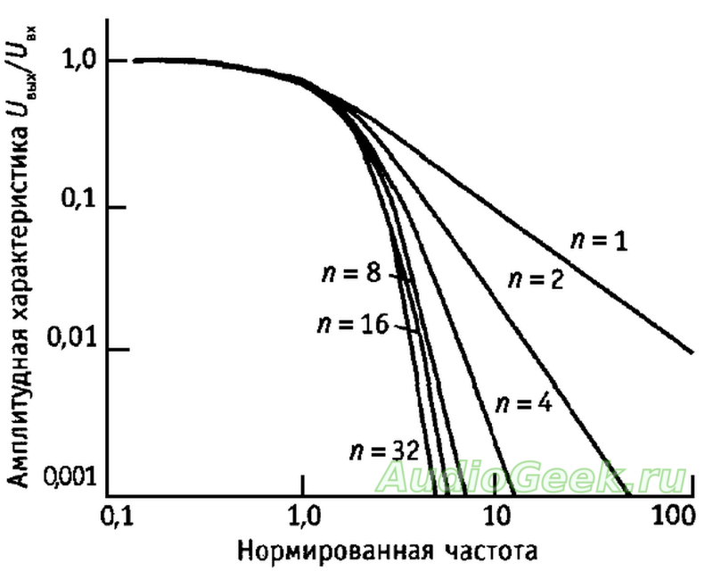
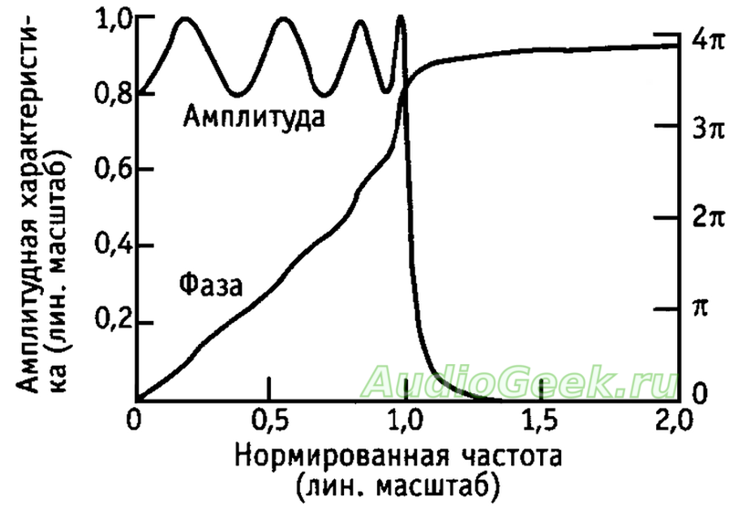
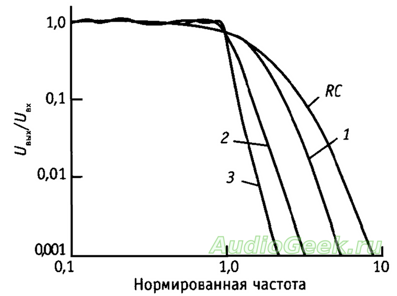
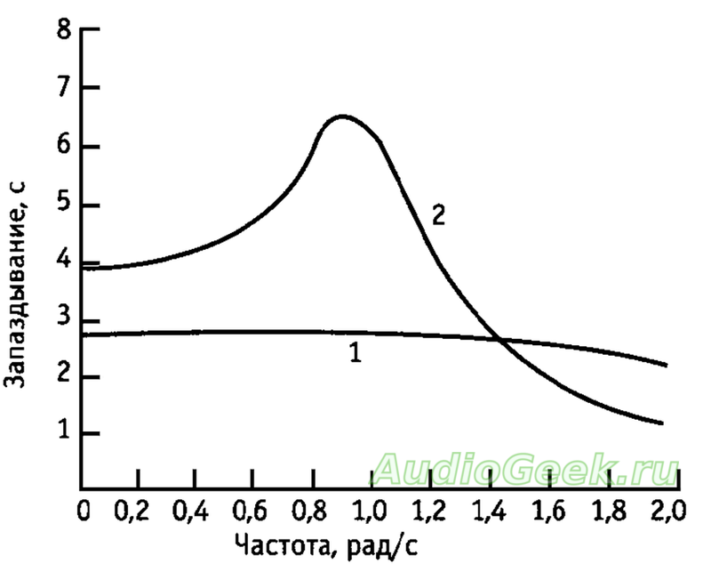

[Русский](./README.ru.md) | **English**

# Filter phase response and sound

**Category:** Audio circuit design  
**Tags:** audio filters, sound quality  
**Original:** https://audiogeek.ru/fazo-chastotnaya-harakteristika-filtrov/

---

Analog signal paths are unthinkable without various filters. There are many kinds of filters for many purposes. We will not go deep into circuit design, but look at how Chebyshev, Butterworth and Bessel filters affect the phase response of an AC signal, and which of them is better for audio, and why.

To avoid confusion we will stick to the generally accepted terminology. So before we start, take a look at the following picture:

Then read an excerpt from [***Wikipedia***](https://en.wikipedia.org/wiki/Phase_response):

> ***Phase response*** is the dependence of the phase difference between the output and input signals on signal frequency, the function describing that dependence, and also the graph of that function.

For definiteness, let us assume we have a low-pass filter. Everything said applies equally to a high-pass filter.

## Filter order

Usually, when a filter has to be made, the first thing to decide is how steep the roll-off needs to be. It directly determines the filter order. The higher the order of a low-pass filter, the steeper the response falls above the cutoff frequency.

> ***For convenience, this and the following graphs use normalized frequency, as if all frequencies had been divided by the filter's cutoff frequency.***

But the higher the filter order, the harder it is to implement and the more finicky to tune. Also, the higher the order, the more it harms the frequency and/or phase characteristics of the signal.

When a high-order filter is needed, designers usually simplify the circuit and the calculations by cascading two, three or more second-order filters. That does make the job easier, but such a cascade requires either different gains for each filter or different cutoff frequencies. That is beyond the scope of this article.

## How a filter affects the phase response

A filter's effect on the phase response of a signal is no less significant than its effect on the amplitude response. For audio signals, the effect of the filter's phase response can be decisive in choosing the filter type.

Apart from the active element (a transistor or an IC), active filters are usually built from RC circuits. Each RC circuit is a pole of the filter, bending the amplitude response in the direction we want. But at the same time, each RC circuit adds a finite time delay to the signal.

That delay means the signal after the filter is shifted in phase relative to the original. The whole problem is that this delay can differ for different frequencies.

**This applies to any filter.** The difference between filter types is that they have different phase responses and different roll-off steepness.

## Chebyshev filters and sound

Let us start with the Chebyshev filter. It has the sharpest roll-off. But the phase shift it introduces varies strongly across the whole passband. For this reason the Chebyshev filter is not used in high-quality audio circuits.

That is not its only drawback. The Chebyshev filter also has a large ripple in the passband, and the total number of maxima and minima equals the filter order.

The next graph shows the amplitude response (left scale) and phase response (right scale) of an 8th-order Chebyshev filter. The same holds for lower-order Chebyshev filters.

## Minimal effect on phase

The amplitude response of a Bessel (or Thomson) filter is flat across the whole passband. But its main virtue is that it introduces no phase distortion: the delay is the same for all frequencies in the passband.

In terms of phase response it is ideal for audio circuits. The fly in the ointment is that it has the gentlest roll-off of all the filters. Only a plain ***[RC circuit](../rc-circuit/)*** has a gentler one.

The next figure compares the steepness of different filter types: 1 is Bessel, 2 is Butterworth, 3 is Chebyshev *(0.5 dB ripple)*.

The ***[Butterworth filter](../second-order-low-pass-filter/)*** has characteristics close to the Bessel filter, but with a steeper roll-off. The price is that the delay differs between frequencies.

The dependence of signal delay on frequency for second-order Bessel (1) and Butterworth (2) filters, with normalized frequency, is shown in the next figure:

Note that the graph shows angular frequency (omega). To convert to hertz, multiply by 2π. The X axis is also linear rather than logarithmic.

Still, the Butterworth filter is not that bad. I would not recommend it for audio circuits, though, or at least you should pick a higher cutoff frequency so that phase distortion in the range you care about is minimal. In practice that is not always possible.

## Conclusion

So how do you get a filter with minimal effect on phase? I asked myself this while choosing a reconstruction filter for a DAC. A gyrator-based filter turned out to be an excellent solution. It is described in detail in a ***[separate article](../filtri-na-gyratorah/)***. The filter described there sits between Bessel and Butterworth and has very interesting phase and amplitude characteristics.

*Originally written for [AudioGeek.ru](https://github.com/SkyTrip-13/AudioGeek). Translated from Russian.*
