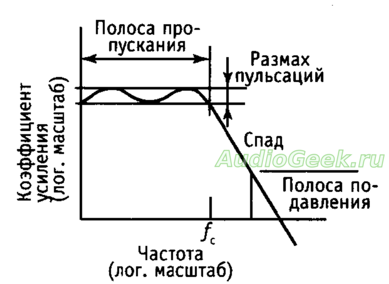
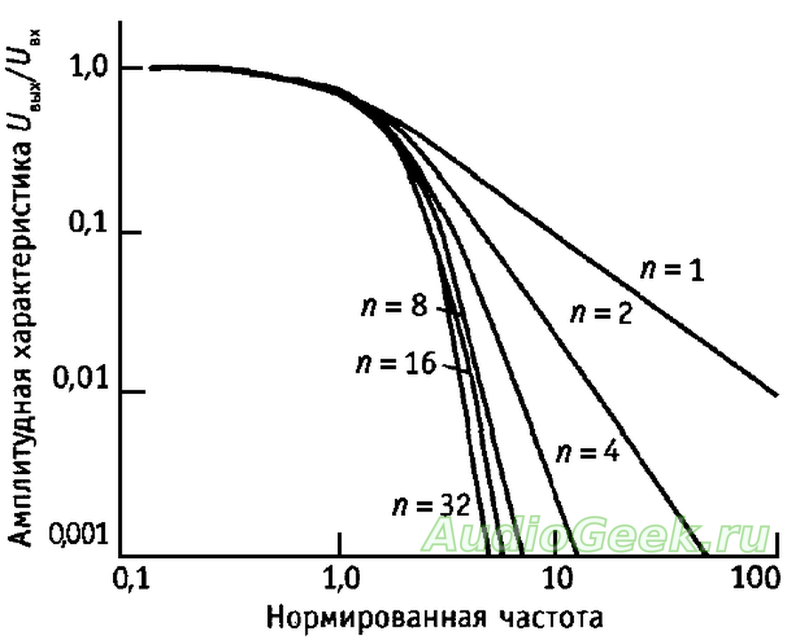
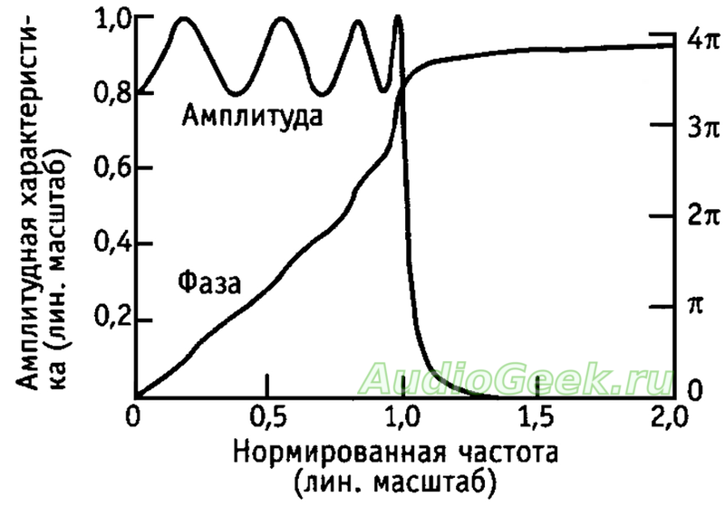
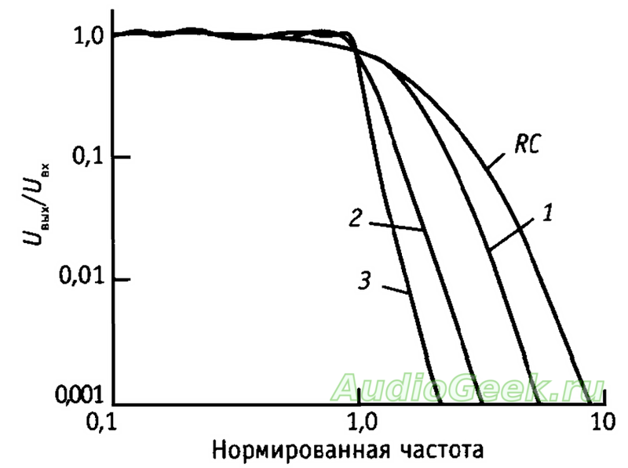
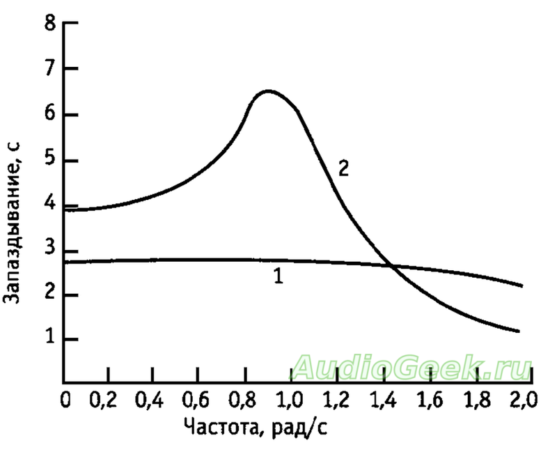

[English](./README.md) | **Русский**

# Фазово-частотная характеристика (ФЧХ) фильтров и звук

**Рубрики:** Схемотехника аудиотракта  
**Метки:** звуковые фильтры, качество звука  
**Оригинал:** https://audiogeek.ru/fazo-chastotnaya-harakteristika-filtrov/

---

Цепи аналогового сигнала просто невозможно представить без различных фильтров. Фильтры существуют разные и для разных целей. Не будем влезать в дебри схемотехники, а рассмотрим как фильтры Чебышева, Баттерворта и Бесселя влияют на фазовую характеристику(ФЧХ) переменного сигнала. И кто из них лучше для звука и почему.
Чтобы не возникало разногласий, будем придерживаться общепринятой терминологии. Поэтому перед тем как начать, предлагаю для начала взглянуть на следующую картинку:

А затем прочитать отрывочек из ***[Википедии](https://ru.wikipedia.org/wiki/%D0%A4%D0%B0%D0%B7%D0%BE-%D1%87%D0%B0%D1%81%D1%82%D0%BE%D1%82%D0%BD%D0%B0%D1%8F_%D1%85%D0%B0%D1%80%D0%B0%D0%BA%D1%82%D0%B5%D1%80%D0%B8%D1%81%D1%82%D0%B8%D0%BA%D0%B0)***:
> ***Фазочастотная характеристика (ФЧХ) —** это зависимость разности фаз между выходным и входным сигналами от частоты сигнала, функция, выражающая (описывающая) эту зависимость, также — график этой функции.*

Для однозначности так же будем считать, что у нас Фильтр Низких Частот (ФНЧ). Все то же самое относится и к фильтру высоких частот.

## **Порядок фильтра**

Обычно, когда встает вопрос о создании фильтра, первым делом необходимо определиться с тем, какая нужна крутизна спада. Она напрямую определяет порядок фильтра. Чем выше порядок ФНЧ, тем круче будет спад частотной характеристики выше частоты среза.

> ***Для удобства, на этом и последующих графиках приводится нормированная частота. Т.е. как если бы все частоты были поделены на частоту среза фильтра.***

Но чем выше порядок фильтра - тем сложнее он будет в реализации и капризнее в настройке. При этом, чем выше порядок, тем худшее воздействие он будет оказывать на частотные и/или фазовые характеристики сигнала.
Обычно, когда нужен фильтр высокого порядка, для упрощения схемотехники и расчетов, прибегают к последовательному включению двух, трех и более фильтров второго порядка. Это конечно облегчает задачу, но при таком включении требуется либо разные коэффициенты усиления каждого фильтра, либо разные частоты среза. Но это уже выходит за рамки данной статьи.

## **Влияние фильтра на ФЧХ**

Влияние фильтра на фазовую характеристику сигнала не менее значимо, чем его влияние на АЧХ. Для звуковых сигналов влияние ФЧХ фильтра на сигнал может оказаться решающим при выборе типа фильтра.
Не считая активного элемента (транзистора или микросхемы), активные фильтры, обычно, строятся на RC цепях. Каждая RC цепь - это полюс фильтра, перегибающий АЧХ в нужном нам направлении. Но одновременно с этим, каждая RC - цепь вносить конечную временную задержку в сигнал.
Такая задержка приводит к тому, что сигнал после фильтра будет сдвинут по фазе относительно исходного сигнала. Вся проблема заключается в том, что эта задержка может быть различна для разных частот.
**Это касается любого фильтра**. Но разница между типами фильтров в том, что они имеют разную фазово-частотную характеристику  и разную крутизну среза.

## **Фильтра Чебышева и звук?**

Начнем с фильтра Чебышева. Он имеет самый резкий спад частотной характеристики. Но вносимый им фазовый сдвиг сильно меняется во всей полосе пропускания. По этой причине фильтр Чебышева не применяется в высококачественных звуковых цепях.
Но это не единственный минус. Фильтра Чебышева так же имеет и большую неравномерность АЧХ в полосе пропускания. При этом сумма максимумов и минимумов равна порядку фильтра
На следующем графике приведены амплитудно-частотные (левая шкала) и фазово-частотные (правая шкала) характеристики для фильтра Чебышева 8-го порядка. Все тоже самое свойственно и фильтрам Чебышева более низких порядков.

## **Минимальное влияние на ФЧХ**

Амплитудно частотная характеристика (АЧХ) фильтра Бесселя (он же Томпсона) линейна во всей полосе пропускания. Но его главным достоинством, является отсутствие вносимых фазовых искажений. Т.е. для всех частот в полосе пропускания задержка одинакова.
В плане ФЧХ он идеален для применения в звуковых цепях. Но его ложкой дегтя является самый пологий спад среди всех фильтров. Более пологий спад имеет только обычная ***[RC-цепь](../rc-circuit/)***.
На следующем рисунке приводится сравнение крутизны срезов фильтров разного типа: 1- Бесселя, 2 - Баттерворта, 3-Чебышева *(неравномерность 0.5 дБ)*.

***[Фильтр Баттерворта](../second-order-low-pass-filter/)*** имеет близкие характеристики к фильтру Бесселя, но у него более крутой спад АЧХ. За это приходится расплачиваться неодинаковостью запаздывания для разных частот..
Зависимость времени запаздывания сигнала от частот для фильтров Бесселя(1) и Баттерворда(2) второго порядка, нормированных по частоте, показаны на следующем рисунке:

Обратите внимание что на графике показана циклическая частота (омега). Для перевода в герцы необходимо умножить ее на 2π. Помимо этого используется линейный а не логарифмический масштаб по оси Х.
Но все же, фильтр Баттерворда не так уж плох. Хотя я бы не рекомендовал использовать его в звуковых цепях. Или же следует выбирать более высокую частоту среза, чтобы фазовые искажения в нужном диапазоне были минимальны. Но на практике такое не всегда возможно.

## **Заключение**

Как же получить фильтр с минимальным воздействием на ФЧХ? Этим вопросом я озадачился при выборе восстанавливающего фильтра для ЦАПа. Отличным решением стал фильтр на гираторах. Этот фильтр был подробно описан в ***[отдельной статье](../filtri-na-gyratorah/)***. Рассмотренный там фильтр является промежуточным между фильтрами Бесселя и Баттерворта и имеет весьма интересные как фазовые так и частотные характеристики.

***Материал подготовлен исключительно для сайта** **[AudioGeek.ru](https://github.com/SkyTrip-13/AudioGeek)***
