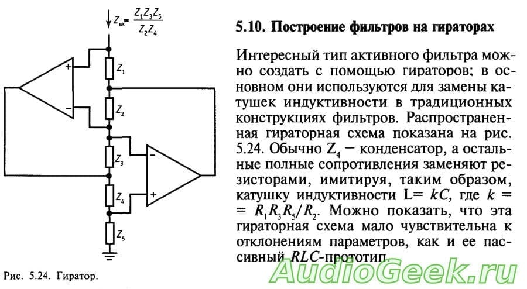
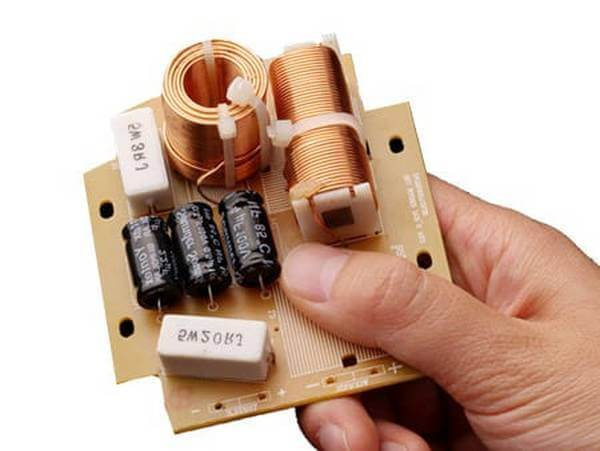
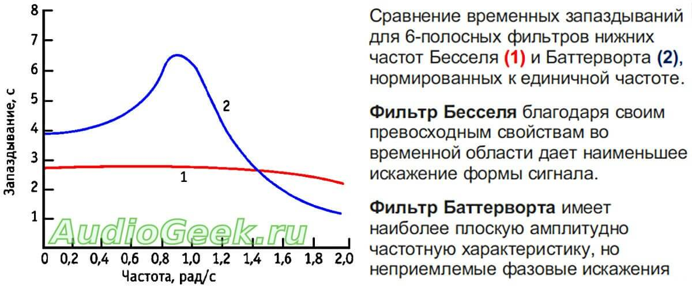
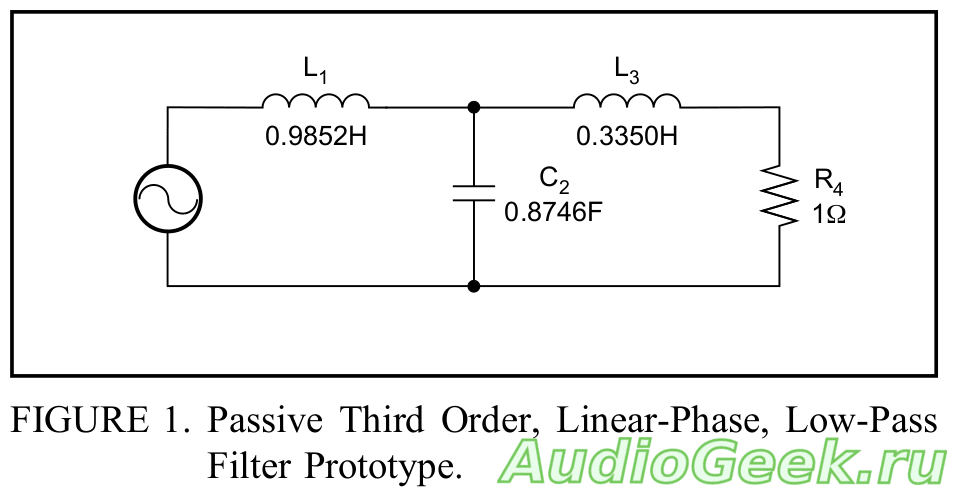
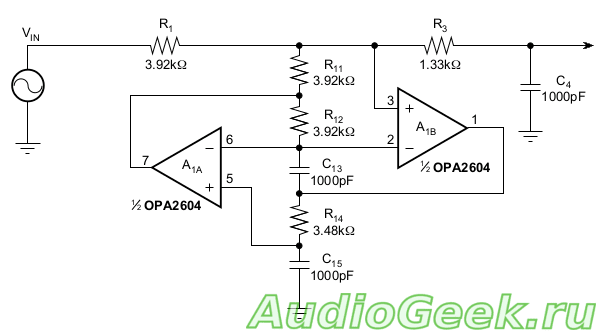
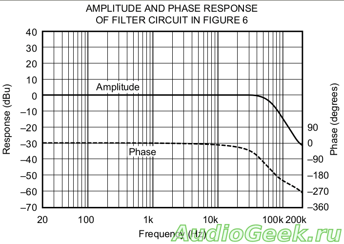
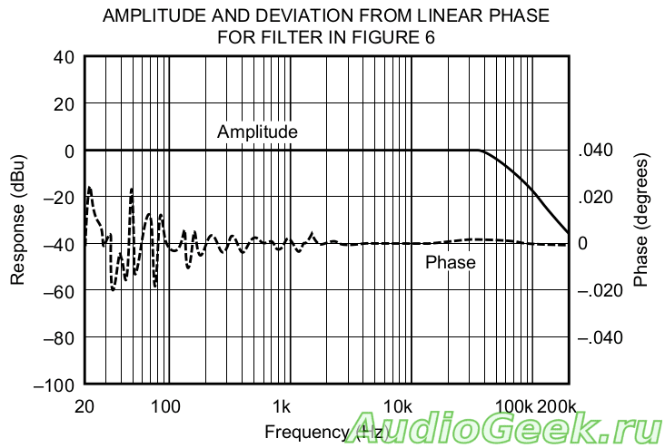
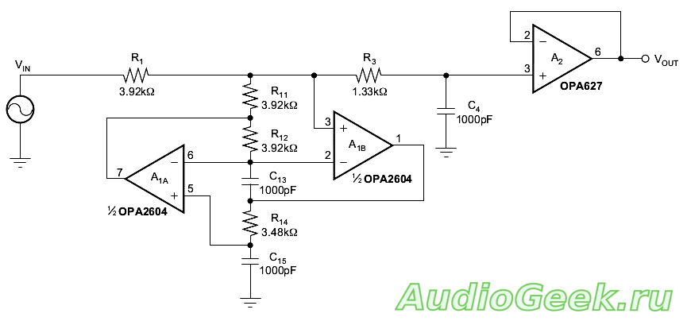
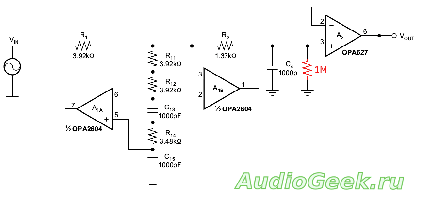

[Русский](./README.ru.md) | **English**

# A gyrator low-pass filter for DACs and ADCs

**Published:** 2018-12-28  
**Category:** Audio circuit design  
**Tags:** audio filters, op-amp circuit, DAC  
**Original:** https://audiogeek.ru/filtri-na-gyratorah/

---

Every music lover who has delved into DACs knows that a low-pass filter at the converter output is absolutely necessary. Let us look at an interesting low-pass filter option for DACs based on gyrators. You will also find a similar filter for ADCs.

## A reconstruction filter for a DAC

The DAC output signal contains a lot of digital junk. It lies above the audible frequencies, but it harms the audible range too. To cut off the extra frequencies and satisfy the ***[sampling theorem](../chastota-diskretizacii-teorema-kotelnikova/)*** a low-pass filter is needed.

There are many kinds of filters, but far from all of them can do the job without spoiling the sound.

To be exact, no analog filter can do it perfectly. But you can come very close to the ideal. Today's article tells how.

## What is a gyrator?

In Russian-language literature the topic of gyrator filters is extremely rare, and there is very little information. Usually it says something like "a gyrator can turn a capacitor into an inductor" and gives the general gyrator circuit.

This is the little that is known about gyrator filters from Horowitz and Hill's "The Art of Electronics":

A gyrator really can turn a capacitor into a coil. It is most often used by IC designers when an inductance is needed, with the gyrator placed directly on the chip.

For hobbyists the good news is that a gyrator works stably even with not very accurate components. Though of course it is better to use precision parts.

In English-language literature gyrator filters are widely discussed and used. One of the most interesting applications is gyrator filters for DACs and ADCs.

## The gyrator filter

In the depths of Burr-Brown documentation I found a very interesting document, **AB-026**. It describes how they build gyrator filters for DAC and ADC demonstration boards.

> ***[Download Burr-Brown document AB-026](./AB-026_-AudioGeek.ru.pdf)*** (~75 KB)

Their documentation is good. Not long ago I found their ***[headphone amplifier circuit](../headphone-amp-dual-current/)*** too.

Burr-Brown recommends a third-order gyrator filter for DACs and a 6th-order gyrator filter for ADCs.

This article covers only the third-order filter, because a 6th-order filter is just two third-order filters in series.

We will look at the circuit a bit later, and first see why this is needed at all.

## Why not a coil?

Why go to all this trouble to replace inductors? The problem is that besides inductance every coil has parasitic parameters such as resistance and capacitance. And that is not even counting the accuracy of the inductance value and the dependence of all parameters on external conditions, such as temperature.

Also, to get enough inductance, coils are wound on a core. For miniaturization, ferrite is used more often than anything. Air-core coils, because of their size, are not usable in portable devices at all.

Another problem is that the core may have a nonlinear dependence of magnetization on the current through the coil. And depending on composition, ferrite may be a low-frequency or a high-frequency type...

In short, if possible, coils are best avoided, especially in signal paths. In this respect a gyrator built on an op-amp is a much better alternative.

## Bessel or Butterworth

Since the gyrator filter is an analog of a passive RLC filter, any filter type's transfer characteristic can be realized with it. Of all filters, the Bessel is the most suitable for audio in terms of its transfer characteristic.

Its whole beauty is a linear phase response. The main drawback is that its roll-off is too gentle. The ***[Butterworth filter](../second-order-low-pass-filter/)***, by contrast, has a steeper roll-off but a much worse phase response.

When gyrator filters are designed, a passive RLC prototype is taken as the basis. The Burr-Brown engineers did the same. After simulating various passive RLC filters, they settled on a circuit with a transfer characteristic between Bessel and Butterworth.

This variant has a steeper roll-off than Bessel, but not as sad a phase response as Butterworth. They then created an equivalent active circuit with a gyrator and brought the component values to convenient standard values.

## A 3rd-order gyrator filter for a DAC

So, we have dealt with the questions that arise first. Now let us finally move on to the circuit itself. It is shown in the next figure.

The phase response at the output of the resulting filter still bends slightly toward the end. So the cutoff frequency was chosen so that phase distortion in the audible range is minimal.

The cutoff frequency was chosen as 40 kHz. With that, the phase distortion in the 1–10 kHz range, for this circuit, was under 0.1%. That is the most audible frequency range. The bend at 10–20 kHz is minimal. This is a superb result for a filter in audio circuits.

The next graph shows the amplitude response after the filter and the relative phase error (the small ripples of the phase response). The large phase error swings at low frequencies are actually only 0.02 degrees. And in that range our ear is practically insensitive to phase distortion anyway.

Another advantage of a gyrator filter for audio is that the signal does not pass directly through the op-amp. The op-amp contributes to the sound but has less influence than in ordinary active filters.

Nevertheless, the quality of the op-amp, like the quality of all the other components, still matters a lot.

In the author's version AD8066 op-amps were used. These are precision high-speed op-amps with a bandwidth of up to 145 MHz and a slew rate of 180 V/µs. They are often praised on forums for their "sound" too, and they performed excellently here as well.

## Matching the filter to other stages

The output impedance of the filter is fairly high. To match the next stage, a buffer is highly desirable. It can be a buffer amplifier or an op-amp connected as a follower. The documentation suggests the OPA627 for this.

In my case half of an OPA2134 acted as the buffer. The other half of that chip was used in the ***[current-to-voltage converter for the DAC output](../i-u-preobrazovatel-na-rezistore/)***. By the way, the signal comes to the filter from there.

## And then something went wrong...

After building the circuit in hardware, it turned out that within 5–10 seconds of switching on, the signal at the buffer output drifted up to the positive supply voltage. And of course after that the circuit produces nothing interesting.

In my case there is a coupling capacitor before the filter and an op-amp follower after it. As a result, the op-amps had no DC connection to ground. All connections to ground are only through capacitors, that is, only for AC.

As a result the capacitors charge and the circuit stops working the way we want. To fix it, it was enough to put a 1 MΩ resistor from the filter output to ground.

As for sound quality, I have no complaints about the filter. Various filters were tried before it, including a plain ***[RC circuit](../rc-circuit/)*** in the op-amp feedback and a ***[2nd-order Butterworth filter](../second-order-low-pass-filter/)***, which turned out to be unusable for audio circuits.

## Conclusion

Although the circuit looks big and unusual, this filter is definitely worth the time and money spent on it. It really did turn out to be an excellent low-pass filter for a DAC.

> **The filter was built and has been working great in a portable player for several months. More here:** ***[A high-quality audio path: a complete mod of the HiFiMan HM-601 player](../hifiman-hm-601-full-mod/)***.

*Originally written for [AudioGeek.ru](https://audiogeek.ru). Translated from Russian.*
