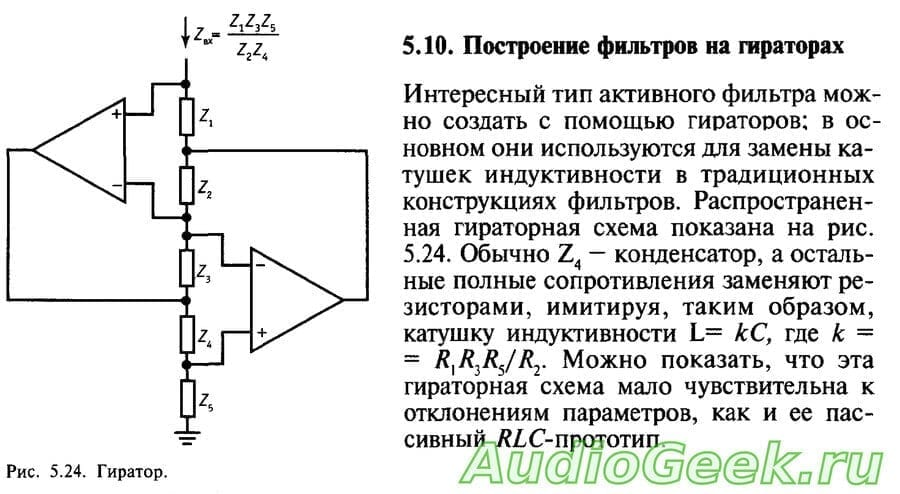
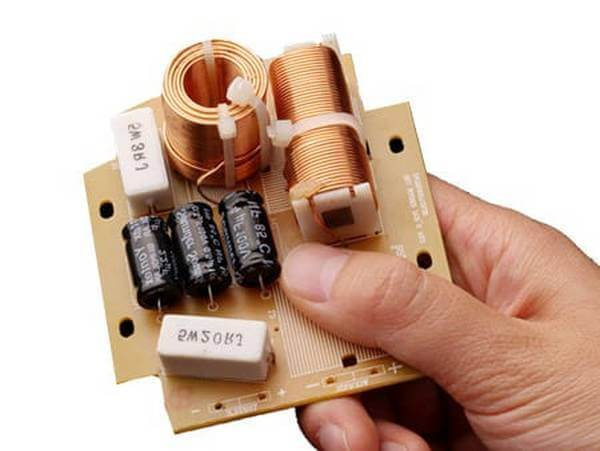
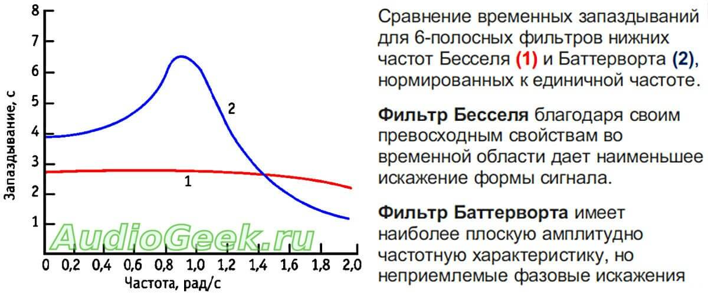
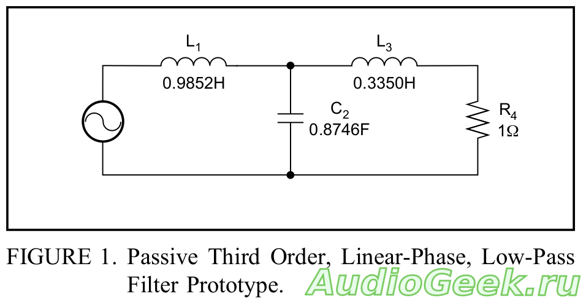
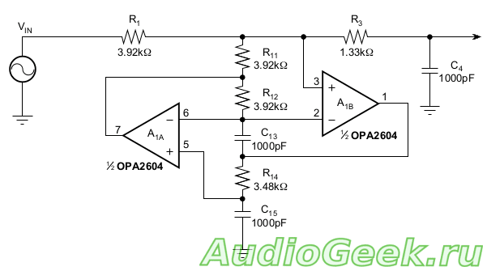
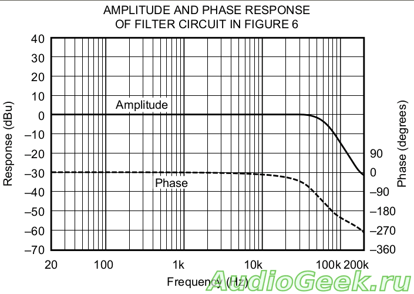
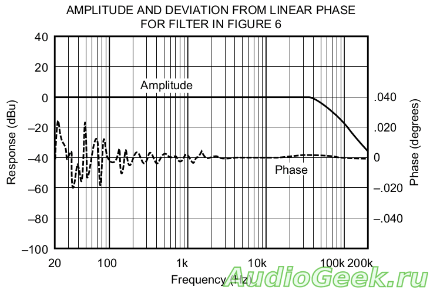
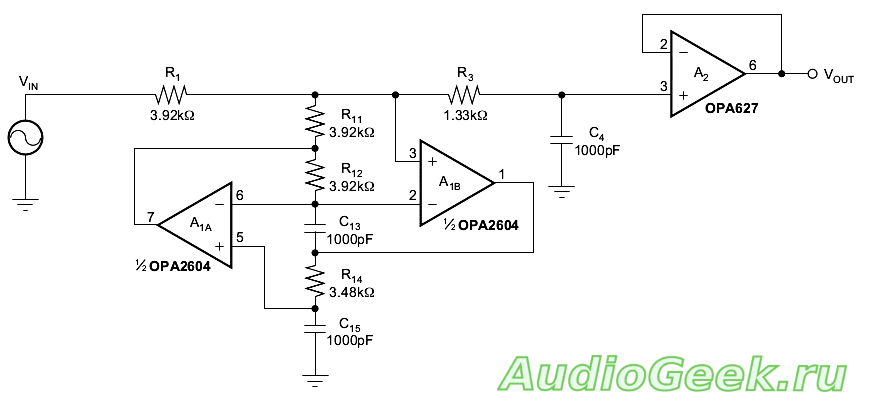
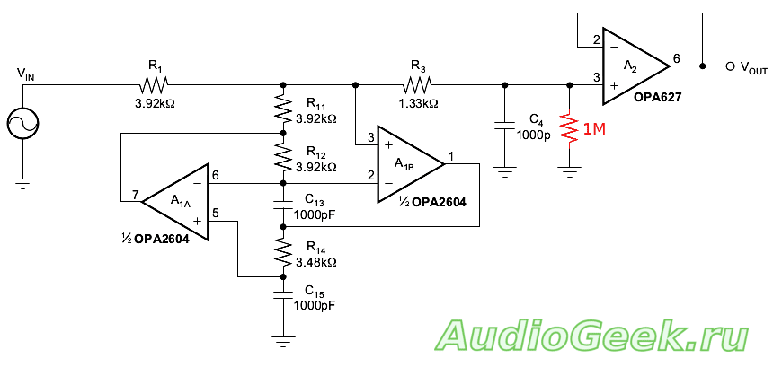

[English](./README.md) | **Русский**

# Фильтр низких частот для ЦАП и АЦП на гираторах

**Дата:** 2018-12-28  
**Рубрики:** Схемотехника аудиотракта  
**Метки:** звуковые фильтры, схема на ОУ, ЦАП  
**Оригинал:** https://audiogeek.ru/filtri-na-gyratorah/

---

Каждый меломан, углубившийся в тему ЦАПов знает, что на выходе преобразователя крайне необходим фильтр низких частот. Рассмотрим интересный вариант ФНЧ для ЦАП на гираторах. Так же Вы найдете аналогичный фильтр и для АЦП.

## Восстанавливающий фильтр для ЦАП

Выходной сигнал ЦАП содержит много цифрового хлама. Он лежит выше слышимых частот, но пагубно влияет и на слышимый диапазон. Для отсечения лишних частот и соблюдения ***[теоремы Котельникова](../chastota-diskretizacii-teorema-kotelnikova/)*** необходим ФНЧ.
Существует довольно много разновидностей фильтров, но далеко не каждый из них способен справиться с поставленной задачей не испортив при этом звука.
Если быть уж совсем точным, то сделать это идеально не способен ни один аналоговый фильтр. Но к идеалу можно очень хорошо приблизиться. О том, как это сделать и расскажет сегодняшняя статья

## Что такое гиратор?

В русскоязычной литературе тема фильтров на гираторах встречается крайне редко. Информации кране мало. Обычно говорится что-то вроде: " гиратор способен превращать конденсатор в индуктивность" и приводится общая схема гиратора.
Вот то немногое, что становится известно о фильтре на гираторах из книги П. Хоровиц и У. Хилла “Искусство схемотехники”:

Гиратор действительно умеет превращать конденсатор в катушку. Наиболее часто он используется разработчиками микросхем когда необходима индуктивность. При этом гиратор располагают непосредственно на кристалле микросхемы.
Для радиолюбителей хорошей новостью станет то, что гиратор стабильно работает и при не самых точных используемых компонентах. Хотя конечно же лучше использовать прецизионные детали.
В англоязычной литературе фильтры на гираторах широко обсуждаются и применяются. Одним из наиболее интересных вариантов применения является фильтры на гираторах для ЦАП и АЦП.

## Фильтр на гираторах

В глубинах документации от Burr Brown был найден очень интересный документ **AB-026**. Он повествует о построении ими фильтров на гираторах для демонстрационных плат с ЦАП и АЦП.
> ***[Скачать документацию AB-026 от Burr Brown](./AB-026_-AudioGeek.ru.pdf)*** (~75kb)

Хорошая у них документация, не так давно у них же была найдена ***[схема усилителя для наушников](../headphone-amp-dual-current/)***.
Ребята из Burr Brown рекомендуют применять для ЦАП фильтр на гираторе третьего порядка, а для АЦП фильтр на гираторах 6-го порядка.
В статье будет рассмотрен только фильтр третьего порядка. Ибо фильтр 6-го порядка это два фильтра третьего порядка включенные последовательно.
Схему фильтра мы рассмотрим чуть позже, а пока рассмотрим зачем это вообще нужно.

## Почему не катушка?

Зачем напрягаться и городить огород ради замены катушек индуктивности? Проблема в том, что любая катушка помимо индуктивности обладает такими паразитными параметрами, как сопротивление и емкость. И это уже не говоря о точности величины индуктивности и зависимости всех параметров от внешних условий, например от температуры..
Помимо этого, для получения достаточной индуктивности, катушки мотаются на сердечник. Для миниатюризации чаще других применяется феррит. Катушки без сердечника из-за своих габаритов в портативе не применимы в принципе.

Проблемой является и то, что сердечник может иметь нелинейную зависимость намагничивания от величины тока протекающего через катушку. Да и в зависимости от состава, феррит может быть как низкочастотным, так и высокочастотным...
Вобщем, если есть возможность, то от катушек стараются избавляться, тем более в сигнальных цепях. Гиратор на ОУ в этом плане - гораздо более качественная альтернатива.

## Фильтр Бесселя или Баттерворта

Так как фильтр на гираторе является аналогом пассивного RLC фильтра, то на нем может быть реализована проходная характеристика любого типа фильтра. Из всех фильтров наиболее подходящим для звука по проходной характеристики является фильтр Бесселя.
Вся его прелесть в том, что он имеет линейную фазовую характеристику. Главный минус же в том, что у него слишком пологий спад частотной характеристики. ***[Фильтр Баттерворта](../second-order-low-pass-filter/)*** же напротив, имеет более крутой спад АЧХ, но гораздо худшую фазовую характеристику.

Когда рассчитываются фильтры на гираторах, то за основу берется пассивный RLC прототип. Так же поступили и инженеры из Burr Brown. Промоделировав разные пассивные RLC фильтры они определились со схемой, выбрав вариант с проходной характеристикой между фильтром Бесселя и Баттерворта.

Такой вариант имеет более крутой спад, чем фильтр Бесселя, но не настолько печальную фазовую характеристику как фильтр Баттерворта. Затем они создали аналогичную активную схему с гиратором. После чего привели величины деталей к удобным номиналам.

## Фильтр 3-го порядка для ЦАП на гираторе

Итак, разобрались с вопросами, возникающими в первую очередь. Теперь наконец перейдем к самой схеме. Она представлена на следующем рисунке.

Фазовая характеристика на выходе получившегося фильтра все же немного загибается к концу. Поэтому частота среза была выбрана такой, чтобы в слышимом частотном диапазоне фазовые искажения были минимальными.
Частота среза была выбрана равной 40 кГц. При этом фазовые искажения в диапазоне 1-10кГц, для указанной схемы, составили менее 0.1%. А это самый слышимый частотный диапазон. Загиб на частотах 10-20кГц минимален. Это потрясающий результат для фильтра в звуковых цепях.

На следующем графике приведена АЧХ сигнала после фильтра и относительная ошибка фазы (мелкие коллебания фазовой характеристики). Большие колебания ошибки фазы в области низких частот на самом деле составляют лишь 0.02 градуса. Да и в этом диапазоне наше ухо к фазовым искажениям практически не чувствительно.

Еще одним плюсом применения фильтра на гираторе для звука является то, что сигнал не проходит непосредственно через операционный усилитель. ОУ лишь вносит свой вклад в звук, но влияет меньше, чем в случае обычных активных фильтров.
Тем не менее качество операционного усилителя, как и качество всех остальных компонентов все равно имеет большое значение.
В авторском варианте были использованы AD8066. Это прецизионные скоростные ОУ с частотой пропускания до 145МГц и скоростью нарастания сигнала 180 В/мкс. На форумах эти ОУ часто хвалят и за их "звуковые" свойства. Они прекрасно продемонстрировали себя и в этой роли.

## Согласование фильтра с другими каскадами

Выходное сопротивление фильтра достаточно велико. Для согласования со следующим каскадом крайне желательна установка буфера. Это может быть как буферный усилитель, так и ОУ, включенный по схеме повторителя. В документации для этих целей предлагается OPA627.

В моем случае в роли буфера выступила половина OPA2134. Вторая половина этой микросхемы участвовала в ***[преобразователе ток-напряжение выходного сигнала ЦАПа](../i-u-preobrazovatel-na-rezistore/)***. С него, кстати, сигнал и поступает на фильтр.

## И тут что-то пошло не так...

После воплощения схемы в железе, выяснилось, что сигнал на выходе буфера за 5-10 секунд после включения доходит до положительного напряжения питания. Ну и само собой, дальше схема ничего интересного не выдает.
В моем случае перед фильтром стоит разделительный конденсатор. А после фильтра - повторитель на ОУ. При этом возникла ситуация, что нет привязки операционных усилителей к земле по постоянному напряжению. Все соединения с землей идут только через конденсаторы, т.е. по переменному напряжению.
Как результат, конденсаторы заряжаются и схема перестает работать, как нам бы этого хотелось. Для решения проблемы оказалось достаточным установить постоянный резистор величиной в 1 МОм с выхода фильтра на землю.

Что касается качества звука, то тут никаких претензий к фильтру нет. До него были опробованы разные варианты фильтров, среди которых просто ***[RC цепь](../rc-circuit/)*** в ОС ОУ и ***[фильтр Баттерворта 2-го порядка](../second-order-low-pass-filter/)***, который для звуковых цепей оказался неприменим.

## Заключение

Хоть схема и выглядит большой и необычной, на самом деле этот фильтр точно стоит потраченных на его изготовление времени и денег. Он и правда оказался отличным ФНЧ для ЦАПа.
> **Фильтр был собран и уже несколько месяцев отлично работает в портативном плеере. Подробнее тут:** ***[Высококачественный аудиотракт или полный мод плеера HiFiMan HM-601](../hifiman-hm-601-full-mod/)***.

### *Материал подготовлен исключительно для сайта* [AudioGeek.ru](https://audiogeek.ru)
