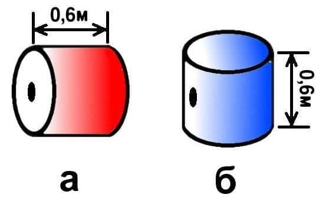
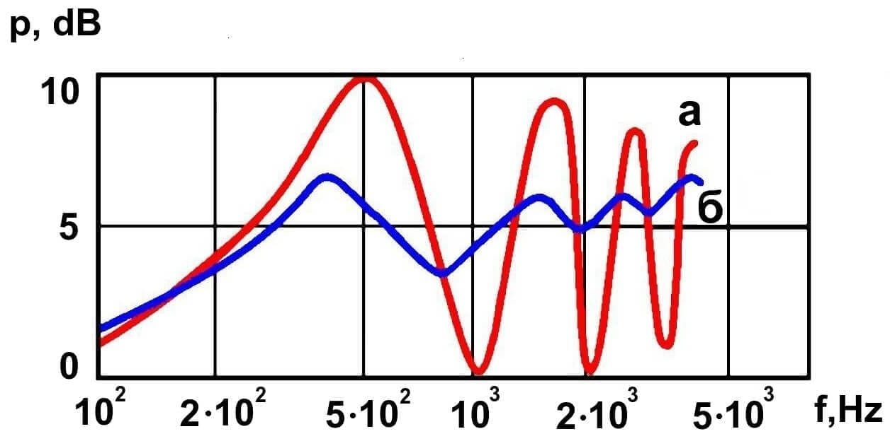
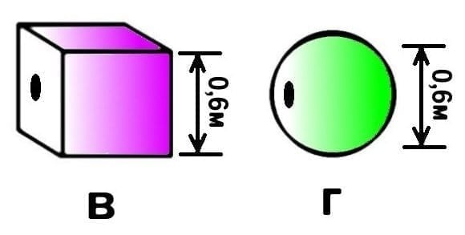
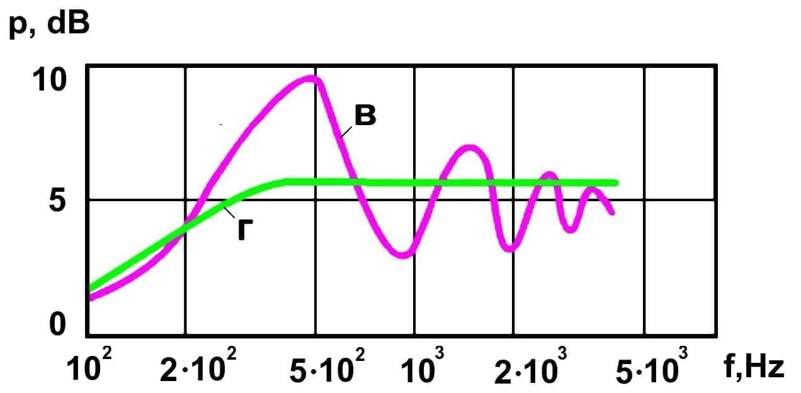

[Русский](./README.ru.md) | **English**

# A round speaker sounds better than a square one

**Category:** Speaker basics  
**Tags:** sound quality  
**Original:** https://audiogeek.ru/forma-as/

---

Today you can find speakers of almost any shape. But how does that affect the sound? Let us look at the main shapes of loudspeaker enclosures and why a round speaker will sound better than a square or cylindrical one.
The final **f**requency **r**esponse of a **l**oudspeaker **s**ystem is affected by many factors: the driver's frequency response, its Q factor, the chosen enclosure type and material, damping and so on. But today we will look at one more interesting nuance that adjusts the final frequency response: **the shape of the enclosure.**

## What the shape of the enclosure affects

The outside shape of the speaker itself does not matter much; what matters is that it determines the shape of the internal volume. At low frequencies the linear dimensions of the enclosure are smaller than the wavelength of the sound, so the shape of the internal volume does not matter.
At mid frequencies, however, diffraction effects make a significant contribution. For simplicity, a closed enclosure is assumed below.
> **Diffraction effects here mean the mutual reinforcement and cancellation of reflected and direct sound waves inside the speaker.**

Sharp corners, recesses and protrusions hurt the frequency response of speakers. That is where the unevenness of the sound field is greatest.
Rounding and smoothing, on the other hand, have a positive effect on the shape of the response. To be more precise, rounder shapes have the least effect on the linearity of the response.

## Frequency response of cylindrical speakers

**The worst** results come from an enclosure in the form of a horizontal cylinder (**fig. a**)

> **The position of the center of the driver is shown conventionally by a dot.**

The frequency response unevenness of the speaker in **figure a** reaches 10 dB at the first maximum (~500 Hz). This is because the wavelength is comparable to the linear dimensions of the enclosure. The following maxima correspond to twice, three times, etc. that frequency.

This picture arises from reflections between the front (*with the driver*) and rear walls of the enclosure. That produces an interference pattern between them. The specific frequencies of the maxima and minima depend on the real dimensions of the speaker.

A speaker shaped like a cylinder but with the driver on the side panel (**fig. b**) has a more even frequency response. The front panel here creates a scattered field in the internal volume. The top and bottom walls have little effect because they are not on the same axis as the radiator.

## Round speaker and square speaker

A cube-shaped enclosure (**fig. c**) also produces a very uneven frequency response. Here a similar interference pattern arises.

The least influence on the shape of the response comes from a spherical enclosure (**fig. d**). In an enclosure of this shape sound is scattered equally in all directions.

However, making a round speaker is quite labor-intensive. Though modern materials such as plastics make the task easier.

But plastic is still not the best material for the enclosure of a high-quality loudspeaker.

## How to improve the sound of a non-round speaker

Mastics give a positive result. If you apply such materials in the corners and joints, they become rounded. Thanks to this the frequency response of the speaker becomes more linear.

Damping the internal volume with absorbing materials is also used to improve the response. They absorb extra sound waves, so there are fewer re-reflections.

Even a spherical enclosure, which has the best frequency response, has a rolloff in the low-frequency region. The most effective solution to this problem may be ***[using a passive radiator to lift the low-frequency region](../passivniy-izluchatel/)***.

*Originally written for [AudioGeek.ru](https://audiogeek.ru). Translated from Russian.*
