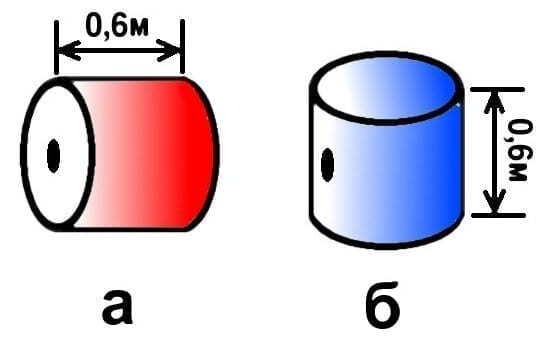
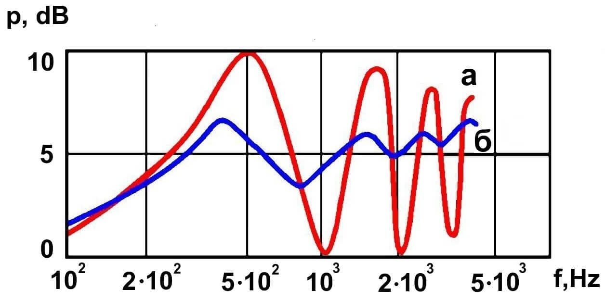
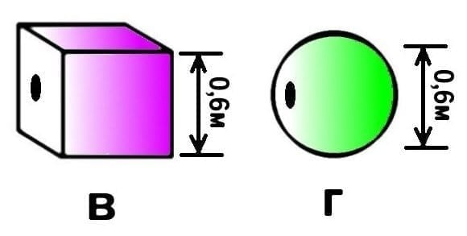
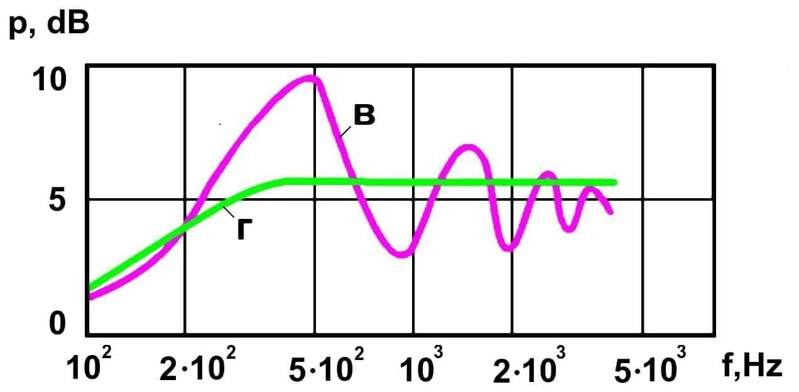

[English](./README.md) | **Русский**

# Круглая колонка звучит лучше чем квадратная колонка

**Дата:** 2017-01-03  
**Рубрики:** Общие вопросы по АС  
**Метки:** качество звука  
**Оригинал:** https://audiogeek.ru/forma-as/

---

Сегодня можно встретить колонки практически любой формы. Но как это влияет на звук. Рассмотрим основные формы акустически систем, и то почему круглая колонка будет звучать лучше чем квадратная или цилиндрическая.
На итоговую **А**мплитудно - **Ч**астотную **Х**арактеристику (**АЧХ**) **А**кустической **C**истемы (**АС**) влияет множество факторов. Это и АЧХ динамика, его добротность, выбранный тип и материал корпуса, демпфирование и т.д. и т.п.. Но сегодня рассмотрим еще один интересный нюанс, вносящий корректировку в конечную АЧХ - **форма акустической системы.**

## На что влияет форма АС

Сама по себе форма колонки снаружи особого значения не имеет, важно то, что она определяет форму внутреннего объема АС. На низких частотах линейные размеры корпуса меньше длины волны звука, поэтому форма внутреннего объема значения не имеет.
А вот на средних частотах дифракционные эффекты вносят существенный вклад. Для упрощения далее подразумевается закрытая акустическая конструкция.
> **Под дифракционными эффектами подразумевается взаимное усиление и гашение отраженных и прямых звуковых волн внутри колонки.**

На АЧХ колонок отрицательно сказываются острые углы, впадины и выступы. На них неравномерности звукового поля максимальны.
А вот скругления и разравнивания оказывают положительное влияние на форму АЧХ. Если быть более точным, то более округлые формы оказывают минимальное воздействие на линейность АЧХ.

## Цилиндрические колонки АЧХ

**Самые худшие** результаты дает корпус в виде горизонтального цилиндра (**рис. а**)

> **Положение центра излучающей головки условно изображено точкой.**

Неравномерность АЧХ колонки, показанной на **рисунке а** достигает 10 дБ на первом максимуме (~500Гц). Связанно это с тем, что длина волны сопоставима с линейными размерами корпуса. Следующие максимумы соответствуют удвоенной, утроенной и т.д. частотам.

Такая картина возникает из-за отражения между передней (*с динамиком*) и задней стенок корпуса. Это приводит к возникновению интерференционной картины между ними. Конкретные частоты максимумов и минимумов зависят от реальных размеров колонки.

АС имеющая форму цилиндра, но с динамической головкой на боковой панели (**рис. б**) имеет более равномерную АЧХ. Передняя панель в данном случае создает рассеянное поле во внутреннем объеме. Верхняя и нижняя стенки влияют мало, т.к. находятся не на одной оси с излучателем.

## Круглая колонка и квадратная колонка

Корпус кубической формы (**рис. в**) также создает сильно неравномерную АЧХ. В данном случае возникает близкая  интерференционная картина.

Самое минимальное влияние на форму АЧХ оказывает сферическая акустика (**рис. г**). В корпусе такой формы рассеяние звука происходит одинаково во всех направлениях.

Однако изготовление круглой колонки достаточно трудоемкий процесс. Хотя использование современных материалов, таких как пластмассы упрощает решение этой задачи.

Но все же пластик не самый лучший материал для корпуса высококачественной акустической системы.

## Как улучшить звук некруглой колонки

Положительный результат дает использование мастик. Если нанести такие материалы в углы и стыки, это приведет к их скруглению. Благодаря этому АЧХ колонок станет линейнее.

Так же для улучшения АЧХ применяется демпфирование внутреннего объема поглощающими материалами. Они гасят лишние звуковые волны, поэтому возникает меньше переотражений.

Даже сферическая акустика, обладающая наилучшей АЧХ имеет спад в низкочастотной области. Наиболее эффективным решением этой проблемы может стать ***[применение пассивного излучателя для подъема НЧ области](../passivniy-izluchatel/)***.

***Материал подготовлен исключительно для сайта* [AudioGeek.ru](https://audiogeek.ru)**
