[Русский](./README.ru.md) | **English**

# Audacity as a simple sound and noise generator

**Category:** Audio processing, Useful software  
**Tags:** Audacity  
**Original:** https://audiogeek.ru/generaciya-signalov-audacity/

---

If you have an idea that requires a sound generator, or a signal of a given shape and frequency, or one of the kinds of noise, then the simplest, fastest and most flexible solution may be the free cross-platform audio editor Audacity.

This audio editor has very broad capabilities and will more than satisfy the needs of the vast majority of users in terms of audio file processing, [**for example for isolating a voice and improving the quality of a voice recorder recording**](../kak-obrabotat-golos-audacity/) (the download link is there too). And of course, the fact that the program is absolutely free and works on Microsoft Windows, Linux and even Mac OS X cannot fail to please. That is why it is recommended to everyone: it is a worthy representative of open source.

> The screenshots show the Russian-language interface of Audacity. The English menu names are given in the text.

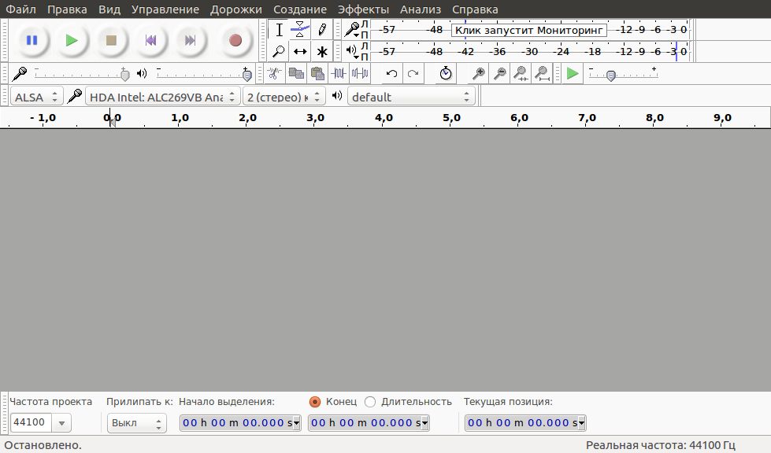

***This is how the program window looks after opening.***

**Sound generation**

Audacity can generate basic waveforms, noise types and signal bursts.

The signal generation options are hidden in the ***Generate*** menu

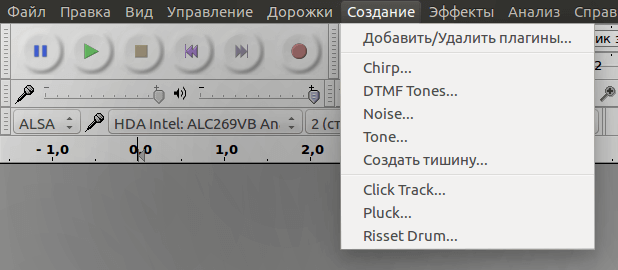

The three bottom items will not be covered in this article, because they create metronome clicks and drum-hit sounds. There is something interesting there too, and you can get a variety of sounds, but that is for another time; for now let us look at the main types of generation.

---

## ***Silence***

You can hardly call this generating a signal, since it generates the absence of a signal. An empty audio track of the chosen duration is created. If you select part of a track, the duration of the piece is filled in automatically.

This is handy when processing real recordings when you need to mute some piece. There is even a special button on the toolbar for quick access to this function. When you press it, no dialog pops up; the selected piece is muted right away.

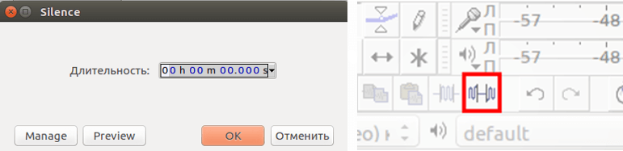

> *The button to its left does the opposite: it keeps only the selected piece and deletes what is around it.*

---

## ***Tone...***

The button that opens the menu for generating tonal signals, i.e. signals whose frequency, shape and amplitude are constant throughout their duration. This may be needed, for example, to **bleep out swearing in a recording**.

At the top is a drop-down list offering a choice of waveform. Among the common options only the triangle wave is missing.

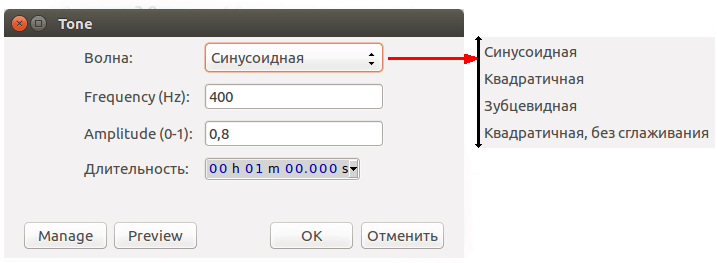

The frequency is set in the ***Frequency (Hz)*** field and can range from 1 to 22050 hertz. Fractional values are supported. As the name suggests, the ***Amplitude*** field sets the amplitude, i.e. the signal swing. The ***Duration*** field is already familiar.

It is worth noting that there are as many as two types of square wave: a regular one and a ~~*strange*~~ "Square, no alias" one. The "no alias" square wave is much more rounded and looks less like a square wave than the regular one. (In the Russian interface it is labeled "without smoothing", which is misleading. Apparently a translation error.)

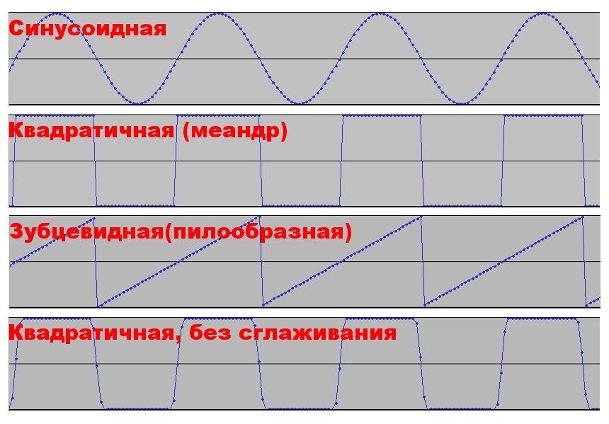

***The picture shows all four available waveforms generated for a frequency of 1 kHz and amplitude = 1 (0 dB)***

---

## ***Chirp...***

You can also create signals whose frequency and/or amplitude change continuously throughout their duration.

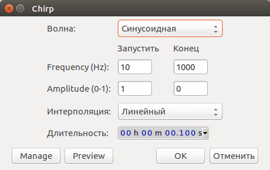

There are a few more input boxes here, but they are all familiar already, except for ***Interpolation***. Two interpolation options are available: linear and logarithmic. Interpolation determines how the frequency changes with time. For the parameters set in the picture, depending on the chosen interpolation type, the following signals will be generated:

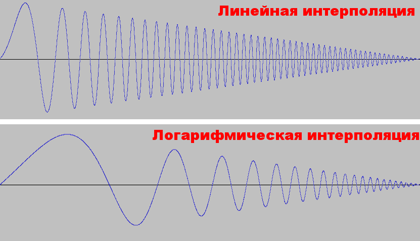

---

## ***DTMF Tones...***

The abbreviation stands for **D**ual-**T**one **M**ulti-**F**requency.

Signals are generated like those that sound when you press keys on a telephone keypad. In the ***Tone sequence*** field enter what you want to create such signals for. The ***Tone/silence ratio*** slider sets the durations of the tones and pauses. At 50% the tone duration equals the pause duration.

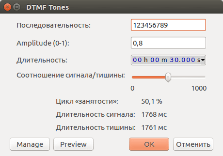

For the entered parameters, 9 dual-tone signals will be generated:

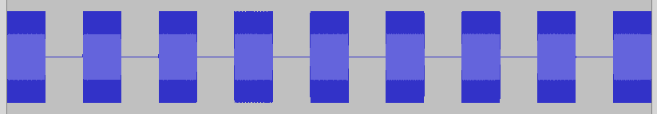

---

## ***Noise...***

Audacity can also generate noise.

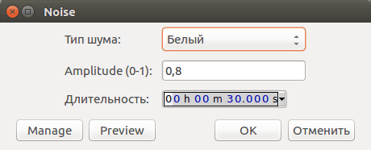

The list of available noise types includes White, Pink and Brownian.

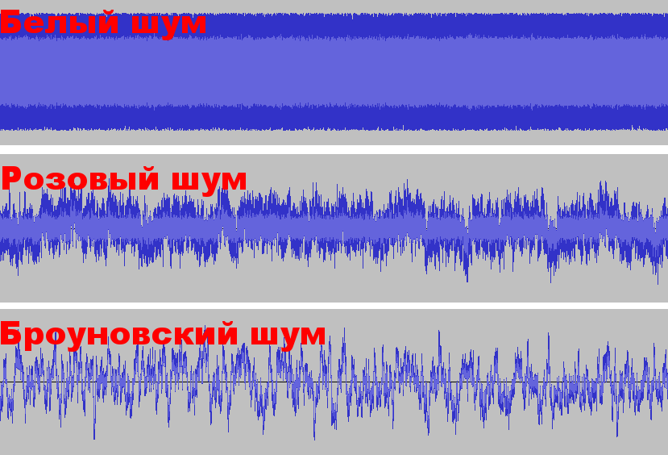

Noise is a separate interesting topic. In brief, white noise has equal intensity at all frequencies. Because of this it masks any other sounds better than the others. Pink noise and Brownian noise have an energy distribution that depends on frequency. At low frequencies the intensity is higher, and as the frequency rises it falls.

That is the solid capability the Audacity audio editor offers for generating various signals. You can generate practically any sound. If even that is not enough, no problem: you can dig into the plugins, of which there are very many, and you will surely find what you need there.

Good luck!

*Originally written for [AudioGeek.ru](https://github.com/SkyTrip-13/AudioGeek). Translated from Russian.*
