[English](./README.md) | **Русский**

# Программа Audacity как простой генератор звука и шума

**Дата:** 2017-03-26  
**Рубрики:** Обработка звука, Разный полезный софт  
**Метки:** Audacity  
**Оригинал:** https://audiogeek.ru/generaciya-signalov-audacity/

---

Если у Вас появилась какая-то задумка и для нее вам требуется генератор звука, либо сигнала заданной формы и частоты, либо один из видов шума, то самым простым, быстрым и гибким способом решения этой проблемы может стать использование бесплатного мультиплатформенного аудио редактора Audacity.

Данный аудио редактор имеет очень широкие возможности, и с лихвой удовлетворит запросы подавляющего числа пользователей в плане обработки аудиофайлов, [**например для выделения голоса и улушения качества диктофонной записи**](../kak-obrabotat-golos-audacity/) (там же ссылка на скачивание). Ну и конечно же, тот факт, что программа абсолютна бесплатна и работает как в Microsoft Windows так и в Linux и даже на Mac OS X не может не радовать. По этой причине она и предлагается для использования всем и каждому - это достойнй представитель опен сорса.

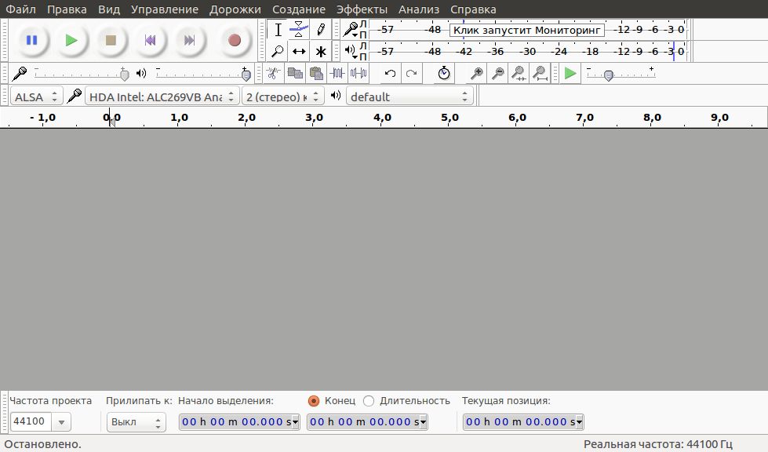

***Так выглядит окно программы после открытия.***

**Генерация звука**

Audacity позволяет генерировать основные формы сигналов, типы шумов и пакеты сигналов.

Варианты генераций сигналов спрятались в пункте меню ***Создание***

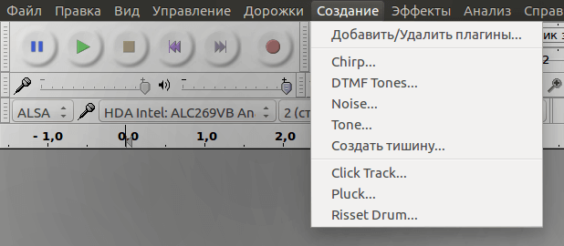

Три самых нижних строки в данной статье рассматриваться не будут, т.к. отвечают за создание щелчков метронома и звуков ударов по барабану. Там тоже есть свои интересности и можно получить разнообразные звуки. Но об этом в другой раз, а пока займемся рассмотрением основных типов генерации.

---

## ***Silence*** или ***Создать тишину***

Не сказать что это можно назвать генерацией сигнала, т.к. это генерация отсутствия сигнала. Создается пустая аудио дорожка выбранной длительности. Если выделить часть дорожки то длительность кусочка будет автоматически вписана.

Это удобно при обработке реальных записей, когда нужно заглушить какой-то кусочек. В панели инструментов есть даже специальная кнопочка для быстрого доступа к этой функции. При ее нажатии окошко не вылезет, а выделенный кусочек будет сразу заглушен.

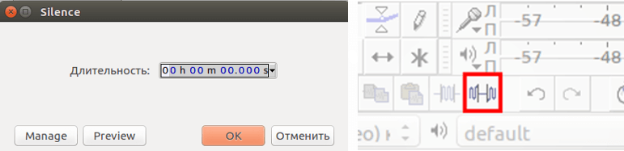

> *Кнопочка левее позволяет произвести обратное, т.е. оставить только выделенный кусочек и удалить то, что вокруг.*

---

## ***Tone...***

Кнопочка открывающая меню генерации тональных сигналов - т.е. сигналов, частота, форма и амплитуда которых постоянна на протяжении всей их длительности. Это может понадобиться например для того, чтобы **запикать мат в записи**.

Вверху располагается выпадающий список, с предложением выбрать форму сигнала. Среди распространенных вариантов не хватает только треугольной формы.

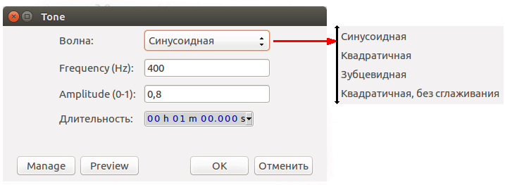

Частота задается в поле ***Frequency(Hz)*** и может лежать в интервале от 1 до 22050 Герц. Поддерживаются и дробные значения. Как и следует из названия, в поле ***Amplitude*** задается амплитуда, т.е размах сигнала. Ну а поле ***Длительность*** итак уже знакомо.

Стоит отметить, что меандра (квадратичной волны) есть аж два типа - один обычный, второй ~~*необычный*~~ без сглаживания. При этом меандр без сглаживания куда более сглажен и менее похож на меандр, чем обычный. Видимо ошибки перевода.

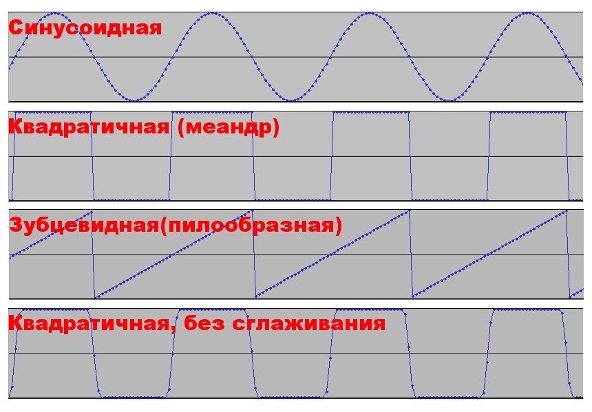

***На картинке все четыре доступные формы волны, сгенерированные для частоты 1кГц и амплитуды = 1 (0 дБ)***

---

## ***Chirp...***

Так же есть возможность создания сигналов частота и/или амплитуда которых непрерывно меняется на протяжении всей их длительности.

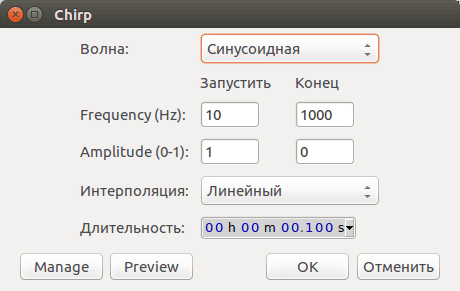

Окошек для ввода тут немного больше, но они все нам уже итак знакомы, за исключением ***Интерполяции***. Доступны два варианты интерполяции - линейная и логарифмическая. Интерполяция определяет то, как будет меняться частота со временем. Для параметров, заданных на картинке, в зависимости от выбранного типа интерполяции,  будут сгенерированы следующие сигналы:

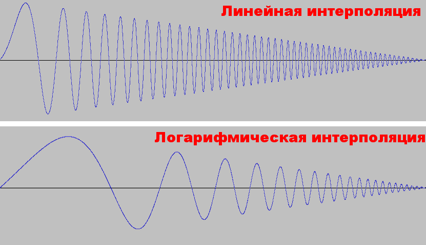

---

## ***DTMF Tones...***

Аббревиатура расшифровывается как **D****ual-****T****one** **M****ulti-****F****requency**что на русский можно перевести как двух-тональные множественные сигналы.

Генерируются сигналы, аналогичные тем, которые звучат при нажатии кнопок клавиатуры на телефонах. В поле ***Последовательность*** нужно ввести то, для чего мы хотим создать подобные сигналы. А ползунок ***Соотношения сигнала/тишины*** определяет длительности сигналов и пауз. В случае 50% длительность сигнала равна длительности паузы.

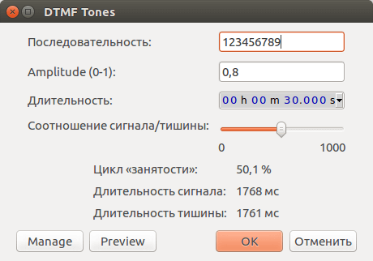

Для введенных параметров будет сгенерированы 9 двух-тональных сигналов:

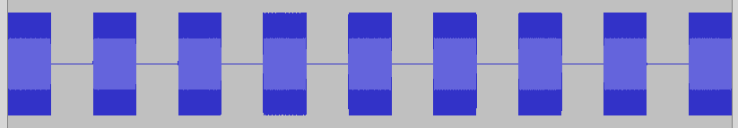

---

## ***Noise...***

Audacity так же позволяет генерировать и шум.

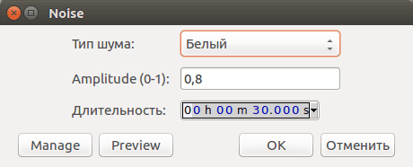

В список имеющихся типов шумов входят: Белый, Розовый и Броуновский(Brownian).

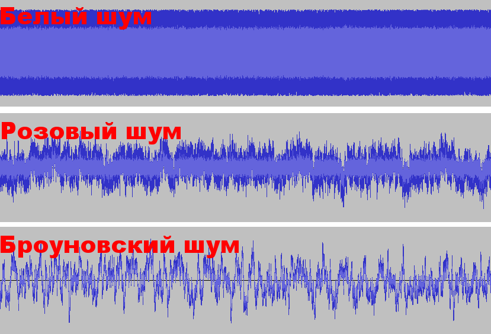

Шумы это отдельная интересная тема. Если вкратце, то Белый шум - это вид шума, имеющий одинаковую интенсивность на всех частотах. Благодаря этому он лучше остальных маскирует любые другие звуки. Розовый шум и броуновский шум имеют зависимость распределения энергии от частоты. На низких частотах интенсивность больше, а с ростом частоты она падает.

Вот такими солидными возможностями располагает аудио редактор Audacity в плане генерации различных сигналов. Можно сгенерировать практически любой звук. Если вам и этого мало, не беда, можно покопаться в плагинах, которых ооочень много и там вы обязательно найдете то, что нужно именно Вам.

Желаю удачи!
