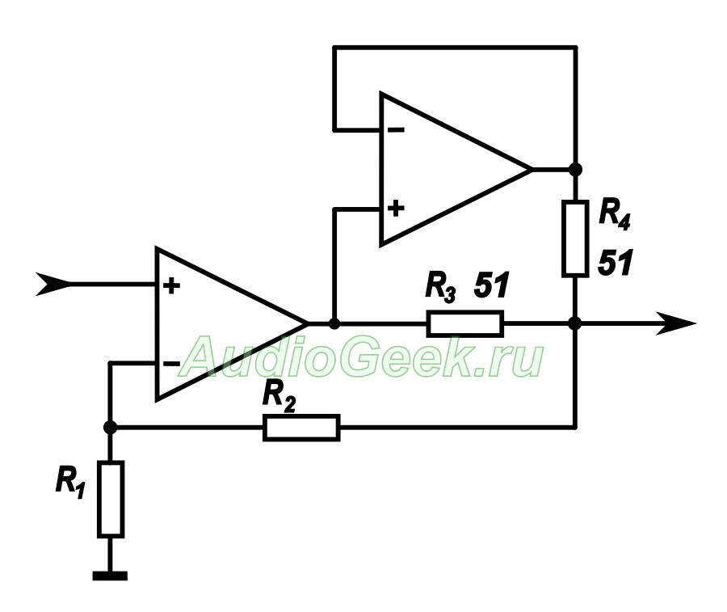
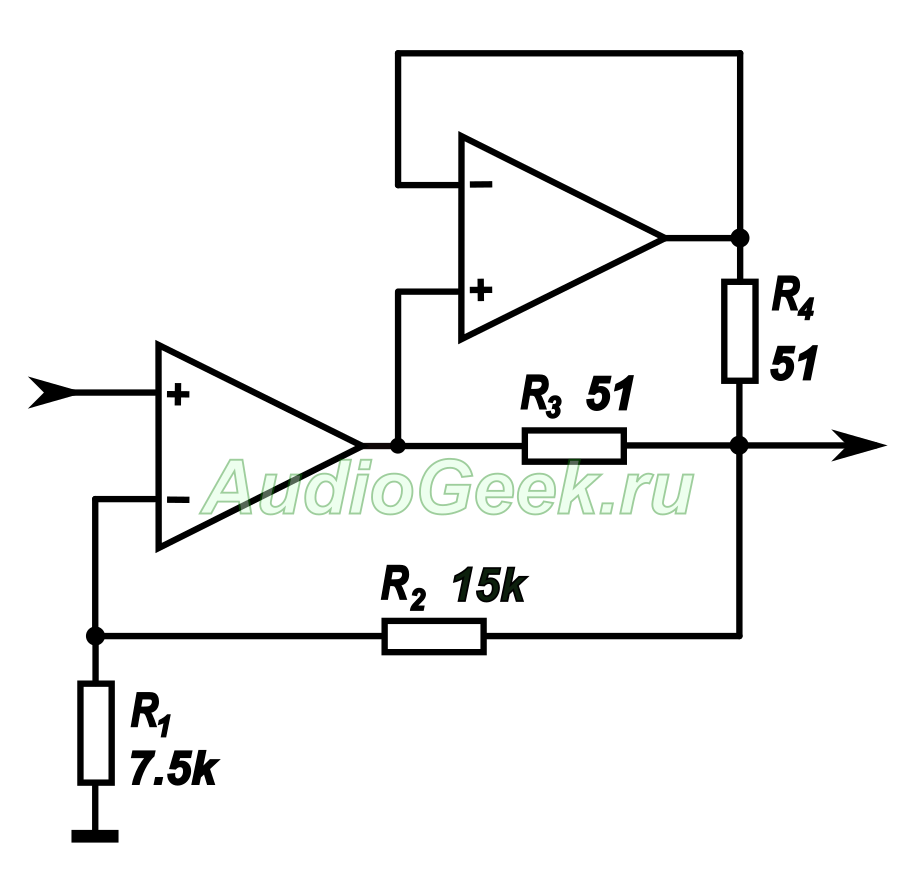
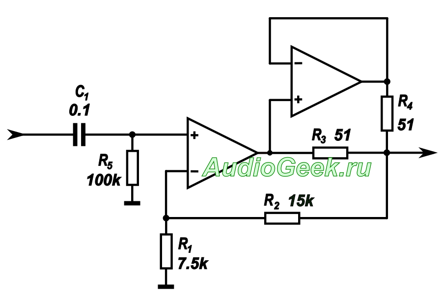
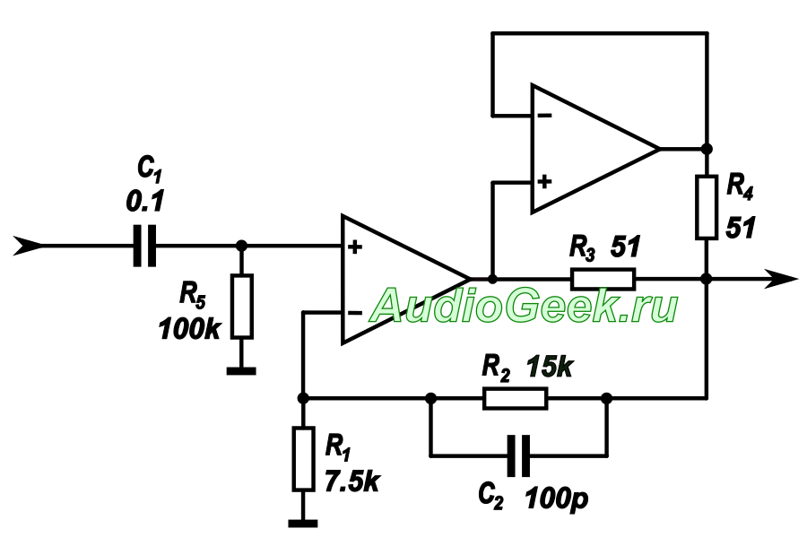
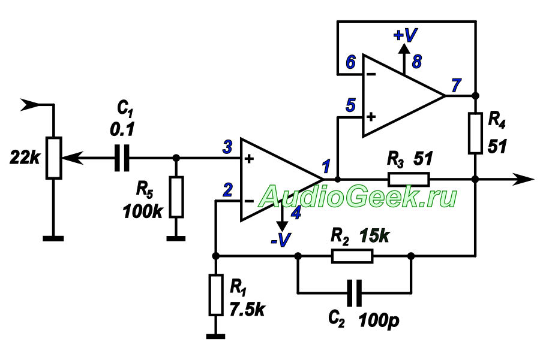
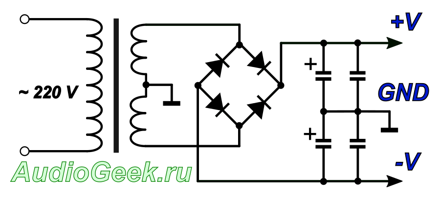
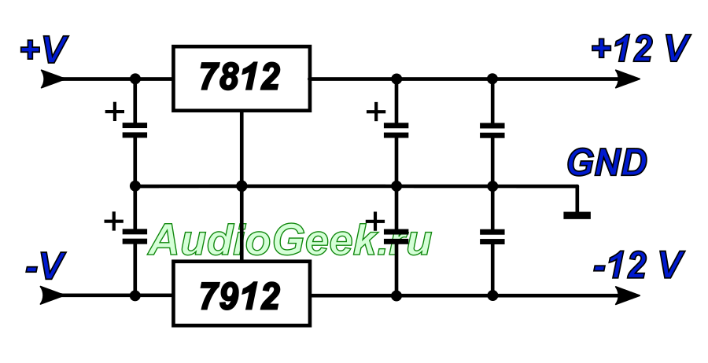

[Русский](./README.ru.md) | **English**

# Op-amp headphone amplifier with doubled output current

**Published:** 2018-05-11 (reworked 2020-04-24)  
**Category:** Audio circuit design  
**Original:** https://audiogeek.ru/headphone-amp-dual-current/

---

An op-amp headphone amplifier circuit that deserves a closer look. It is very simple, yet it will drive practically any headphones. The trick is that it delivers twice the output current of an ordinary op-amp stage.

> **Update (24.04.2020):** the article was heavily rewritten and the circuit was changed, so some of the old comments no longer apply.

> **My build video:** [watch on YouTube](https://www.youtube.com/watch?v=R743zFo0948)

## The circuit

Wandering around the internet, that bottomless ~~dump~~ treasury of knowledge, I came across an interesting find: a PDF from Burr-Brown. It inspired me to build an op-amp headphone amplifier.

The title of the document is ***Double the output current to a load with the dual OPA2604 audio op amp***. You can download it here:

> **Download: *[Double the output current to a load with the dual OPA2604 audio op amp](./Dual_autput_current_headphone_amp.pdf)***

The file is two pages long, and only the first one is really useful. I redrew the circuit from it and removed the extra annotations.

> **Schematic source file:** ***[head_amp.svg](./head_amp.svg)***

***Meet*** the future heart of our amplifier. To be precise, this is one channel.

There will be two channels with two op-amps in each, so the most convenient option is to use dual op-amps.

> **Resistors R3 and R4 (51 Ω each) protect the op-amp outputs from overcurrent.**

## What is special about this amplifier?

The circuit is not new at all. It has been around since the datasheets of the 1990s. What makes it interesting is that both op-amps amplify the same signal, yet this is not a bridged configuration. The two outputs are in phase, so their output currents add up.

This solves the problem of the low output current of many op-amps and noticeably widens the choice of parts that can be used. Each op-amp now only has to supply 35–40 mA instead of the 70–80 mA needed with a single op-amp per channel.

> **The maximum output current is always given in the op-amp datasheet.**

## Gain

The resulting circuit is a non-inverting amplifier. The gain is set by resistors ***R1*** and ***R2***:

> ***K = 1 + R2/R1***

Let us assume the input is a line-level signal. In that case a voltage gain of 3 leaves a comfortable margin, so that is what we will aim for.

How well the two channels match depends on the tolerance of ***R1*** and ***R2***, so resistors of ***±1% or better*** are preferable. Shops and home parts bins rarely have a wide range of precision values, but here you can get by with a single value.

In my case I dug up some 7.5 kΩ precision resistors, which became ***R1***. For ***R2*** I used two 7.5 kΩ resistors in series. Equally, you could use two 15 kΩ resistors in parallel as ***R1*** and a single 15 kΩ resistor as ***R2***.

To change the gain, it is better to change ***R2***. For op-amp audio circuits, values of 1–50 kΩ are usually recommended. Every resistor adds noise to the audio path, and the higher its value, the more noise it adds.

## Finishing the circuit

The circuit in the document is somewhat incomplete. For proper operation it needs input circuitry.

Op-amps amplify DC just as well as AC. So, audiophile preferences aside, it is considered good practice to put a capacitor at the input.

> Modern sources do not put DC on their outputs, of course, but I have no idea what you are going to plug the amplifier into... and I would rather not be responsible for your burnt headphones :)

Besides the DC-blocking capacitor, add a resistor to ground. It ties the non-inverting input of the op-amp to ground. Together with the capacitor it also forms an RC high-pass network.

This [***RC network***](../rc-circuit/) (***R5***, ***C1***) cuts off both DC and infrasonic frequencies. They carry no useful information but load the amplifier with considerable current. With the values shown in the schematic the cutoff frequency is 16 Hz. With a 220 nF capacitor it drops to roughly 7 Hz. Increasing the capacitance further makes little sense.

To rule out possible oscillation of the op-amp, it is also worth limiting the upper end of the band. To do that, place a small capacitor in parallel with ***R2***.

The R2–C2 network works as a low-pass filter. With the values shown, the cutoff frequency is about 100 kHz.

## The complete circuit

All that is left is to add a potentiometer at the input for volume control, and the circuit is ready to use. It needs no adjustment at all. Build it, solder it, plug in the op-amps and enjoy.

As mentioned above, the amplifier is built on dual op-amps, so the pin numbers are marked on the schematic for convenience.

> **It is highly advisable to add 0.1 µF capacitors from the op-amp supply pins directly to ground.**

## Power supply

Supply quality matters a lot for audio. This circuit is designed for a bipolar (split) supply. That spares us from adding extra parts to the signal path and is generally better for the sound.

There are op-amps today that run from ±1.5 V, but most work from bipolar supplies between ±3 V and ±18 V. ±12 V or ±15 V is a good choice and falls within the supply range of most op-amps.

> **Check the exact maximum supply voltage in the documentation for your specific ICs.**

I recommend building a bipolar transformer-based power supply. For smoothing after the diode bridge, two capacitors per rail are enough: 10 µF and 100–470 µF.

Voltage regulation is conveniently done with 7812 and 7912 regulators.

For good regulation the input voltage has to be at least 2.5–3 V higher than the regulated output.

## Component quality

Capacitor ***C1*** must be non-polar, preferably polypropylene or another film type. A ceramic capacitor is best for C2. Capacitor tolerance is not critical, but 5% or better is preferable. Resistors should preferably be 1% or better.

Good ICs are not cheap. For example, **two genuine OPA2604s**, the part used in the original circuit, will set you back about $23.

But there is no need to buy the most expensive parts right away. You can start with whatever the nearest electronics shop has and gradually replace it with better components. The board will work with any parts.

Op-amp prices vary widely, and more expensive does not always mean better sounding. To begin with, you can fit something cheap and common, such as the much-loved NE5532 ($0.30), ideally one made by Philips.

Later you can swap op-amps as much as you like. Among higher-grade parts, the OPA2134, OPA2132, OPA2604, AD8066, AD823 and AD8397 have a good reputation for audio.

> Do not order the **cheapest** ICs from AliExpress and other Chinese shops. There are a lot of counterfeits. They will work, but what you get may not be the OPA2134 you ordered. It may well be a cheap TL061 marked as an OPA2134...

> **I did manage to find a shop that sells genuine ICs, and good audio components in general, including top-end ones. I can recommend this shop.**

## Conclusion

Built on an OPA2132 and running from as little as ±5 V, the amplifier drives the Sennheiser HD380 Pro with ease.

I do not like describing sound in subjective terms such as "crystal highs" or "warm bass". I will only say that with a good op-amp this headphone amplifier has plenty of volume and output power in reserve. It needs no adjustment and uses a minimum of parts while delivering decent sound quality.

> **This circuit led to the idea of a portable headphone amplifier, the *Vol.X project*: a complete portable headphone amplifier built from scratch.**

*Originally written for [AudioGeek.ru](https://audiogeek.ru). Translated from Russian.*

*Visit my [YouTube channel](https://www.youtube.com/channel/UC86Un7mhv1TsEdaCO3ldjrg).*
