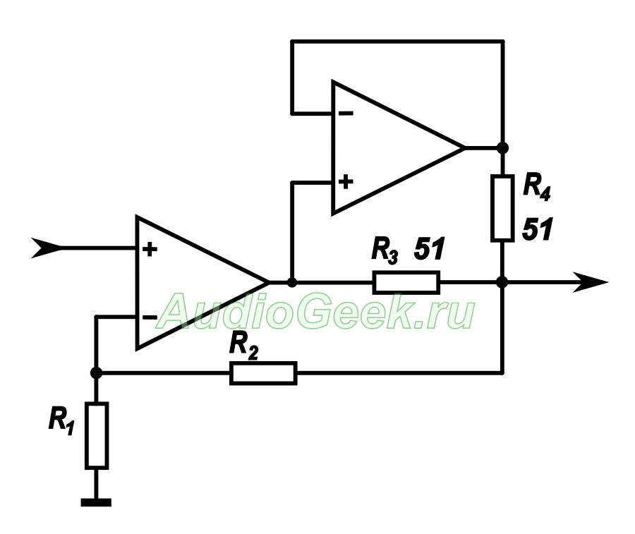
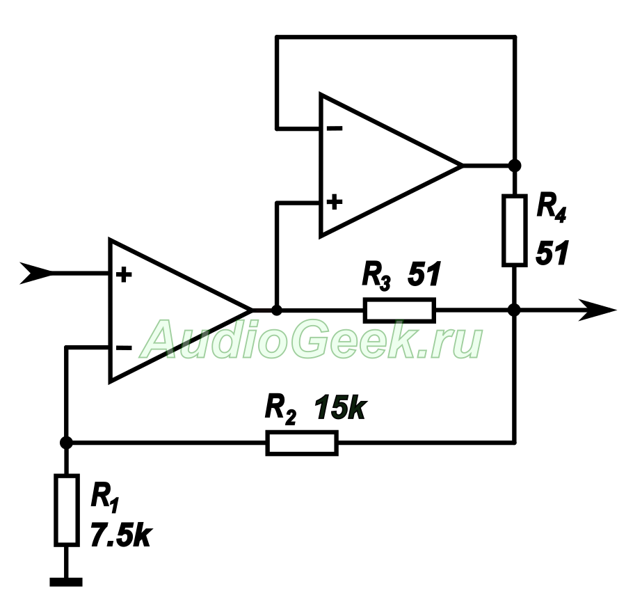
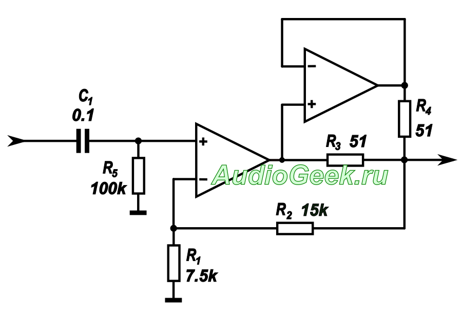
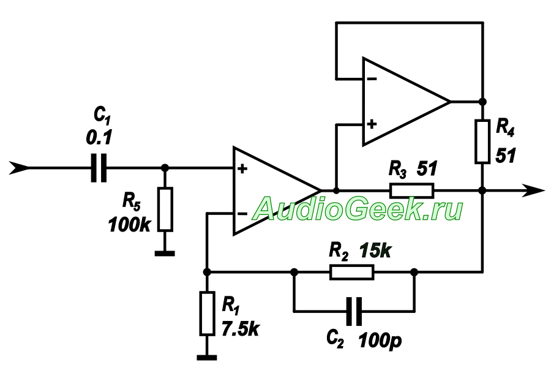
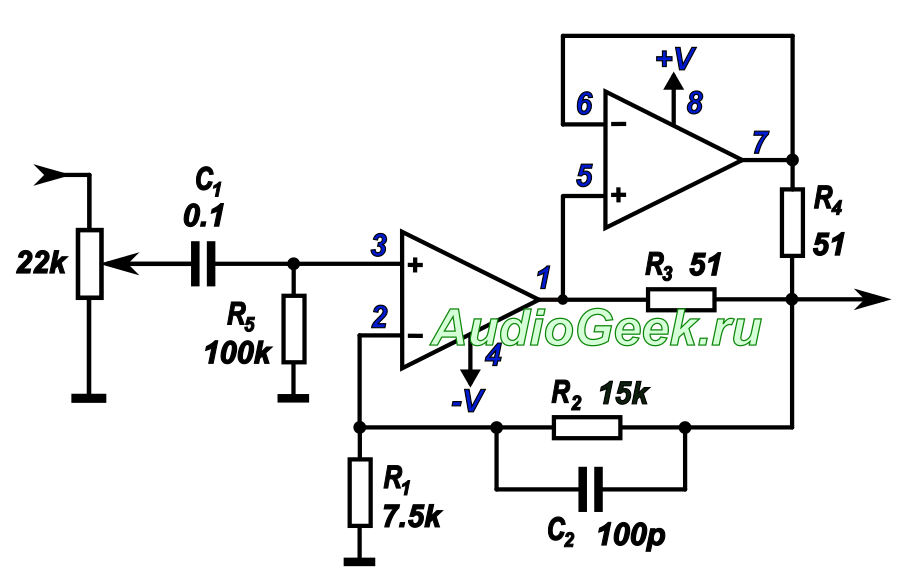
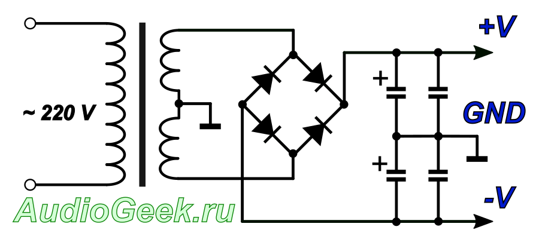
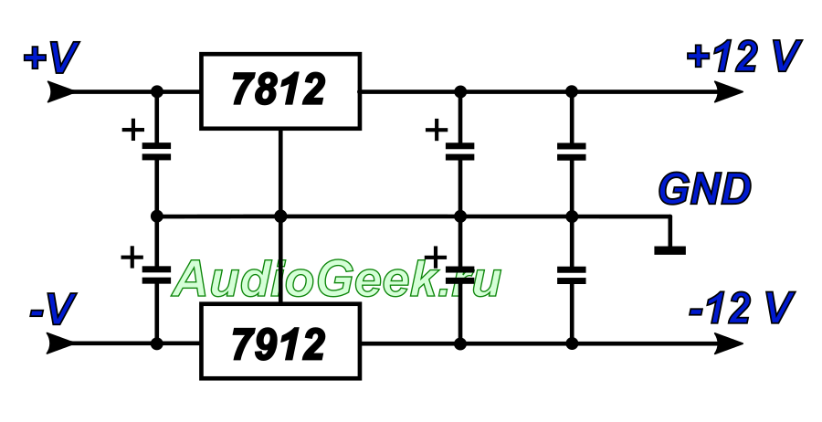

[English](./README.md) | **Русский**

# Схема усилителя для наушников на ОУ с удвоенным выходным током

**Рубрики:** Схемотехника аудиотракта  
**Метки:** схема на ОУ  
**Оригинал:** https://audiogeek.ru/headphone-amp-dual-current/

---

Схема усилителя для наушников на ОУ, которая точно заслуживает внимания. При всей своей простоте, такой усилитель для наушников раскачает любые наушники. А главная фишка заключается в удвоенном выходном токе, по сравнению с обычными включениями ОУ.

> **UPD[24.04.2020]** - статья была сильно переписана, а схема изменена, поэтому некоторые комментарии уже неактуальны.

> **Мое видео по сборке усилителя:**

> ▶ **[Смотреть видео на YouTube](https://www.youtube.com/watch?v=R743zFo0948)**

## **Схема усилителя для наушников**

Скитания по по бескрайним просторам *~~помойки~~* кладезя знаний — интернету, привели к интересной находке. Это был PDF файл от компании Burr Brown. Находка воодушевила меня собрать усилитель для наушников на ОУ.

С языка потенциального врага, название файла дословно можно перевести следующим образом : ***Удвоение выходного тока в нагрузку двумя аудио ОУ OPA2604***. Скачать этот ПДФ вы можете по прямой ссылке с моего сайта.

> **скачать: *[Double the output current to a load with the dual OPA2604 audio op amp](./Dual_autput_current_headphone_amp.pdf)***

Файл состоит из двух страниц, где ценность представляет только первая. Представленная там схема усилителя для наушников была перерисована и избавлена от лишних умных надписей.

> **скачать исходник схемы:** ***[head_amp.svg](./head_amp.svg)***

***Знакомьтесь***, это будущее сердце нашего усилителя. А если быть точнее - это схема одного канала.

Каналов у нас будет 2 и на каждый нужно по 2 ОУ. Наиболее удобным вариантом будет воспользоваться сдвоенными операционными усилителями.

> **Резисторы R3 и R4 сопротивлением по 51 Ом нужны чтобы защитить выходы операционных усилителей по току.**

## **В чем "фишка" этого усилителя?**

Схема совсем не нова. Она известна еще из даташитов 90-х годов. Но интересность схемы заключается в том, что оба ОУ усиливают один и тот же сигнал. Но это не мостовое включение. Выходные сигналы обоих ОУ находятся в фазе, благодаря чему их выходные токи складываются.

Такое включение решает проблему малого выходного тока многих ОУ. Это заметно увеличивает количество ОУ, которые могут быть использованы в усилителе. Теперь достаточно, чтобы каждый операционный усилитель мог обеспечивать выходной ток в 35-40 мА, вместо 70-80 в случае одного ОУ на канал.

> **Максимальное значение выходного тока всегда приводятся в даташитах на ОУ.**

## **Коэффициент усиления**

Полученная схема - это неинвертирующий усилитель. Коэффициент усиления сигнала определяют резисторы ***R1*** и ***R2***. Его точное значение определяется формулой:

> ***K= 1+ R2/R1***

Будем считать, что на вход мы подаем сигнал с линейного выхода. В таком случае коэффициента усилия по напряжению равного 3 будет с хорошим запасом. Поэтому на три и будем ровняться.

От точности резисторов ***R1*** и ***R2*** зависит насколько одинаковым будет усиление у каналов. Поэтому желательно, чтобы резисторы имели точностью ***не хуже ±1%***.Далеко не всегда в магазинах или в домашних запасах можно найти большой ассортимент номиналов резисторов хорошей точности. Но в данном случае можно обойтись резисторами одного номинала.

Так, в закромах шкафа были найдены прецизионные резисторы по 7,5 кОм которые и стали резисторами ***R1***. В качестве ***R2*** было использовано по два резистора в 7,5 кОм, которые были включены последовательно. Аналогично можно сделать, включив параллельно два резистора по 15кОм в качестве ***R1***, и один резистора на 15кОм в качестве ***R2***.

Для изменения коэффициента усиления лучше менять резистор ***R2***. Для звуковых схем на ОУ, обычно рекомендуется использовать резисторы номиналом 1÷50 кОм. Любой резистор вносит шум в аудио тракт и чем больше номинал этого резистора - тем больше вносимый им шум.

## Доводим схему до ума

Представленная в документе схема несколько неполная. Для нормально работы следует дополнить схему входными цепями.

Операционные усилителя одинаково хорошо усиливают как переменное, так и постоянное напряжение. Поэтому, несмотря на всякие аудиофильские заморочки, считается хорошим тоном добавлять на вход конденсатор.

> Конечно современные источники не дают постоянного напряжения на выход, но я же не знаю, куда вы будете подрубать усилитель... а я не горю желанием нести ответственно за Ваши спаленные наушники  :)

Помимо конденсатора, отсекающего постоянное напряжение, следует добавить идущий на землю резистор. Такой резистор обеспечит привязку неинвертирующего входа ОУ к земле. С другой стороны. вместе с конденсатором он образовывает дифференцирующую RC цепь.

Образовавшаяся [***RC-цепь***](../rc-circuit/) (***R5******,*** ***С1***) будет отсекать как постоянное напряжение так и инфра-низкие частоты. Они не несут полезной информации, однако значительно нагружают усилитель по току. При номиналах, указанных на схеме, частота среза составляет 16 Гц. При использовании конденсатора на 220нФ частота среза опустится примерное до 7Гц.  Дальнейшее увеличение емкости особого смысла не имеет.

Для исключения возможного самовозбуждения ОУ, не лишним будет ограничить и верхний диапазон. Для этого установим параллельно ***R2*** конденсатор малой емкости.

Цепь R2 C2 будет работать как фильтр низких частот. При указанных номиналах деталей частота среза составит около 100 кГц.

## **Готовая схема усилителя для наушников**

Остается только воткнуть по входу переменный резистор для регулировки громкости и на этом схему можно считать готовой к употреблению. Ни в каких настройках схема не нуждается. Достаточно ее собрать, спаять, воткнуть ОУ и радоваться жизни.

Как говорилось выше, схема будет собираться на сдвоенном ОУ, поэтому для большего удобства на схеме были обозначены ножки ОУ.

> **Крайне желательно добавить конденсаторы по 0.1 микрофараде, непосредственно с ножек операционного усилителя на землю.**

## **Питание усилителя**

Для звука очень важно качество питания. Данная схема рассчитана на двухполярное напряжение питания. Это избавляет нас от необходимости добавлять лишние детали в звуковой тракт, и в целом это лучше для звука.

Сегодня существуют ОУ работающие от ±1.5В, но большинство операционников работают при двухполярном напряжении питания от ±3В до ±18В. Оптимальными можно назвать напряжение в ±12В или ±15В, которые входят в пределы питания большинства ОУ.

> **Точные значения максимального напряжения питания следует смотреть в документации на конкретные микросхемы.**

Для питания усилителя рекомендуется собрать двухполярный трансформаторный блок питания. Для сглаживания напряжения после диодного моста будет достаточным установить по два конденсатора емкостью 10 мкФ и 100 - 470 мкФ.

Стабилизацию напряжения удобно реализовать на микросхемах 7812 и 7912.

Для обеспечения хорошей стабилизации необходимо, чтобы входное напряжение было минимум на 2.5-3 вольта выше напряжения стабилизации.

## **Качество компонентов**

Конденсатор ***С1*** должен быть неполярным. Лучше полипропиленовый или пленочным. Конденсатор С2 лучше использовать керамический. Точность конденсаторов не так важна, но лучше использовать с точностью не хуже 5%. Резисторы желательно точностью не хуже 1%

Хорошие микросхемы стоят недешево. Например, за **две оригинальные OPA2604**, которые и предлагались в исходной схеме, придется отдать около 23$.

Но совсем не обязательно сразу закупать самое дорогое. Для начала можно поставить что-то из ассортимента ближайшего магазина радиодеталей, а постепенно заменить их более качественными компонентами. Плата будет работать на любых деталях.

Цены на операционные усилители лежат в широких пределах и не всегда дороже значит лучше для звука. Для начала можно будет установить что-то недорогое и доступное, например любимую многими NE5532(0.3$). Очень желательно чтобы она была производства Филлипс.

В последствии с заменой ОУ можно будет играться сколько хотите. Если рассматривать ОУ классом повыше, то для звука хорошо себя зарекомендовали OPA2134, OPA2132, OPA2406, AD8066, AD823, AD8397....

> Не заказывайте **самые дешевые** микросхемы с АлиЭкспресс и в прочих китайских магазинах. Там очень много поддельных микросхем. Они будут работать, как и положено, но это может быть совсем не OPA2134, который вы заказывали, а довольно дешевая TL061 с надписью OPA2134...

> **Но мне удалось найти магазин, в котором продаются действительно оригинальные микросхемы. Да и вообще в нем очень качественные аудиокомпоненты. В том числе топовые. Очень рекомендую этот магазин.**

## Заключение

Полученная схема усилителя, собранная на OPA2132 и работающая даже при напряжении питания ±5В свободно раскачивает Sennheiser HD380 Pro.

Не люблю описывать звук субъективными терминами вроде "высокие стали хрустальными" или "басы теплыми", скажу лишь то, что при использовании хорошего ОУ, этот усилитель для наушников обладает достаточным запасом громкости и выходной мощности. При этом он не требует никакой настройки и использует минимум деталей, обеспечивая при этом достойное качество звука.

> **Рассмотренная схема привела к идее создания портативного усилителя для наушников. Так придумался *[проект Vol.X](https://audiogeek.ru/volx/)*. Суть которого заключается в создании законченной конструкции портативного усилителя для наушников своими руками с нуля.**

***Материал подготовлен исключительно для сайта** **[AudioGeek.ru](https://github.com/SkyTrip-13/AudioGeek)***

***Заглядывайте на мой [YouTube канал](https://www.youtube.com/channel/UC86Un7mhv1TsEdaCO3ldjrg)***
