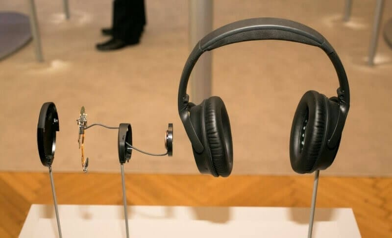
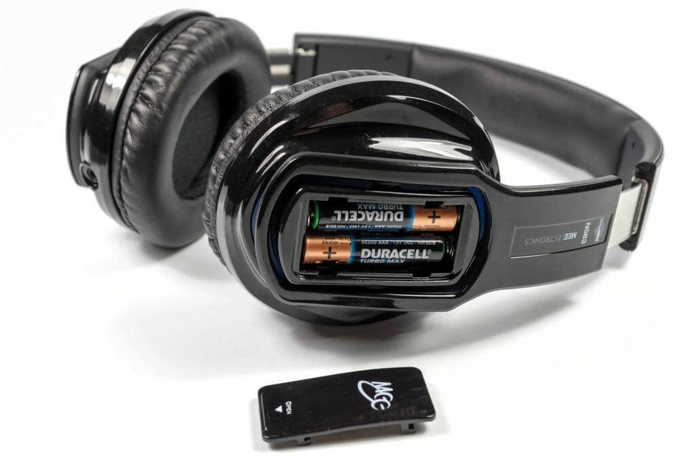
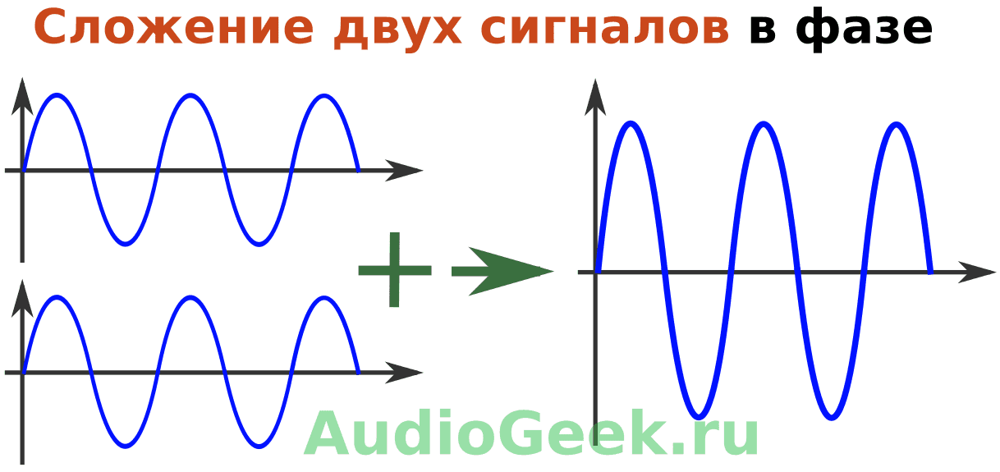
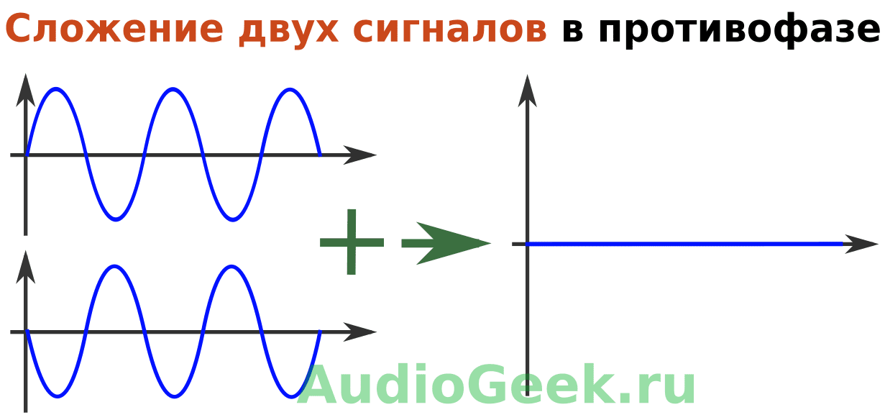
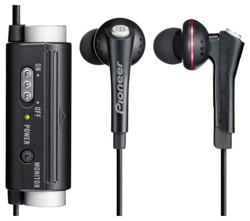
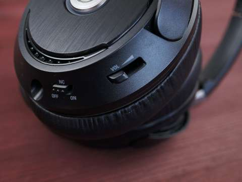

[Русский](./README.ru.md) | **English**

# How active noise-cancelling headphones work

**Published:** 2017-11-02  
**Category:** Headphone types  
**Original:** https://audiogeek.ru/headphones-antinoise/

---

When buying headphones for the street and transport, one of the most important characteristics is their degree of noise isolation. But however good it is, alas, it is impossible to isolate all external noise. For those who want to appreciate every smallest detail of a piece of music in any conditions, active noise-cancelling headphones were invented, and their principle of operation is covered below.

Unlike noise isolation, which is passive in itself and determined by the design of the headphones, noise cancelling means acting on the noise coming from outside. That is why it is called active.

## **Active noise cancelling**

Active noise cancelling is implemented with a special electronic circuit built into the headphones or placed on the cable.

Naturally, such a circuit needs an additional power source, so active noise-cancelling headphones always come with a compartment for batteries or rechargeable cells.

## **Adding signals with different phases**

To understand the principle of active noise cancelling we have to dive a little into the concept of phase. When two signals with different phases interact, first of all two extreme cases should be considered (for simplicity we will assume the two signals are identical):

**Case 1:** the signals are in phase, i.e. both are in the same phase. When two such signals meet, they simply add. At every moment the resulting signal equals the sum of the two originals.

**Case 2:** the signals are in antiphase, i.e. one signal is inverted relative to the other. Such signals subtract.

In other words, if we add the same signal in phase with itself in antiphase, we get no signal at all, since they cancel each other completely (*ideally*).

All other variants lying between in-phase and antiphase lead to partial cancellation or reinforcement of the signals by each other.

Why am I telling you about phase at such length? Here is why:

> Active noise cancelling is built precisely on the fact of **mutual cancellation of antiphase signals**.

## **How active noise cancelling is implemented**

The idea is quite simple. Noise taken from the surrounding space is mixed into the music you are listening to. This noise is picked up by built-in microphones. But the trick is that the phase of the mixed-in noise is inverted.

As a result, the ear receives the external noise and the noise added by the noise-cancelling system. Because their phases are opposite, they cancel each other. That is all. Isn't it brilliant? )

## **Reality**

Of course, it is impossible to cancel noise 100.00%, the world is not perfect. Noise on the street is far from such a pretty and simple little wave. But compared with passive noise isolation the difference is enormous.

To get an idea of the capabilities of active noise cancelling, imagine that you can comfortably enjoy music while a jackhammer is working nearby, if you use headphones with active noise cancelling.

## **Kinds of noise-cancelling headphones**

Today, active noise-cancelling headphones come both as full-size or on-ear models and as ordinary earbuds.

For better noise cancelling, the microphones that pick up external noise should be placed directly on the earcups themselves. And the signal from each microphone should be mixed into its own channel.

Active noise cancelling is often implemented in wireless headphones. This is convenient, because they already have a power source and part of the electronics, and with modern technology it is not hard to add a pair of microphones and an extra chip to the headphones.

However, manufacturers often, to simplify the design and cut production costs, place the microphone on the in-line remote of the cable. This variant is worse, but active noise cancelling still contributes to noise isolation.

Active noise cancelling for headphones can also be built by yourself. A circuit and an explanation of how it works will be covered in one of the following articles.

**Great sound to everyone!**

*Originally written for [AudioGeek.ru](https://audiogeek.ru). Translated from Russian.*
