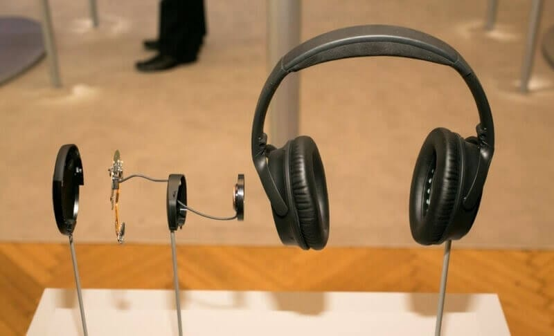
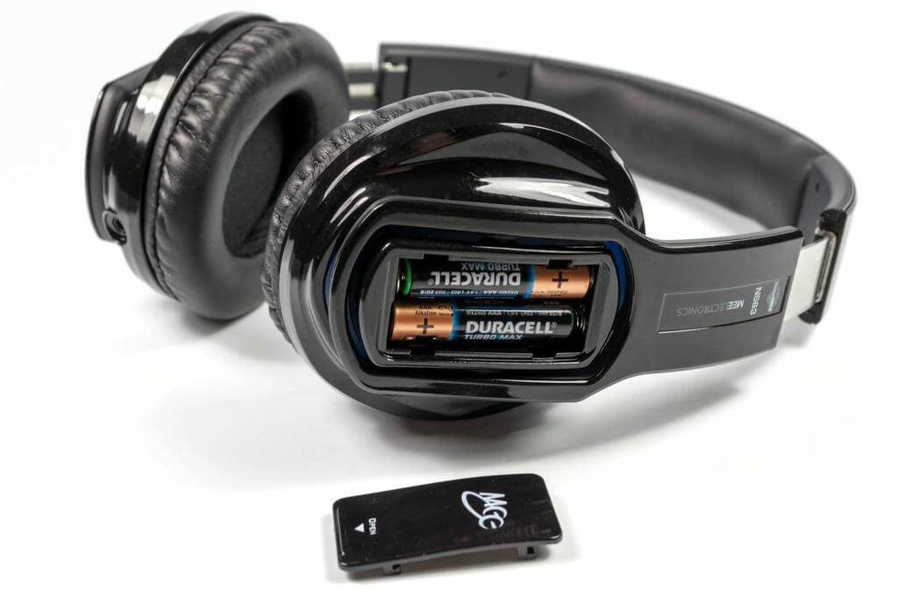
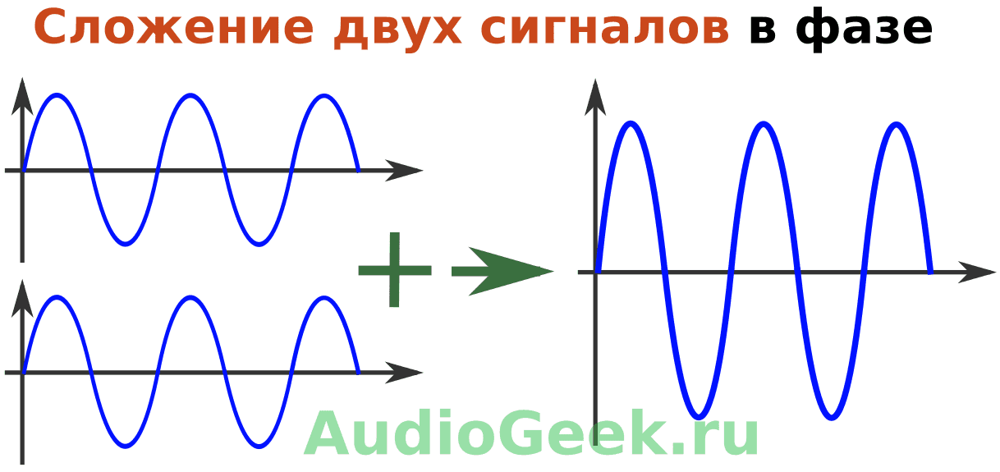
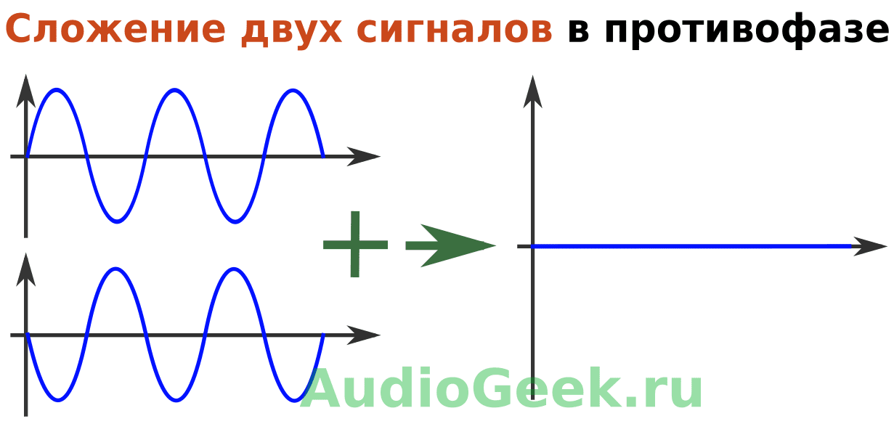
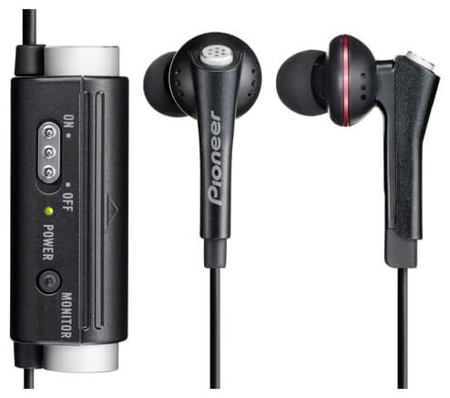
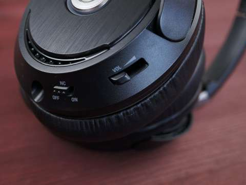

[English](./README.md) | **Русский**

# Как работают наушники с активным шумоподавлением

**Рубрики:** Виды и типы наушников  
**Оригинал:** https://audiogeek.ru/headphones-antinoise/

---

При покупке наушников для улицы и транспорта, одной из важнейших характеристик является степень их шумоизоляции. Но насколько бы она ни была хороша, увы, невозможно изолировать все внешние шумы. Для желающих оценить все мельчайшие детали музыкального произведения в любых условиях были придуманы наушники с активным шумоподавлением, принцип работы которых и будет рассмотрен далее.

В отличие от шумоизоляции, которая сама по себе пассивна и определяется конструкцией наушников, шумоподавление подразумевает воздействие на приходящий из вне шум. Поэтому оно, собственно, и активное

## **Активное шумоподавление**

Активное шумоподавление реализуется за счет специальной электрической схемы, встраиваемой в наушники или располагаемой на кабеле.

Разумеется, такая схема требует дополнительного источника питания, поэтому наушники с активным шумоподавлением всегда снабжены отсеком для батарей или аккумуляторов.

## **Сложение сигналов с разными фазами**

Для понимания принципа активного шумоподавления придется немного погрузиться в понятие фазы. Если речь заходит о взаимодействии двух сигналов, фазы которых отличаются, то в первую очередь стоит рассмотреть два крайних случая (для простоты будем считать, что рассматриваются два одинаковых сигнала):

**Случай 1:** сигналы синфазны - т.е. оба находятся в одной фазе. Когда два таких сигнала встречаются, то они просто складываются. В каждый момент времени итоговый сигнал будет равен сумме двух исходных.

**Случай 2:** сигналы противофазны - т.е один сигнал перевернут относительно второго. Такие сигналы будут вычитаться.

Иначе говоря если мы сложим один и тот же сигнал в фазе с ним же в противофазе, то получим полное отсутствие сигнала, т.к. они друг друга полностью нейтрализуют (*в идеале*).

Все остальные варианты, находящиеся между синфазностью и противофазностью приводят к частичному подавлению или усилению сигналами друг друга.

К чему это я так долго рассказываю вам о фазе, а вот почему:

> Активное шумоподавление построено именно на факте **взаимоподавления противофазных сигналов**.

## **Как реализуется активное шумоподавление**

Идея достаточна проста. В прослушиваемую вами музыку подмешивается шум, который берется из окружающего пространства. Этот шум улавливается встроенными микрофонами. Но фишкой является то, что фаза подмешиваемого шума изменяется на противоположную.

В итоге получается, что в ухе встречаются внешние шумы и шумы, добавленные системой шумоподавления. Из-за противоположности фаз они подавляют друг друга. Вот и всё. Не правда ли гениально?)

## **Реальность**

Конечно, подавить шум на все 100.00% невозможно, мир не идеален. Шум на улице далекоо  не такая красивая и простая волнушка. Но в сравнении с пассивным шумоподавлением разница колоссальна.

Для представления возможностей активного шумоподавления, представьте, что работая отбойным молотком настройке вы можете вполне комфортно наслаждаться музыкой, если используете наушники с активным шумоподавлением.

## **Какие бывают наушники с активным шумоподавлением**

На сегодняшний день, наушники с активным шумоподавлением бывают как полноразмерными или накладными, так и обычными затычками.

Для лучшего шумоподавления микрофоны, улавливающие вешние шумы должны быть расположенны непосредственно на самих чашах наушников. А сигнал каждого микрофона должен подмешиваться в свой канал.

Часто активное шумоподавление реализуется в беспроводных наушниках. Это удобно, т.к. питание и часть электроники в них уже имеется, а с современными технологиями не трудно дополнить  наушники парой микрофонов и лишней микросхемой.

Однако часто производители, для упрощения конструкции и сокращения затрат на производство, размещают микрофон на пульте провода. Такой вариант хуже, но активное шумоподавление все равно вносит вклад в шумоизоляцию.

Активное шумоподавление для наушников можно реализовать и собственноручно. Вариант схемы и объяснение ее работы будут рассмотрены в одной из следующих статей.

**Отличного всем звука!**

*Материал подготовлен исключительно для сайта [AudioGeek.ru](https://github.com/SkyTrip-13/AudioGeek)*
