[Русский](./README.ru.md) | **English**

# Types of headphones: differences and characteristics

**Published:** 2018-11-16  
**Category:** Headphone types  
**Original:** https://audiogeek.ru/headphones-types/

---

Nobody is surprised by headphones these days. We would be far more surprised to find none in the box with a newly bought phone or tablet. Store shelves are full of headphones of every possible type. But what kinds and types of headphones are there, anyway? Are there really so many, and how do they differ?
Despite the countless number of models, all types and kinds of headphones fit into 4 categories:

1. ***Earbuds (shell-type, rest in the outer ear)***
2. ***In-ear (canal) headphones***
3. ***On-ear headphones***
4. ***Full-size (over-ear) headphones***

Most often the first two types are lumped together. In my opinion they should be considered separately, because of a rather serious difference in construction.
> All types of headphones can have either an ***[open or a closed design](../open-close-headphones/)***. This strongly affects both the sound and the sound-isolating properties.
> There is also a variety of headphones called ***[studio monitor headphones](../monitoring-headphones/)***.

## 1. Earbuds

Earbuds are what Russians colloquially call "shells". For quite a long time they were the most widespread type of headphones, especially for portable use. But the noisy world forced many to switch to in-ear buds.
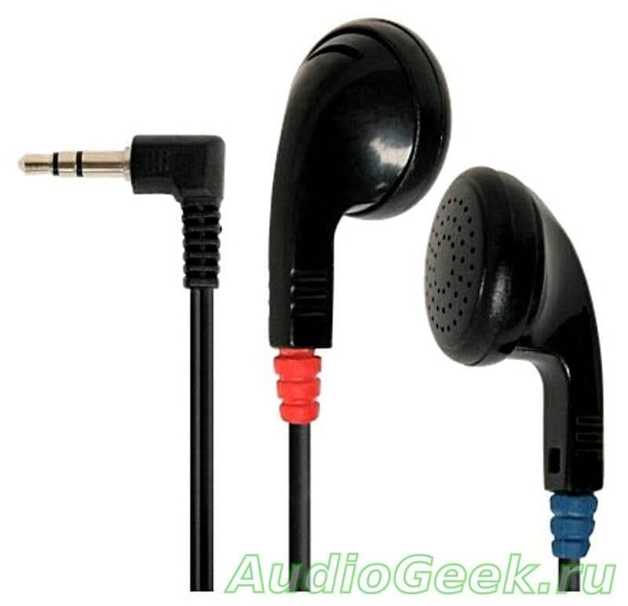
I do not know what they have in common with shells. The next picture fits that name better:
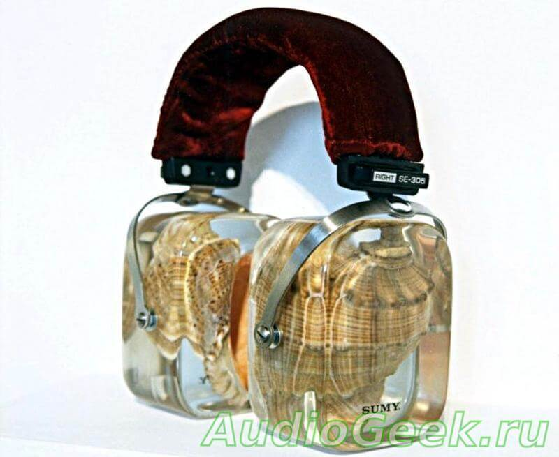
But back to the topic. Today there are quite a few supporters of this design. Probably the love for this type of headphones is partly due to the products of a certain well-known fruit company.
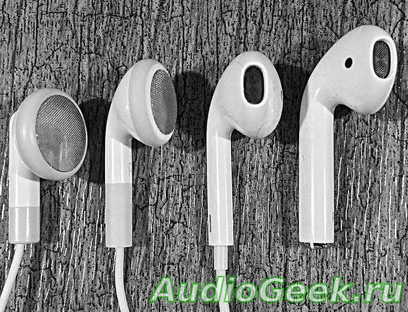
By and large their EarPods, as well as AirPods, are also shells rather than in-ear buds.

### *1.1 Comfort*

As the name suggests, the headphones rest in the outer ear. To improve the seal, some manufacturers add rubber rings. To reduce irritation of the outer ear by hard plastic, foam covers are used.
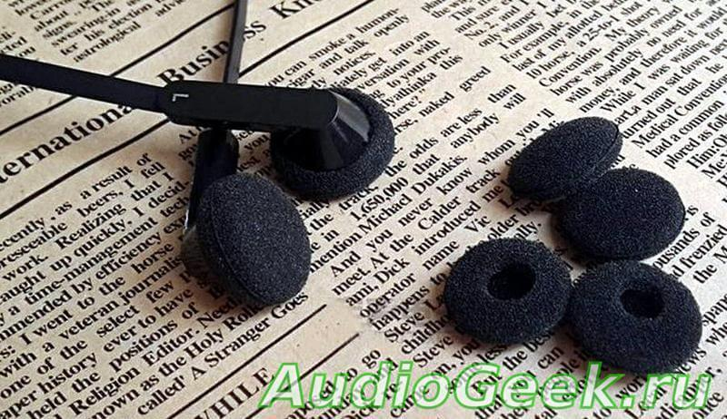
With or without the covers, these headphones cannot boast noise isolation, so with most of them you will hear most of what is going on around you, and you will surely be listening to the tracks on your player together with the people around.
Another problem of this type is that the headphones do not always match the size and shape of your outer ear. As a result they are too small and fall out for some, and press on others...

### *1.2 Sound*

Such headphones usually have a dynamic driver 10–15 mm in diameter. Back when such headphones were just appearing, because manufacturing technology for such tiny drivers was lacking or expensive, their midrange was quite overstated.
Given the loose fit of the headphones against the ear, the lows and highs suffered even more. This even led sound engineers to artificially boost the lows and highs when recording music.
The V-shaped equalizer setting was also in fashion, which in many equalizers today is called "Rock". That is because rock music has plenty of midrange, and the shells already had an excess of it.
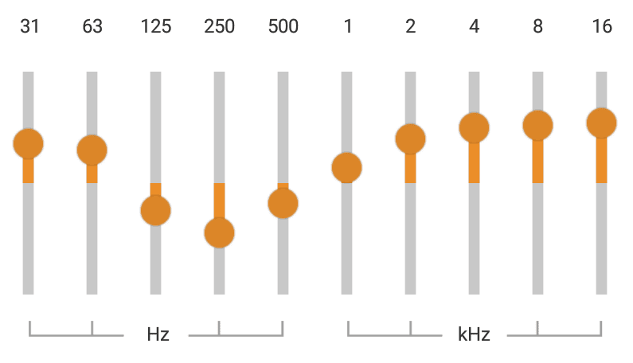
Today we have learned to make quality drivers of even smaller sizes. But the problem of the loose fit has not gone away, so today manufacturers try to make a dip in the mids and raise the lows and highs.

### *1.3 Portability*

There are definitely no problems with this. They fit easily in a pocket and in other small hiding places. I would not advise carrying headphones just anywhere. Small debris can get into their openings and spoil life for them and for you.

## 2. In-ear headphones

Plugs, vacuum headphones: these are the popular names that in-ear headphones got. This type got these nicknames for the sound-isolating properties of its construction.
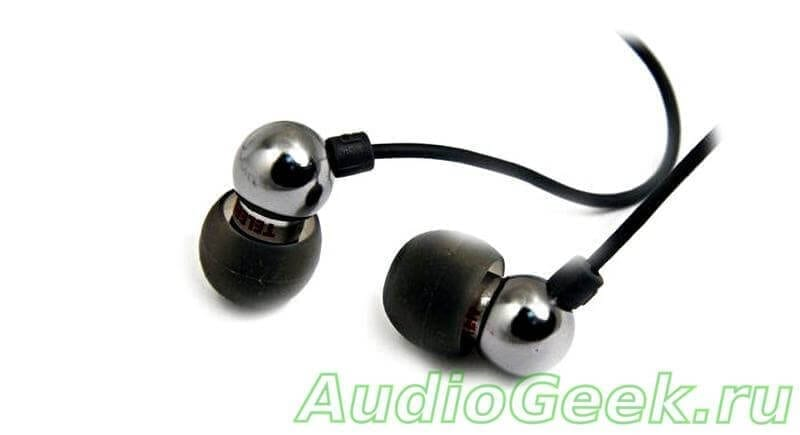

### *2.1 Comfort*

The main difference is the creation of a practically sealed volume between the driver diaphragm and the eardrum. This seal is provided by a silicone ear tip.
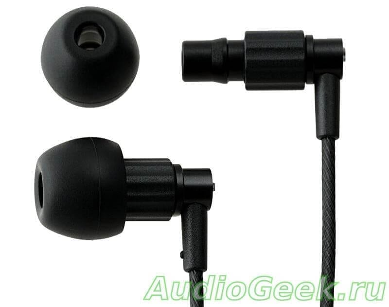
I have heard more than once that people do not like the feeling of a plunger in the ear. For that reason they prefer shells. Many people really do feel discomfort from in-ear buds.
But in fact it is enough to put them on and wait a little. Our ear is built so that it equalizes the pressure by itself and becomes more comfortable. But somehow even that does not help everyone.

### *2.2 Sound*

The cardinal technical difference is the sound tube placed directly in the ear canal. Thanks to this, the power of the drivers can be an order of magnitude lower than in other types of headphones. All the movements of the diaphragm are transmitted directly and as efficiently as possible to the eardrum.
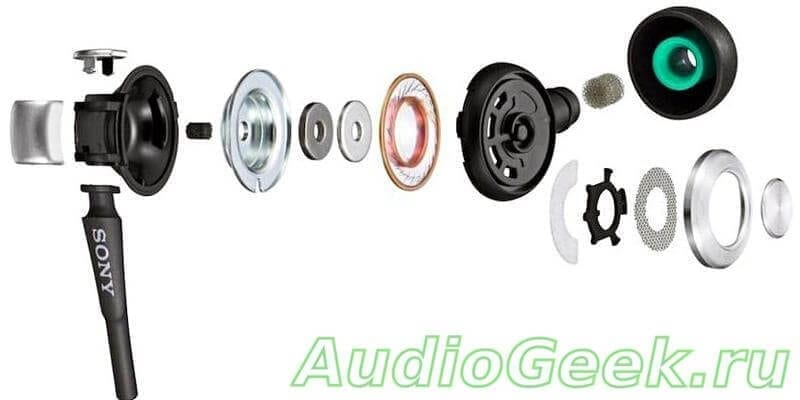
In in-ear headphones with a dynamic driver the diaphragm diameter is usually 10–12 mm, but can be as little as 8 mm. Such a driver is very difficult to design. The biggest problem is getting correct low frequencies and an even frequency balance.
Today many headphones, especially in the budget category, suffer from boosted bass that overlaps the midrange, making it inexpressive. The depth and detail of the lows is also not as good as one would like.
In addition, such a small driver size means its resonance frequency lies quite high. This emphasizes the highs, which often start to hiss, click and smack excessively.
Besides the dynamic driver, in-ear headphones may also use a balanced-armature driver. The balanced-armature driver, as it is officially called, sounds better in the mids and especially the highs.
However, an armature cannot squeeze out decent bass, mainly because of its very modest size. So hybrid headphone models, in which a dynamic driver coexists with an armature one, are becoming more and more popular. But such headphones are often not the smallest and not as convenient to wear.

### *2.3 Portability*

As with the previous type, there are no portability problems here. And they will play at sufficient volume from any source. But do not forget that sound quality is determined not only by the headphones themselves but also by the quality of the sound source..
For lovers of maximum portability and no wires, a heap of wireless solutions have appeared today.
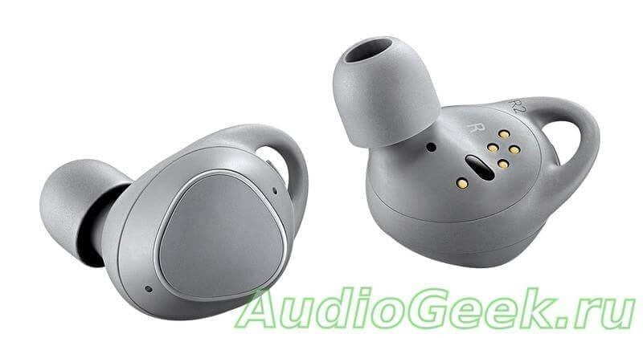

## 3. On-ear headphones

They are named so because the earcup, as you might expect, is "placed on" the outer ear. On-ear headphones are rather a compromise. They are a very good combination for those who need quality sound and a sufficient degree of portability.
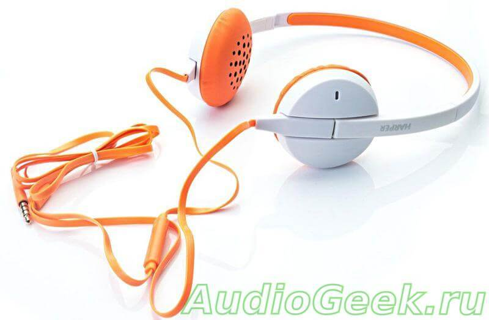
If you are looking for not very expensive but good on-ear headphones, I recommend taking a look at ***Superlux headphones.***
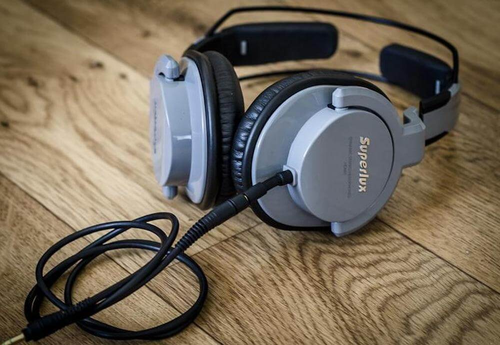

### *3.1 Sound*

On-ear headphones are not as large as full-size headphones, but with their driver size they can deliver much better sound quality than their younger siblings.
Because the sound source is located outside the ear rather than in it, it is easier for the sound (heard) image to form outside the head. This helps better perception of the depth and height of the soundstage.
This makes it possible to use on-ear headphones for professional applications too. So there are on-ear studio monitor headphones. Read what studio monitor headphones are in the ***[article](../monitoring-headphones/)***.
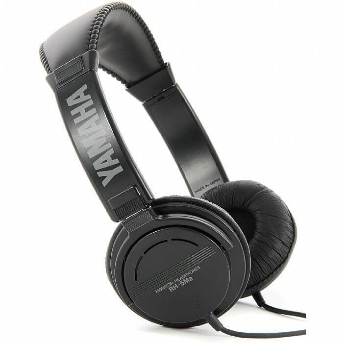

### *3.2 Comfort*

When it comes to noise isolation, many on-ear headphones can only stand nervously aside. Their construction is such that many of them cannot fit snugly against the ear. If the headphones are open, there is no noise isolation in them at all.
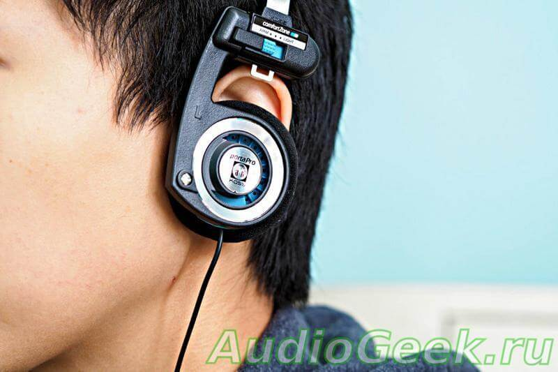
With most models, when listening to music in the subway you hear the subway much better than the music. Though there are models with decent noise isolation too.
For this reason more and more manufacturers release models with active noise cancelling. ***[How active noise-cancelling headphones work](../headphones-antinoise/)***
On-ear headphones usually have dimensions equal to or smaller than the outer ear. They also press directly against the ear, so they can cause discomfort when worn for a long time.

### *3.3 Portability*

On-ear headphones are much more portable than full-size ones. For even greater portability many headphones are made foldable. Often a small pouch or carrying case also comes with the headphones.

## 4. Full-size headphones

Full-size headphones, called ***over-ear*** or ***circumaural*** in English, are the largest. They are rightly considered the highest quality among all types.
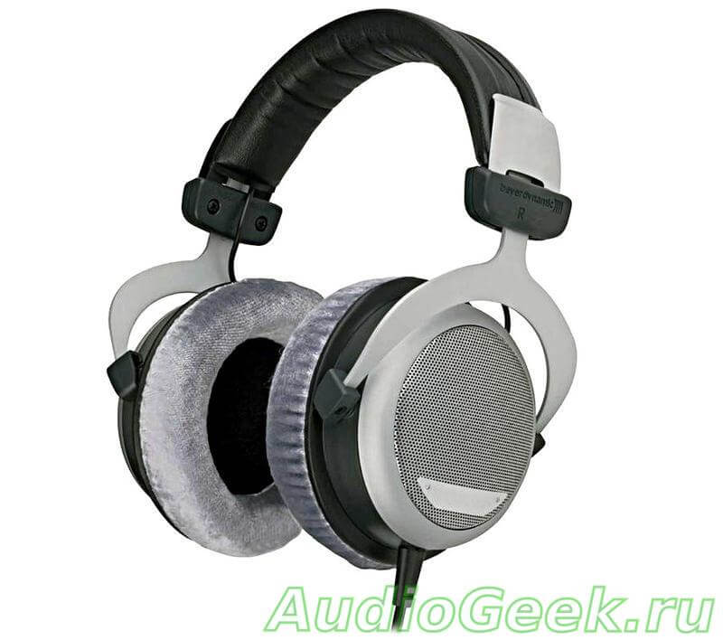
As the saying goes: a big piece is a joy to the mouth, and in this case to the ear. But what makes them better?

### *4.1 Sound*

The main reason full-size headphones have the best sound is obvious: their size. Or, to be more precise, the size of their drivers. The driver diameter in full-size headphones is usually more than 40 mm in the case of dynamic drivers.
A driver of that size has a much easier time properly reproducing the low-frequency component. As a result the bass in them is more worked out, rich and deep. Many such headphones have a frequency range starting from 8–10 Hz.
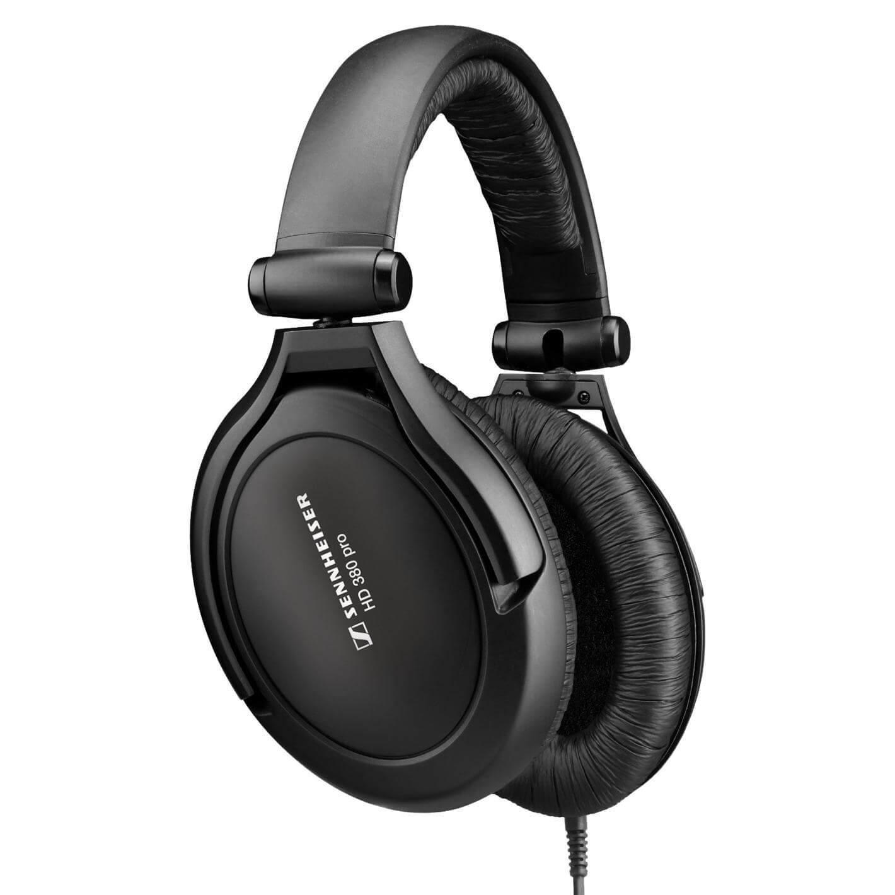
But the size of the headphones also allows drivers of other, more "exotic" types: for example isodynamic or orthodynamic (planar magnetic) drivers, electrostatic drivers and others.
But it is not only about driver size; the full-size construction makes it possible to create good noise isolation and eliminate losses from a loose fit.
It is also easier to implement various systems of acoustic filters and sound tubes in such headphones to give the frequency response the right shape. That is why ***[studio monitor headphones](../monitoring-headphones/)*** are most often full-size.

### *4.2 Comfort*

These headphones can also be called the most comfortable of all types. They do not act on or press the outer ear but surround it, pressing with soft earpads directly against the head. Even if the earpads are not as good as you would like, you can ***[sew them yourself](../earpads/)***.
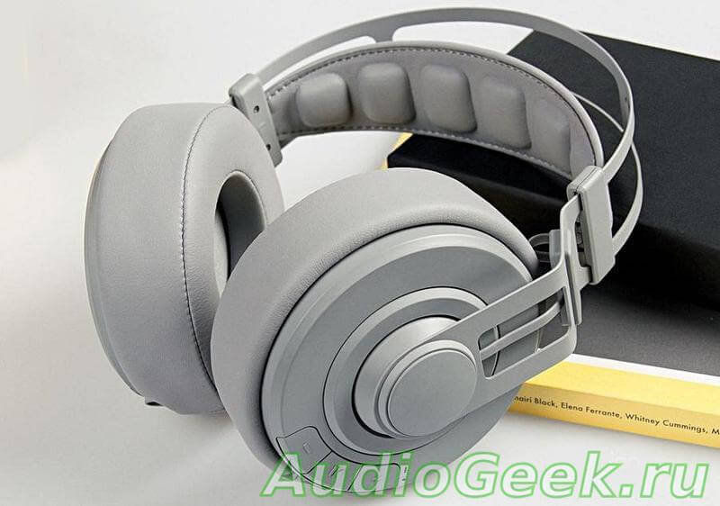
Your ear gets its own "microclimate". However, this can create some problems in warm and hot weather: it will simply be hot in the headphones.

### *4.3 Portability*

In terms of portability things are somewhat worse. Most full-size headphones are designed for home or studio use. Full-size headphones very rarely come with a pouch or case.
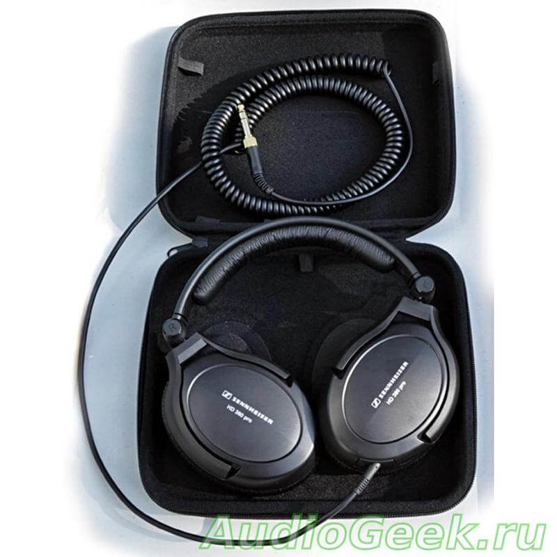
Of course there are quite a few models that fold fairly compactly. But if compactness is a priority for you, it is better to look at the previous types.
It is not only about compactness. Most full-size headphones have high impedance and need a more powerful amplifier, so not every player can fully drive most full-size headphones.
An interesting representative of full-size headphones is the ***HD668*** headphones from ***Superlux***. This is a Chinese company that faithfully reproduces famous headphone models at prices several times lower than the branded ones.
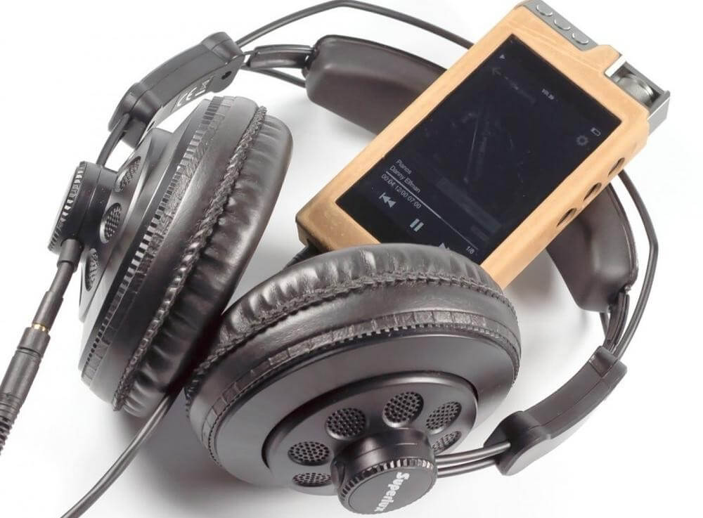

## Conclusion

However hard manufacturers try, ideal headphones simply do not exist. But each type of headphones has its strengths and weaknesses. For example, in the subway it makes more sense to take in-ear buds with you, and to enjoy full-size headphones at home.
It is worth repeating that all the types of headphones described can have either an open or a closed design. Read more about the differences between open and closed headphones in the article: ***[Open-back and closed-back headphones: which is better for what](../open-close-headphones/)***

*Originally written for [AudioGeek.ru](https://audiogeek.ru). Translated from Russian.*
