[English](./README.md) | **Русский**

# Типы наушников и виды наушников - отличия и особенности

**Рубрики:** Виды и типы наушников  
**Оригинал:** https://audiogeek.ru/headphones-types/

---

Наушниками в наши дни уже никого не удивишь. Гораздо сильнее мы удивимся их отсутствию в коробке с купленным телефоном или планшетом. На прилавках магазинов красуются кучи наушников всевозможных типов. Но какие вообще бывают виды и типы наушников. Так ли их много и чем они отличаются?
Несмотря на бесчисленное множество моделей, все типы и виды наушников можно уместить в 4 категории:

1. ***Наушники вкладыши***
2. ***Внутриканальные наушники***
3. ***Накладные наушники***
4. ***Полноразмерные наушники***

Чаще всего первые два типа наушников объединяют в один. На мой взгляд их стоит рассматривать отдельно, ввиду ввиду довольно серьезного конструктивного различия.
> Все типы наушников могут иметь как ***[открытую так и закрытую конструкцию](../open-close-headphones/)***. Это сильно влияет как на звук так и на звукоизолирующие свойства.
> Так же существует такая разновидность наушников как ***[мониторные наушники](../monitoring-headphones/)***.

## 1.Наушники вкладыши

Наушники вкладыши, по народному - ракушки. Довольно долго они были самым распространенным типом наушников, особенно для портатива. Но шумный мир вынудил многих перейти на затычки.
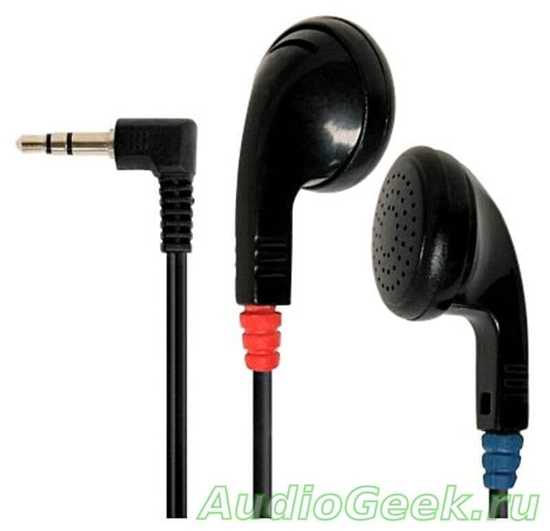
Не знаю чем они похожи на ракушки. Скорее следующая картинки больше подходит под это название:
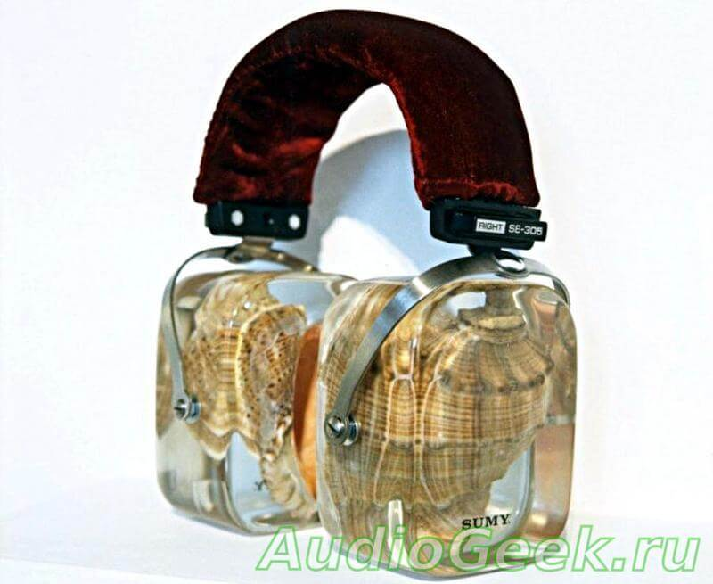
Но вернемся к теме. Сегодня также насчитывается немало сторонников данного исполнения. Вероятно, любовь к этому типу наушников отчасти обусловлена продукцией небезизвестной яблочной компании.
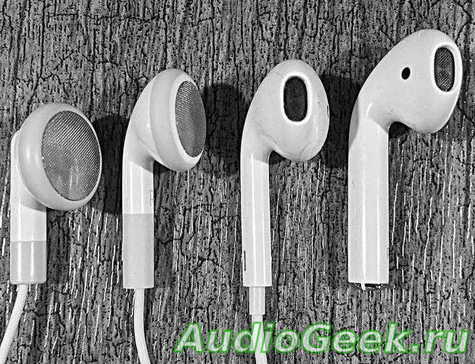
По большому счету их EarPods как и AirPods(***обзор***) тоже скорее ракушки чем затычки.

### *1.1 Комфорт*

Как и следует из названия, наушники вкладываются в ушную раковину. Для обеспечения большей герметичности некоторые производители одевают резиновые кольца. Для меньшего раздражения ушной раковины твердым пластиком, используются поролоновые насадки.
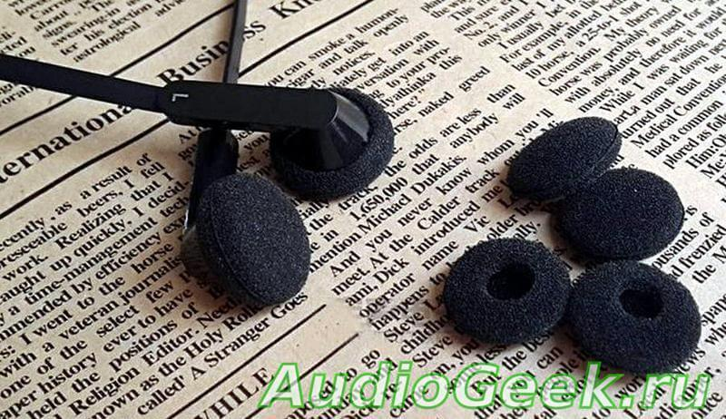
С накладочками или без эти наушники не могут похвастаться шумоизоляцией, поэтому в большинстве таких наушников вы будете слышать большую часть происходящего вокруг, а треки на вашем плеере вы наверняка будите слушать с окружающими.
Еще одной проблемой данного типа является то, что наушники не всегда соответствуют размерам и строению Вашей ушной раковины. Это приводит к тому что для кого-то наушники малы и выпадают, а кому-то давят...

### *1.2 Звук*

Такие наушники, как правило обладают динамическим излучателем диаметром 10-15 мм. Раньше когда подобные наушники тока появлялись, из-за отсутствия или дороговизны технологий производства таких маленьких динамиков, средние частоты у них были весьма завышены.
С учетом неплотного прилегания наушников к уху низкие и высокие частоты страдали еще больше. Это даже приводило к тому, что звукорежиссеры при записи музыки искусственно завышали низкие и высокие частоты.
Так же в моде была V-образная настройка эквалайзера, которая сегодня во многих эквалайзера именуется как “Рок”. А все потому, что в рок-музыке достаточно много средних частот. А в ракушках их было и без того с излишком.
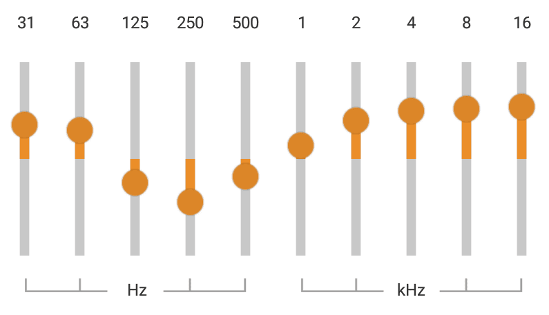
Сейчас уже научились делать качественные динамики даже меньших размеров. Однако проблема неплотного прилегания никуда не делась, поэтому сегодня производители стараются сделать провал на средних частотах, а низкие с высокими поднять.

### *1.3 Портативность*

С этим у наушников проблем точно нет. Они легко умещаются как в кармане, так и в других укромных местах небольшого размера. Я бы не советовал носить наушники абы где. В их отверстия может попасть мелкий мусор, который подпортит им и вам жизнь.

## 2. Внутриканальные наушники

Затычки, вакуумные наушники - такие народные названия получили внутриканальные наушники. Эти прозвища данный тип наушников получил за свои звукоизолирующие свойства конструкции.
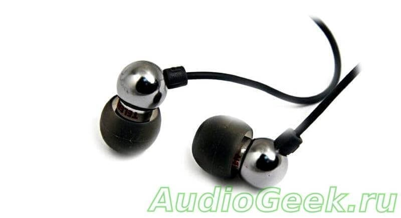

### *2.1 Комфорт*

Главное отличие заключается в создании практически герметичного объема между мембраной динамика и перепонкой уха. Такая герметичность обеспечивается применением силиконовой насадки.
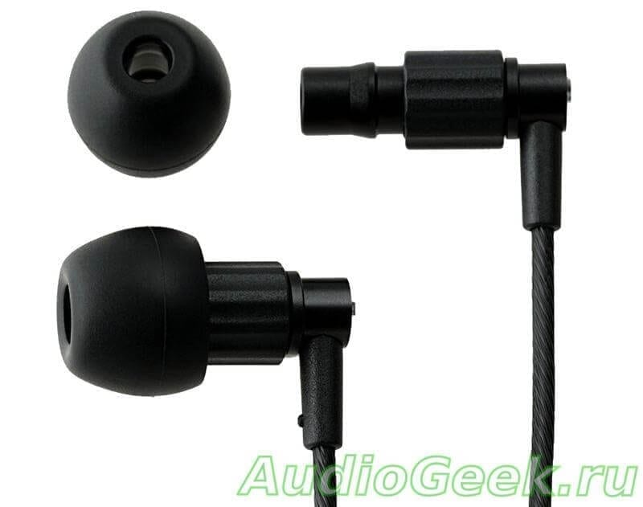
Не раз доводилось слышать, что людям не нравится ощущение вантуза в ухе. По этой причине они предпочитают ракушки. Многие люди действительно испытывают дискомфорт от затычек.
Но на самом деле достаточно их одеть и немного подождать. Устройство нашего уха таково, что оно само выровняет давление и станет комфортнее. Но и такое почему-то помогает не всем.

### *2.2 Звук*

Координальным техническим отличием является наличие звуковода, помещаемого непосредственно в слуховой канал. Благодаря этому мощность излучателей может быть на порядок меньше, чем у остальных типов наушников. Все колебания диффузора напрямую и максимально эффективно передаются барабанной перепонке.
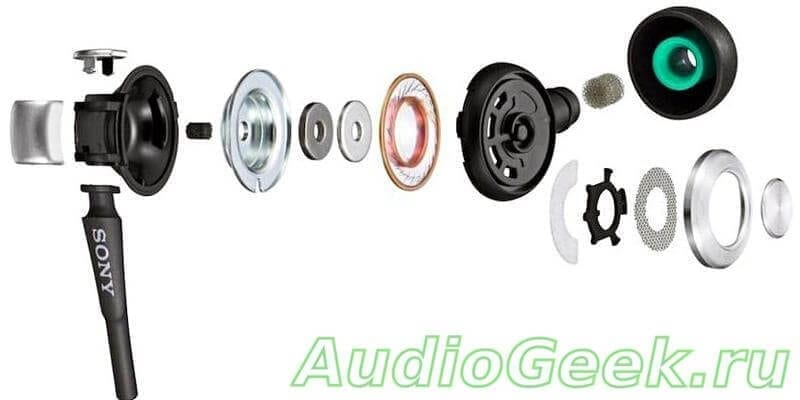
У внутриканальных наушников с динамическим излучателем диаметр мембраны обычно составляет 10-12 мм, но может быть всего 8 мм. Конструктивно такой динамик вызывает большие трудности. Наибольшую проблему представляет получение правильных низких частот и ровного частотного баланса.
Сегодня многие наушники, особенно из бюджетной категории, страдают задранными басами, которые перекрывают средние частоты, делая их маловырозительными. Глубина и детализации низких при этом не так хороша, как бы этого хотелось.
Помимо этого, столь малый размер динамика приводит к тому, что его резонансная частота лежит достаточно высоко. Это подчеркивает высокие частоты, которые часто начинают излишне шипилявить, цокать и чмокать.
Помимо динамического излучателя, во внутриканальных наушниках может использоваться и арматурный излучатель. Излучатель с уравновешенным якорем, как его называют официально, имеет лучшее звучание на средних и особенно высоких частотах.
Однако выжать приличные басы арматура не может в основном по причине своих очень скромных размеров. Поэтому все популярнее становятся гибридные модели наушников в которых динамический излучатель сосуществует с арматурным. Однако зачастую такие наушники имеют не самые малые размеры и не так удобны в ношении.

### *2.3 Портативность*

Как и у представителей предыдущего типа, проблем с портативностью тут нет. Да и играть они будут с достаточной громкостью от любой дырки. Но не стоит забывать, что качество звука определяется не только самими наушниками, но и качеством источника звука..
Для любителей максимальной портативности и отсутствия проводов сегодня развелась куча беспроводных решений.
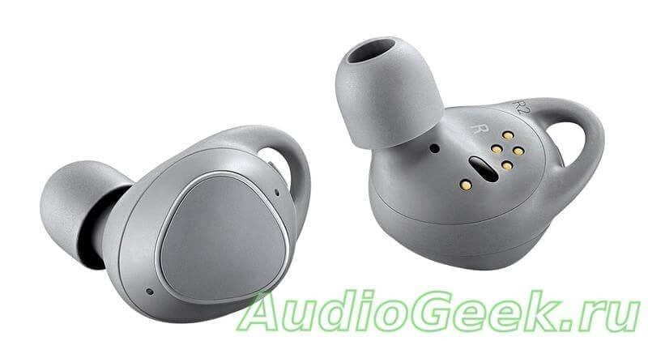

## 3. Накладные наушники

Названы так благодаря тому, что наушник, как и следовало ожидать, "накладывается" на ушную раковину. Накладные наушники это скорее компромисс.Они весьма удачное сочетание для тех, кому нужен качественный звук и при этом достаточная степень портативности.
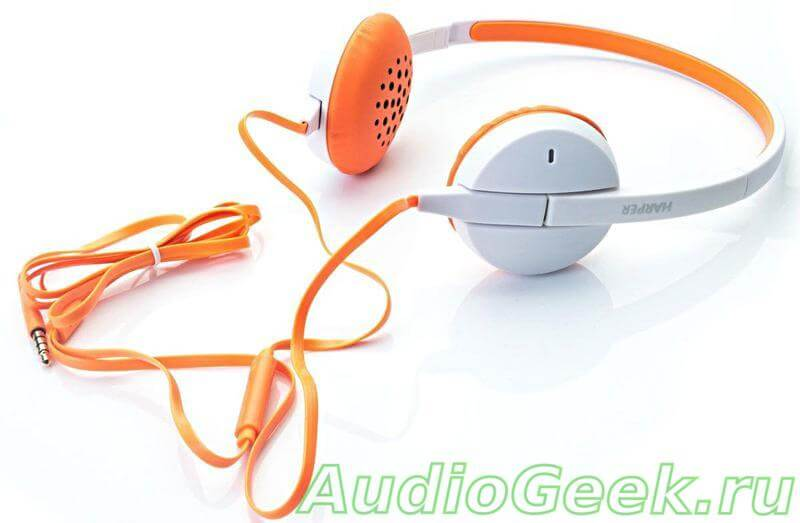
Если вы ищите себе не очень дорогие, но качественные накладные наушники, рекомендую присмотреться к ***наушникам Superlux.***
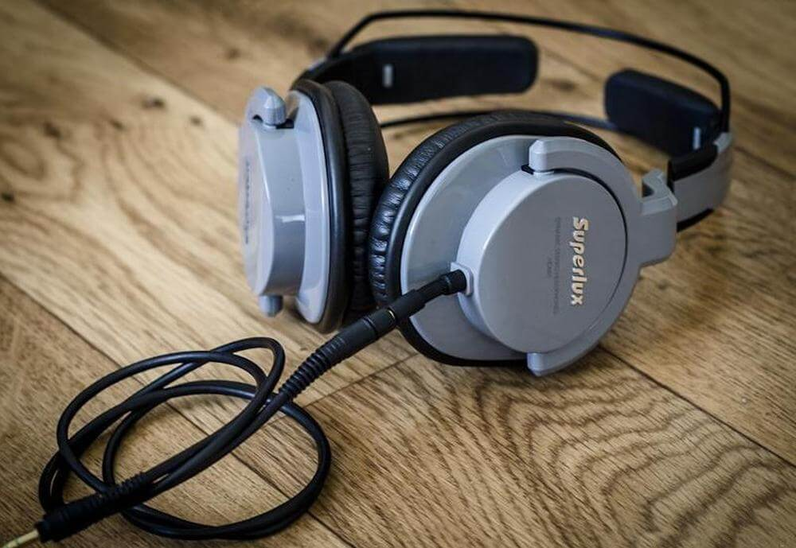

### *3.1 Звук*

Наушники-вкладыши не так велики, как полноразмерные наушники, но при их размере драйверов они могут обеспечить куда более хорошее качество звука, чем их младшие собратья.
Благодаря тому, что источник звука располагается за ушной раковиной, а не в ней, звуковому(слышимому) образу проще формироваться за пределами головы. Это способствует лучшему восприятию глубины и высоты звуковой сцены.
Это позволяет использовать накладные наушники и для профессиональных применений. Так существует мониторные накладные наушники. Что такое мониторные наушники, читайте в ***[статье](../monitoring-headphones/)***.
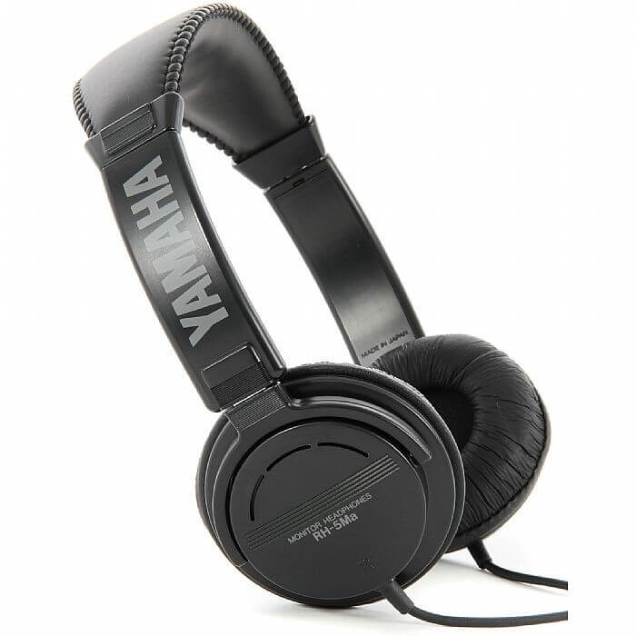

### *3.2 Комфорт*

Когда дело доходит до шумоизоляции, многие накладные наушники нервно курят в сторонке. Особенность их конструкции такова, что многие из них не могут плотно прилегать к ушной раковин. Если наушники открытые, то шумоизоляции в них нет в принципе.

В большинстве моделей при прослушивании музыки в метро гораздо лучше слышно метро, чем музыку. Хотя встречаются и моделью с достойной шумоизоляцией.
По этой причине все больше производителей выдает в свет модели с активным шумоподавлением. ***[Как работают наушники с активным шумоподавлением](../headphones-antinoise/)***
Накладные наушники как правило имеют размеры равные или меньше ушной раковины. При этом прижимаются они непосредственно к уху, поэтому при длительном ношении могту вызывать дискомфорт.

### *3.3 Портативность*

Накладные наушники гораздо более портативны, чем полноразмерные. Для еще большей портативности многие наушники делают складными. Часто в комплекте с наушниками так же идет небольшой мешочек или кейс для переноски.

## 4. Полноразмерные наушники

Полноразмерные наушники, называемые в английском языке ***Over ear*** (вокруг уха) либо же ***circumaural*** (круговые) являются самыми крупными. Они по праву считаются самыми качественными среди всех типов.
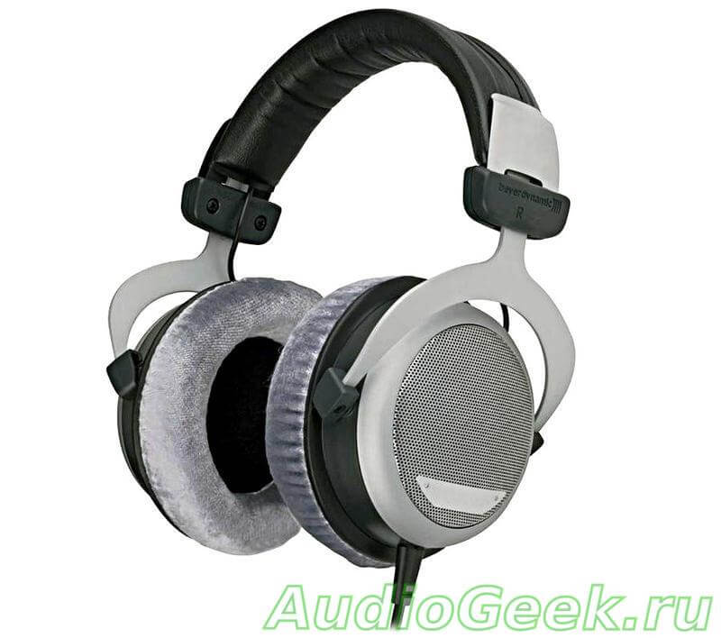
Как говорится - большому куску и рот радуется, а в данном случае ухо. Но чем же они лучше?

### *4.1 Звук*

Главная причина, благодаря которой полноразмерные наушники обладают наилучшим звуком очевидна - их размер. А если быть точнее, то размер их динамиков. Обычно диаметр драйверов полноразмерных наушников более 40 мм в случае динамических излучателей.
Динамику такого размера намного проще полноценно отыгрывать низкочастотную составляющую. Как следствие бас в них более проработанный, насыщенный и глубокий. Многие такие наушники имеют частотный диапазон от 8-10 Гц.
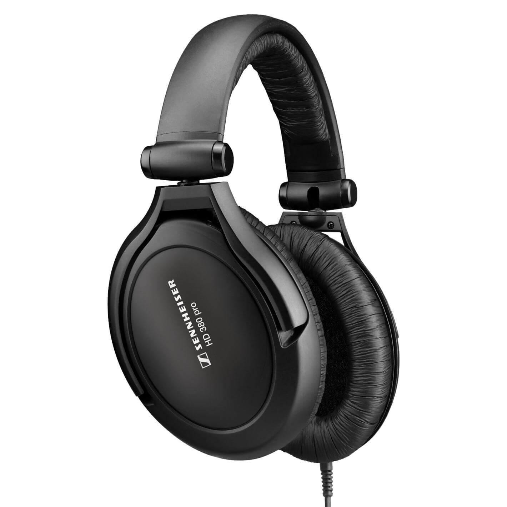
Но размеры наушников позволяют применять и динамики других более “экзотических” типов. Например это могут быть изо- или орто-динамические драйверы, динамики конденсаторного типа и другие.
Но дело не только в размере динамика, полноразмерная конструкция позволяет создать хорошую шумоизоляцию и исключить потери из-за неплотного прилегания.
Так же в таких наушниках проще реализовать различные системы акустических фильтров и звуководов для придания АЧХ нужной формы. Именно поэтому ***[мониторные наушники](../monitoring-headphones/)*** чаще всего полноразмерные.

### *4.2 Комфорт*

Эти наушники так же можно назвать и самыми комфортными среди всех типов. Они не воздействуют и не давят на ушную раковину, а обрамляют ее, прижимаясь мягкими амбушюрами непосредственно к голове.  Даже если амбушюры не так хороши, как хотелось бы, то их можно ***[сшить и самому](../earpads/)***.
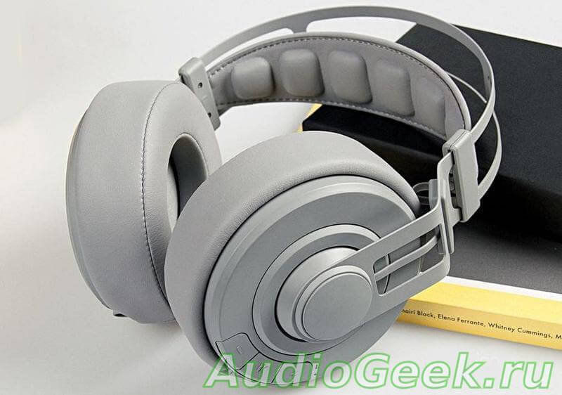
Вокруг вашего уха создается свой “микроклимат”. Однако это может создать некоторые проблемы при использовании в теплую и жаркую погоду - в наушниках будет попросту жарко.

### *4.3 Портативность*

В плане портативности тут все несколько хуже. Большинство полноразмерных наушников предназначены для домашнего или студийного применения. Очень редко полноразмерные наушники комплектуются мешочком или кейсом.
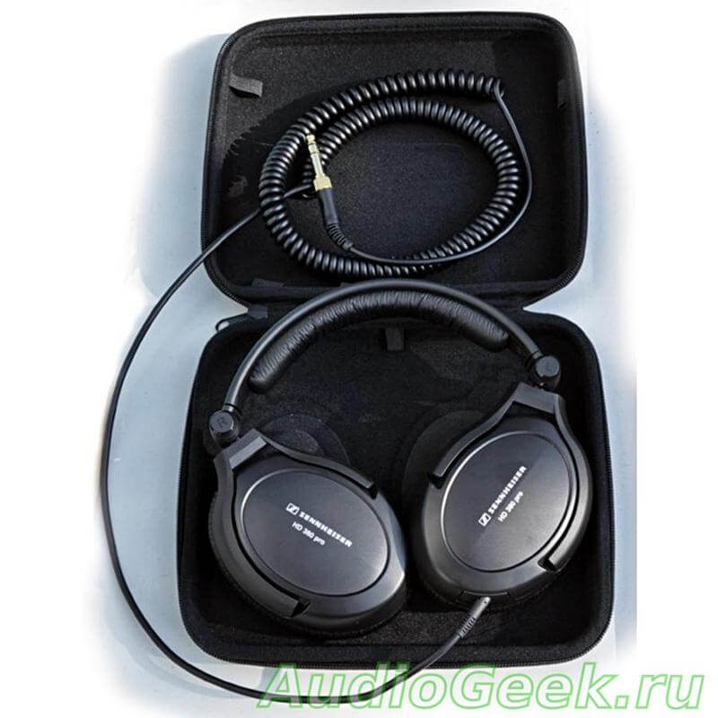
Конечно есть достаточно моделей, которые могут достаточно компактно складываться. Но если для вас в приоритете компактность - лучше присмотреться к предыдущим типам.
Дело не только в компактности. Большинство полноразмерных наушников обладает высоким сопротивлением и требует более мощного усилителя, поэтому не все плееры полноценно могут раскачать большинство полноразмерных наушников.
Интересным представителем полноразмерных наушников являются ***наушники HD668*** от компании ***Superlux***. Это китайская компания, в точности воспроизводящая именитые модели наушников, по ценам в несколько раз дешевле брендовых.
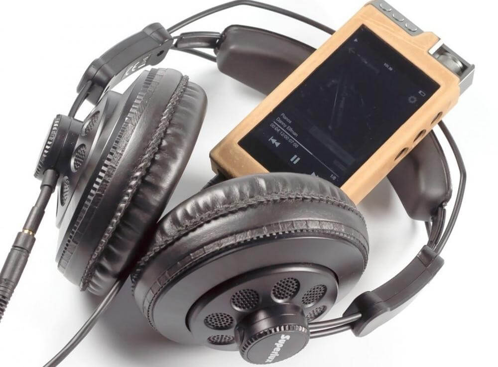

## Заключение

Как бы ни старались производители, идеальных наушников просто не существует. Но у каждого типа наушников есть свои сильные и слабые стороны. Например в метро логичнее взять с собой затычки, а дома наслаждаться полноразмерными наушниками.
Стоит повторить еще раз, что все описанные типы наушников могут иметь как открытую, та и закрытую конструкцию. Подробнее об отличиях наушников открытого и закрытого типов читайте в статье: ***[Открытые наушники и закрытые наушники, какие и для чего лучше](../open-close-headphones/)***

***Материал подготовлен исключительно для сайта*** ***[AudioGeek.ru](https://github.com/SkyTrip-13/AudioGeek)***
