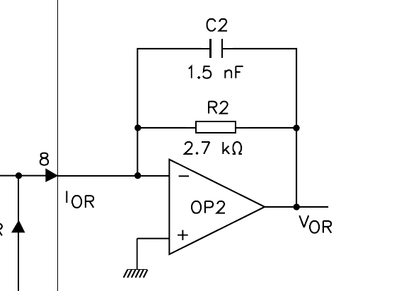
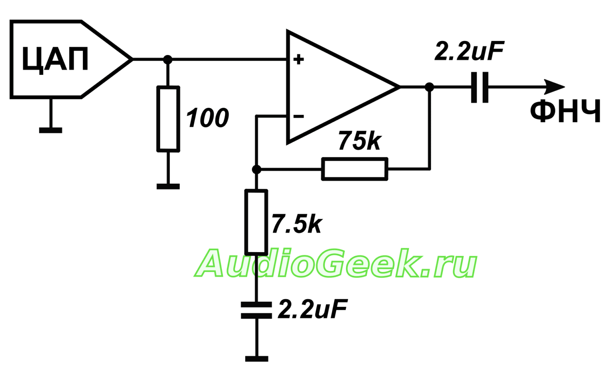
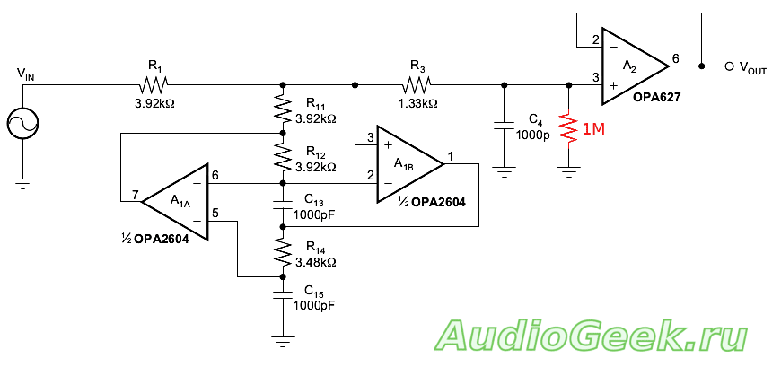
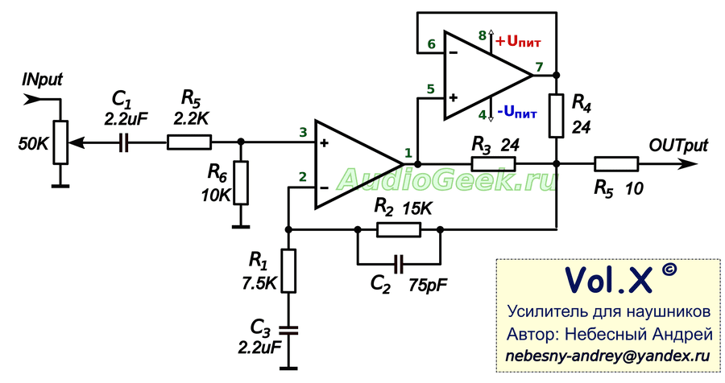
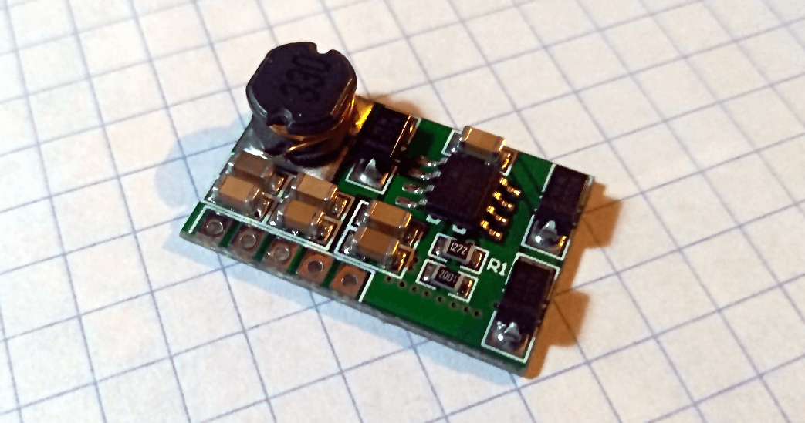
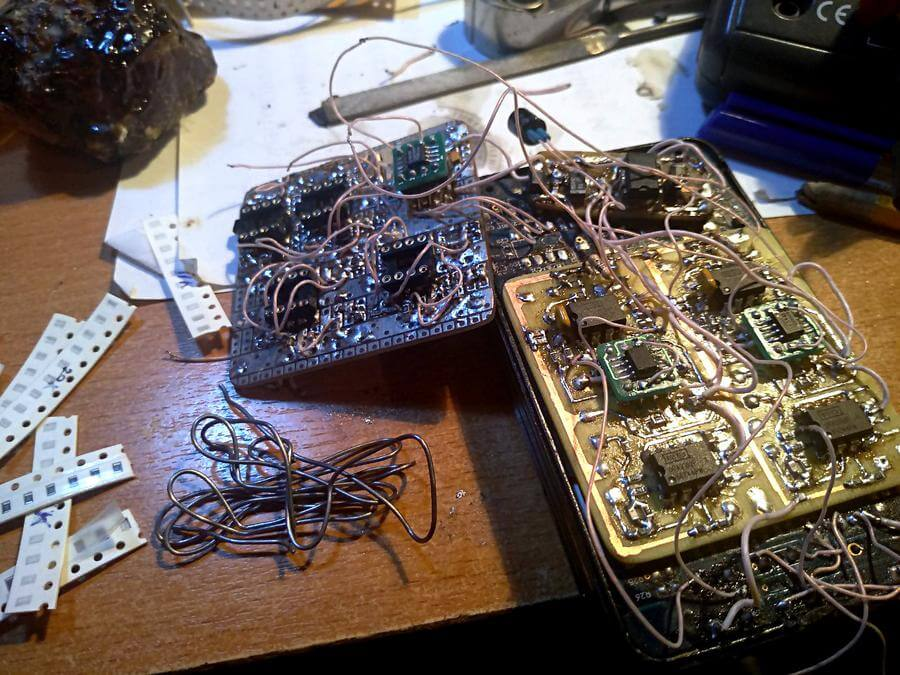

[Русский](./README.ru.md) | **English**

# A high-quality audio path: a complete mod of the HiFiMan HM-601 player

**Category:** Audio circuit design  
**Tags:** AliExpress, audio filters, op-amp circuit, DAC  
**Original:** https://audiogeek.ru/hifiman-hm-601-full-mod/

---

When it comes to sound quality there is no limit to perfection, you always want more. The HiFiMan HM-601 player has quite interesting characteristics, even though it belongs to the entry class of Hi-End devices. The work done on this player is a complete rebuild of the whole audio path, from the digital-to-analog converter (DAC) to the headphone jack. Here is how to create a high-quality audio path in a portable device.

## A little about the teardown

The player consists of two boards. When you unscrew the back cover you see the board with the analog section. The lower board does all the digital functions.

To avoid making a new analog board myself, I decided to simply desolder all the components. That decision, like the idea of the rework itself, came after the player took a hard fall onto a concrete floor.

I left the output connectors and the volume knob on the board. The connector to the lower board also stayed. From it come power and three wires of the I²S digital bus. Music reaches the DAC in digital form over this bus.

We will look at each stage the signal passes through separately, in the order of the signal path.

## The digital-to-analog converter (DAC)

As is well known, a DAC transforms the incoming digits into an analog electrical signal. The DAC used in the player, the TDA1543, is a cut-down portable version of the TDA1541 that many people love. On forums you very often see claims that in stock form the HM-601 sounds rather "dark" and lacks airiness, transparency and spaciousness in the high frequencies.

The DAC makes the main contribution to that impression. So we will replace it with a slightly more advanced one, the TDA1387. According to the chip makers' documentation, "this DAC uses an output current calibration system that very effectively compensates conversion errors".

This DAC also works over the I²S bus and is designed for single-supply battery operation from 3 to 5 volts. But many people recommend overclocking it to its limit of 5.5 volts. It will not die, and the sound will be denser and tastier.

### The DAC output stage

The DAC has a single-ended current output. To use the signal further, the current has to be converted to a voltage. The DAC documentation suggests the standard op-amp circuit for this:

This op-amp current-to-voltage converter is covered in detail in ***[this article](../i-u-preobrazovatel/)***.

### Conversion with a resistor

But if we want to get the most out of the DAC, it is better to use just a resistor for the conversion. The voltage obtained across the resistor must be amplified. A non-inverting amplifier circuit was used for that:

This circuit has a significant advantage over the classic I-V converter shown in the datasheet. Its main virtue is the absence of phase distortion, which is deadly for sound. Why this circuit is better and what the capacitors are for is explained in the article ***[A resistor for a current-output DAC](../i-u-preobrazovatel-na-rezistore/)***.

## Low-pass filter

The signal is obtained and amplified. Now all frequencies above the audible range have to be cut from it. This is a mandatory requirement of the ***[sampling theorem](../chastota-diskretizacii-teorema-kotelnikova/)***.

Ideally we need a filter with a 20 kHz cutoff giving more than −40 dB attenuation at 40 kHz. In practice that is hard to achieve, and the portable nature of the design imposes a number of restrictions.

You can take the simplest path and use an ***[RC circuit](../rc-circuit/)*** in the op-amp feedback. That gives a first-order low-pass filter. It has good phase characteristics but too gentle a roll-off.

Another option is a ***[second-order Butterworth low-pass filter](../second-order-low-pass-filter/)***. After soldering one and listening to it, it was immediately clear that it should not be used. The Butterworth filter has a considerable bend in its phase response near the cutoff frequency. As a result, the highest frequencies, which should sound very wide and create airiness, collapse toward the center. It is hard to describe. In short, you can forget about spacious sound...

### A gyrator low-pass filter

A yearning for the sublime led me to leaf through quite a few pages of text. A great low-pass filter solution for DACs and ADCs was found in the Burr-Brown documentation. They suggested using gyrators for such filters. A gyrator is a circuit that uses a capacitor and an op-amp to realize the properties of an inductor.

Such a circuit is an equivalent of a third-order RLRC filter with a 40 kHz cutoff. It has a perfectly linear phase response up to 20 kHz and a fairly steep roll-off. Read more: ***[A gyrator low-pass filter for DACs and ADCs](../filtri-na-gyratorah/)***.

A buffer is needed to match the fairly high-impedance filter output to the next stage. An ordinary ***[op-amp voltage follower](../povtoritel-opamp/)*** was used as the buffer.

Next the signal goes to the volume control. A 50 kΩ resistor is used, although 22 kΩ can be used to reduce noise. From the wiper of the variable resistor the signal goes to the headphone amplifier.

## The headphone amplifier

Most op-amps, even expensive ones, do not have very high output current. The typical value is 20–50 mA at peak. That is a problem for every op-amp headphone amplifier.

To overcome this flaw, an interesting circuit with two op-amps per channel was used. It is not a bridge configuration. The circuit was borrowed from Analog Devices documentation and refined. It turns out digging through datasheets is useful :)

The circuit is built on the principle of summing the output currents of each op-amp. The circuit and its refinement are described in detail in the article ***[An op-amp headphone amplifier with doubled output current](../headphone-amp-dual-current/)***.

## Power supply, an important question

Any active element, be it a tube, a transistor or an IC, is essentially a modulator of the supply voltage. It is extremely important that the power source can provide enough current at the given voltage.

Many chips today can run stably from ±2.5 V. But a higher voltage undoubtedly gives a significant improvement in sound quality. The DAC needs at least 3 V, but 5 V is better.

And what current is needed? In total the analog section includes 6 dual op-amps and the DAC. The typical consumption of each package is 5–6 mA. Let us say 50 mA in total is needed. In addition we want up to 50 mA at the output of each channel. It follows that the supply must provide up to 150–200 mA on both the positive and negative rails.

At first the power was implemented with a ***[MAX660 voltage inverter](../otricatelnoe-napryajenie-iz-polojitelnogo/)***. But its maximum output current is 100 mA, with a voltage sag of 0.35 V. The supply voltage is also ± the battery voltage, so the swing drops as the battery discharges. Another potential candidate was the ***[TPS65133](../unipolar-to-bipolar-voltage-converter/)***, but unfortunately I could not get one.

For now the solution has been found in a ready-made DC-DC converter module from AliExpress. You can order such a module for 5 or 6 volts, and by changing resistor R1 get ±5.5 volts. That is great for both the DAC and the op-amps. Moreover this voltage is ideal when powering from a battery, and now the supply voltage no longer depends on battery discharge.

Such a module costs only $3. At just 25×16.3×6.6 mm it copes superbly with all the electronics described above. I have already received a fifth such module with no problems. I got them from the manufacturer's shop, eletechsup, on AliExpress.

## Conclusion

The result exceeded all expectations. The sound became so deep, detailed and spacious that I rediscovered music. I still have the impression that I used to hear music completely differently.

How could I listen to it in the terrible quality that any consumer audio device gives?

During testing and while determining the component values, I first soldered everything on a breadboard. When I had more or less settled on the circuit, I quickly laid out a PCB. I was too lazy to bother, so I wired the power supply with jumper wires. I still cannot find time to lay out a proper version of the board... But it looks epic :) I will add the final photo a bit later, and for now I will show how it all looked during development.

On the downside, the battery drains quickly. It was also replaced, with one of 2200 mAh. A full charge lasts 6–7 hours of continuous use. If the music is in lossless formats, the running time is shorter by another hour.

**But it is worth it!**

*Originally written for [AudioGeek.ru](https://audiogeek.ru). Translated from Russian.*
