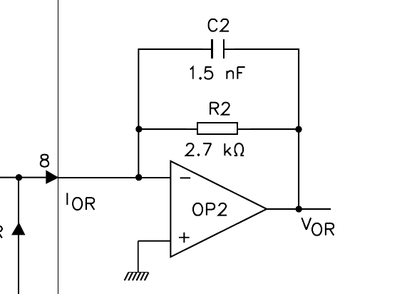
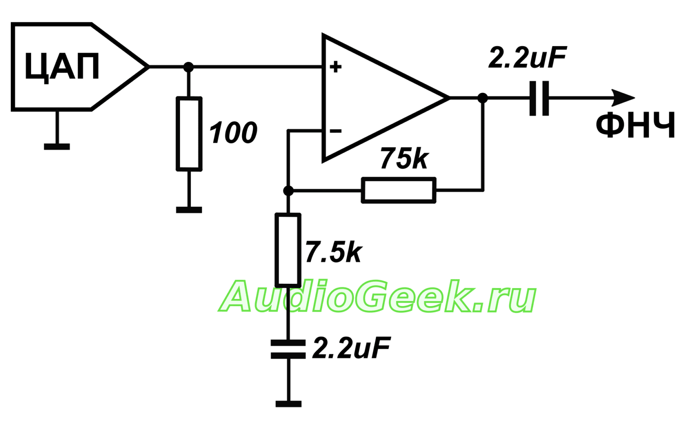
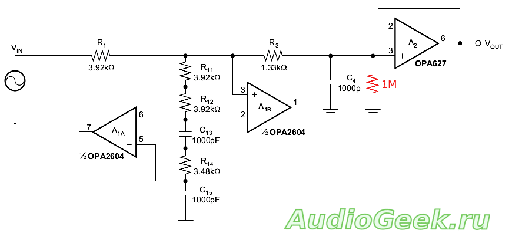
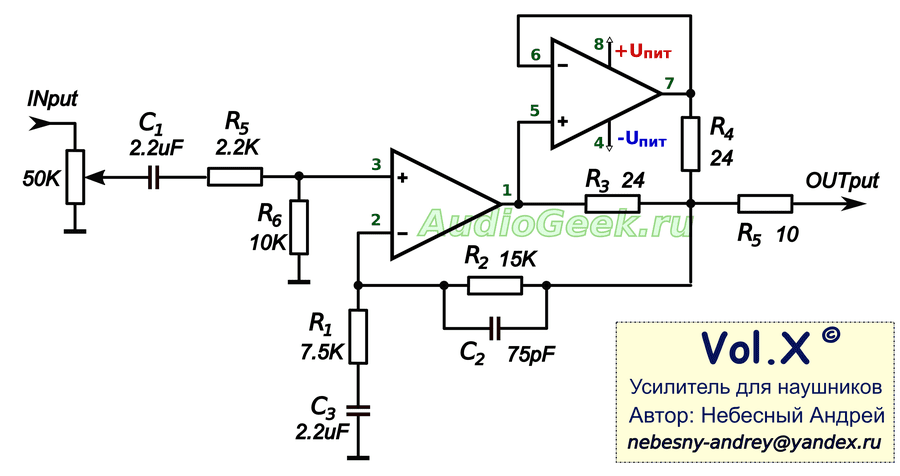
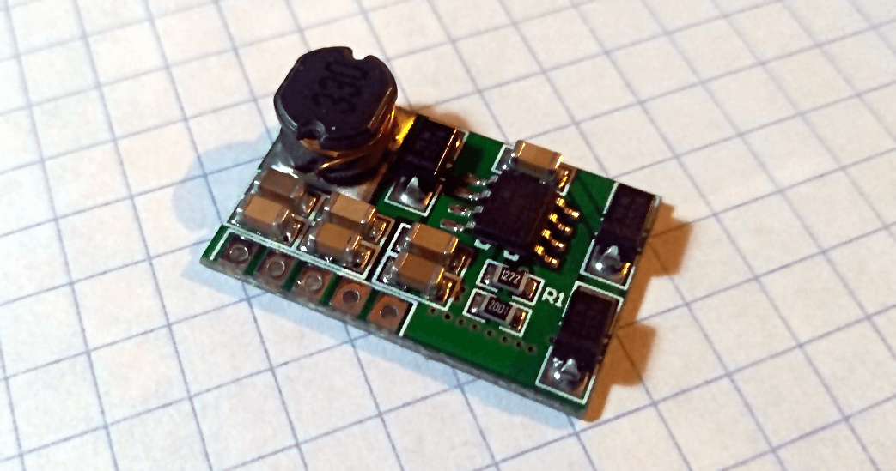
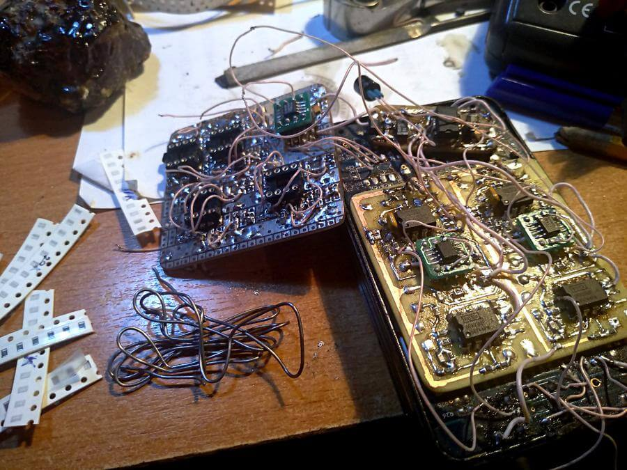

[English](./README.md) | **Русский**

# Высококачественный аудиотракт или полный мод плеера HiFiMan HM-601

**Дата:** 2019-02-04  
**Рубрики:** Схемотехника аудиотракта  
**Метки:** AliExpress, звуковые фильтры, схема на ОУ, ЦАП  
**Оригинал:** https://audiogeek.ru/hifiman-hm-601-full-mod/

---

В вопросах качества звука нет предела совершенству, всегда хочется большего. Плеер HiFiMan HM-601 обладает весьма интересными характеристиками, хоть и относится к начальному классу Hi-End устройств. Проделанная над плеером работа - это полная переработка всего аудиотракта, от Цифро-Аналогового Преобразователя (ЦАП) до разъема наушников. Рассмотрим подробно как сотворить высококачественный аудиотракт в портативе.

## Немного о препарировании

Плеер состоит из двух плат. При откручивании задней крышки плеера перед вами предстанет плата с аналоговой частью. Нижняя же плата выполняет все цифровые функции. 

Чтобы не заморачиваться с самостоятельным изготовлением аналоговой платы, было решено просто выпаять все компоненты. Такое решение, как и сама идея о переделке, возникли после жесткого падения плеера на бетонный пол.

На плате были оставлены выходные разъемы и крутилка громкости. Так же остался разъем для соединения с нижней платой. С нее приходят питание и три провода цифровой шины I²C. По этой шине музыка в цифровом виде приходит на ЦАП.

Каждый узел, использованный в пути сигнала мы рассмотрим отдельно. Порядок рассмотрения будет идти по пути следования сигнала. 

## Цифро аналоговый преобразователь (ЦАП)

Как известно ЦАП занимается трансформацией приходящих циферок в аналоговый электрический сигнал. Использованный в плеере ЦАП - TDA1543 является урезанной для портатива версией любимого многими TDA1541. На форумах очень часто можно встретить высказывания о том, что в исходном состоянии плеер HM-601 имеет довольно "темный" звук и что ему не хватает воздушности, прозрачности и объемности в ВЧ диапазоне.

Основной вклад в сложившееся мнение вносит примененный ЦАП. Поэтому его мы заменим на чуть более продвинутый вариант - TDA1387. Если верить документации авторов чипа, то в "этом ЦАПе применена система калибровки выходного тока, которая очень эффективно компенсирует ошибки преобразования".

Этот ЦАП так же работает по шине I²C и рассчитан на однополярное батарейное питание от 3 до 5 вольт. Но многие рекомендуют разгонять его до предельного напряжения в 5.5 вольта. Так он еще не сдохнет, а звук будет плотнее и вкуснее.

### Выхлоп для ЦАПа

ЦАП имеет несиммитричный токовый выход. Для дальнейшего использования сигнала необходимо преобразование тока в напряжение. В документации на сам ЦАП, для этих целей предлагается использовать стандартную схему на ОУ.:

Такой преобразователь ток-напряжение на ОУ подробно рассмотрен в ***[этой статье](../i-u-preobrazovatel/)***.

### Преобразование на резисторе

Но если мы хотим выжать из ЦАПа максимум, то лучше использовать для преобразования просто резистор. Полученное на резисторе напряжение необходимо усилить. Для этого была использована схема неинвертирующего усилителя:

Такая схемотехника имеет существенно приимущество над классическим i-u преобразователем, приводимым в даташите. Главным достоинством можно назвать отсутствие фазовых искажений, убийственных для звука . Чем такая схема лучше и зачем нужны конденсаторы читаем в статье: ***[Резистор для ЦАП с токовым выходом](../i-u-preobrazovatel-na-rezistore/)***.

## Фильтр низкой частоты

Сигнал получен и усилен. Теперь из него следует вырезать все частоты лежащие выше слышимого диапазона. Это является обязательным требованием ***[теоремы Котельникова о дескретизации сигнала](../chastota-diskretizacii-teorema-kotelnikova/)***.

В идеале необходим фильтр с частотой среза 20кГц , обеспечивающий затухание более -40дБ к частоте 40 кГц. На практике же такое труднореализуемо. Да и портативность конструкции накладывает ряд ограничений.

Можно пойти самым простым путем и использовать ***[RC цепь](../rc-circuit/)***, включенную в ОС операционного усилителя. Так мы получим ФНЧ первого порядка. Он имеет хорошие фазовые характеристики, но слишком плавный спад.

Еще одним вариантом может стать ***[ФНЧ Баттервота второго порядка](../second-order-low-pass-filter/)***. Спаяв и отслушав такой фильтр, сразу стало понятно, что использовать его не стоит. Фильтр Баттерворта имеет приличный загиб фазовой характеристики при приближении к частоте среза. Приводит это к тому, что самые высокие частоты, которые должны звучать очень широко и создавать воздушность, заворачиваются к центру. Трудно это описать. Вообщем про объемный звук можно будет забыть...

### ФНЧ на гираторах

Тяга к возвышенному сподвигла перелистать немало страниц текста. Великолепное решение ФНЧ для ЦАП и АЦП было найдено в закромах документации от Burr-Brown. Они предложили использовать для таких фильтров гираторы. Гиратор - это схемное решение, позволяющее посредством конденсатора и ОУ реализовать свойства катушки индуктивности.

Такая схема является аналогом RLRC фильтра третьего порядка с частотой среза 40 кГц. При этом она имеет идеально линейную фазовую характеристику до 20кГц и достаточно крутой спад. Читать подробнее: ***[ФНЧ для АЦП на гираторах](../filtri-na-gyratorah/)***.

Для согласования достаточно высокоомного выхода фильтра со следующим каскадом необходим буфер. В качестве буфера использован обычный ***[повторитель напряжения на ОУ](../povtoritel-opamp/)***.

Далее сигнал поступает на регулятор громкости. Использован резистор номиналом в 50 кОм.Хотя для уменьшения шумов можно и 22 кОма поставить. С движка переменного резистора сигнал поступает на усилитель для наушников.

## Усилитель для наушников

Большинство ОУ, даже дорогих, имеют не очень большой выходной ток. Типичное значение - 20-50 мА в пике. Это является проблемой для всех наушниковых усилителей на ОУ. 

Для преодоления этого порока была применена интересная схема с двумя ОУ на канал. Но это не мостовое включение. Схема была позаимствована в документации Analog Devices и доработана. Полезно оказывается в даташитах копаться)

Схема построена на принципе суммирования выходных токов каждого ОУ. Подробно схема и ее доработка описаны в статье: ***[Схема усилителя для наушников на ОУ с удвоенным выходным током](../headphone-amp-dual-current/)***.

## Питание - важный вопрос

Любой активный элемент, буть то лампа, транзистор или микросхема по своей сути являются модуляторами напряжения питания. Крайне важно, чтобы источник питания мог обеспечивать достаточную величину тока при заданном напряжении.

Сегодня многие микросхемы могут стабильно работать начиная с напряжения ±2.5 В. Но большее напряжение несомненно дает значительный прирост в качестве звука. Для цапа нужно хотябы 3, но лучше 5 Вольт.

А какой ток требуется для питания? суммарно аналоговая часть включает в себя 6 сдвоенных ОУ и ЦАП. Типичное значение потребления каждого корпуса составляет 5-6 mA. Будем считать, что суммарно нужно 50 mA. Помимо этого мы хотим иметь на выходе каждого канала ток до 50 мА. Логично, что источник питания должен обеспечивать ток до 150-200 мА по положительному и отрицательному напряжению.

Изначально питание было реализовано на ***[инверторе напряжения MAX660](../otricatelnoe-napryajenie-iz-polojitelnogo/)***. Но ее максимальный выходной ток составляет 100мА и это при просадке напряжения в 0,35 В. Напряжение питания же получается ± Uбатарейки. Соответственно размах напряжения падает вместе с разрядкой батарейки. Другим потенциальным кандидатом могла стать ***[TPS65133](../unipolar-to-bipolar-voltage-converter/)***, но увы ее не удалось приобрести.

На данный момент решение было найдено в готовом модуле dc-dc преобразователя с АлиЭкспресс. Можно заказать такой модуль на 5 или 6 вольт, а перепайкой резистора R1 получить ±5.5 вольта. Что отлично и для ЦАПа и для ОУ. К тому же такое напряжение оптимально при питании от аккумулятора, да и теперь напряжение питания не зависит от разрядки аккумулятора.

Стоит такой модуль всего 3$. Имея размеры всего 25×16.3×6.6 мм он на отлично справляется со всей описанной выше электроникой. Получил уже пятый такой модуль - никаких проблем. Заказывать рекомендую в магазине производителя модулей ***eletechsup Outlet Store*** на Алиэкспресс.

## Заключение

Полученный результат превзошел все ожидания. Звучание стало настолько глубоким, детальным и объемным, что я по новому открыл для себя музыку. Меня до сих пор не покидает впечатление, что раньше я слышал музыку совершенно по другому.

Как я мог ее слушать в том ужасном качестве, что дает любое бытовое аудиоустройство?

В ходе тестов и определения номиналов деталей сначала напаивал все на макетке. Когда более менее определился со схемотехникой развел по быстрому печатку. Лень было напрягаться поэтому питание кинул проводами. Развести нормальный вариант платы все никак не хватает времени... Но выглядит эпично :) Конечное фото добавлю чуть позже, пока что покажу как все это выглядело в процессе разработки.

Из минусов - быстрый разряд аккумулятора, который кстати тоже был заменен на аккумулятор емкостью 2200 мА\*ч. Полной зарядки хватает на 6-7 непрерывного пользования. Если музыка в лосслесс форматах, то время эксплуатации сокращается еще на час.

**Но оно того стоит!**
