[Русский](./README.ru.md) | **English**

# How to improve the sound of hybrid earphones, using the KZ ES3 as an example

**Category:** Headphone mods  
**Tags:** Chinese earphones, DIY  
**Original:** https://audiogeek.ru/hybrid-headphones-mod/

---

It is hard to get solid bass from balanced-armature drivers, so hybrid earphones are becoming more and more popular. The most common and affordable two-driver models often suffer from an uneven frequency response. Today, using the very cheap but quite interesting KZ ES3 as an example, we will see how to significantly improve the sound of hybrid earphones in a simple way.

## A little about the test subject

Judging by search queries, the ES3 hybrid earphones from Knowledge Zenith have not yet gained much recognition. The KZ ZST hybrids, the forerunners of the ES3 described here, are much better known.

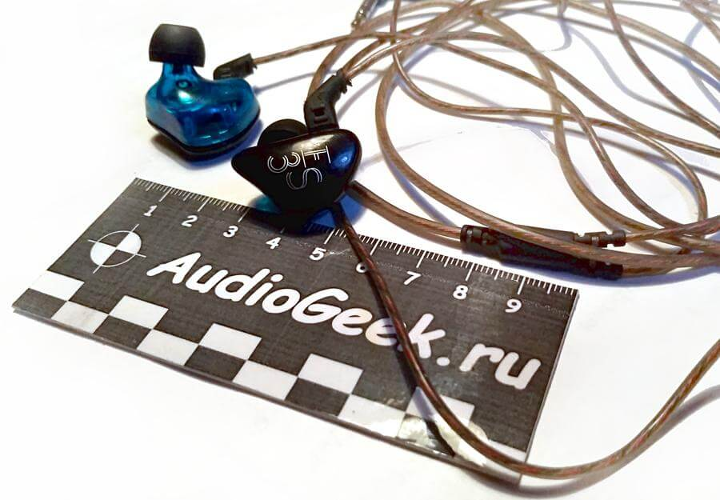

There are enough reviews of both KZ models without me. The sound is indeed very good, and for the price it is excellent. By the way, at the time of writing the earphones cost only $12. Compared with famous brands that is 3 times cheaper or more...

> Note that any hybrid or pure balanced-armature earphones are quite demanding for the sound source. It is desirable to have a device with a fairly powerful output. This recommendation applies not only to balanced-armature earphones but to any headphones. A good solution can be a *[**simple headphone amplifier**](../headphone-amp-dual-current/)* that you can easily build yourself.

## What is wrong with the earphones?

In general the earphones are fine. The main reason for what I did to the KZ ES3 was the bright highs, which are tiring, and the recessed midrange, which the bass encroaches on. But that is in comparison with the sound of ***[professional headphones](../monitoring-headphones/)***.

It is quite possible that many people will like the out-of-the-box sound. Similar traits are typical of many hybrid earphones because of the difficulty of matching the drivers.

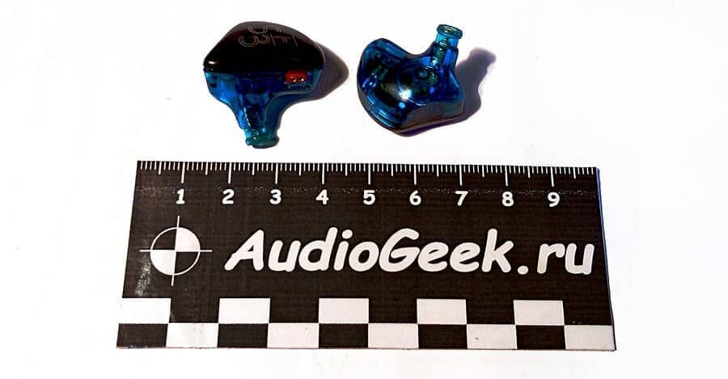

Of course a lot also depends on the music you prefer. But the dip in the mids, for many styles, usually makes you turn the volume up. As a result the boosted highs start to scour and cut the ear.

After a year of fairly regular listening I could not stand it. I decided to improve the sound and climbed in to do my little deeds. The earphones have great potential, even though they are budget.

## Disassembly

Each earphone consists of two halves. The black back wall is held on by 5 pins. They are lightly smeared with glue. The whole back wall is also glued around the perimeter.

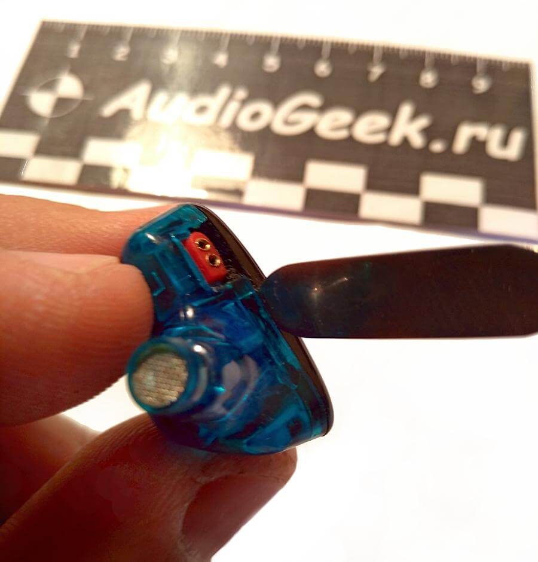

The glue is not reinforced concrete, as is often the case with Chinese products. The main thing when opening is not to rush. It is best to start from the connector. Carefully run a thin object along the seam several times, slightly pushing the parts apart.

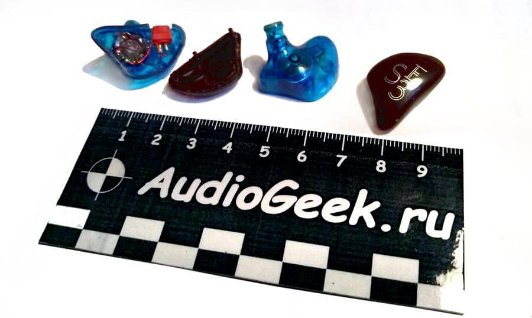

After that the earphone opens up its soul to us and we get access to its insides, and room for creativity.

## How to improve the sound

The two drivers in the KZ ES3 are simply connected in parallel. Each just plays what it can.

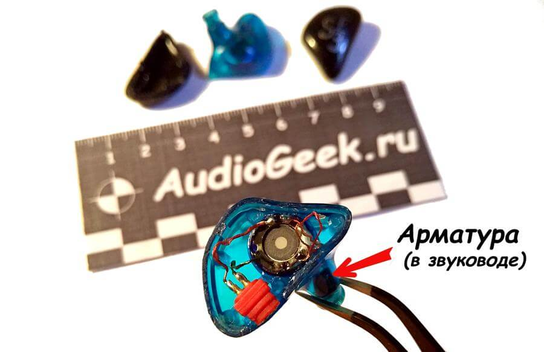

In general it is a good idea. There are no filters affecting sound and phase. But the problem is that balanced-armature drivers, compared with dynamic ones, have higher sensitivity at lower impedance.

As a result we get a boost in the highs. This boost strongly emphasizes all hissing and clicking sounds, which is unpleasant and tiring. It is especially noticeable with a not very powerful source, such as a Xiaomi Redmi 5 phone.

So the first torture for the earphones will be reducing the amount of high frequencies.

## Mod #1: reduce the highs

Playing with an equalizer showed that my ears want the highs cut by 6 dB. That is equivalent to halving the volume.

How do we do it? Very simply! You need a resistor connected in series with the armature driver. At these sizes and such low power, an 0805 SMD resistor is convenient.

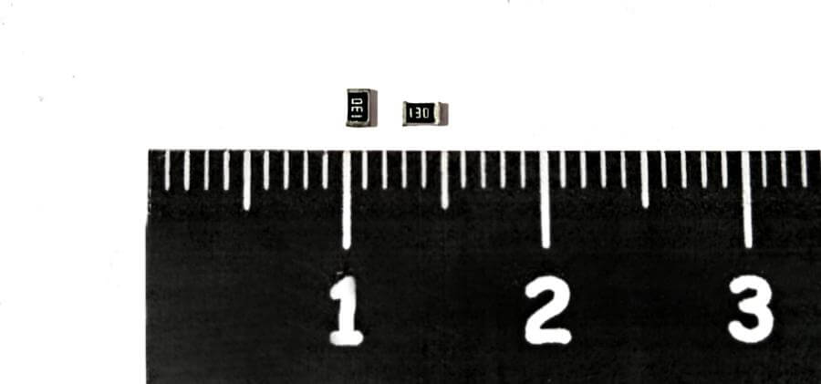

If the resistor value equals the driver's resistance, the power arriving at them is divided equally. As a result, half of what was meant for the armature is dissipated in the resistor as heat.

After desoldering the armature driver's wires you can measure the resistance of each driver separately. The armature drivers measured **12.7 Ω** and the dynamic ones **20.9 Ω**.

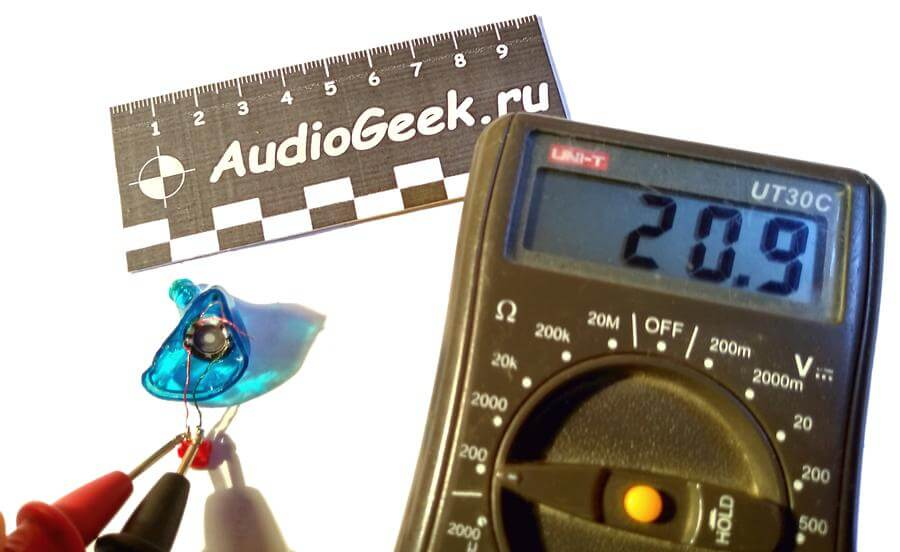

So the armature driver's resistance is 12.7 Ω, and the resistor should have the same resistance. If a 6 dB cut of the highs is too much for your taste, you can reduce the resistor value to whatever you like.

### How to solder the resistor

For those who find it easier to see once than hear a hundred times:

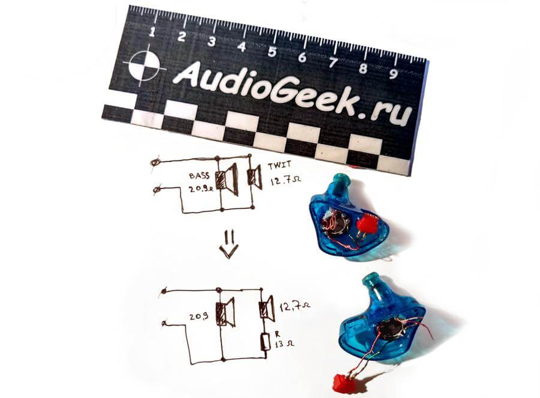

Besides cutting the highs, wiring the resistor this way has another advantage. Every driver is a complex resonant system with a resonant frequency. The manufacturers' main efforts to improve sound are aimed at lowering the Q factor, that is, reducing the resonant peak.

A resistor in series with an inductance, in our case the driver, lowers the Q of the circuit. So the frequency response should become smoother.

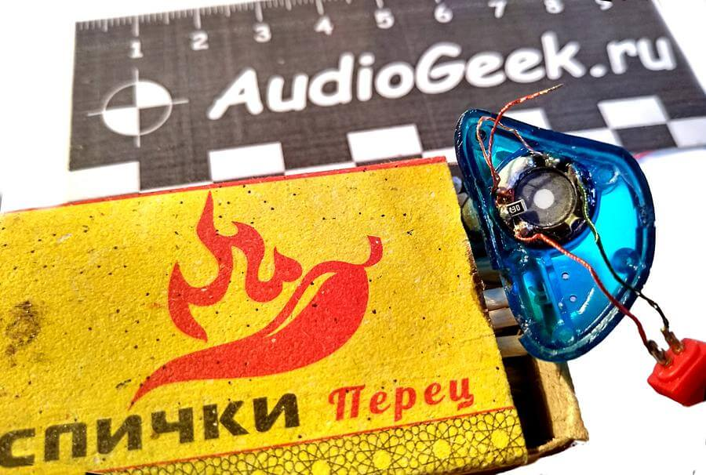

***For easier soldering you can clamp the earphone in a matchbox***

Conveniently, the contact pads are originally intended for soldering two wires. To solder in the resistor, first desolder one of the armature driver's wires.

Then solder one end of the resistor to the freed pad. And solder the desoldered wire to the free end of the resistor.

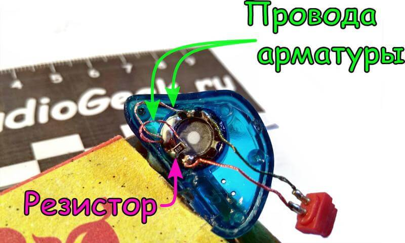

The downside of this deed is a small loss in volume. But most modern sound sources have enough headroom to cover that loss.

## Mod #2: taming the boomy bass

The problem is that the lower register is not well worked out. On some recordings there is also a slight drone. The cause is usually the plastic body. Mechanical vibrations travel through it very easily. Damping them is what we will do now.

To remove extra vibration and resonances, vibration-damping materials are used. As a rule they are amorphous substances with a very viscous consistency, stuck onto the resonating surfaces. Modeling clay or bitumen are examples of such substances.

More interesting and practical is foil-backed bitumen damping sheet ("folgoizol"), used for vibration damping in cars. It is essentially bituminous resin with various additives, covered with a layer of aluminum.

I already have experience experimenting with this material in audio. The material itself is described in more detail in the article about ***[damping Sennheiser HD 380 Pro headphones](../vibro-dempfirovanie/)***. It was also used in the ***[Samsung earphone mod](../vibra-vkladishi/)***.

For metal surfaces it is usually recommended to cover more than 50% of the surface. For plastic, 10–15% is enough. For earphones, too much damping material would make them heavy. I chose to use two small pieces in each earphone.

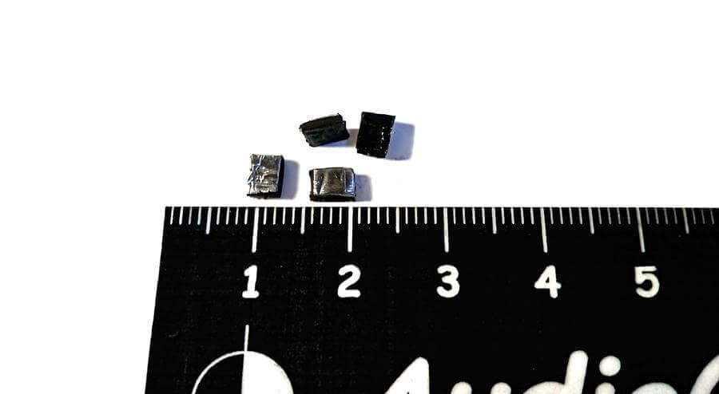

The pieces are about 2.5×2.5 mm, 1 mm thick. I decided to glue them into the corners. After pressing them in firmly with a screwdriver, a hot soldering iron was held near them for 1–2 seconds without touching. Then the same screwdriver pressed the material as tightly as possible against the body.

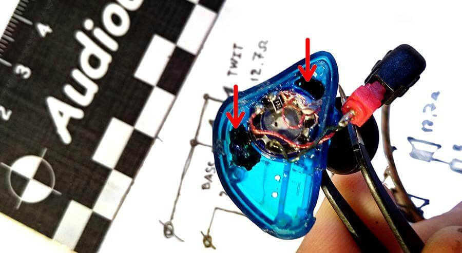

## Mod #3: damping the bass driver

I had noticed long ago that the left earphone has more bass than the right. The reason turned out to be very simple: one acoustic filter had come slightly unstuck.

If you look at the driver from the back you will find a sound filter stuck in the center of the magnet. The filter damps the bass driver. If you peel it off, there is a small recess under it.

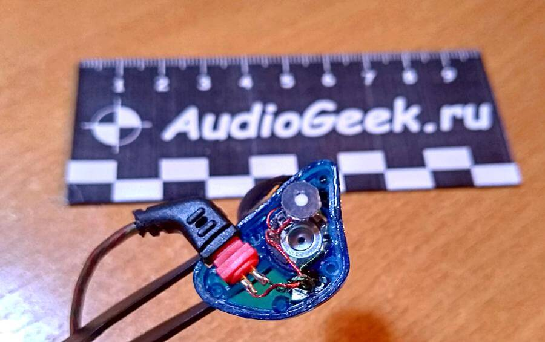

***In the photo the filter has already been peeled off***

Removing the filter leads to uncontrolled low-frequency drone, as if the sound came from a fairly long pipe. If you seal the filter on tightly, the lows and mids sag. The filter should be semi-transparent to sound but still be a sufficient load for the driver.

After trying various materials I chose a damping method. We fill the inner volume inside the driver magnet, under the filter, with cotton wool, and glue fabric tape over it.

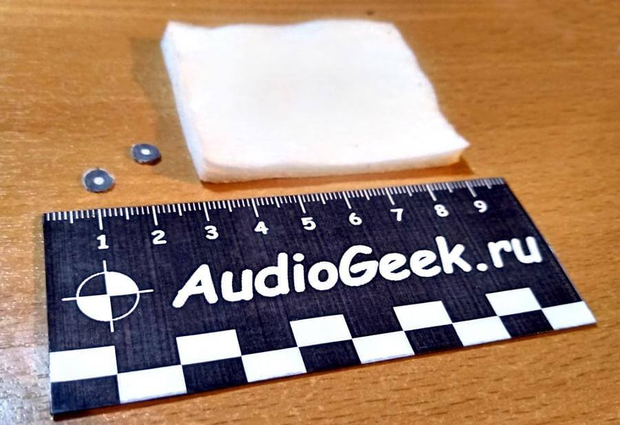

I used vape cotton in sheet form. It is cheap and sold in any vape shop. This cotton is thoroughly cleaned and laid with the fibers in one direction. And because it comes as a sheet, it is easy to dose.

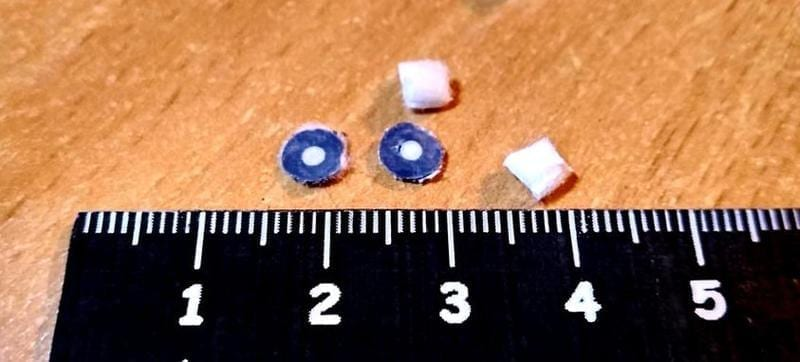

For damping I cut a 3×3 mm square and split it in half through its thickness. Each piece was then fluffed up with tweezers.

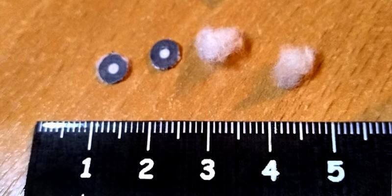

Cut two squares from the roll of fabric plaster. To round them off, trim the corners, turning them into octagons.

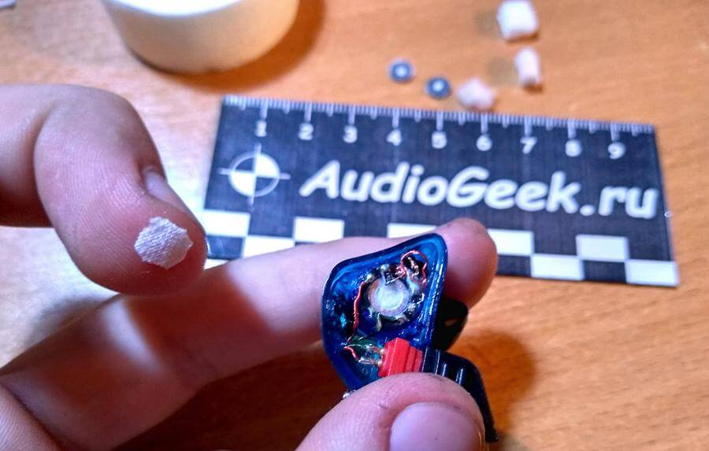

***The cotton fits fairly tightly into the recess in the driver magnet***

Glue the octagons over the cotton onto the driver. The cotton fibers must not stick out of the recess. Cotton is a very good natural damping material, and the fabric tape lets part of the sound through.

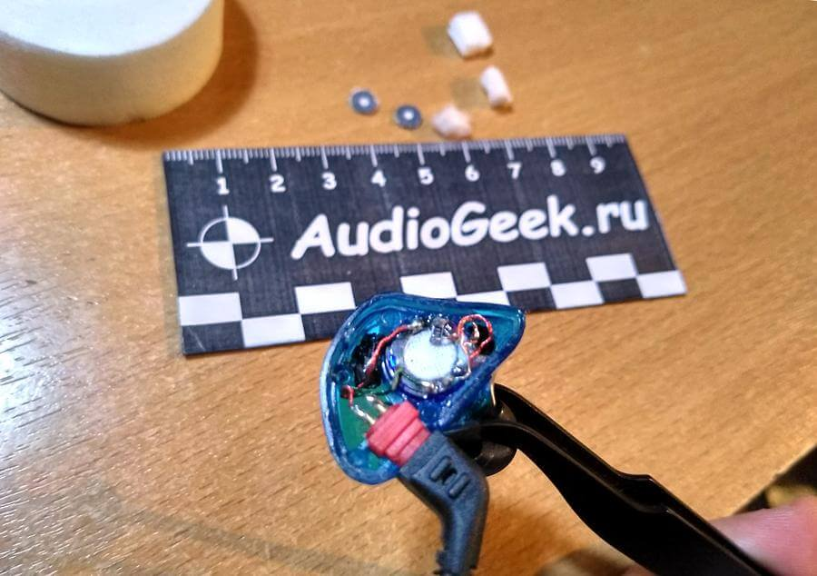

This damping completely brought the bass register under control. There is no less bass, there is as much as there is. Sometimes it is so much it sets your teeth on edge.

## Results of the mod

After all this the midrange became normal and the sound more even. Music styles with lots of midrange are now much more pleasant to listen to. That applies especially to heavy styles and various live music.

Reducing the highs let me increase the depth of the soundstage and even out the frequency balance. Overall I am very happy with the mod. I did not even expect it to turn out so well that I could postpone buying more expensive earphones.

## Conclusion

If you do not have these earphones yet, I definitely recommend buying them. They sound good even in factory form. And if you want to experiment, now you know what to do and how to improve the sound.

The same can be done with any other hybrid earphones. For example, Xiaomi's hybrids have similarly boosted highs and droning lows.

If you have already started down this thorny road to quality sound, I also recommend reading the beginning of the article about the ***[portable headphone amplifier](https://audiogeek.ru/volx/)*** (in Russian). It will make clear why a phone is not the best sound source.

*Originally written for [AudioGeek.ru](https://audiogeek.ru). Translated from Russian.*
