[English](./README.md) | **Русский**

# Как улучшить звук гибридных наушников, на примере  KZ ES3

**Рубрики:** Доработка наушников  
**Метки:** китайские наушники, своими руками  
**Оригинал:** https://audiogeek.ru/hybrid-headphones-mod/

---

От арматурных излучателей трудно добиться солидных басов, поэтому все популярнее становятся гибридные наушники. Самые распространенные и доступные двух-драйверные модели, зачастую, страдают не очень ровной АЧХ. Сегодня на примере очень дешевых, но весьма интересных, наушников KZ ES3 рассмотрим как простым путем значительно улучшить звук гибридных наушников.

## **Немного о подопытном**

Гибридные наушники ES3 от компании Knowledge Zenith, судя по запросам в поиске, пока не получили особого признания. Пока гораздо более известны гибридные наушники KZ ZST, являющие прородителями описываемых KZ ES3.
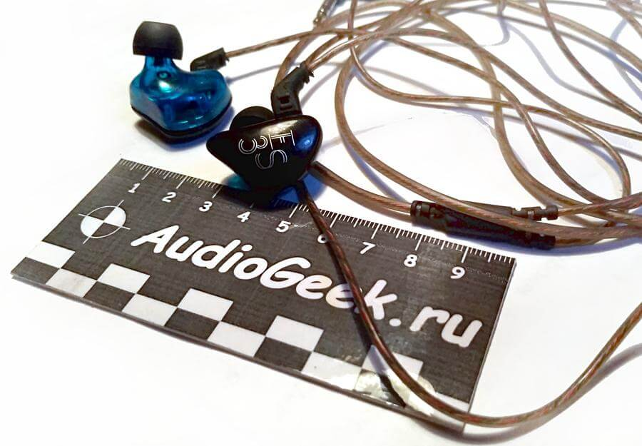
Обзоров на обе модели от KZ хватает и без меня. Звук у наушников действительно очень хороший, а при их стоимости вообще отличный. К слову, на момент написания статьи, стоят наушники всего 12$. В сравнении с именитыми брендами это дешевле в 3 и более раз...
На Алиэкспресс есть даже фирменный магазин ***KZ Official Store***. Но почему-то их же наушники там на 1-2$ дороже, чем в других магазинах. Сам я заказывал в другом ***хорошем магазине  аудиотоваров*.** Там цена в обычные дни оказалась ниже, чем в других магазинах в черную пятницу.
> Следует заострить внимание, что любые гибридные и чисто арматурные наушники достаточно сложны для источника звука. Желательно иметь устройство с достаточно мощным выходом.
>  Эта рекомендация относится не только к арматурным наушникам, но и вообще к любым.  Отличным решением тут может стать *[**простой усилитель для наушников**](../headphone-amp-dual-current/)*, который можно легко собрать самостоятельно.

## Что не так с наушниками?

В целом с наушниками все хорошо. Основной причиной содеянного над KZ ES3 стали яркие верха, которые утомляют, и проваленная середина, на которую наезжает бас. Но это в сравнении с звуком ***[профессиональных наушников](../monitoring-headphones/)***. 
Вполне возможно, что многим придется по вкусу звучание наушников из коробки. Аналогичные черты свойственны многим гибридным наушникам из-за трудностей согласования  динамиков.
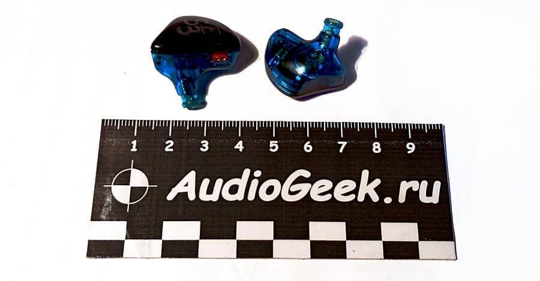
Конечно многое так же зависит от предпочитаемой музыки. Но провал середины, для многих стилей, обычно вынуждает поднять громкость выше. Как результат - задранные высокие начинают песочить и резать слух.
После года относительно регулярного прослушивания музыки, я не выдержал. Решил улучшить звук наушников и полез в них творить свои делишки. Потенциал то у наушников большой, хоть они и бюджетные.

## Разбор наушников

Каждый наушник состоит из двух половинок. Задняя черная стенка крепится на 5 штырьках. Они слегка смазаны клеем. Также по периметру клеем смазана и вся задняя стенка.
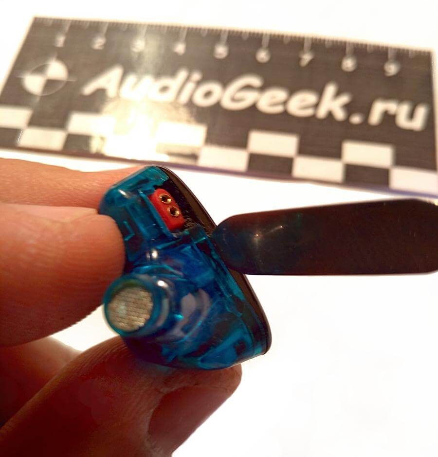
Не сказать, что клей железобетонный, как это обычно бывает у продуктов китайской промышленности. Главное при разборе - не торопиться. Начинать разбор лучше от разъема. Достаточно аккуратно пройтись несколько раз по стыку тонким предметом, слегка раздвигая части.
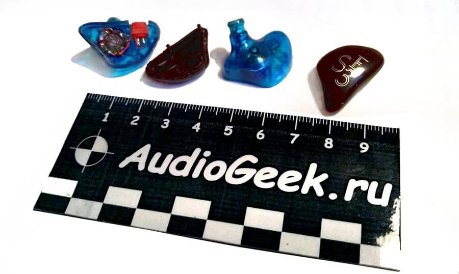
После этого наушник откроет нам свою душу и мы получим доступ к его потрохам и просто для творчества.

## Как улучшить звук наушников

Имеющиеся в наушниках KZ ES3 два динамика тупо подключены параллельно. При этом каждый просто отыгрывает то, что умеет и может.
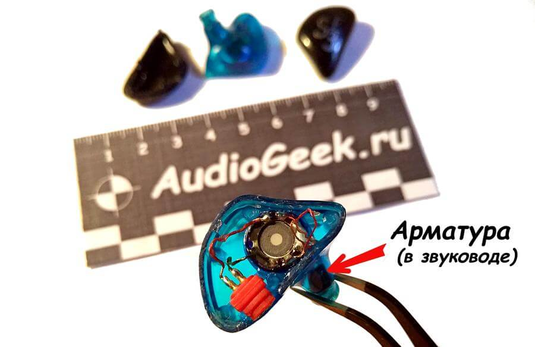
В целом это хороша идея. Тут нет никаких фильтров, влияющих на звук и фазу. Но проблема в том, что арматурные излучатели, в сравнении с динамическими, обладают большей чувствительностью при меньшем сопротивлении.
Как результат и имеем подъем на высоких. Этот подъем очень хорошо выделяет все шипяще-цокающие звуки, что не очень приятно при прослушивании и утомляет слух. Особо сильно это проявляется при прослушивании с не очень мощного источника, например телефона Xiaomi Redmi 5.
Поэтому первой пыткой для наушников станет уменьшение количества высоких частот.

## Пытка #1 - уменьшаем ВЧ

Игры с эквалайзером показали, что мои ухи требуют среза высоких частот на 6 дБ. Это соответствует уменьшению громкости вдвое.
Как же это реализовать? - Очень просто! Понадобится резистор, который необходимо включить последовательно с арматурным динамиком. При таких размерах составных частей и столь малых мощностях, удобно использовать SMD резистор 0805.
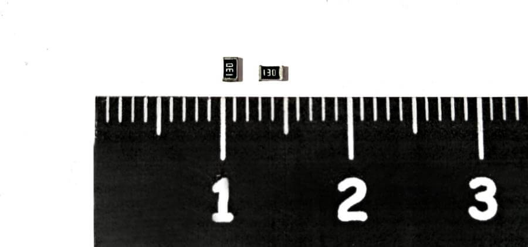
Если величина резистора будет равна сопротивлению динамика, то приходящая на них мощность будет делиться поровну. Как результат - половина того, что предназначалось арматуре будет выделяться на резисторе в виде тепла.
Отпаяв проводки арматурного излучателя можно измерить сопротивление каждого динамика по отдельности. Арматурные динамики имели сопротивление по **12.7 Ома**, а динамические по **20.9 Ома**.
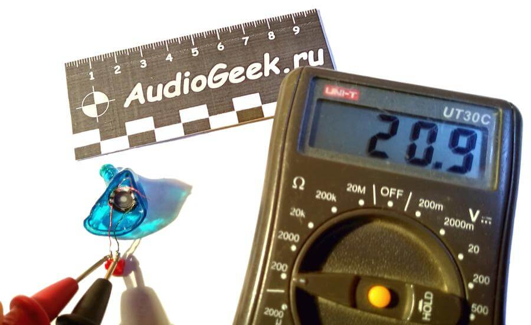
Итак, сопротивление арматурного излучателя 12.7 Ом. Значит такое же сопротивление должен иметь и резистор. Если на ваш вкус завал по ВЧ на 6дБ излишен, то можно уменьшить сопротивление резистора до понравившегося вам значения.

### Как припаять резистор

Для тех кому проще один раз увидеть, чем сто раз услышать:
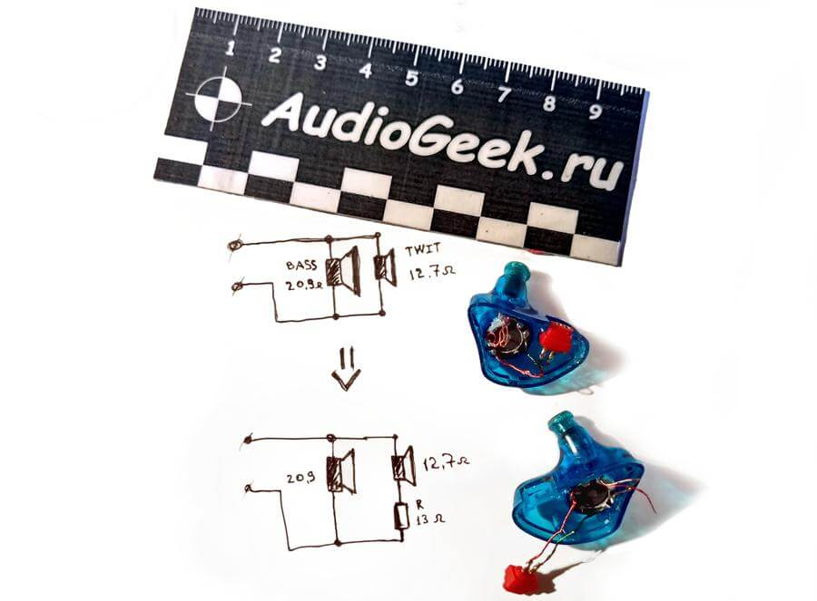
Такое включение резистора, помимо заваливания высоких имеет еще один плюс. Любой динамик является сложной резонансной системой и обладает резонансной частотой. Основные действия производителей по улучшению звука направленны на снижение добротности, т.е. уменьшение резонансного пика.
Резистор, включаемый последовательно с индуктивностью, т.е. в нашем случае динамиком, уменьшает добротность контура. Соответственно АЧХ должна стать более гладкой. 
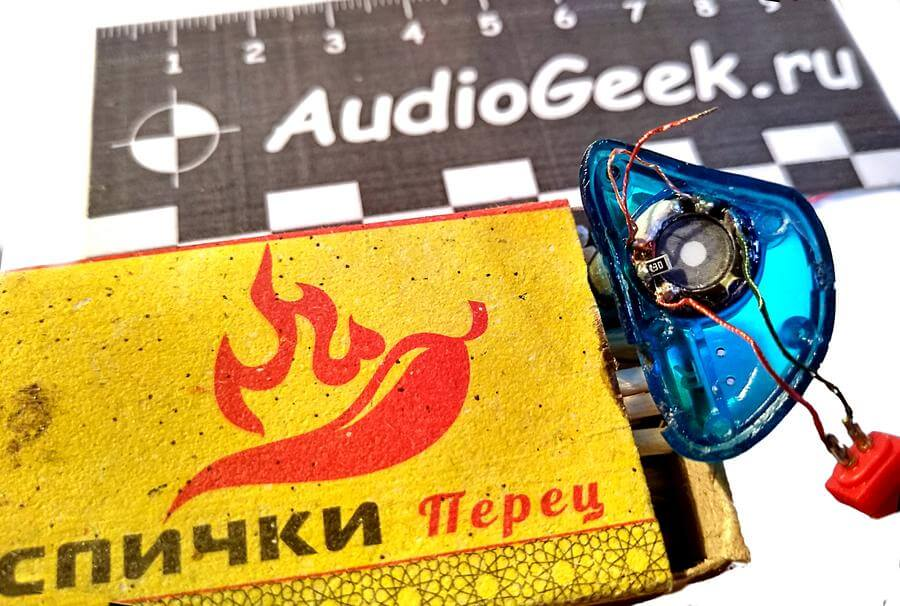

***Для удобства пайки можно зажать наушник в спичечном коробке***
Удобно то, что контактные площадки исходно предназначены для припаивания двух проводов. Чтобы впаять резистор сначала необходимо отпаять один из проводов арматурного динамика.
Далее к освободившейся площадке припаиваем одним концом резистор. А отпаянный провод припаиваем к свободному концу резистора.
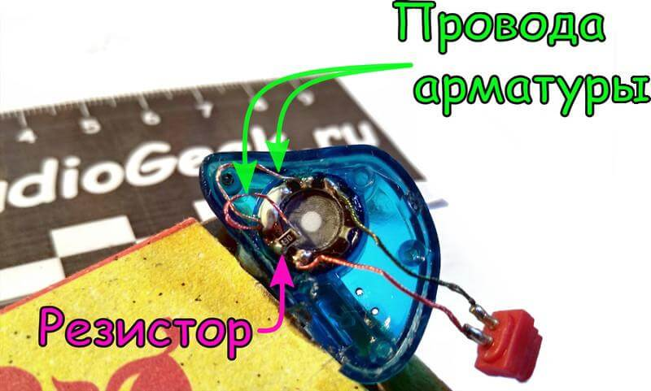
Минус сего деяния - небольшая потеря в громкости. Но большинство современных источников звука имеют достаточный запас, который перекрывает эту потерю.

## Пытка #2 - Укрощение гудящих басов

Проблема в том, что нижний регистр недостаточно проработан. Так же на некоторых записях наблюдается небольшой гул. Обычно виной тому является пластиковый корпус. По нему очень хорошо распространяются механические колебания. Их погашением мы сейчас и займемся.
Для удаления лишних вибраций и резонансов используют вибро-поглощающие материалы. Как правило, это аморфные вещества, имеющие сильно вязкую консистенцию. Ими обклеивают резонирующие поверхности. Примером такого вещества служит пластилин или битум.
Более интересным и практичным для применения является фольгаизол, применяемый при виброизоляции автомобилей. По сути это битумная смола с различными добавками, покрытая слоем алюминия.
Я уже имел опыт экспериментов с этим материалом в звуке. Более подробно сам материал описан в статье про ***[вибродемпфирование наушников Sennheiser HD 380 Pro](../vibro-dempfirovanie/)***. Так же он был использован в ***[моде самсунговской гарнитуры](../vibra-vkladishi/)***.
Для металлических поверхностей обычно рекомендуется обклеивать более 50% поверхности. Для пластика достаточно 10-15%. В случае наушников излишнее количество фольгаизола приведет к утяжелению. Выбор был сделан в пользу использования двух небольших кусочков на каждый наушник.
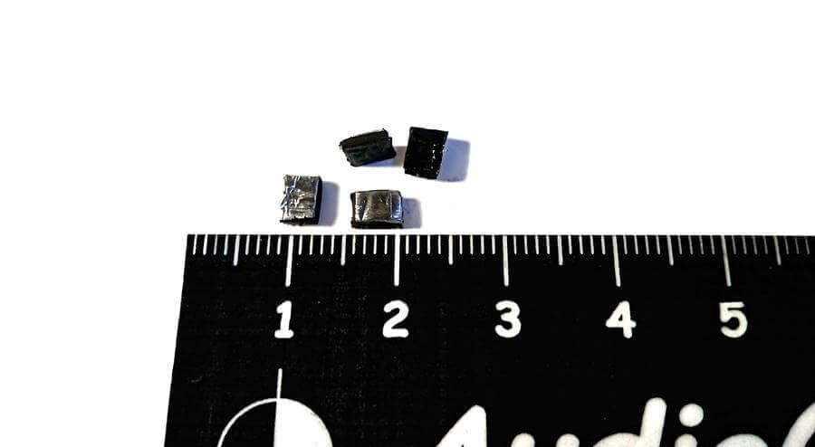
Размеры кусочков примерно - 2.5х2.5 мм, толщина 1мм. Было решено вклеить их в угловые места. После плотного вдавливания отверткой, к ним на 1-2 секунды подносился разогретый паяльник без касания. Затем той же отверткой материал прижимался максимально плотно к корпусу.
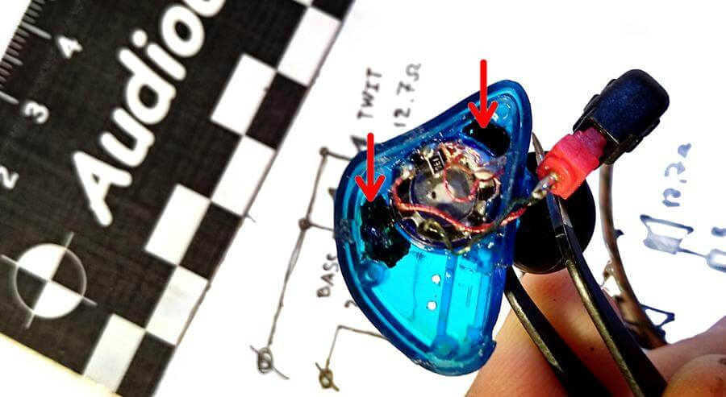

## Пытка #3 - Демпфирование НЧ динамика

Было давно замечено, что левый наушник отличается от правого басовитостью. Причина оказалась очень проста - немного отклеился один акустический фильтр
Если взглянуть на динамик с задней стороны, то можно обнаружить, что в центре магнита наклеен звуковой фильтр. Фильтр служит для демпфирования НЧ динамика. Если отклеить фильтр то под ним есть небольшое углубление.
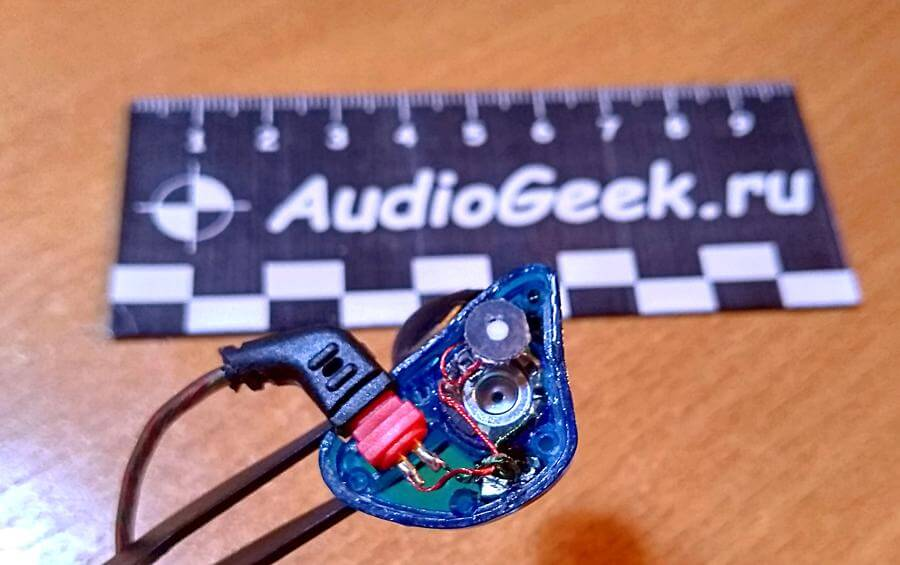

***на фотографии фильтр уже отклеен***
Удаление фильтра приводит к бесконтрольному гудению на НЧ. Как будто звук доносится из достаточно длинной трубы. Если же фильтр заклеить наглухо, то НЧ и СЧ проседают. Это фильтр должен быть полупрозрачным для звука, но при этом являться достаточной нагрузкой для динамика.
После опробования различных материалов был выбран способ демпфирования. Внутренний объем, внутри магнита динамика под фильтром, мы заполним ватой. А сверху наклеим тканевый пластырь.
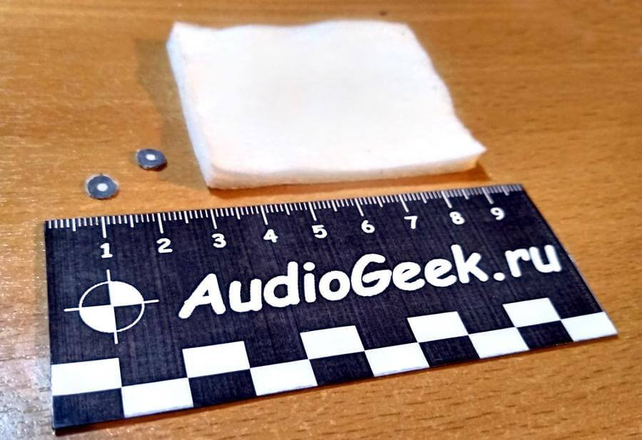
Я использовал вату для вейпов в форме пластов . Она дешевая и продается в любом вейпшопе. Эта вата очень тщательно очищается и укладывается волокнам в одном направлении. А то, что она выполнена в форме пласта, упрощает ее дозирование.
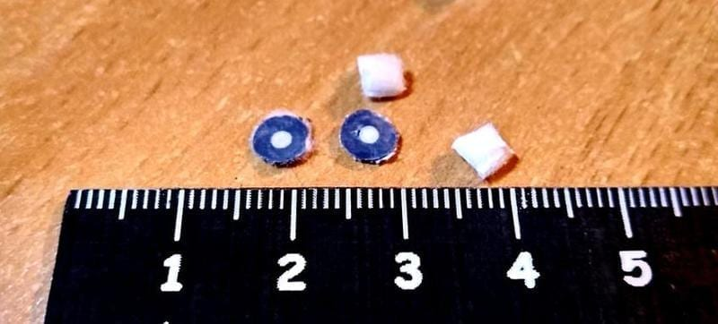
Для демпфирования был отрезан квадратик размерами 3х3 мм и разделен пополам по толщине. После этого каждый кусочек был распушен пинцетом.
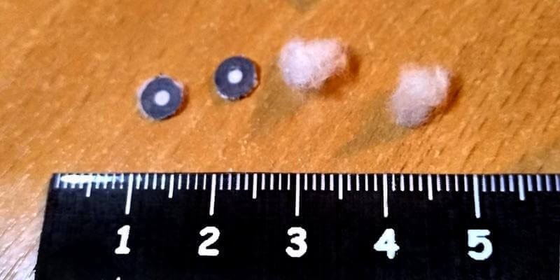
Из рулонного пластыря вырезаем два квадратика. Для большего скругления срезаем им уголки превращая в восьмиугольники.
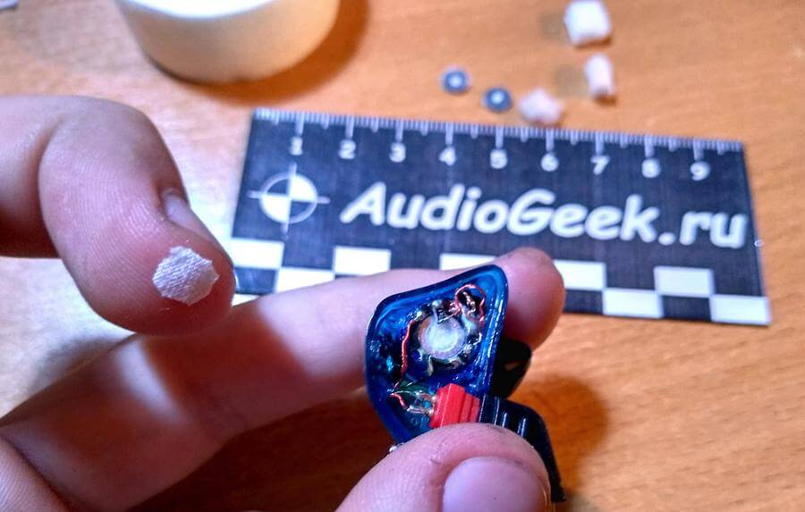

***вата довольно плотно вставляется в углубление в магните динамика***
Клеим восьмиугольники поверх ваты к динамику. Волокна ваты не должны торчать из углубления. Вата является очень хорошим и натуральным демпфирующим материалом. А тканевый скотч способен пропускать через себя часть звука.
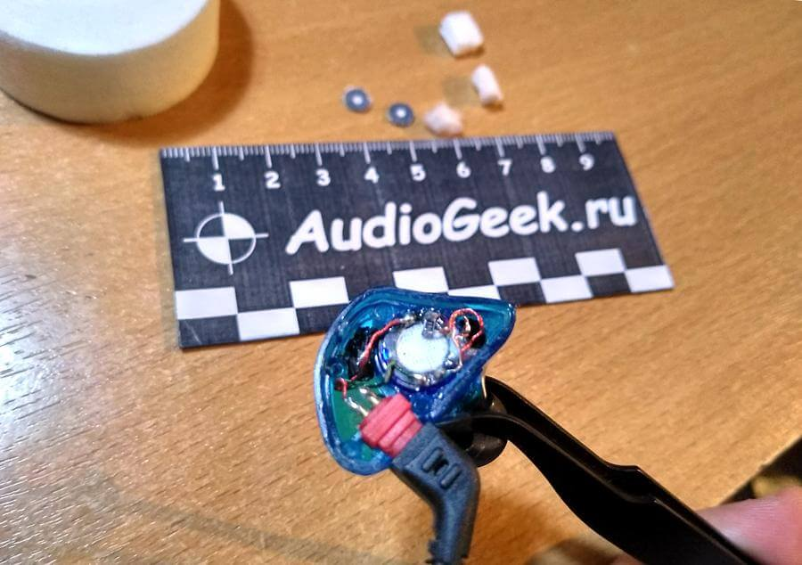
Такое демпфирование полностью взяло под контроль НЧ регистр. НЧ не стало меньше, их столько, сколько есть. Иногда даже зубы сводит, от того сколько их.

## Итоги мода

После всего проделанного появились нормальные СЧ, а звук стал ровнее. Теперь музыкальные стили с большим количеством СЧ стало слушать намного приятнее. Особенно это относится к тяжелым стилям, и различной живой музыке.
Снижение ВЧ позволило увеличить глубину звуковой сцены и выровнять частотный баланс. В целом, проделанным модом я очень доволен. Даже не ждал, что получится настолько хорошо, что можно будет отложить покупку более дорогих наушников.

## Заключение

Если вы еще не обзавелись такими наушниками, то однозначно ***рекомендую их к покупке***. Даже в заводском исполнении они хорошо звучат. А если захочется экспериментов, то теперь вы знаете что делать и как улучшить звук наушников.
Проделанное можно также осуществить и на любых других гибридных наушниках. Например те же гибриды от Сяоми имеют аналогично задранные верха и гудящий низ.
Если уж вы начали этот тернистый путь к качественному звуку - то рекомендую также прочесть начало статьи про ***[портативный усилитель для наушников](https://audiogeek.ru/volx/)***. Из статьи станет понятно, почему телефон - это не самый качественный источник звука.

*Материал подготовлен исключительно для сайта [AudioGeek.ru](https://github.com/SkyTrip-13/AudioGeek)*
