[Русский](./README.ru.md) | **English**

# A resistor as the I/V converter for a current-output DAC

**Category:** Audio circuit design  
**Tags:** sound quality, op-amp circuit, DAC  
**Original:** https://audiogeek.ru/i-u-preobrazovatel-na-rezistore/

---

The sound quality at the output of an audio device is determined by the quality of the whole audio path. But what matters most is the quality of the DAC and how its output stage is implemented. A DAC with a current output necessarily needs a current-to-voltage converter. How it is implemented determines how good or bad the sound going to the next stages will be.

## The classic circuit

The standard way to convert the DAC output current to a voltage is the classic op-amp circuit. In general form it looks like this:

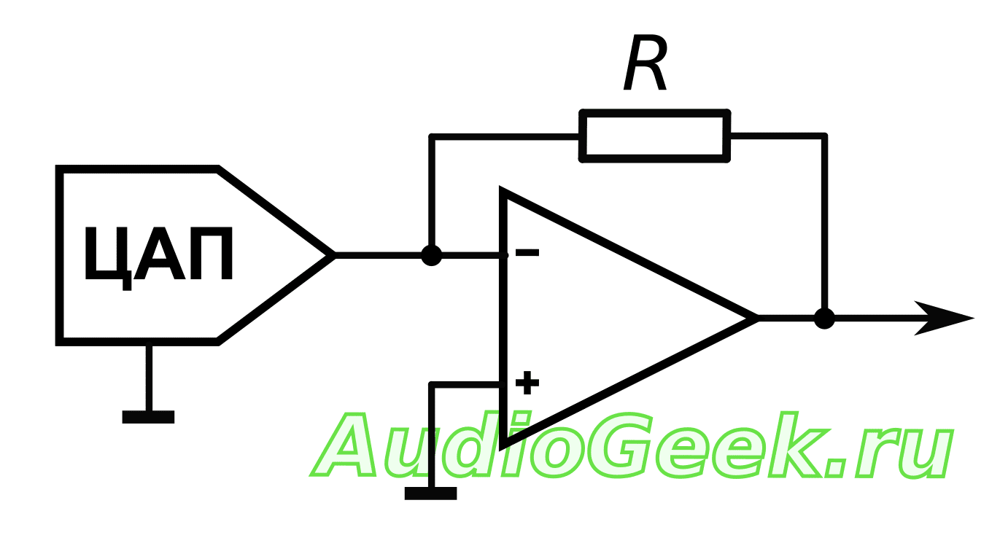

This circuit was described in detail in the article [***Current-to-voltage converter on an op-amp***](../i-u-preobrazovatel/).

In practice a capacitor is always added to the feedback path. This ***[RC circuit](../rc-circuit/)*** works as a low-pass filter and is needed to prevent the op-amp from oscillating.

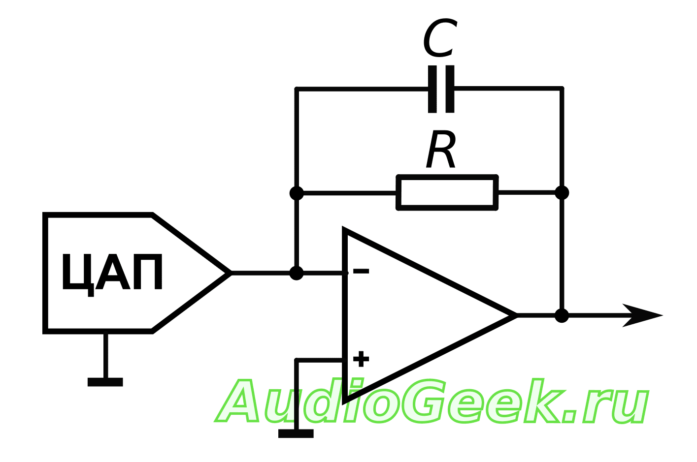

As an example, look at the I/V converter circuit given in the TDA1387 datasheet.

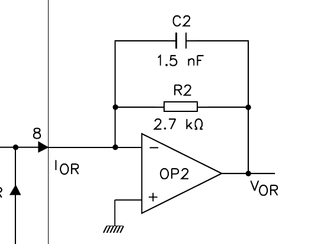

The RC values shown give a cutoff frequency of about 40 kHz.

The circuit is fully functional. The designers were just too lazy to draw a coupling capacitor at the output, but that is not what we are discussing.

## The drawbacks of the classic circuit for audio

Despite its widespread use, this circuit has some drawbacks.

### Op-amp speed

With this circuit, even with not very fast DACs, you should use op-amps that are as fast as possible. For music DACs with a ***[sampling rate](../chastota-diskretizacii-teorema-kotelnikova/)*** of 44.1 kHz, it is better to use op-amps with a slew rate above 10–20 V/µs.

The slew rate is always given in the op-amp datasheet, often even on the first page.

For example, here is a piece of the first page of the AD8066 datasheet. This op-amp has a slew rate of 180 V/µs. It is mentioned fairly often on audio forums and recommended for a DAC output stage.

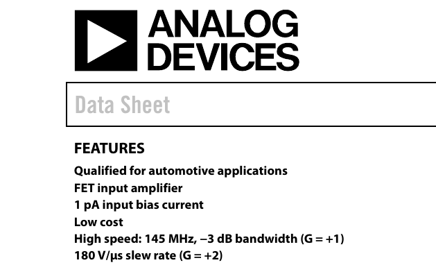

### Op-amp precision

The output current of DACs is usually a few milliamps, more rarely tens of milliamps. For that reason the op-amp must also be a precision one.

That means it must have minimal input bias current, ideally at the picoampere level. For the AD8066 shown above, the bias current is 1 pA.

And the chosen op-amp also has to "sound" good...

## Circuit problems of the converter

For high-quality sound you cannot do without good ICs with the parameters above in any case.

But even a precision, fast op-amp does not solve the main problem of this circuit.

A DAC has a certain output capacitance. It is made up of the capacitances of the current-switch transistors. Conventionally it can be drawn going from the DAC output to ground.

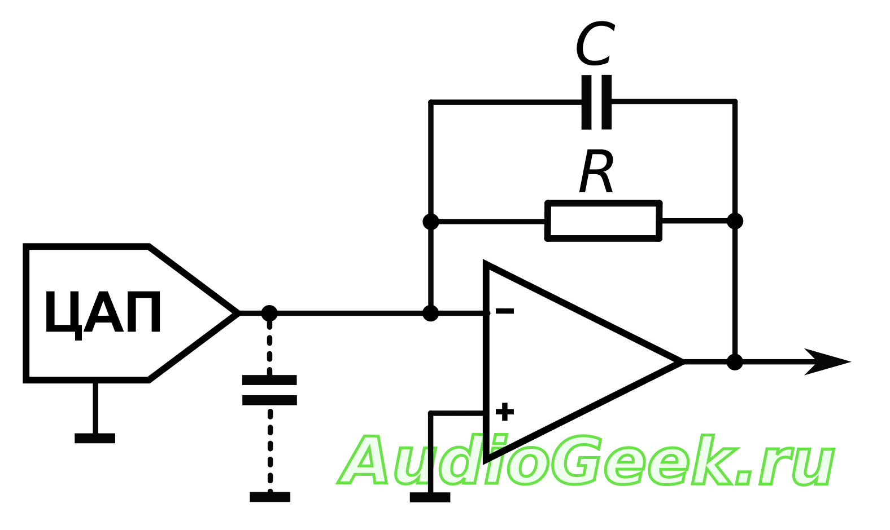

Together with the RC network in the op-amp feedback, the DAC output capacitance forms a phase-shifting circuit that delays lower frequencies, that is, causes phase distortion. And phase distortion is death for sound.

You can read more about phase distortion in filters in [this article](../fazo-chastotnaya-harakteristika-filtrov/).

## A resistor as the current-to-voltage converter

In high-end audio equipment, a plain resistor is increasingly used as the DAC's I/V converter.

Opinions differ on this, of course. But despite the apparent problems, an ordinary resistor is a much better approximation of an ideal current-to-voltage converter.

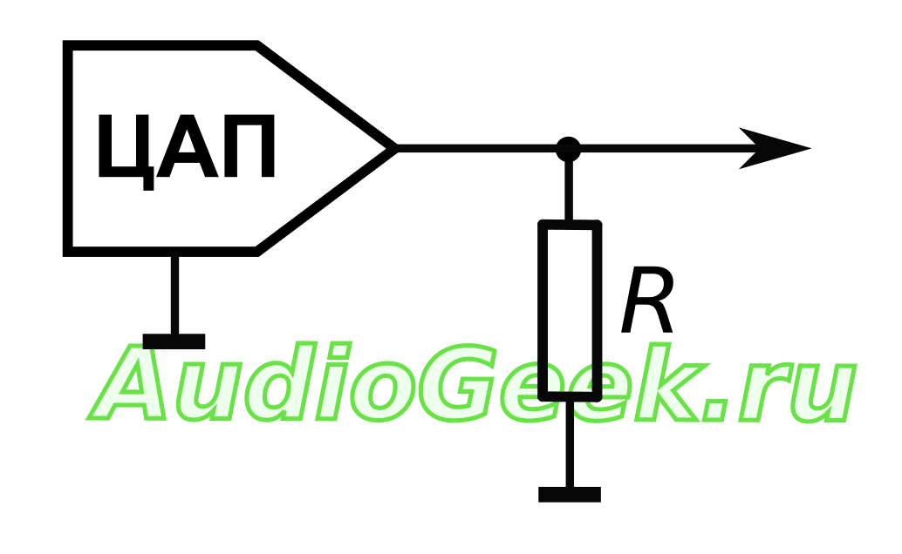

Its main advantage is that it introduces no phase distortion at all. However, a few things need to be taken into account when using a resistor.

## Resistor value

When a resistor is connected directly to the DAC's current output, the voltage appearing across it is applied to the DAC's output switches.

Even a small applied voltage increases the probability of DAC conversion errors. Ideally the resistor would have zero resistance.

On the other hand, the lower the resistance, the smaller the voltage drop across it, and the more the signal has to be amplified.

If the voltage is too small, the resistor's noise starts to noticeably affect signal quality. *The noise is amplified in exactly the same way as the useful signal.*

## More specifics

> The article was written based on the development of the ***[audio path for the HiFiMan HM-601 player](../hifiman-hm-601-full-mod/)*** with a TDA1387 DAC. But everything said applies to any DAC with a single-ended current output.

In practice the resistor value is chosen fairly small, usually 50–100 Ω. With a maximum output current of 1 mA (*for the TDA1387*), the useful signal voltage across the resistor will be about 50–100 mV.

On the web you can find circuits that use resistors up to 1 kΩ, often with several DACs connected in parallel.

The author considers a resistor this large simply unacceptable. Possible conversion errors were mentioned above. A voltage of 1 volt can cause DAC conversion errors not only in the least significant bits but in the most significant ones too.

## Resistor quality

Of course the resistor used for conversion must be of much higher quality than any other resistor in the audio path, because the quality of everything downstream depends directly on it.

An important characteristic of a resistor is thermal noise. I strongly advise against MLT resistors: they are very noisy. For example, C2-13 resistors have a noise figure tens of times lower than MLT.

Do not forget the accuracy of this resistor either. Use a resistor of 0.5% or better. Besides matching its marked resistance, such resistors depend less on temperature.

## Amplifying the resulting signal

Of course one resistor after the DAC is not enough. The voltage across it has to be amplified. A non-inverting op-amp amplifier is ideal for this.

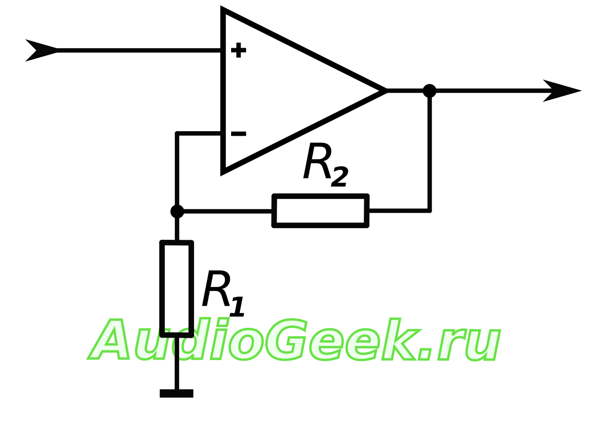

Such an amplifier has a very high input impedance (more than 10¹² to 10¹⁴ Ω), determined by the op-amp's input impedance. Its output impedance is close to zero. That is ideal for impedance matching between stages.

The gain is set by the resistor ratio and equals ***K = 1 + (R2/R1)***. Resistor values are chosen from the range ***1 to 100 kΩ***.

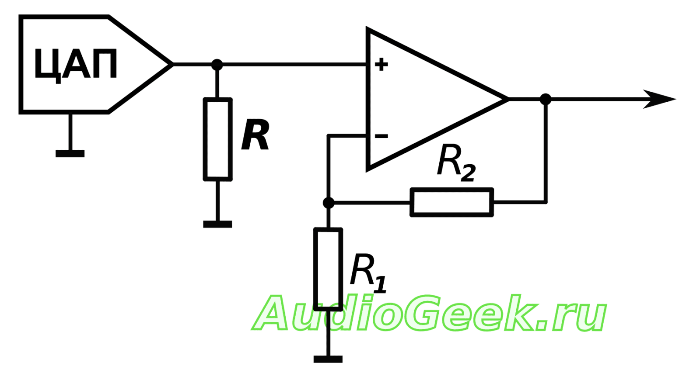

The main advantage of this arrangement is that the non-inverting amplifier has no capacitor in the feedback path, which would cause phase distortion.

> ***This approach is by no means new. You can find it in Horowitz and Hill's "The Art of Electronics" as far back as 1980. So everything new is just well-forgotten old...***

Another advantage of this DAC output arrangement is that the conversion resistor ties the op-amp's non-inverting input to ground.

## Removing the DC component

Many current-output DACs (TDA1541, TDA1543) have the peculiarity that the output current, besides the useful signal, contains a DC component ***Ibias***.

For the TDA1387, ***Ibias*** is about 1 mA. So the useful analog signal at the DAC output lies between 1 and 2 mA.

On a graph of output current against time it looks like this:

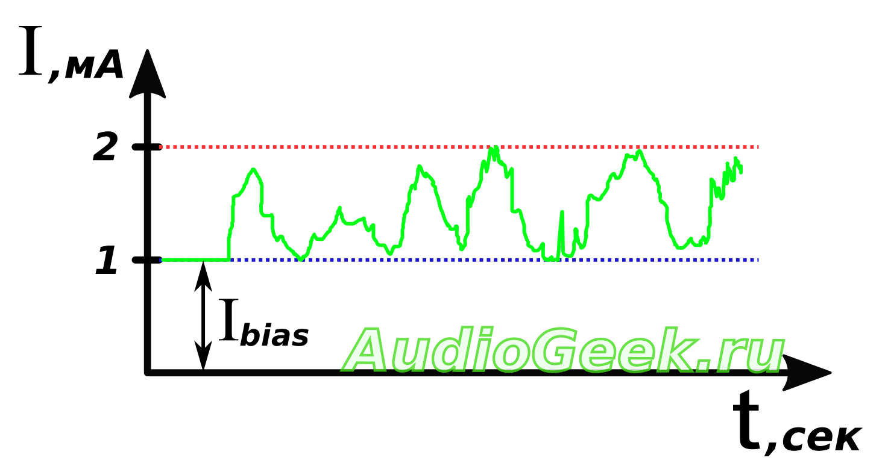

An op-amp amplifier amplifies AC and DC equally well. But it is very easy to turn it into an AC amplifier that blocks the DC component.

For that you do have to add a capacitor to the op-amp feedback path. But now this capacitor is in series with the resistor that goes from the inverting input to ground.

The network formed by the capacitor and resistor is a high-pass filter. It no longer introduces phase distortion in the audible range, but it removes the DC component and infrasonic frequencies.

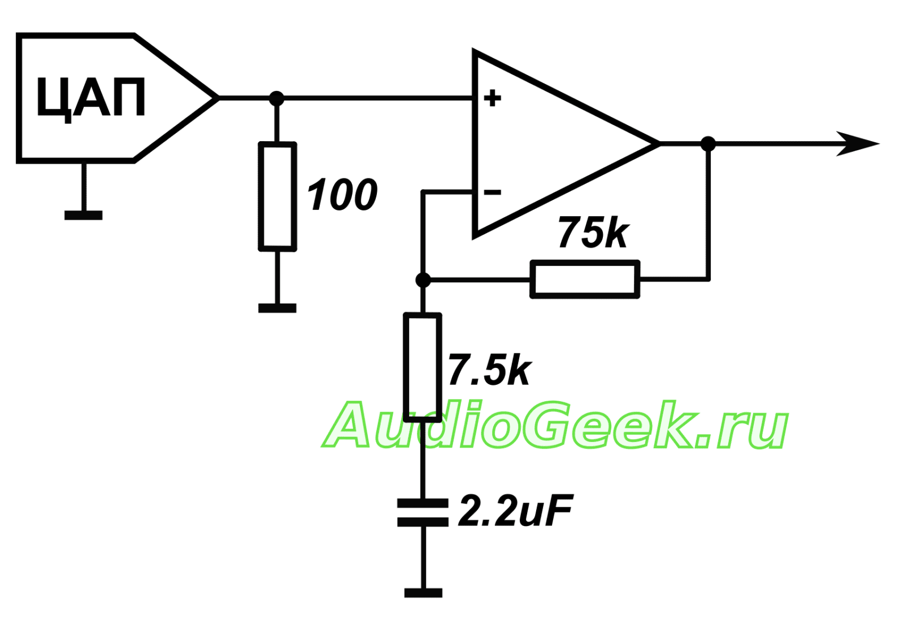

The capacitor is chosen so that the cutoff frequency lies below 20 Hz. For the values shown the cutoff is just under 10 Hz, and the voltage gain is 11.

You can also use a 2 µF capacitor. Then the cutoff frequency is 10.6 Hz rather than 9.65 Hz, which is not critical. Naturally the capacitor should be non-polar and preferably of good quality...

## The output coupling capacitor

You can argue endlessly about coupling capacitors and how they affect sound. But here you simply cannot do without one.

The DAC runs from a single supply, so the op-amp output signal lies between zero and the positive supply voltage.

For the signal to be centered around 0, a coupling capacitor of 2–3 µF should be placed at the amplifier output.

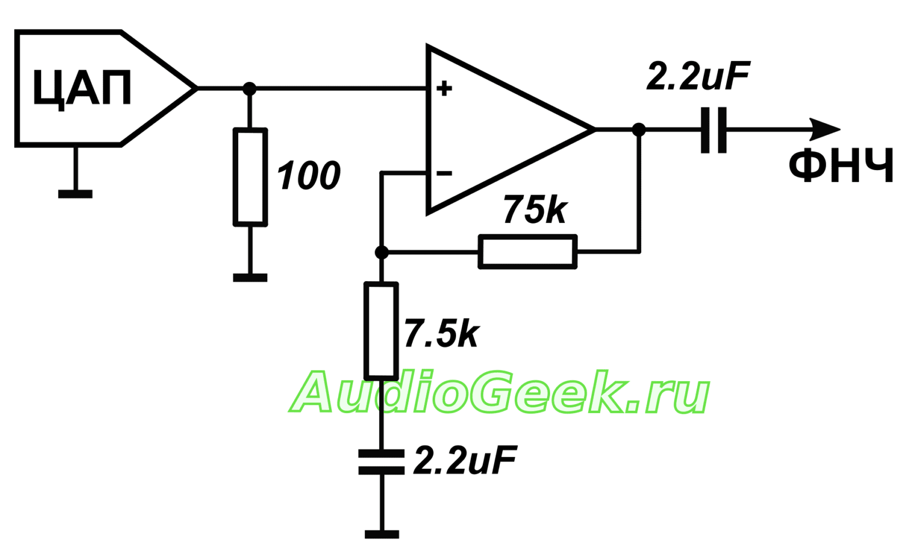

## Conclusion

That is about it. I hope I managed to explain the purpose of each part, and that you will have no trouble modifying the circuit for your own needs if necessary.

If you have questions, do not hesitate to ask in the comments. I will answer everyone.

### What next?

From the I/V converter the signal should go to a low-pass filter. It is needed to remove various digital noise that lies beyond the audible range but strongly affects the sound.

At the moment the most interesting option I see is the ***[DAC low-pass filter on gyrators](../filtri-na-gyratorah/)***.

*Originally written for [AudioGeek.ru](https://audiogeek.ru). Translated from Russian.*
