[English](./README.md) | **Русский**

# Резистор для ЦАП с токовым выходом

**Рубрики:** Схемотехника аудиотракта  
**Метки:** качество звука, схема на ОУ, ЦАП  
**Оригинал:** https://audiogeek.ru/i-u-preobrazovatel-na-rezistore/

---

Качество звука на выходе аудиоустройства определяется качеством всего аудиотракта. Но первостепенное значение имеет качество ЦАП и реализация его выхлопа. Для ЦАП с токовым выходом непременно требуется преобразователь ток-напряжение. Его реализация определяет насколько хорош или плох будет звук, идущий на следующие каскады

## **Классическая схема**

Стандартным решением для преобразования выходного тока ЦАП в напряжение является классическая схема на операционном усилителе. В общем виде она выглядит следующим образом:
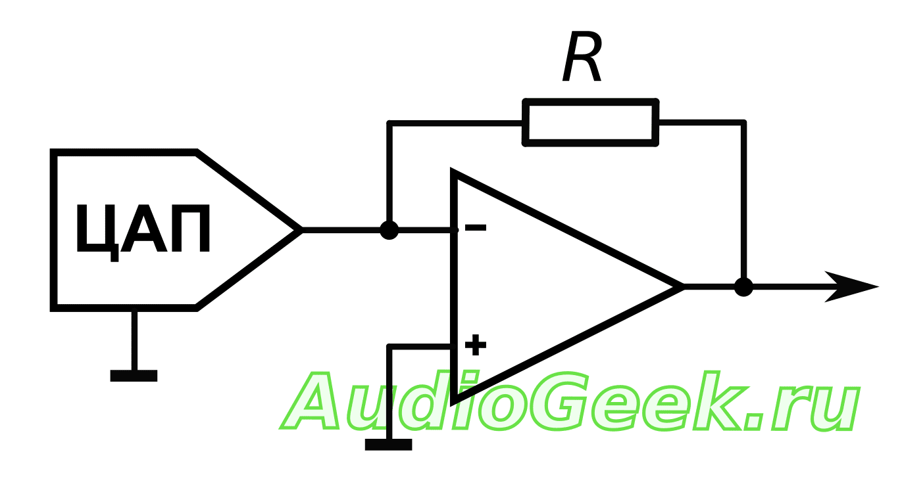
Эта схема была подробно описана в статье: [***Преобразователь ток-напряжение на ОУ***](../i-u-preobrazovatel/)
На практике, в цепь обратной связи всегда добавляют конденсатор. Такая ***[RC-цепь](../rc-circuit/)*** работает как ФНЧ и необходима для исключения самовозбуждения операционного усилителя.
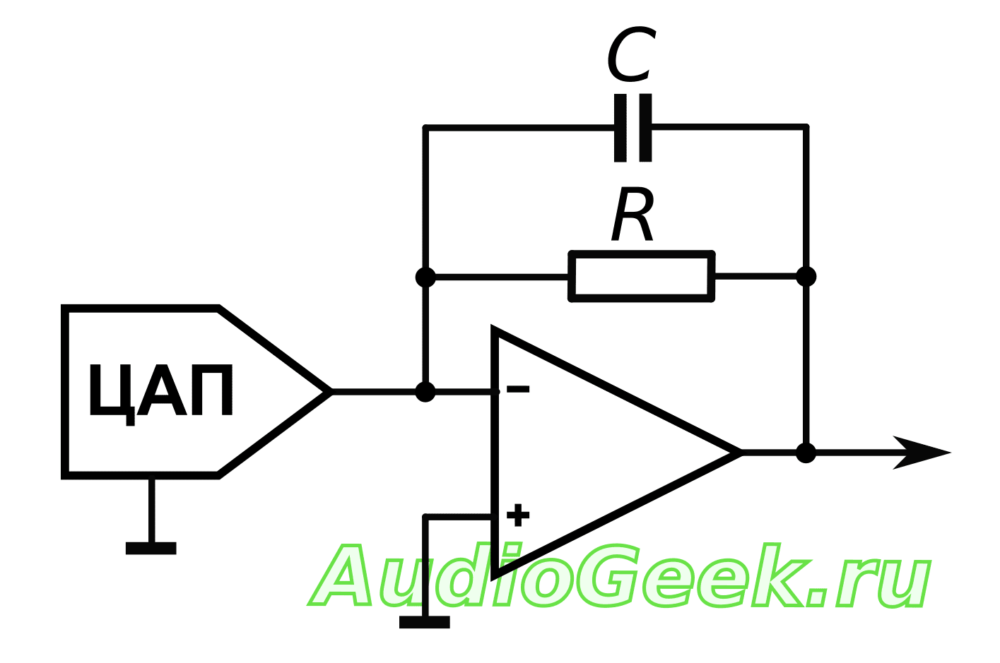
В качестве примера давайте взглянем на схему преобразователя ток-напряжение, приводимую в даташите для TDA1387.
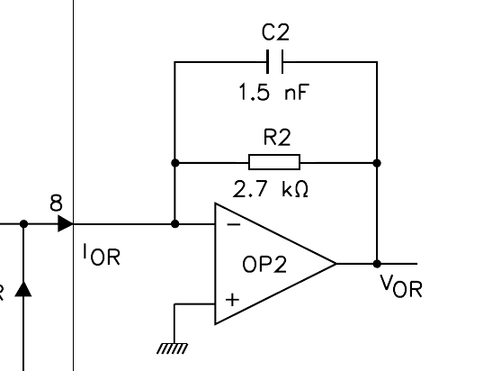
Указанные номиналы RC-цепи дают частоту среза около 40кГц.
Схема полностью рабочая. Правда разработчики поленились нарисовать проходной конденсатор на выходе, но речь сейчас не об этом.

## **Минусы классической схемы для звука**

Не смотря на повсеместное применение этой схемы, есть у нее и некоторые недостатки

### **Быстродействие ОУ**

При использовании такой схемы, даже с несамыми быстрыми ЦАП-ами следует использовать как можно более быстродействующие ОУ. Для музыкальных ЦАП-ов, с ***[частотой дискретизации](../chastota-diskretizacii-teorema-kotelnikova/)*** 44.1кГц лучше использовать ОУ, скорость нарастания сигнала которых более 10-20 В/мкс.
Скорость нарастания сигнала всегда приводится в даташитах на ОУ. Зачастую даже на первой странице документации.
Для примера вот кусок первой страницы документации на AD8066. Этот ОУ имеет скорость нарастания сигнала 180В/мкс. Он довольно часто упоминается на аудиофорумах и рекомендуется для выхлопа ЦАПа.
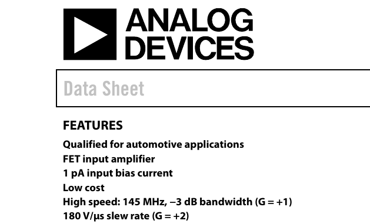

### **Прецизионность ОУ**

Выходной ток ЦАП-ов обычно составляет единицы, реже - десятки миллиампер. По этой причине используемый ОУ должен быть еще и прецизионными.
Это означает, что он должен иметь минимальный входной сдвиг по току. Желательно велична сдвига был на уровне пикоампер. Для показанного выше AD8066 ток сдвига составляет 1пА.
При этом выбранный операционник должен еще и нормально "звучать"...

## **Проблемы схемотехники пребразователя**

Для качественного звука, в любом случае не обойтись без использование качественных микросхем, с указанными выше параметрами.
Но даже использовании прецизионного и быстродействующего ОУ не решает главную проблему этой схемы.
ЦАП обладает определенной выходной емкостью. Она складывается из емкостей транзисторов токовых ключей. Условно ее можно изобразить идущей с выхода ЦАП на землю.
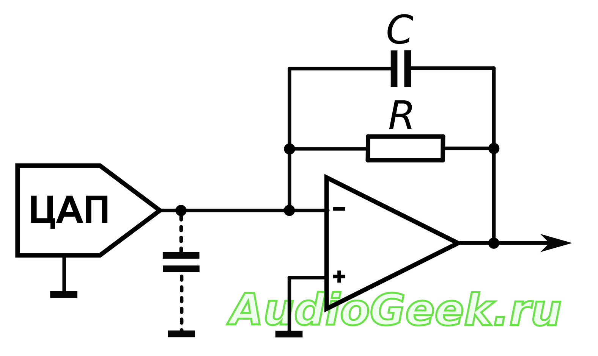
Вместе с RC-цепочкой в обратной связи ОУ, выходная емкость ЦАП образует фазосдвигающую цепь, приводящую к запаздыванию более низких частот, т.е. фазовым искажениям. А фазовые искажения это смерть для звука.
Подробнее про фазовые искажения фильтров можно почитать в ***[этой статье](../fazo-chastotnaya-harakteristika-filtrov/)***.

## **Преобразователь ток-напряжение на резисторе**

В высококачественной аудио аппаратуре все чаще в качестве преобразователя ток-напряжение для ЦАП используют просто резистор.
Конечно есть разные мнения на этот счет. Но, несмотря на кажущиеся проблемы, обычный резистор является куда лучшим приближением к идеальному преобразователю ток-напряжение.
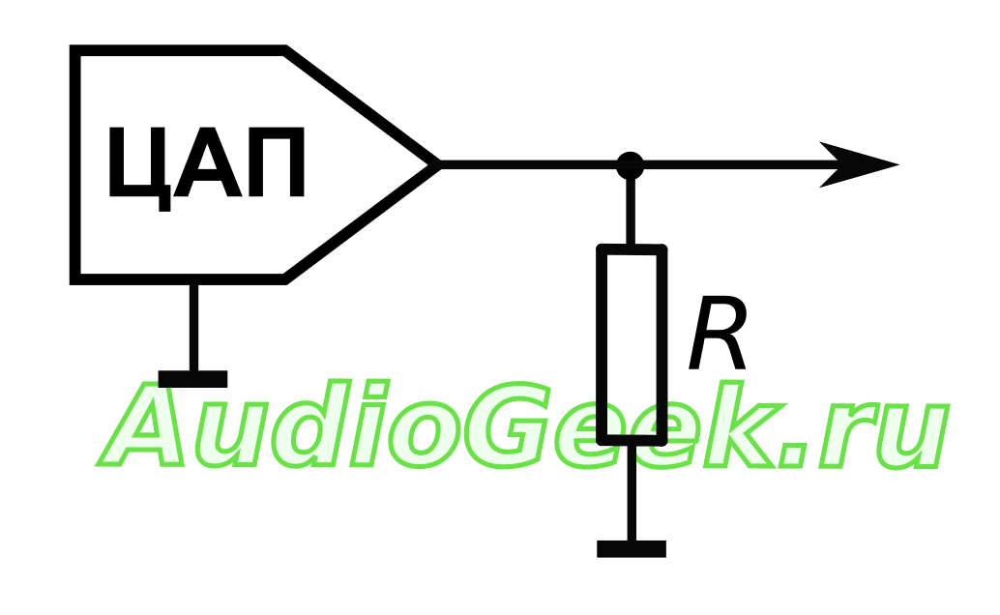
Главным его плюсом является полное отсутствие вносимых фазовых искажений. Однако при использовании резистора следует учитывать некоторые обстоятельства.

## **Номинал резистора**

При непосредственном подключении резистора к токовому выходу ЦАП, возникающее на резисторе напряжение оказывается приложенным к выходным ключам ЦАПа.
Даже при небольших величинах прикладываемого напряжения, оно увеличивает вероятность возникновению ошибок преобразования ЦАП. В идеале, конечно, резистор должен обладать нулевым сопротивлением.
С другой стороны чем меньше сопротивление резистора, тем меньше будет падение напряжения на нем, и тем больше сигнал придется усиливать.
Если величина напряжения будет слишком мала, то шум резистора начнет оказывать заметное влияние на качество сигнала. *Шум усиливается точно так же, как и полезный сигнал.*

## **Больше конкретики**

> Статья писалась на основании разработки ***[аудиотракта для плеера HiFiMan HM-601](../hifiman-hm-601-full-mod/)*** с ЦАПом TDA1387. Но все сказанное относится к любым ЦАП-ам с несимметричным токовым выходом.

На практике величина резистора выбирается достаточно маленькой, обычно в пределах 50-100 ом. В таком случае при максимальном выходном токе в 1 мА (*для TDA1387*) на выходе резистора будет получено напряжение полезного сигнала порядка 50-100 мВ.
В сети встречаются схемы в которых используются резисторы номиналом до 1кОма. При этом часто прибегают к параллельному (каскадному) включению ЦАПов.
Автор считает применение резистора столь большого номинала просто неприемлемым. Выше уже говорилось об возможных ошибках преобразования. Напряжение в 1 вольт может вызывать ошибки преобразования ЦАП не только в младших, но уже и в старших разрядах.

## **Качество резистора**

Разумеется, что резистор, применяемый для преобразования должен обладать качеством, намного превосходящее качество любого другого резистора в звуковом тракте. Ибо от него напрямую зависит дальнейшее качество.
Важной характеристикой резистора является тепловой шум. Крайне не советую использовать МЛТ резисторы - они очень шумные. Например резисторы С2-13 имеют показатель шума в десятки раз меньший чем у МЛТ.
Не стоит забывать и про точность этого резистора. Желательно использовать резистор точностью не хуже 0.5%. Помимо соответствия реального сопротивлению надписи, сопротивление таких резисторов меньше зависит от температуры.

## **Усиление полученного сигнала**

Разумеется одного резистора после ЦАП не достаточно. Получаемое на резисторе напряжение следует усилить. Для этого как нельзя лучше подходит неинвертирующий усилитель на ОУ.
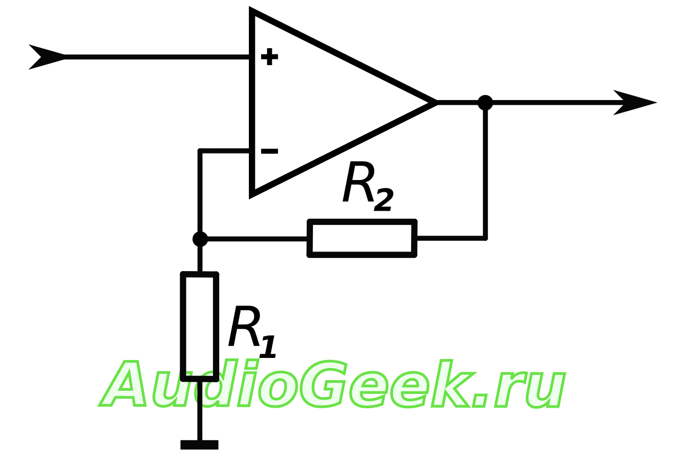
Такой усилитель имеет очень большое входное сопротивление (более 1012 ÷ 1014 Ом), определяемое входным сопротивлением ОУ. При этом выходное сопротивление близко к нулю. Это идеально подходит для согласования каскадов по сопротивлению.
Коэффициент усиления задается соотношением резисторов и равен ***K=1+(R2/R1)***. Номиналы резисторов выбирают из ряда ***1...100 кОм***.
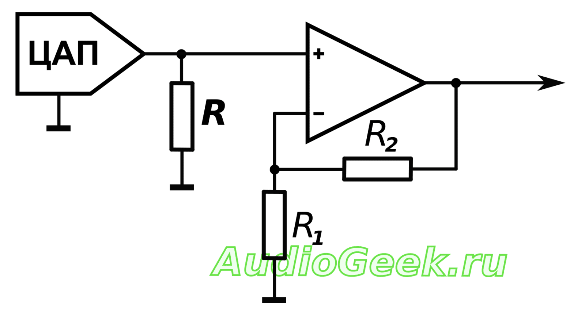
Главное преимущество такого включения состоит в том, что неинвертирующий усилитель не содержит в цепи ОС конденсатора, приводящего к фазовым искажениям.
> ***В целом такой подход далеко не новый. Его можно встретить еще в "Исскустве схемотехники" Хорвица и Хилла 1976 года. Так что всё новое - это хорошо забытое старое....***

Еще одним плюсом применения предлагаемой схемы выхлопа для ЦАП-а является то, что резистор, отвечающий за преобразование, привязывает неинвертирующий вход ОУ к земле.

## **Отсечение постоянной составляющей**

Многие ЦАП-ы с токовым выходом (TDA1541, TDA1543) имеют такую особенность, что выходной ток, помимо полезного сигнала содержит постоянную составляющую ***Ibias***.
В случае TDA1387 ток ***Ibias*** составляет около 1 мА. Соответственно полезный аналоговый сигнал на выходе ЦАП-а лежит в интервале от 1 до 2 мА.
На графике зависимости выходного тока от времени это можно отобразить следующим образом:
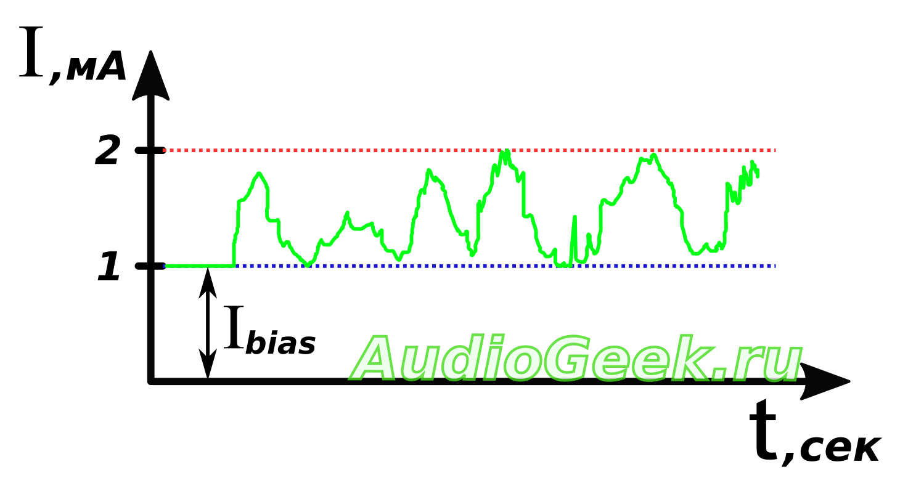
Усилитель на ОУ одинаково хорошо усиливает как переменный, так и постоянный ток. Но можно очень просто превратить его в усилитель переменного напряжения, отсекающий постоянную составляющую.
Для этого, правда все же придется добавить конденсатор в цепь ОС операционного усилителя. Однако теперь этот конденсатор включается последовательно с резистором идущим на землю с инвертирующего входа.
Образованная конденсатором и резистором цепь является Фильтром Высокой Частоты. Она уже не вносит фазовых искажений в слышимый диапазон частот, зато отсекает постоянную состовляющую и инфранизкие звуки.
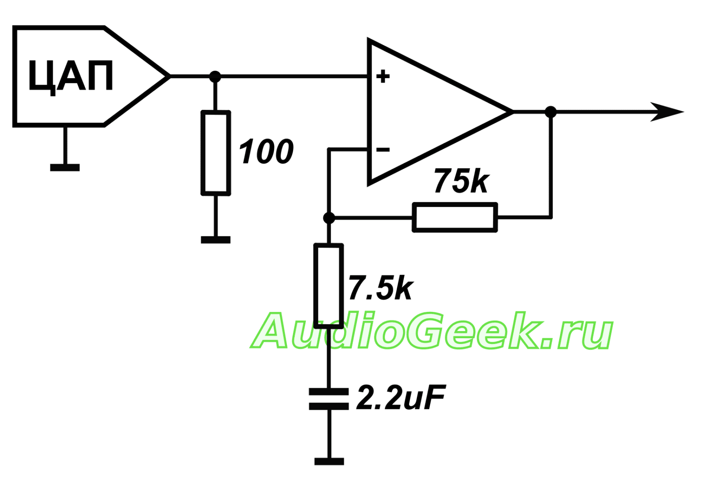
Величина конденсатора выбирается так, чтобы частота среза лежала ниже 20Гц. Для показанных номиналов частота среза составляет чуть меньше 10 Гц, а коэффициент усиления сигнала по напряжению равен 11.
Конденсатор можно установить и на 2 мкФ. Тогда частота среза будет не 9.65Гц, а 10.6Гц. Что не критично. Само собой конденсатор стоит брать неполярный и желательно качественный...

## **Проходной конденсатор**

Можно долго разводить халивары на тему проходных конденсаторов и того как они влияют на звук. Но в данном случае без него просто не обойтись.
ЦАП питается однополярным напряжением. Соответственно сигнал на выходе ОУ будет лежать между нулем и положительным напряжением питания.
Для того, чтобы сигнал строился относительно 0, на выходе усилителя следует установить проходной конденсатор, емкостью в 2-3 мкФ.
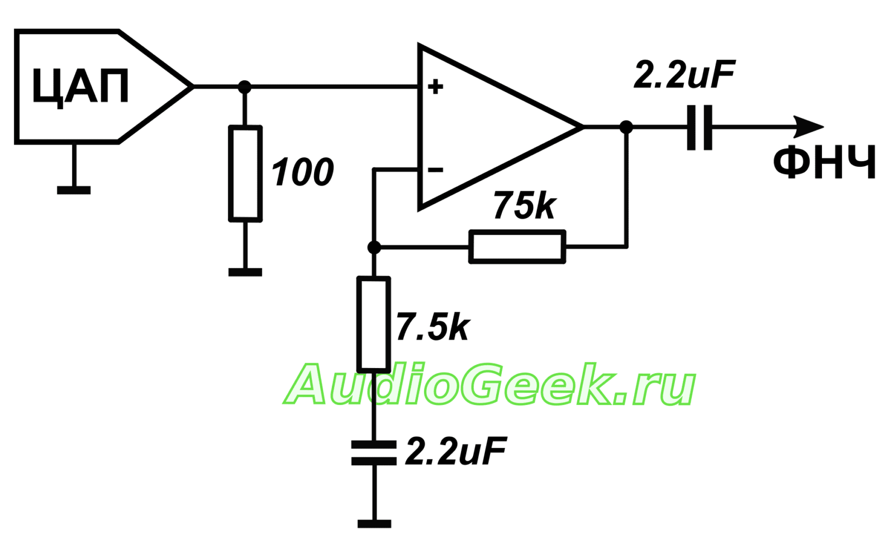

## **Заключение**

Вот собственно и все. Надеюсь, что мне удалось, разъяснить назначение каждой детали и Вам не составит труда, в случае необходимости, переделать схему под свои задачи.
Если остались вопросы - не стесняйтесь задавать их в комментариях. Отвечу всем)

### Что дальше?

С преобразователя ток-напряжение сигнал должен отправляться на Фильтр Низких частот. Он нужен для отсечения различных цифровых шумов, лежащих за слышимым диапазоном, но сильно влияющих на звук.
На данный момент наиболее интересным мне видится ***[ФНЧ для ЦАП на гираторах](../filtri-na-gyratorah/)***.

**Материал подготовлен исключительно для сайта** [***AudioGeek.ru***](https://github.com/SkyTrip-13/AudioGeek)
