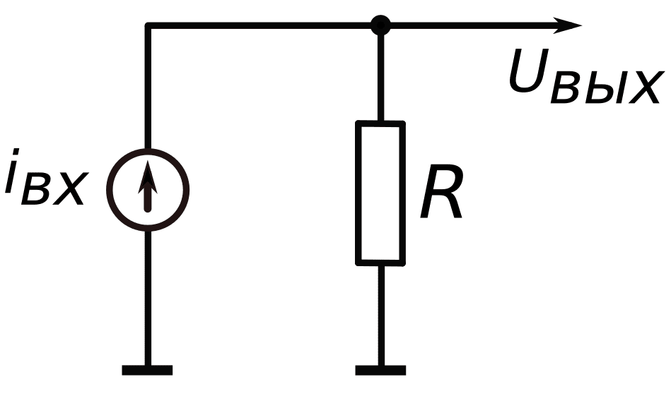
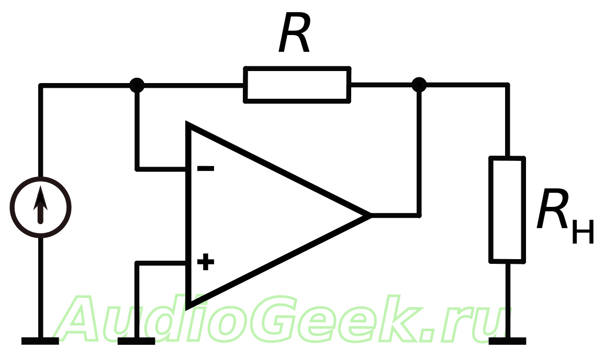
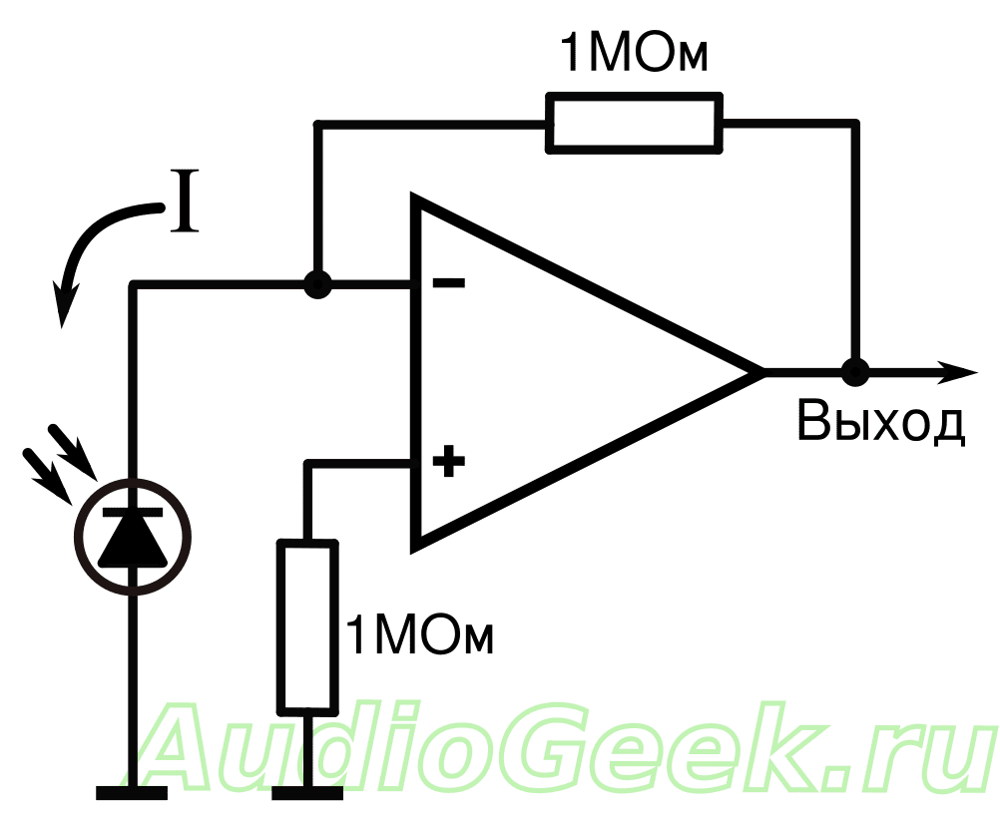
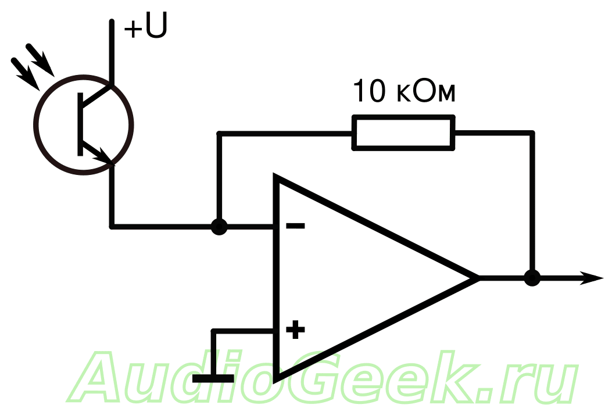
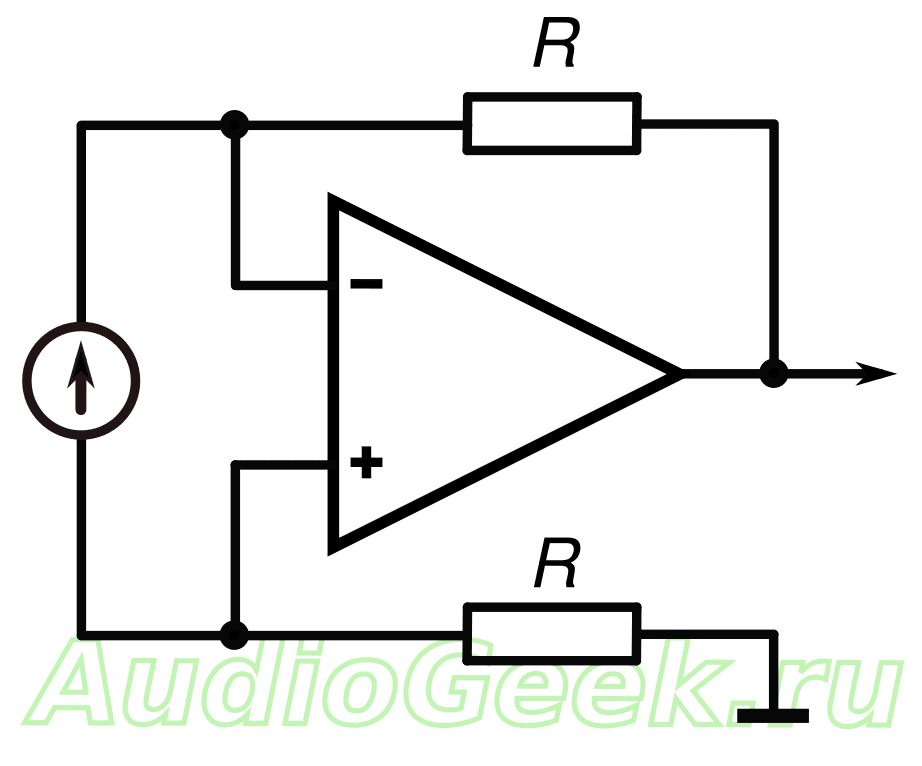

[Русский](./README.ru.md) | **English**

# Current-to-voltage converter on an op-amp

**Published:** 2018-01-03  
**Category:** Useful circuits, Audio circuit design  
**Tags:** op-amp circuit, DAC  
**Original:** https://audiogeek.ru/i-u-preobrazovatel/

---

In electronics we often need converters. Many signal sources have a current output: DACs, photoresistors, phototransistors and others. To do anything further with the signal it has to be converted to voltage. Here is the time-tested op-amp current-to-voltage converter with various signal sources.

## The current-to-voltage converter

A **current-to-voltage converter** *(I-V converter for short)* is a circuit that converts the current output of a source into a voltage.

In Russian technical literature it is also called a **transresistance amplifier**, because the simplest current-to-voltage converter is a resistor.

All the magic of the conversion comes from Ohm's law. The current ***Iin*** flowing through resistor ***R*** causes a voltage drop ***Uout*** across it. This voltage is directly proportional to the product of the resistance and the input current. The formula says it even more simply:

***Uout = R × Iin***

The main drawback of using a single resistor is its nonzero resistance. This becomes a serious problem when the source cannot provide the required voltage across the resistor. The result is voltage sag at the output.

The resistance matters even more if the current source has a small working output range. A photodiode is such a source, for example. Its output current is a few microamps.

In the case of a **DAC**, especially a high-quality one, using a resistor for the conversion is preferable. Why, and what for, you can read in [***A resistor for a current-output DAC***](../i-u-preobrazovatel-na-rezistore/). This is because of some phase problems of the circuits, which we will cover. Fortunately for us, sources like photodiodes do not care about phase distortion.

## The op-amp current-to-voltage converter

The circuit is not new at all, but it is proven and reliable. In general form it looks like this:

The signal current ***Iin*** flows into the inverting input. Since the input current of an ideal op-amp is zero, all of the incoming current goes into feedback resistor ***R***. This current creates a voltage drop across the resistor according to the same Ohm's law.

As a result the op-amp tries to maintain across the load resistance ***RL*** a voltage proportional to the input current. The gain of the circuit then has the dimension of resistance, which once again explains the Russian name "resistance-converting amplifier":

***K = Uout ÷ Iin = R***

## A converter for a grounded source

Let us look at several op-amp current-to-voltage converter circuits suitable for any case. Let us begin with a converter for a photodiode.

The direction of current flow is shown by the arrow, and in this case the output voltage is:

***Uout = −Iin × R***

> ***The minus sign appears because of the chosen direction of the photodiode current (shown by the arrow in the diagram above).***

This circuit also shows an additional 1 MΩ resistor from the non-inverting (**+**) input of the op-amp to ground. The circuit will work without this resistor, in which case the op-amp input is grounded directly.

However, with a 1 MΩ resistor in the feedback path, every 1 µA of input current produces 1 volt at the output. With such a gain (*a million times*) the resistor is advisable because op-amps are not ideal.

The current-to-voltage converter is also used with signal sources connected to the supply rail. Such a circuit is often used with elements like phototransistors. A phototransistor conducts current from the positive supply rail under the action of an external light source.

## A converter for a floating source

This converter differs by having a second current-sensing resistor in the signal current path, which is grounded. The circuit of a symmetrical current-to-voltage converter resembles a differential amplifier.

Because of the voltage drop across the grounded resistor too, the op-amp input potential falls below ground, and the output voltage is:

***Uout = −2 × Iin × R***

The symmetrical current-to-voltage converter is an example of an op-amp circuit that needs a floating signal source. The same photodiode can serve as one. The photodiode can then be placed off the board. To minimize interference further, use a shielded cable with the shield connected to ground.

## Conclusion

The circuits described are used everywhere. They are excellent for current sources whose signal changes smoothly. For DACs, a resistor is preferable. For why that is better, and how to match the resistor properly to the next stage, read [***A resistor for a current-output DAC***](../i-u-preobrazovatel-na-rezistore/).

*Originally written for [AudioGeek.ru](https://audiogeek.ru). Translated from Russian.*
