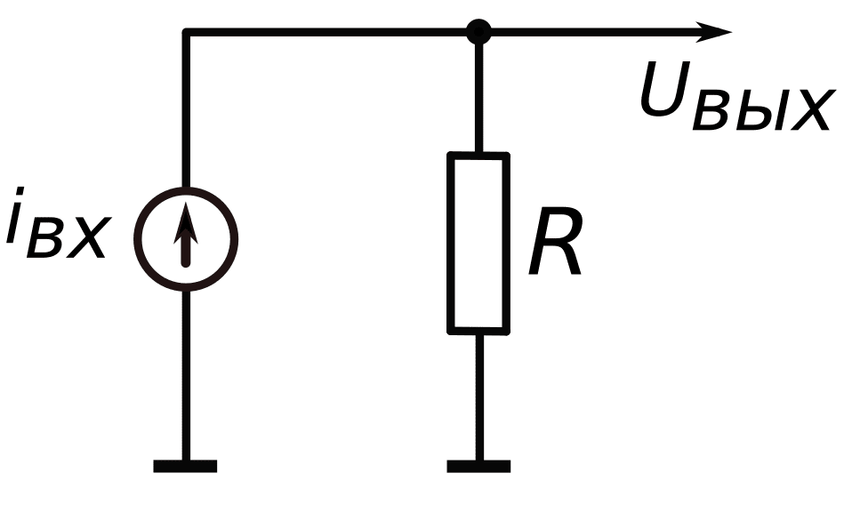
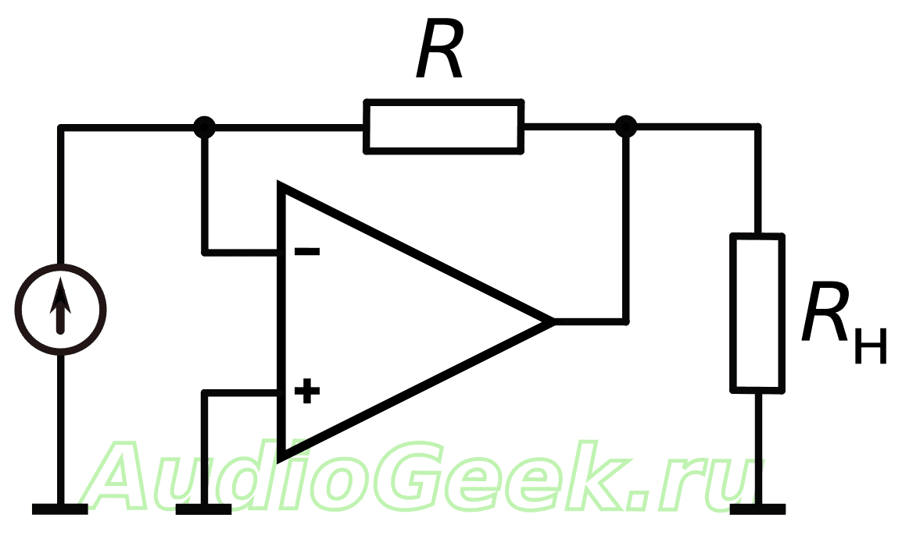
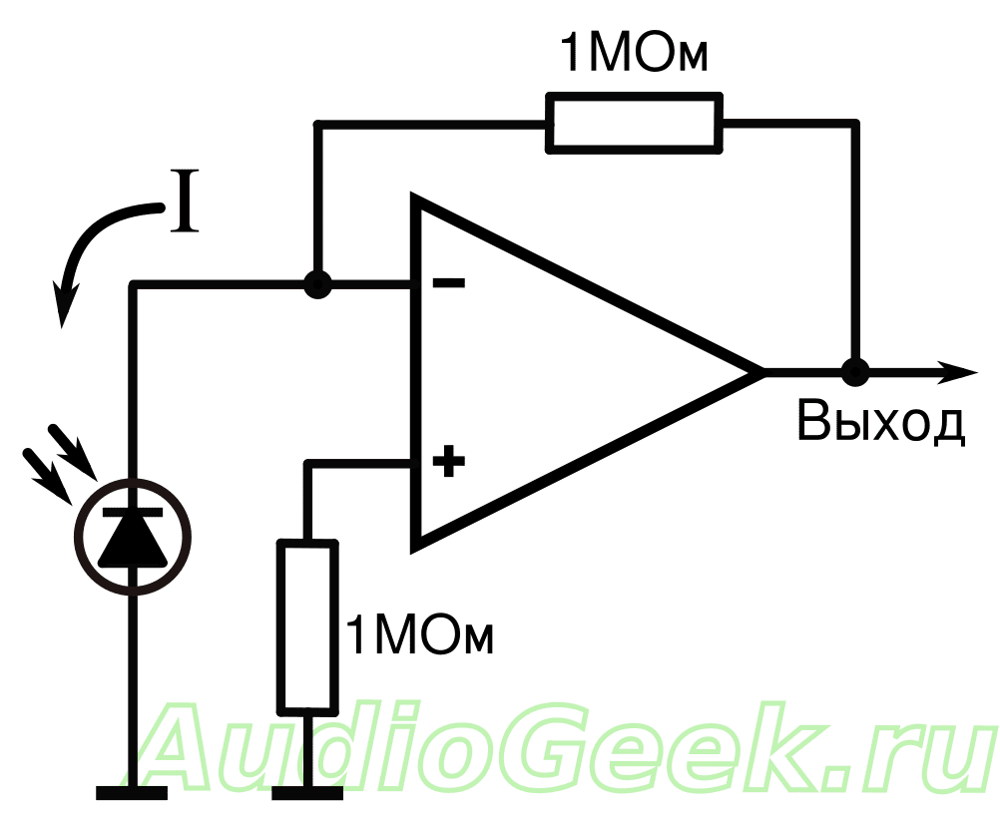
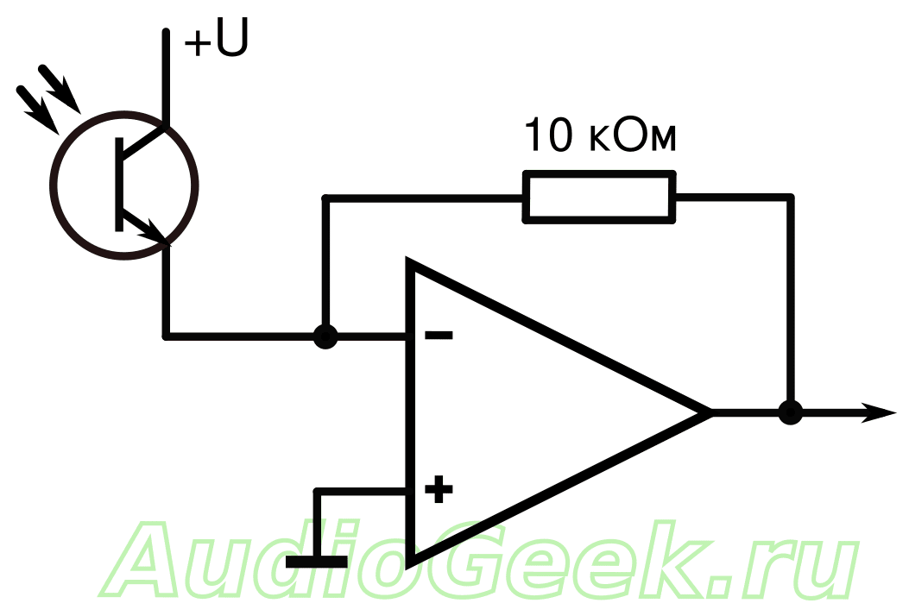
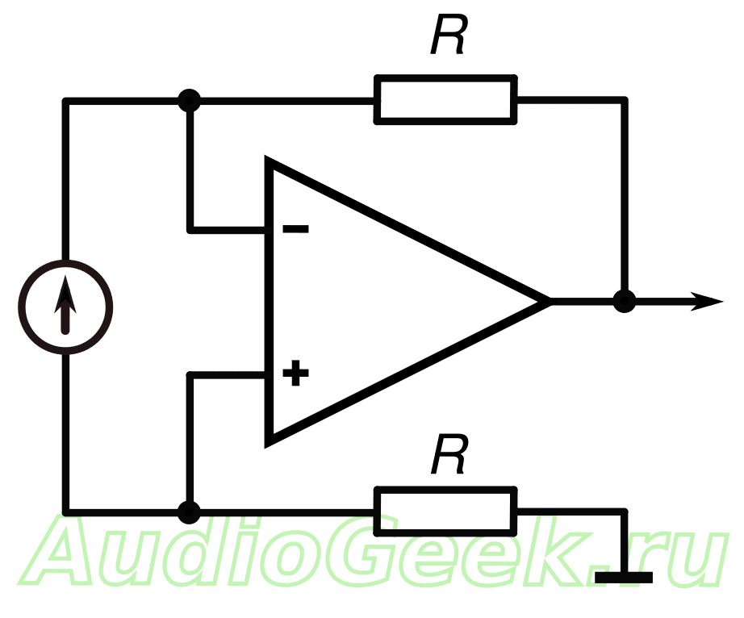

[English](./README.md) | **Русский**

# Преобразователь тока в напряжение на ОУ

**Рубрики:** Полезные схемы, Схемотехника аудиотракта  
**Метки:** схема на ОУ, ЦАП  
**Оригинал:** https://audiogeek.ru/i-u-preobrazovatel/

---

В радиотехнике часто возникает необходимость в преобразователях. Многие источники сигнала имеют токовый выход. К таким источникам относятся ЦАПы, фоторезисторы, фототранзисторы и др... Для последующих манипуляций с сигналом необходимо преобразовывать его в напряжение. Рассмотрим проверенный временем преобразователь тока в напряжение на ОУ с разными источниками сигнала. 

## **Преобразователь тока в напряжение**

**Преобразователь тока в напряжение** *(или сокращенно I-U преобразователь) - это схемное решение, позволяющее преобразовывать* выходной токовый сигнал источника в напряжение. 

Так же его называют **усилитель - преобразователь сопротивления**. Такое название в технической литературе было дано за то, что простейший преобразователь тока в напряжение - это резистор. 

Вся магия преобразования происходит по закону дедушки Ома. Ток ***iвх*** протекая через резистор ***R***  вызывает на нем падение напряжение ***U**вых***. Величина этого напряжения прямо пропорциональна произведению сопротивления резистора и входного тока. Пожалуй формулой все звучит даже проще:

***Uвых = R × iвх***

Основной недостаток использования одного резистора состоит в его ненулевом сопротивлении. Это обстоятельство становится серьезной проблемой, когда источник не в состоянии обеспечить необходимый уровень напряжения на резисторе. Результатом буду просадки напряжения на выходе.

Еще больше сопротивление сказывается на работе преобразователя, если у источника тока малый выходной рабочий диапазон. К таким источникам относится, например, фотодиод. Его выходной ток составляет единицы мкА.

В случае же **ЦАПа**, особенно высококачественного, использование резистора для преобразования предпочтительнее. Почему и зачем читайте в статье***[Резистор для ЦАП с токовым выходом](../i-u-preobrazovatel-na-rezistore/).*** Это обусловлено некоторыми фазовыми проблемами схем, которые будут рассмотрены. К счастью для нас, источникам вроде фотодиода фазовые искажения безразличны. 

## **Схема преобразователя ток-напряжение на ОУ**

Схема преобразователя тока в напряжение, совсем не нова, но проверенна и безотказна. В общем виде она выглядит следующим образом:

Ток сигнала ***iвх*** втекает в инвертирующий вход. Поскольку входной ток идеального ОУ равен нулю, то весь входящий ток поступает на резистор ***R*** цепи обратной связи. Этот ток создает на резисторе падение напряжения по закону все того же Ома.

Как результат ОУ будет стараться поддерживать на сопротивлении нагрузки ***RН*** напряжение, пропорциональное величине входного тока. Коэффициент усиления схемы в, таком случае, имеет размерность сопротивления. Что еще раз объясняет советское название усилитель-преобразователь сопротивления:

***K = Uвых÷ iвх = R***

## **Преобразователь для заземленного источника**

Рассмотрим несколько схем преобразователя тока в напряжение на ОУ, подходящие для любого случая. Начнем со схемы преобразователя для фотодиода.

Направление протекания тока показано стрелкой, и для данного случая величина выходного напряжения составит:

***Uвых = − iвх × R***

> ***Знак минус появляется из-за выбранного направления протекания тока фотодиода. (Указано стрелкой на схеме выше)***

На этой схеме так же показан дополнительный резистор в 1 МОм, с неинвертирующего(**+**) входа ОУ на землю. Схема останется работоспособной и без этого резистора, а вход операционного усилителя в таком случае заземляется напрямую.

Однако имея резистор в 1 МОм в цепи обратной связи, на каждый 1 мкА входного тока на выходе будет создан 1 Вольт напряжения. При таком коэффициенте усиления (*миллион раз*) резистор желателен из-за неидеальности операционных усилителей.

Преобразователь тока в напряжение используют и с источниками сигнала, подключенными к шине питания. Такая схема часто применяется с элементами вроде фототранзисторов. Фототранзистор потребляет (*пропускает*) ток, под действием внешнего источника света, положительной шины питания.

## **Преобразователь тока в напряжение для незаземленного источника**

Такой преобразователь отличается наличием второго токочувствительного резистора в цепи прохождения сигнального тока, который заземлен. Схема симметричного преобразователя ток-напряжение это подобие дифференциального усилителя.

В следствии падения напряжения так же и на заземленном резисторе, потенциал входа ОУ падает ниже потенциала земли, а на выходе устанавливается напряжение:

***Uвых = −2 × iвх× R***

Симметричный преобразователь тока в напряжение - пример операционной схемы, которой необходим незаземленный (*плавающий*) источник сигнала. Таким источником может послужить все тот же фотодиод. При этом фотодиод может быть вынесен за пределы платы. Для еще большей минимизации помех, желательно использовать экранированный кабель, экран которого должен быть соединен с землей.

## **Заключение**

Рассмотренные схемы используются повсеместно. Они прекрасно подходят для токовых источников с плавным изменением сигнала. Для ЦАПов же предпочтительнее использование резистора. О том, чем это лучше, и как правильно согласовать резистор со следующим каскадом читайте в статье [***Резистор для ЦАП с токовым выходом***](../i-u-preobrazovatel-na-rezistore/).

***Материал подготовлен исключительно для сайта* [AudioGeek.ru](https://github.com/SkyTrip-13/AudioGeek)**
