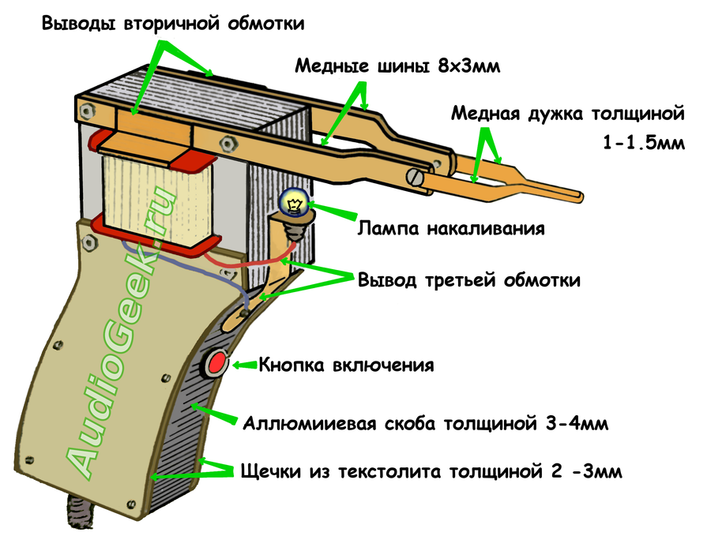
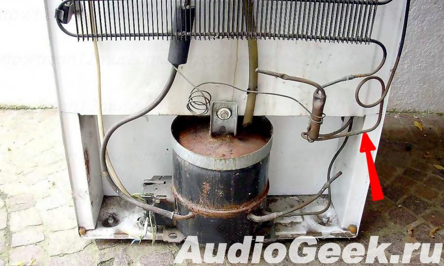
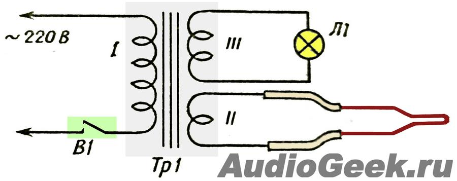

[Русский](./README.ru.md) | **English**

# A Soviet-style pulse soldering gun, built yourself

**Published:** 2019-03-10  
**Category:** Electronics  
**Tags:** DIY  
**Original:** https://audiogeek.ru/impulsniy-payalnik-svoimi-rukami/

---

A pulse soldering iron is easy to build yourself. The beauty of the design presented is its reliability, simplicity and, at the same time, decent power. Building such a pulse soldering iron with your own hands is no great trouble, and you can use it practically forever.
Recently an electrician friend proudly showed off a pulse soldering iron he had built back in the 1980s, which works perfectly to this day. A minimum of parts, and the design is simple and logical. It easily solders even wires several mm in cross-section.

## How to make a pulse soldering iron

Of course you can do everything by eye. But by happy chance a complete description of this design was found in one of my books. I think it is better to show it right away:

To build the iron yourself you first need to get a mains step-down transformer. It is desirable to use a transformer built with E-shaped (shell-type) iron. The power should be around 40–50 watts. Flea markets are full of such stuff.
The transformer must be taken apart and all the windings removed except the primary. It was already calculated at the factory for this transformer's iron, and it is better not to touch it. The secondary winding, though, will take a little bother. But not much.

## How many turns in the secondary winding?

The secondary winding should give a voltage of about 0.8 volt. But the number of turns in the primary may be unknown.
To determine how many turns are needed, first find the voltage each single turn gives. To do this, wind 10–20 turns of any wire you have. Measure the voltage and divide it by the number of turns. Most likely only 5–6 turns will be needed.

## What to wind the secondary from

The current in the secondary winding will be tens of amperes, so it must have enough cross-section. It is recommended to use a strip of copper foil 0.3 mm thick and 25 mm wide. It is not so easy to find, and it also has to be insulated somehow.
It is easier to find and use thick enameled wires. The main thing is that the total cross-sectional area is greater than or equal to **7.5 mm2**.
A wire of **1 mm** diameter has an area of **0.785 mm2**. Accordingly, you would need to wind nine wires in parallel. With 1.5 mm wire, four wires in parallel are in principle enough. It is better if the area is larger, so you can use more wires.

## Current busbars and the tip

The ends of the secondary winding must be attached to copper busbars with a cross-section of 8x3 mm. I do not know where to get ready-made copper busbars. It is much easier to find a copper tube and flatten it. Such tubes were used, for example, in the cooling systems of old refrigerators.

The soldering iron tip is made from a strip of copper 1–1.5 mm wide or from copper wire. The dimensions of the tip are chosen experimentally. Do not try to make the tip heat up instantly. The time to heat up to melting tin should be 1–5 seconds..

## The button and the lamp

The overall circuit of the iron with the button and lamp is shown in the next figure.

A normally-open button ***B1*** is used to switch the iron on. It is installed in the break between the mains cord and the primary winding of the transformer ***T1***. When choosing the button, keep in mind that while the iron is heating, the currents through the button can reach 0.3 A.
To see that the iron is working, a lamp ***L1*** is fitted to it. The lamp is very important. It is an excellent indicator that the iron is working and can serve as a light for the soldering area. To power it, you need to wind one more winding on the transformer for the lamp's supply voltage.

## Conclusion

If you build a pulse soldering iron yourself to the design shown, it is very important to insulate well the studs and nuts that clamp the core and the copper busbars. For that it is better to use Teflon, varnished cloth, glass-fiber laminate or Pertinax (phenolic laminate).
Built correctly, such an iron can be used for soldering with both low-melting and hard solders. Or you can burn wood with it. It is desirable to choose the tip so that the temperature in the drop of solder is held around 300–350 degrees.

*Originally written for [AudioGeek.ru](https://audiogeek.ru). Translated from Russian.*
