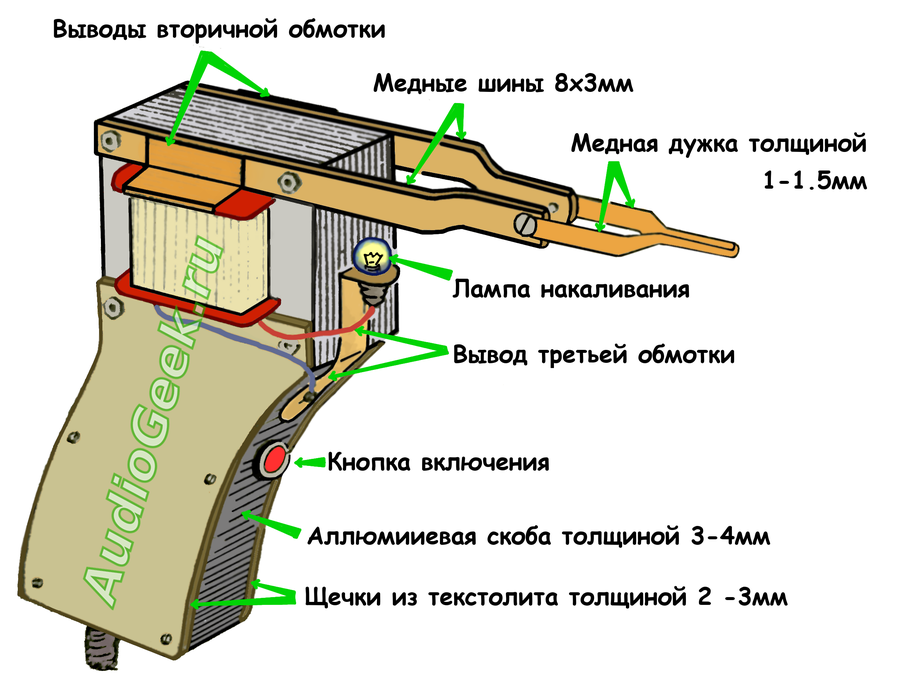
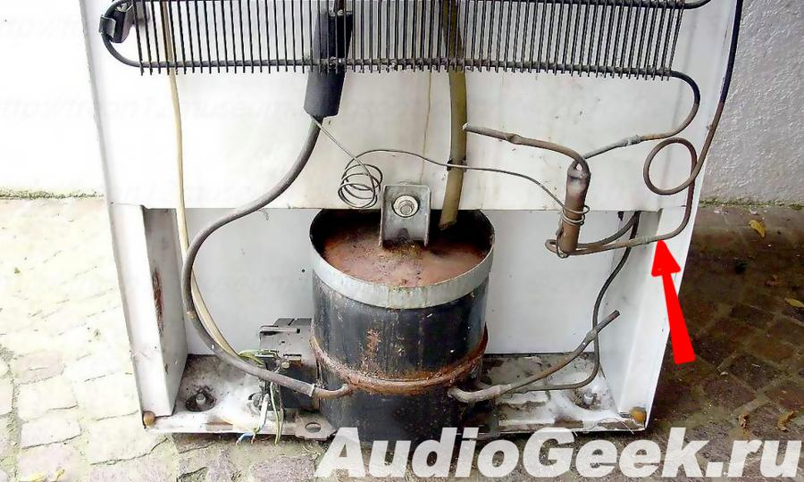
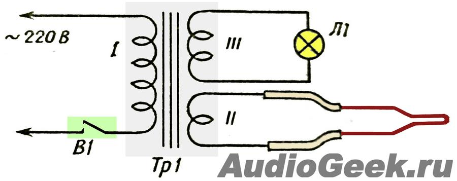

[English](./README.md) | **Русский**

# Импульсный паяльник пистолет из СССР своими руками

**Рубрики:** Разная электроника  
**Метки:** своими руками  
**Оригинал:** https://audiogeek.ru/impulsniy-payalnik-svoimi-rukami/

---

Импульсный паяльник можно легко собрать самостоятельно.  Прелесть предлагаемой конструкции в надежности, простоте и при этом достойной мощности. Собрать такой импульсный паяльник своими руками не составит особого труда, зато пользоваться им можно практически вечно.
Недавно, знакомый электрик гордо демонстрировал импульсный паяльник, собранным им еще в 80-х годах прошлого столетия и прекрасно работающим по сей день. Минимум деталей, конструкция паяльника проста и логична. Легко паяет даже провода сечением несколько мм.

## Как сделать импульсный паяльник

Конечно можно сделать все “на глаз”. Но, по счастливой случайности, в одной из книг было найдено полное описание сей конструкции. Думаю лучше сразу ее показать:

Чтобы своими руками собрать паяльник, в первую очередь, потребуется раздобыть сетевой понижающий трансформатор. Желательно использовать трансформатор, собранный из Ш-образного железа. Мощность должна быть в районе 40-50 ватт. Такого добра полно на блошиных рынках.
Трансформатор необходимо разобрать и смотать все обмотки кроме первичной. Она уже была рассчитана на заводе под железо этого транса и ее лучше не трогать. А вот со вторичной обмоткой придется немного заморочиться. Но не сильно.

## Сколько витков во вторичной обмотке?

На вторичной обмотке должно быть напряжение около 0.8 Вольта. Но количество витков в первичке  может быть не известно.
Чтобы определить сколько нужно витков, сначала определим какое напряжение дает каждый отдельный виток. Для этого наматываем 10-20 витков любым имеющимся проводом. Замеряем напряжение и делим его на число витков. Скорее всего потребуется всего 5-6 витков.

## Из чего мотать вторичку

Ток во вторичной обмотке будет составлять десятки ампер, поэтому она должна обладать достаточным сечением. Рекомендуется использовать полоску медной фольги толщиной 0.3 мм и шириной 25мм. Ее не так просто найти, так еще и изолировать как-то нужно.
Проще найти и воспользоваться толстыми эмалированными проводами. Главное чтобы суммарная площадь поперечного сечения была больше или равна **7.5 мм2**.
Провод диаметром **1мм** имеет площадь **0.785мм2**. Соответственно, потребуется намотать параллельно девятью проводами. При использовании провода диаметром 1.5мм в принципе хватит четырех проводов в параллель. Лучше если площадь будет больше, поэтому можно использовать и больше проводов.

## Токовые шины и наконечник

Концы вторичной обмотки должны быть прикреплены к медным шинам сечением 8х3 мм. Не знаю, где можно взять готовые медные шины. Гораздо проще найти и сплющить медную трубку. Такие трубки, например, применялись в системе охлаждения старых холодильников.

Наконечник паяльника изготавливается из полоски меди, шириной 1-1.5мм или из медной проволоки. Размеры наконечника подбираются экспериментально. Не стоит добиваться того, чтобы наконечник разогревался моментально. Время разогрева до плавки олова должно составлять 1-5 секунд..

## Кнопка и лампочка

Общая схема паяльника с кнопкой и лапочкой изображена на следующем рисунке.

Для включения паяльника используется нормально-разомкнутая кнопка ***В1***. Она устанавливается в разрыв между сетевым проводом и первичной обмоткой трансформатора ***Тр1***. При выборе кнопки стоит учитывать, что при нагреве паяльника токи через кнопку могут достигать 0.3А .
Для того, чтобы видеть что паяльника работает на него устанавливается лампочка ***Л1***. Наличие лампочки очень важно. Она является отличным индикатором работы паяльника и может служить подсветкой для области пайки. Для ее запитки необходимо намотать на трансформатор еще одну обмотку на напряжение питания лампочки.

## Заключение

Если делать импульсный пяльник своими руками, по приведенной конструкции, то очень важно хорошо заизолировать шпильки и гайки, стягивающие сердечник и медные шины. Для этого лучше применять тефлон, лакоткань, стеклотекстолит или гетинакс.
Такой паяльник, при правильном изготовлении можно применять для пайки как легкоплавкими, так и твердыми припоями. Ну а можно им по дереву им выжигать. Желательно подобрать жало так, чтобы температура в капле припоя держалась в районе 300-350 градусов.

***Материал подготовлен исключительно для сайта* [AudioGeek.ru](https://github.com/SkyTrip-13/AudioGeek)**
