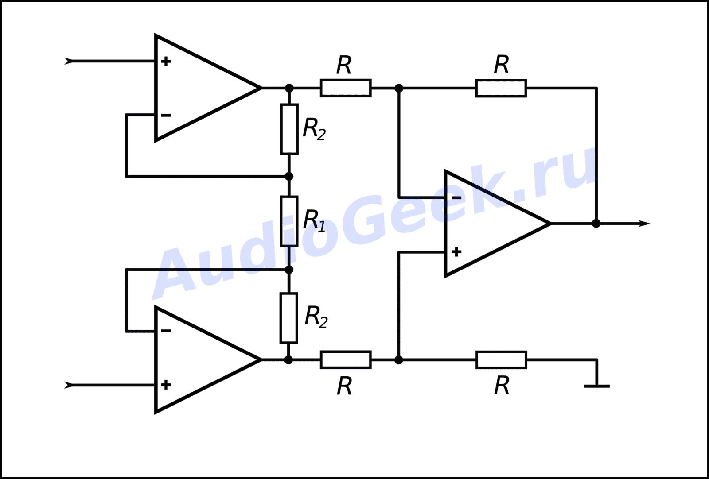
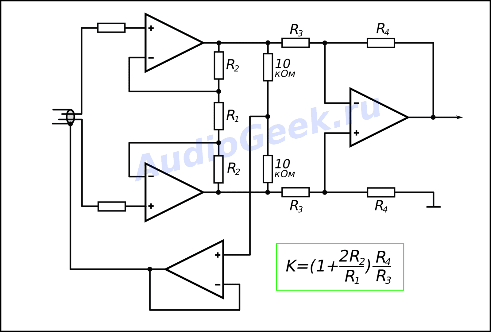

[Русский](./README.ru.md) | **English**

# Instrumentation amplifier: the best circuits and a full description

**Category:** Useful circuits  
**Tags:** measurements, op-amp circuit  
**Original:** https://audiogeek.ru/instrumental-amp/

---

An instrumentation amplifier is a kind of differential amplifier used for precise measurement of a difference signal and in test equipment. That is, these are high-class amplifiers with excellent characteristics. They can also be used as microphone preamps.

## The classic instrumentation amplifier

The instrumentation amplifier is an advanced variety of the **differential amplifier [covered earlier](../diff-amp/)**. The classic instrumentation amplifier circuit is shown in the following figure:

Like a plain differential amplifier, this amplifier is used to amplify a difference signal and to suppress the unwanted common-mode signal (one arriving at both inputs at once).

The advantage of this circuit is that the input stage on 2 op-amps provides a large differential gain and unity gain for common-mode signals without any particularly precise resistor matching.

The differential gain of the first stage is given by the formula

> **Kdiff = 1 + (2R2/R1).**

The second stage is an ordinary differential amplifier, whose differential gain is 1 and whose common-mode gain is practically 0.

As you can see, the unwanted common-mode signal arriving at both inputs of the amplifier is not amplified in the first stage and is suppressed in the second. The output op-amp does not need a high CMRR, and precise matching of the resistors R to each other, which is unacceptable for an ordinary differential amplifier, is not required either.

For such an amplifier the impedance of the signal source no longer matters, whether the source is a sensor or a microphone capsule.

> ***An instrumentation amplifier is a ready-made microphone preamp circuit with a balanced input.***

There are also hybrid instrumentation amplifier ICs. Examples are the AD623, AD625, AD522, INA143, MAX4199, LH0036 and others. In these ICs, as a rule, all components except the resistor R1 are built in. The gain is selected with the external R1. The gain range of these amplifiers is usually 1...1000, and the input impedance is more than 100 MΩ. There are both high-voltage ones (LT1167, INA146), for which the permissible common-mode and differential voltages are up to ±100 V, and low-voltage ones (LH0036) able to work from a ±1 V supply.

## The instrumentation amplifier: the full circuit

The most commonly used op-amps are duals, that is, two op-amps in one package. So when two packages are used, one op-amp stays unused. Let us look at another circuit in which the 4th op-amp is put to good use. Besides, an instrumentation amplifier is more often built exactly this way.

The added lower op-amp is used as a "guard" driver. Its amplified common-mode signal can be used to reduce the effects of cable capacitance and leakage. In this connection the guard output must be connected to the shield of the input cable. It is important that the shield is not connected anywhere else, and especially not grounded.

If you want to bring the gain-setting resistor out to a front-panel control (which is not recommended), do it with shielded cable whose shield is also connected to the guard output.

The overall gain is shown on the diagram. Typical component values are as follows:

- R1 - 100 Ω
- R2 - 50 kΩ
- R3 - 10 kΩ
- R4 - 10 kΩ
- Input resistors - 1 kΩ each.

Resistors R3 and R4 set the gain of the second stage, which is an ordinary differential amplifier and was described in the article **[Differential amplifier: an op-amp circuit and what it is for](../diff-amp/)**.

I plan to build several such amplifiers soon, so a PCB layout will appear here before long :-)

*Originally written for [AudioGeek.ru](https://github.com/SkyTrip-13/AudioGeek). Translated from Russian.*
