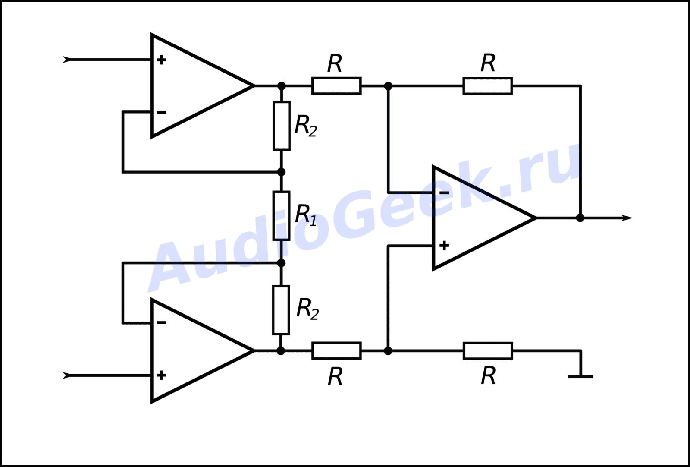
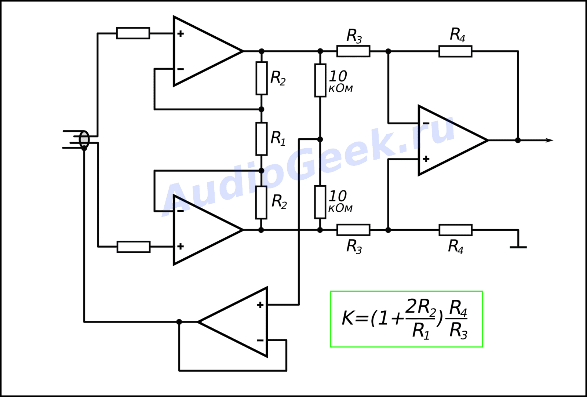

[English](./README.md) | **Русский**

# Измерительный усилитель – лучшие схемы и их полное описание

**Рубрики:** Полезные схемы  
**Метки:** измерения, схема на ОУ  
**Оригинал:** https://audiogeek.ru/instrumental-amp/

---

Измерительный усилитель (он же инструментальный) - разновидность дифференциального усилителя, применяемая для точных измерений разностного сигнала и тестирующего оборудования. Т.е. Это высококлассные усилители с отличными характеристиками. Они так же могут быть применены и как микрофонный пред усилители.

## Классический измерительный усилитель

Измерительный усилитель - это продвинутая разновидность **дифференциального усилителя, [рассмотренного ранее](../diff-amp/)**. Такие усилители также называют инструментальными. Классическая схема измерительного усилителя приведена на следующем рисунке:

Этот усилитель, так же, как и просто дифференциальный усилитель используется для усиления разностного сигнала и подавления паразитного синфазного (т.е. приходящего сразу на оба входа) сигнала.

Плюсами этой схемы является то, что входной каскад на 2-х ОУ обеспечивают большой дифференциальный коэффициент усиления и единичный коэффициент усиления синфазных сигналов без какого-либо особо точного согласования резисторов.

Дифференциальный коэффициент усиления первого каскада определяется формулой

> **Кдифф=1+(2R2/R1).**

Второй каскад представляет из себя обычный дифференциальный усилитель. Дифференциальный коэффициент усиления которого равен 1, а коэффициент усиления синфазного сигнала равен практически 0.

Как видите паразитный синфазный сигнал, приходящий на оба входа усилителя на первом каскаде не усиливается, а на втором подавляется. При этом не обязательно, чтобы выходной ОУ имел большой КОСС, и также не обязательно прецизионное согласование резисторов R между собой, что не допустимо для обычного дифференциального усилителя.

Для такого усилителя уже не имеет значения полное сопротивление источника сигнала, которым может стать какой либо датчик или же микрофонная головка.

> ***Инструментальный усилитель - это готовая схема микрофонного пред усилителя с симметричным входом.***

Существуют также гибридные ИМС измерительных усилителей. Примерами можно привести AD623, AD625, AD522, INA143, MAX4199, LH0036 и другие. У этих ИМС, как правило, все компоненты, за исключением резистора R1 встроены внутрь. А при помощи R1, располагаемого снаружи выбирается коэффициент усиления. Диапазон регулировки усиления этих усилителей обычно составляет 1...1000, а входное полное сопротивление более 100Мом. При этом существуют как высоковольтные (LT1167, INA146) , для которых допустимые синфазное и дифференциальное напряжения составляют до ±100 В, так и низковольтные(LH0036) способные работать от напряжения питания ±1вольт.

## Измерительный усилитель - полная схема

Самые часто используемые операционные усилители - сдвоенные. Т.е. Два ОУ в одном корпусе. Соответственно при использовании двух корпусов, один ОУ остается невостребованным. Предлагаю рассмотреть еще одну схему, в которой 4-ый ОУ будет приносить значительную пользу. К тому же измерительный усилитель чаще строится именно по такой схеме.

Добавленный нижний операционник используется как “защитный”. Усиленный синфазный сигнал этого операционника может быть использован для ослабления эффектов емкости кабеля и утечек. При таком включении защитный выход должен быть соединен с экраном входного кабеля. При этом важно, что больше экран не должен никуда быть подключен. И тем более не должен быть заземлен.

В случае, если Вы хотите вынести резистор, задающий коэффициент усиления на переднюю панель регулировок (что не рекомендуется), делать это следует экранированным кабелем, экран которого так же следует подключить к защитному выходу.

Общий коэффициент усиления показан на схеме. Типичными значениями элементов схемы можно назвать следующие -

- R1 - 100 Ом
- R2 - 50 кОм
- R3 - 10 кОм
- R4 - 10 кОм
- Входные резисторы - по 1 кОм.

Резисторы R3 и R4 задают коэффициент второго каскада, который представляет из себя обычный дифференциальный усилитель, и был описан в статье: **Дифференциальный усилитель - схема на ОУ и его предназначение**.

В скором времени запланировано изготовить несколько таких усилителей. Так что скоро здесь появится разведенная печатная плата :-)
