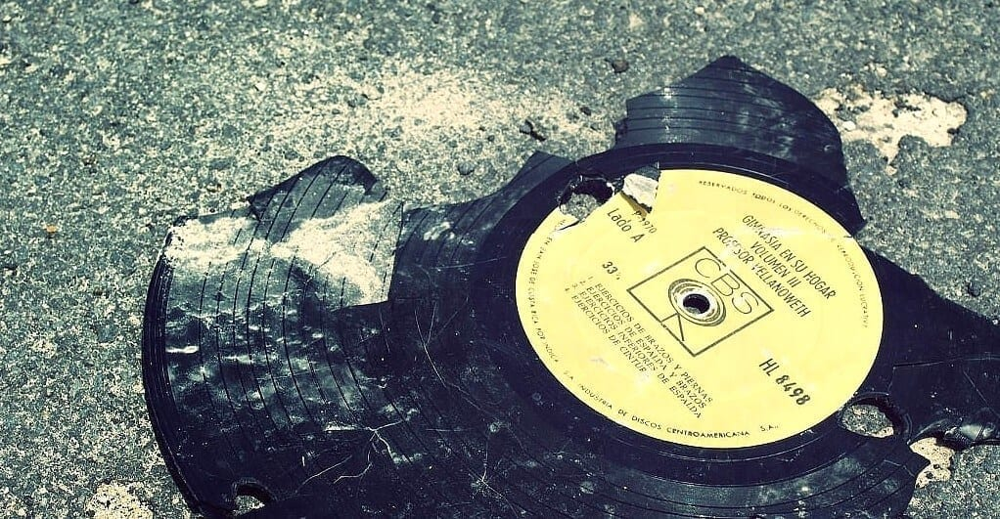
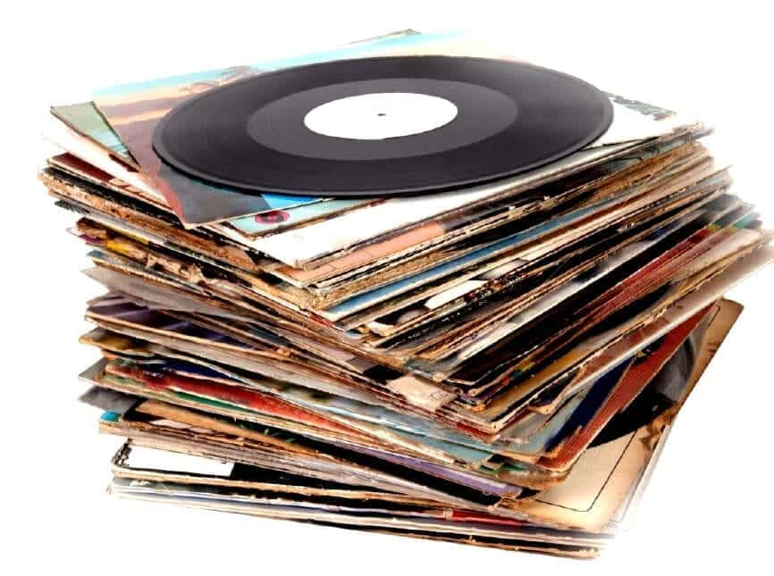
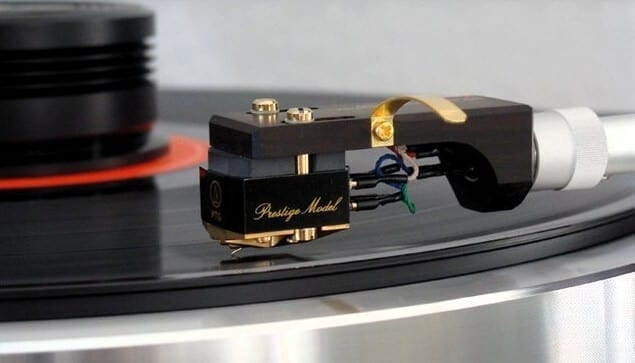
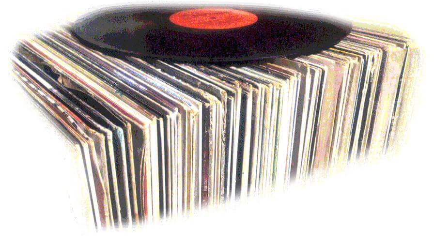

[Русский](./README.ru.md) | **English**

# Caring for and washing vinyl records at home

**Category:** Vinyl  
**Original:** https://audiogeek.ru/kak-hranit-vinil/

---

The classic material for making records is polyvinyl chloride, from which the familiar everyday word "vinyl" comes. It has its own drawbacks, because of which records need quite careful handling. Let us go over all the precautions worth observing when handling your favorite records, and learn how to store and wash vinyl records at home.

The record material has a fairly low melting point (60–70 °C), deforms easily under mechanical load even at normal temperatures, and is rather soft. Because of this, scratches and cuts easily appear on records if they are handled carelessly. In addition, polyvinyl chloride easily becomes electrically charged, which makes it attract dust very well.

Being an amorphous substance, like any plastic, polyvinyl chloride crystallizes, very slowly but surely. Because of this it becomes less pliable and more brittle. This applies mostly to old records, so knowing how to store and wash vinyl records properly matters even more for them.

## How to store vinyl records

- **Do not touch the surface of a record with your fingers.** Pick up a record with both hands, touching only the outer edge and the central label area. Sweat and grease from your hands collect dust.
- **Avoid replaying from the middle of the record.** Every lowering of the needle, even with a cueing lever, creates scratches and subsequently leads to microcracks on the record surface.
- **Be careful.** Touching with long fingernails, metal jewelry and other hard objects causes scratches, which increase noise.
- **Do not stack several records on top of each other** when you take them out of their sleeves.

---

## Temperature conditions

- Store records **away from any heat sources**: stoves, radiators, sunlight...
- **Do not leave vinyl records in a car in summer!** Especially in direct sunlight.
- Do not forget to **keep your cigarette away** when handling records, if you smoke

## Vinyl records and dust

- **Do not leave records out of their sleeves.** About 5 g of dust settles in a room every hour. Dust has a strong abrasive effect (mechanical friction) as the needle passes through the groove. This wears down the groove walls.
- **Dust the surfaces of vinyl records before and after playing.** Use dry soft cloths or pads made specifically for this. Microfiber cloths work great. Use materials that leave no lint. Wipe lightly, without pressing hard, in circular motions following the direction of the grooves.
- **Avoid using "antistatic" liquid to remove dust.** Such a liquid can often do more harm than good.
- **Do not blow the dust off.** That moistens the surface, which helps dust settle and stick.
- **Avoid smoking in the room while listening to or recording from especially valuable records.** Tar and nicotine particles and cigarette ash are so fine and small that they are hard to clean off records, and they also have strong abrasive properties.

## Washing vinyl records

If a record has dirt on it, it is better to remove it with a detergent like Fairy dish soap (preferably without any vitamin E for hands). This process may look barbaric, but it cleans records of dirt very effectively and safely.

- Rinse the record with slightly warm (**but not hot!**) water over the whole surface except the label.
- Pour detergent onto the vinyl surface and spread it over the whole surface of the record with soft movements of your fingertips.
- Using a wet piece of cotton wool or microfiber, without pressing hard, move along the tracks. Moving across the grooves is not advisable.
- After going over the whole record on both sides, rinse it thoroughly under running water, then lay it on a clean cloth or paper towel to dry.

Try not to let water get onto the central label of the record. On most records, especially Soviet ones, this can leave stains.

---

## **The pickup stylus**

And of course do not forget to regularly clean dust and lint off the pickup stylus! It should be cleaned very carefully and attentively, with a small soft brush (preferably squirrel hair). The brush strokes should go along the tonearm, not across.

## Conclusion

Of course, storing and washing vinyl records while observing absolutely all the rules is quite a hassle and in real life far from always feasible. Regular cleaning of vinyl records and careful handling will let you enjoy their warm analog sound for a long time.

*Originally written for [AudioGeek.ru](https://audiogeek.ru). Translated from Russian.*
