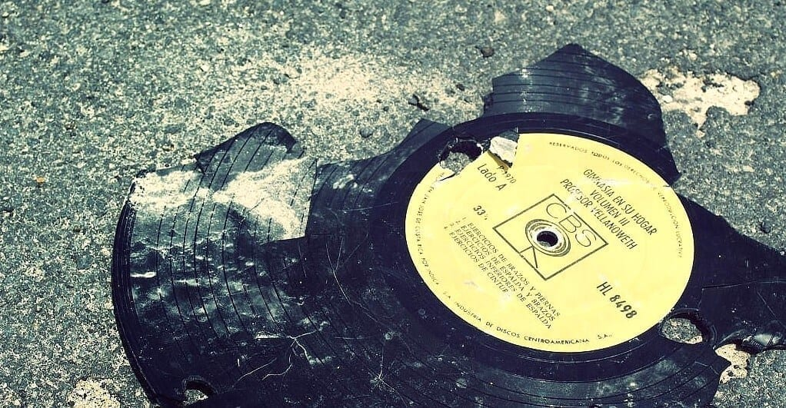
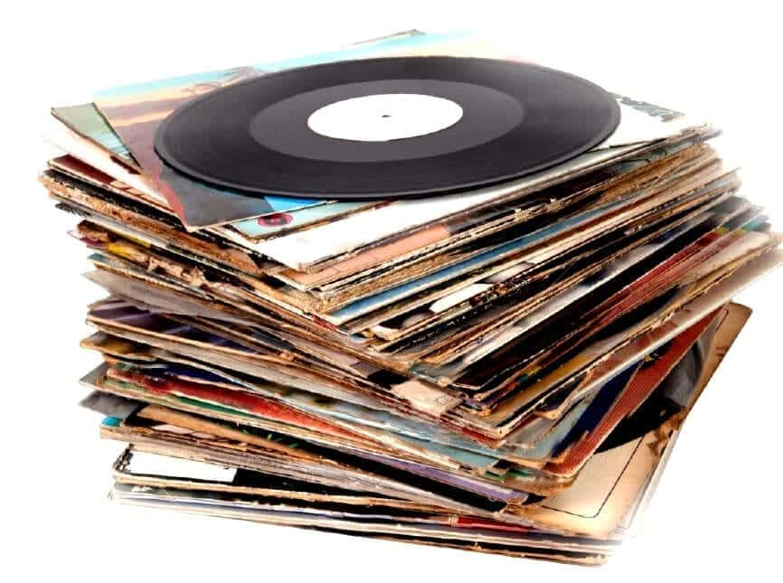
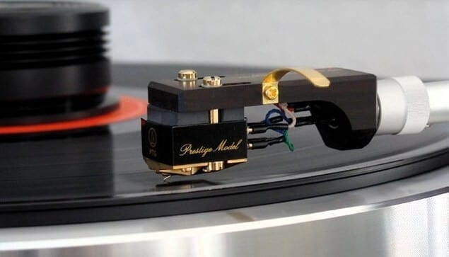
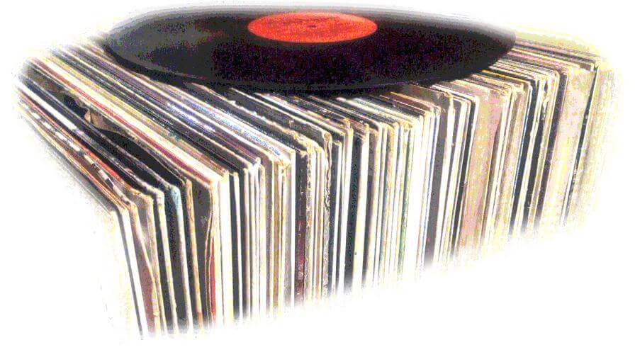

[English](./README.md) | **Русский**

# Уход и мойка виниловых пластинок в домашних условиях

**Рубрики:** ВИНИЛ  
**Оригинал:** https://audiogeek.ru/kak-hranit-vinil/

---

Классическим материалом для изготовления пластинок является поливинилхлорид от которого и произошло всем знакомое, народное “винил”. Ему присущи свои недостатки,  из-за которых пластинки требуют достаточно бережного отношения к себе . Рассмотрим все предосторожности, которые желательно соблюдать при работе с любимыми пластинками и узнаем как  хранить и мыть виниловые пластинки в домашних условиях.

Материал пластинок имеет довольно низкую температуру плавления (60-700С), легко поддается деформации при механической нагрузке даже в нормальных температурных условиях, довольно мягок. Из-за этого на пластинках при невнимательной эксплуатации легко появляются царапины и порезы. Помимо этого поливинилхлорид легко электризуется, благодаря чему отлично притягивает пыль.

Являясь аморфным веществом, как и любая пластмасса, поливинилхлорид очень медленно, но кристаллизуется. Из-за этого он становится менее пластичен и более хрупок. В большей степени это относится к старым пластинкам, поэтому умение правильно хранить и мыть виниловые пластинки для них еще актуальнее.

## Как хранить виниловые пластинки

- **Не трогайте поверхность пластинки пальцами.** Берите пластинку только двумя руками, касаясь только внешнего края и центрального круга с этикеткой. Пот и жир от рук собирают пыль.
- **Избегайте повторения с середины пластинки.** Любое опускание иглы, даже при помощи микролифта, создает царапины и в последствии приводит к микротрещинам на поверхности пластинки.
- **Будьте аккуратны.**Прикосновения длинными ногтями, металлическими украшениями и другими твердыми предметами вызывает царапины, которые увеличивают шумы.
- **Не ставьте несколько пластинок друг на друга**, когда вынимаете их из конверта.

---

## Тепловые условия

- Хранить пластинки следует **подальше от любых источников тепла** - печей, радиаторов, солнечных лучей...
- **Не оставляйте виниловые пластинки летом в автомобиле!** Особенно при прямом солнечном облучении.
- Не забывайте **подальше отложить сигарету** при работе с пластинками, если вы курите

## Виниловые пластинки и пыль

- **Не оставляйте пластинки без конверта.** Каждый час в комнате опускается около 5 г пыли. Пыль оказывает сильное абразивное воздействие (механическое трение) при прохождении иглы по канавке. Это приводит к стиранию стенок канавки.
- **Очищайте от пыли поверхности виниловых пластинок до и после проигрывания.** Для этого используйте сухие мягкие или тампоны, специально созданные для этого. Отлично подходят тряпочки из микрофибры. Используйте материалы не оставляющие ворсинок. Вытирайте легко, без сильного нажима, круговыми движениями по направлению канавок.
- **Избегайте применять для очищения от пыли “антистатическую” жидкость.** Такая жидкость зачастую может принести больше вреда чем пользы.
- **Не сдувайте пыль.** Тем самым увлажняется поверхность, что способствуете оседанию и прилипанию пыли.
- **Избегайте курить в комнате во время прослушивания или записи с особенно ценных пластинок.** Смолистые и никотиновые частицы и сигаретный пепел так тонки и малы, что их трудно очистить с пластинок, а их действие также отличаются сильными абразивными свойствами.

## Мойка виниловых пластинок

Если на пластинке имеются загрязнения, то для их удаления лучше воспользоваться моющим средством на подобии Фэри (желательно без всяких витаминов Е для рук). Этот процесс хоть и выглядит варварским, однако очень эффективно и при этом безопасно очищает пластинки от грязи.

- Промойте пластинку слегка теплой (**но не горячей!**) водой по всей поверхности, кроме этикетки.
- Налейте моющее средство на поверхность винила и мягкими движениями распределите его по всей поверхности пластинки подушечками пальцев.
- При помощи намоченного куска ваты либо микрофибры, без особого нажима водите вдоль дорожек. Совершать движения поперек канавок не желательно.
- После того, как вся пластинка будет пройдена с обеих сторон, следует тщательно промыть ее под напором воды, после чего положить на чистое тканевое или бумажное полотенце для сушки.

Старайтесь не допускать попадания воды на центральную этикетку пластинки. У большинства пластинок, особенно советский это может приводить к появлению разводов.

---

## **Игла звукоснимателя**

Ну и конечно же не забывайте регулярно очищать от пыли и ворсинок иглу звукоснимателя! Ее следует чистить очень осторожно и внимательно, небольшой мягкой кисточкой (лучше беличьей). Движения кисточки должны быть направлены вдоль тонарма, а не поперек.

## Заключение

Конечно хранить и мыть виниловые пластинки с соблюдением абсолютно всех правил достаточно хлопотное дело и в реальной жизни далеко не всегда осуществимое. Регулярная чистка виниловых пластинок и бережное к ним отношение позволит еще долго наслаждаться их теплым аналоговым звуком.

***Материал подготовлен исключительно для сайта** **[AudioGeek.ru](https://github.com/SkyTrip-13/AudioGeek)***
