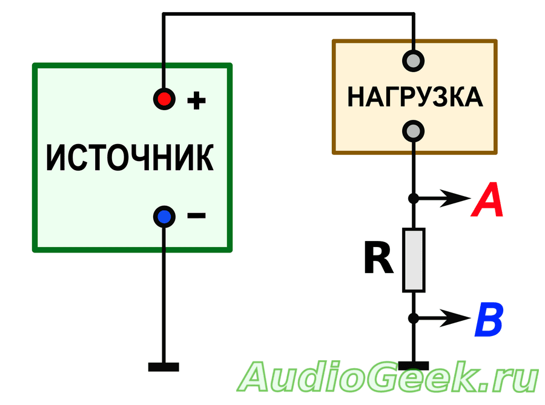
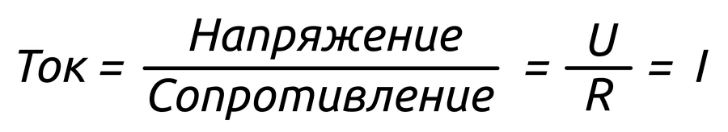
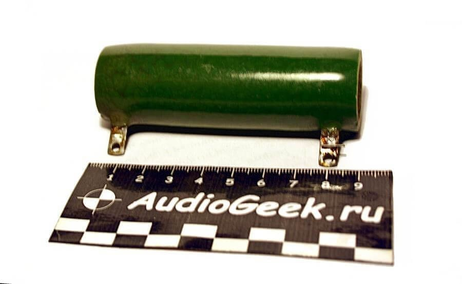
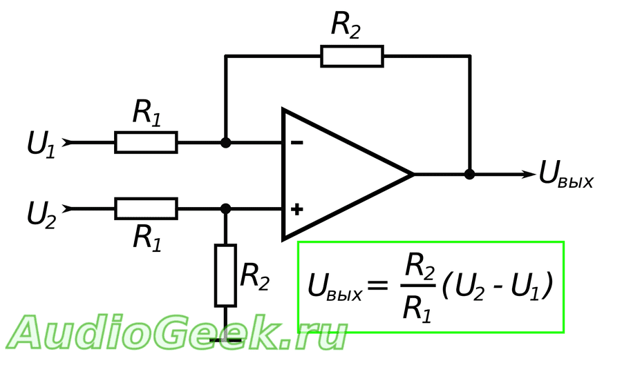
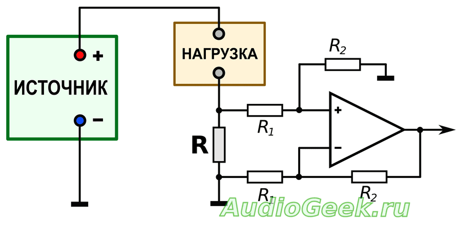
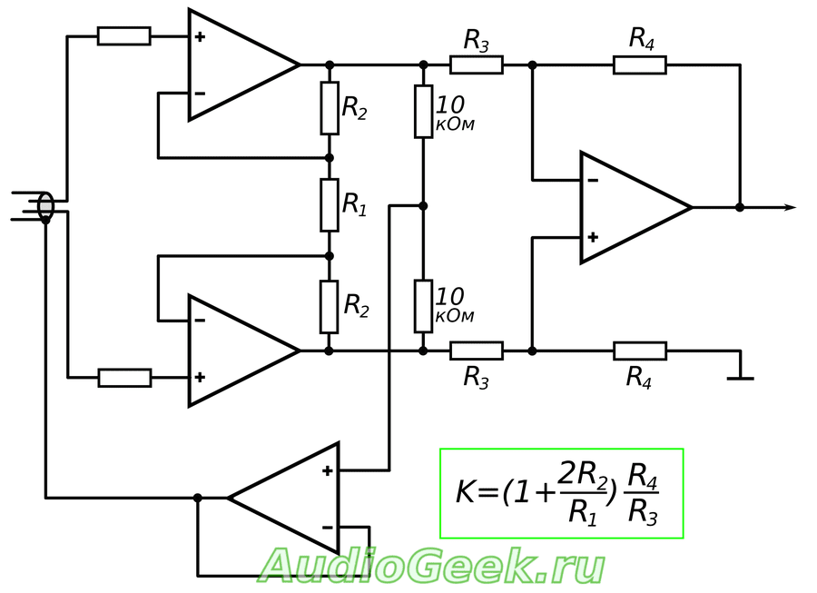

[Русский](./README.ru.md) | **English**

# How to measure current in a circuit with any accuracy

**Category:** Useful circuits  
**Tags:** measurements, op-amp circuit  
**Original:** https://audiogeek.ru/kak-izmerit-tok/

---

In a number of cases you need to measure current: for example, when monitoring the current a power supply delivers to a load, or when taking measurements. Of course you can use a multimeter, but its accuracy is not that great. Let us look at how to measure current in any circuit.

## **How to measure current**

You cannot measure the current directly. To measure the current flowing, a low-value resistor is placed in the break of the circuit, and the voltage drop across it is measured.
An ordinary analog ammeter, shown on the article's cover, works in a similar way. It is a voltmeter shunted by a low-resistance piece of wire. But today analog meters are no longer so relevant.
Let us look at how to measure the current of a power supply through a load. The same method, however, can measure current in any circuit you can stick a resistor into.
The current-sense resistor is usually placed in the break between the load and ground. The voltage drop is taken across the terminals of this resistor, i.e. between points **A** and **B**:

Knowing the resistance of the resistor and the voltage drop across it, calculating the current in the circuit by Grandpa Ohm's law is easy:

It follows from Ohm's law that at a current of 1 ampere, 1 volt drops across a 1 Ω resistor.
> A piece of wire made of a metal with high resistivity, constantan for example, can also serve as the resistor. You can get such wire from a wire-wound variable resistor.

In practice it is better to use resistors of less than 1 Ω. When choosing a specific resistance there are several important points to consider, which we will now go through.

## The resistor must not limit the current in the circuit

Suppose we have a 4 volt DC source that can supply up to 1 ampere. In that case a 1 Ω resistor can be used.
The maximum current through the resistor can be found from the same Ohm's law:

**I = 4 V / 1 Ω = 4 A.**

The source's maximum current is limited to 1 ampere, so a limit of 4 amperes does not concern it at all. Still, it is better to take a resistor with a lower value. Why? Let us dig deeper.

## **Power dissipated in the resistor**

The larger the resistor, the easier and more accurately the voltage across it, and therefore the current, can be measured. But you must take into account the power that will be dissipated in the resistor as heat. The power (P) is found from the relation:

**P = R·I2**

For example, if you intend to measure currents of about 10 amperes, then a resistor of just 0.1 Ω can dissipate about 10 watts of heat.
Allowing at least a twofold power margin, normal operation would need a 20 W resistor, and better yet 50 W. A wire-wound resistor of that power looks like this, for example:

**Using an immersion-heater-sized resistor like that is highly unreasonable, for two reasons:**

- The resistor will get very hot, and the temperature change will change its resistance.
- Such a resistor puts a considerable extra load of those same 10 watts on the source.

It is more logical to use a 0.01 Ω resistor rated at 2 or 3 watts. Better still, use a low-power precision resistor of 0.001 Ω.

## **Accuracy of the voltage measurement**

Using a resistor with such a small resistance causes some measurement difficulties. The voltage drop across it may be not much above the noise level.
For this reason the voltage drop must be taken not relative to ground but directly between the resistor terminals (points **A** and **B**), as shown above. Otherwise the resistance of the connections and interference picked up on them can give a measurement error of more than 10%.
The best solution for taking the voltage difference between two points is a differential amplifier. It has a balanced input, thanks to which it rejects common-mode interference well.

The amplifier also has a huge input resistance, which rules out shunting of the sense resistor. At the same time it has a low output resistance, and any voltmeter can safely be connected to it for visual monitoring. The differential amplifier circuit is covered in detail in a ***[separate article](../diff-amp/)***.
For our case the overall current measurement circuit looks like this:

The gain should be chosen according to your own needs. For example, if you need to measure currents up to 10 amperes using a 0.01 Ω resistor, the maximum voltage drop across it will be no more than 0.1 volt.
By setting the gain to 100, we get each volt at the amplifier output equal to 1 ampere in the measured circuit.

# **High-precision measurements**

If you need high measurement accuracy, the circuit described must use precision parts. In particular, resistors with accuracy of 1% or better and an op-amp like the AD8066, AD8116, OPA2132, etc. But you can also get by with the NE5532.
Even greater accuracy in current measurement comes from using an ***[instrumentation amplifier](../instrumental-amp/)***:

It is a more advanced version of the differential amplifier described. This is especially relevant when using a 0.001 Ω sense resistor.

# Conclusion

The current measurement method described is classic and used everywhere. This way you can measure current in almost any circuit and with any accuracy. A future article will show how to measure current when it is alternating.
***Feel free to share your opinion in the comments :)***

*Originally written for [AudioGeek.ru](https://audiogeek.ru). Translated from Russian.*
