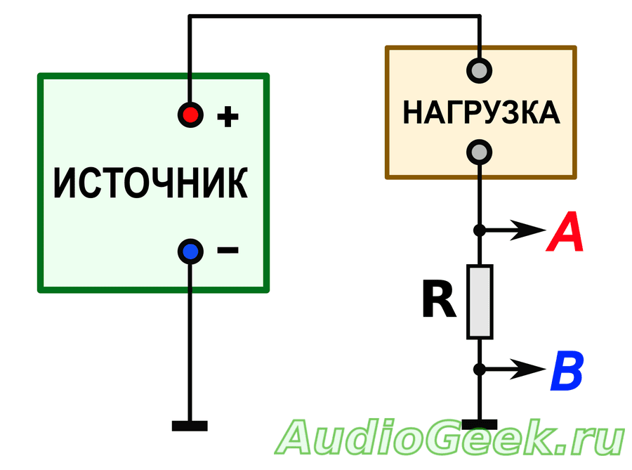
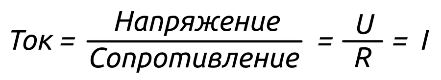
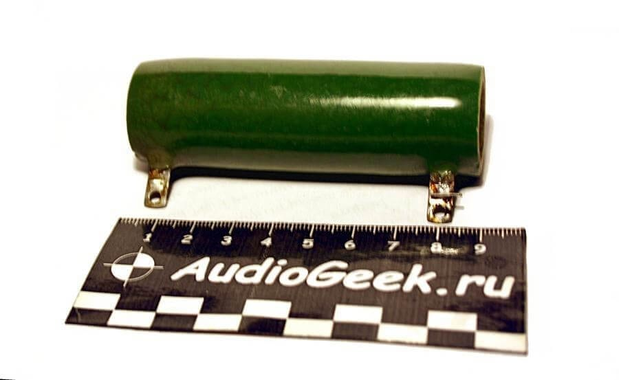
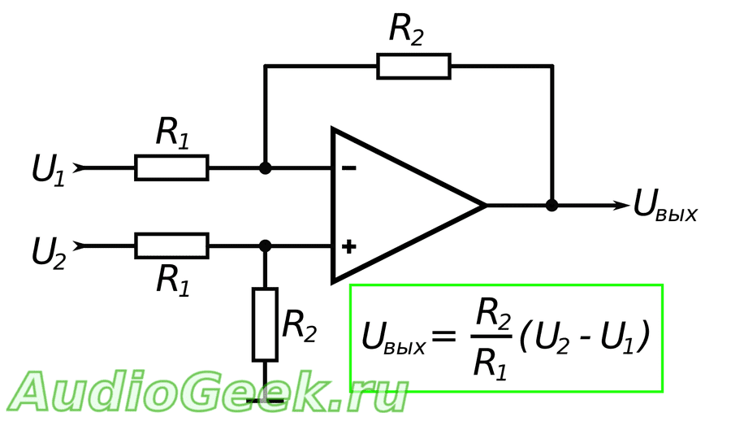
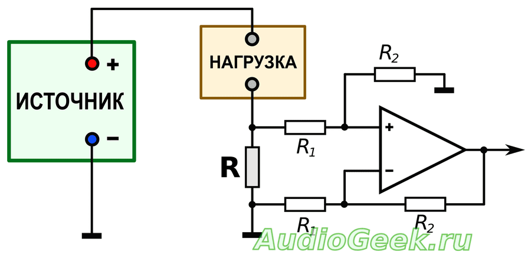
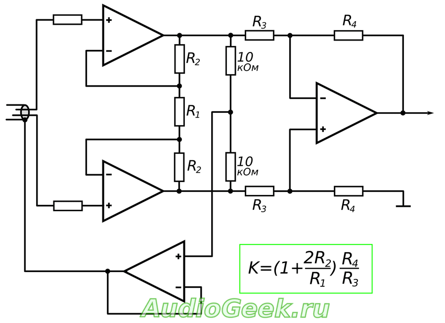

[English](./README.md) | **Русский**

# Как измерить ток в цепи с любой точностью

**Дата:** 2019-02-20  
**Рубрики:** Полезные схемы  
**Метки:** измерения, схема на ОУ  
**Оригинал:** https://audiogeek.ru/kak-izmerit-tok/

---

В ряде случаев возникает необходимость в измерении тока. Например, при контроле тока отдаваемого источником питания в нагрузку или при измерениях. Конечно можно воспользоваться мультиметром, однако его точность не так велика. Рассмотрим, как измерить ток в любой цепи..

## **Как измерить ток**

Измерить напрямую величину тока невозможно. Для измерения величины протекающего тока, в разрыв цепи устанавливается низкоомный резистор, на котором измеряется падение напряжения.
Аналогичным образом работает и обычный стрелочный амперметр, показанный в обложке статьи. Он представляет из себя вольтметр, шунтированный низкоомной проволочкой. Но сегодня стрелочные приборы уже не так актуальны.
Рассмотрим как измерить ток источника питания через нагрузку. Однако таким же образом можно мерить ток в любой цепи, в которую вы засунете резистор.
Обычно резистор для измерения тока устанавливается в разрыв между нагрузкой и землей. Падение напряжения снимается на выводах этого резистора, т.е. между точками **A** и **B**:

Зная сопротивление резистора и величину падения напряжения на нем, по закону дедушки Ома не составит труда посчитать ток в цепи:

Из закона Ома следует, что при токе величиной в 1 Ампер на резисторе, сопротивлением в 1 Ом будет падать 1 Вольт.
> В качестве резистора можно использовать и отрезок проволоки из метала с высоким удельным сопротивлением. Например из константана. Добыть такую проволоку можно из проволочного переменного резистора.

На деле лучше использовать резисторы с сопротивлением меньше 1 Ома. При выборе конкретной величины сопротивления резистора следует учитывать несколько важных моментов, которые мы сейчас и рассмотрим.

## Резистор не должен ограничивать ток в цепи

Допустим у нас имеется источник постоянного напряжения в 4 вольта, который может давать ток до 1 Ампера. В таком случае можно использовать резистор в 1 Ом.
Найти максимальный ток через резистор можно из того же закона Ома:

**I = 4В / 1Ом = 4 A.**

Максимальный ток источника ограничивается 1 Ампером, соответственно ограничение в 4 Ампера его в принципе не касается. Однако лучше взять резистор меньшего номинала. Почему? Вникаем дальше.

## **Выделяемая на резисторе мощность**

Чем больше величина резистора, тем проще и точнее можно измерить падающее на нем напряжение, а следовательно и ток. Но обязательно стоит учитывать мощность, которая будет выделяться на резисторе в виде тепла. Мощность (P) находится из соотношения:

**P = R\*I2**

Для примера, если предполагается измерять токи, величиной около 10 Ампер, то на резисторе сопротивлением всего 0.1 Ом будет может выделяться около 10 Ватт тепловой энергии.
Учитывая хотя бы двухкратный запас по мощности, для нормальной работы потребуется резистор мощностью в 20Ватт, а еще лучше на 50 Ватт. Проволочный резистор такой мощности выглядит например так:
**Использовать кипятильник таких размеров, крайне нерезонно по двум причинам:**

- Резистор будет сильно греться, а изменение температуры вызовет изменение сопротивления.
- Такой резистор создаст приличную дополнительную нагрузку для источника в те самые 10 ватт.

Логичнее использовать резистор сопротивлением 0.01 Ом и мощностью в 2 или 3 ватта. А еще лучше использовать маломощный прецизионный резистор сопротивлением 0.001 Ом.

## **Точность снятие напряжения**

Использование резистора со столь малым сопротивлением вызывает некоторые трудности с измерениями. Величина падения напряжения на нем может лежать не намного выше уровня шумов.
По этой причине снимать падение напряжения необходимо не относительно земли, а непосредственно между выводами резистора (точки **A** и **B**), как это было показано выше. Иначе сопротивление соединений и наводки на них могут дать ошибку измерений более 10%.
Наилучшим решением для снятия разности напряжений между двумя точками является дифференциальный усилитель. Он обладает симметричным входом, благодаря чему хорошо подавляет синфазные помехи.

Так же усилитель имеет огромное входное сопротивление, исключающее шунтирование измерительного резистора. При этом усилитель обладает низким выходным сопротивлением и к нему можно смело подключать любой вольтметр для зрительного контроля. Подробному рассмотрению схемы дифференциального усилителя посвящена ***[отдельная статья](../diff-amp/)***.
Применительно к нашему случаю общая схема для измерения тока выглядит следующим образом:

Коэффициент усиления следует подбирать исходя из собственных нужд. Например, если необходимо измерять токи до 10 Ампер используя резистор 0.01 Ом, то максимальное падение напряжения на нем составит не более 0.1 вольта.
Установив коэффициент усиления равным 100, мы получим, что каждый вольт на выходе усилителя равен 1 амперу в измеряемой цепи.

# **Высокоточные измерения**

Если вам требуется высокая точность измерений, то в описанной схеме необходимо применять прецизионные детали. В частности резисторы точностью не хуже 1% и операционный усилитель на подобии AD8066, AD8116, OPA2132 и тд. Но можно ограничиться и применением NE5532
Еще бОльшую точность при измерении тока даст применение ***[инструментального усилителя](../instrumental-amp/)***:

Он является более совершенной версией описанного дифференциального усилителя. Это особенно актуально в случае использовании измерительного резистора сопротивлением 0.001 Ом.

# Заключение

Рассмотренный способ измерения тока является классическим и применяется повсеместно. Таким образом можно производить измерение тока практически в любой цепи и с любой точностью. В одной из следующих статей будет показано, как измерить ток если он переменный.
***Не стесняйтесь делиться своим мнением в комментариях :)***
