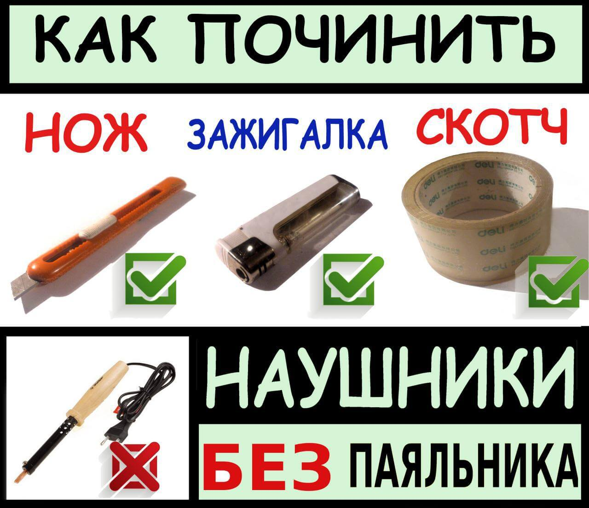
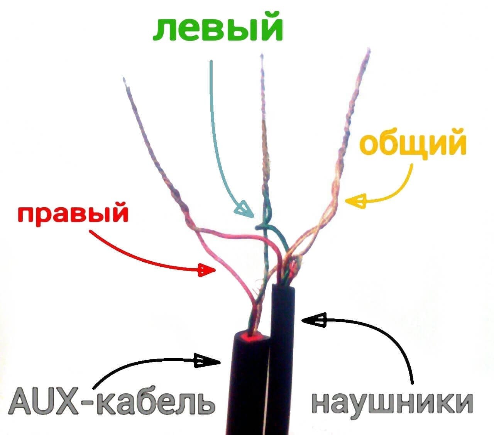
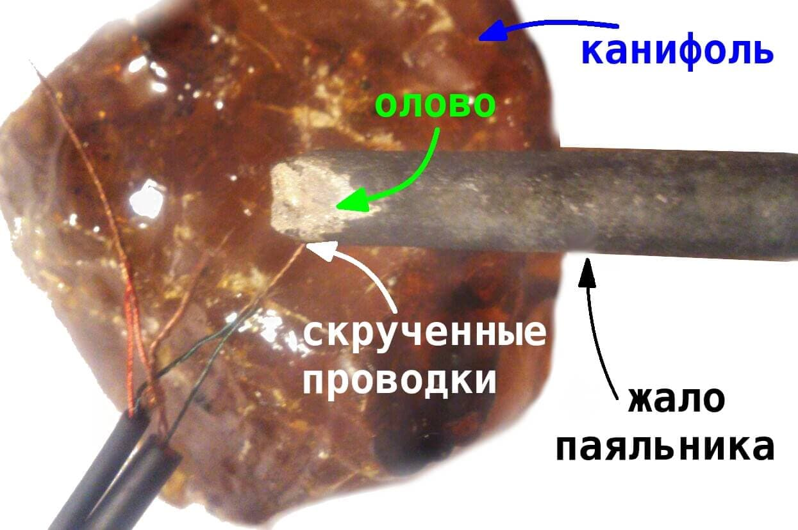
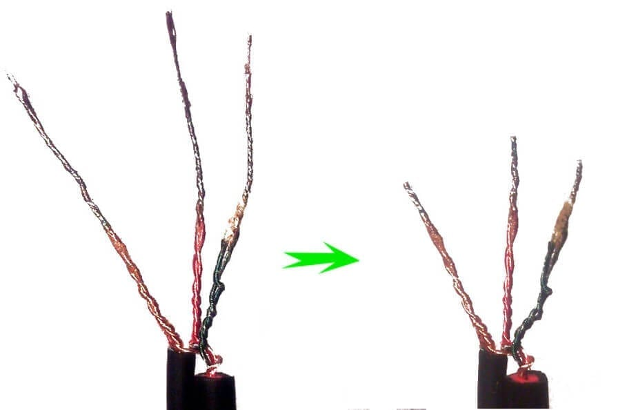
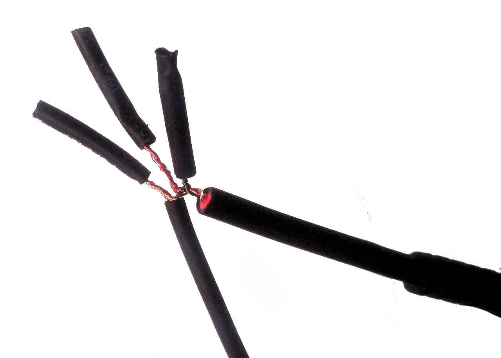
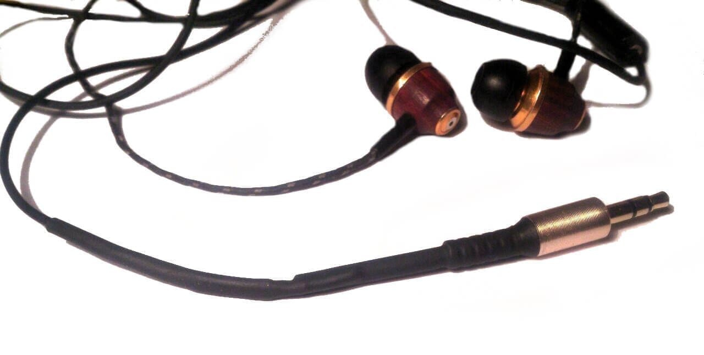
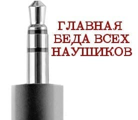

[Русский](./README.ru.md) | **English**

# How to easily learn to solder wires properly, using headphones as an example

**Category:** Repair and testing, Headphone repair  
**Original:** https://audiogeek.ru/kak-nauchitsya-payat-naushniki/

---

This article is a small continuation of the article "Fixing headphones with your bare hands, no soldering iron". If you have always wanted to be able to solder but did not know how to approach it or where to start, this is a very good moment to try soldering wires and realize that soldering is easy.

---

**If you have not read the first article yet:**

**[Fixing headphones with your bare hands, no soldering iron!](../remont-naushnikov-bez-payalnika/)**

---

## **What we will need:**

- **The soldering iron itself.** I prefer 40 honest Soviet watts. An iron of that power is quite universal and suits both thin wires and relatively massive joints.
- **Solder**, or as people say, "tin". In fact solder is usually tin-lead, and its melting point depends on the ratio of the metals. When buying, ask for ***low-melting*** solder, preferably in the form of wire ***with rosin inside***, which is much more convenient to solder with.
- **Rosin.** Good rosin has a uniform cognac-amber color, with no cloudiness when held to the light. But in principle any will do.
- **Desire**, but since you are here, you have it, which is great! ))

## **Rosin only**

As you can see, there are no soldering acids or fluxes on the list. I never use them when soldering, getting by with rosin alone, and I advise you not to use them either. Besides being toxic, the problem with flux is that the joint must be washed thoroughly. Even the slightest amount left will inevitably lead to corrosion in time. But either way the choice is yours.

## **What do we have?**

[**The first article**](../remont-naushnikov-bez-payalnika/) showed how to prepare the wires of the headphones being repaired and the wires of the AUX cable for twisting together, and how to insulate them afterwards.

Since everything is already prepared, all that is needed from the soldering iron is a tiny bit: soldering the headphone wires. First plug it in and wait for it to heat up.

It is assumed that the right wires have already been found and twisted, and by now the workpiece looks something like this:

## **Let us begin!**

Once the iron has heated up, put a small drop of tin on the end of its tip: that is, melt a little solder with the tip so that some of the solder transfers to the tip.

For that to happen, the end of the tip must be cleaned of carbon buildup and dipped in rosin, i.e. poke the hot iron into the rosin. Rosin improves wetting and the tin sticks better to copper.

So we put the twist of wires on a piece of rosin and press it lightly with the tip of the iron so that, literally for a moment, it dips into the rosin.

Next, move the tip of the iron along the joint so that the drop of tin passes onto the copper and envelops the wires. We try to make the tin cover evenly the whole part of the wire stripped of lacquer.

## **Cutting off the excess**

Once the wires are soldered, cut off the excess, leaving 2–3 mm covered with tin, which is enough.

## Insulating

And then we do all the usual things with heat-shrink tubing: put on tubes of suitable diameter (they usually shrink by half) and get an excellent result in every sense.

As you can see, using a soldering iron is not as hard as it seems. If you managed this, repairing a jack will pose no difficulties either :-)

---

**Go to the article:**

[**Headphones not working? Repairing a headphone jack yourself**](../remont-razyoma-naushnikov/)

*Originally written for [AudioGeek.ru](https://github.com/SkyTrip-13/AudioGeek). Translated from Russian.*
