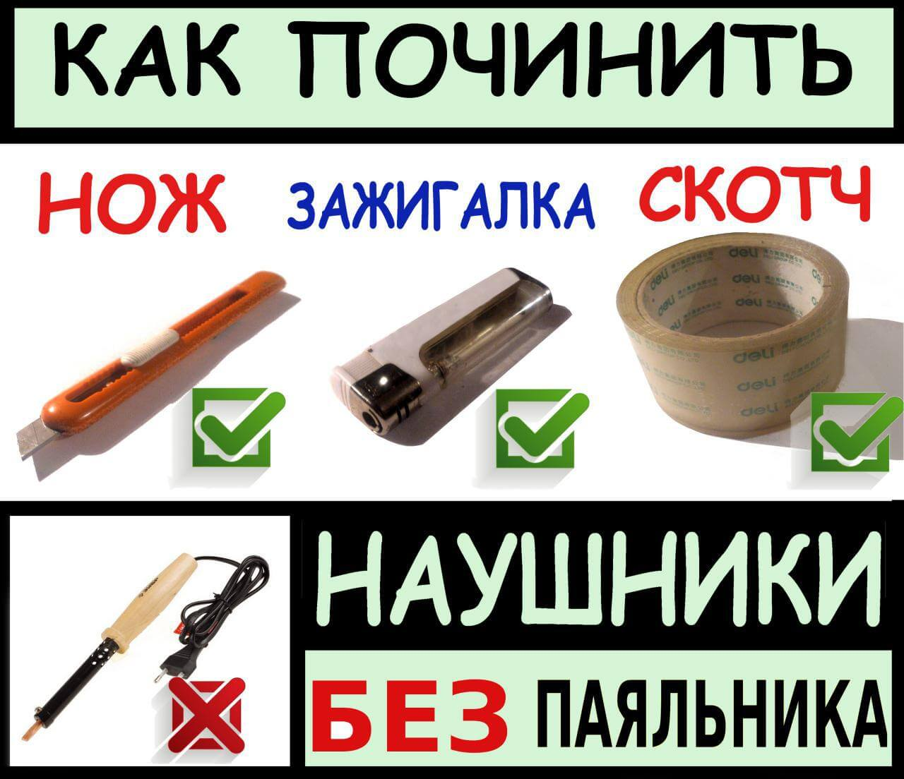
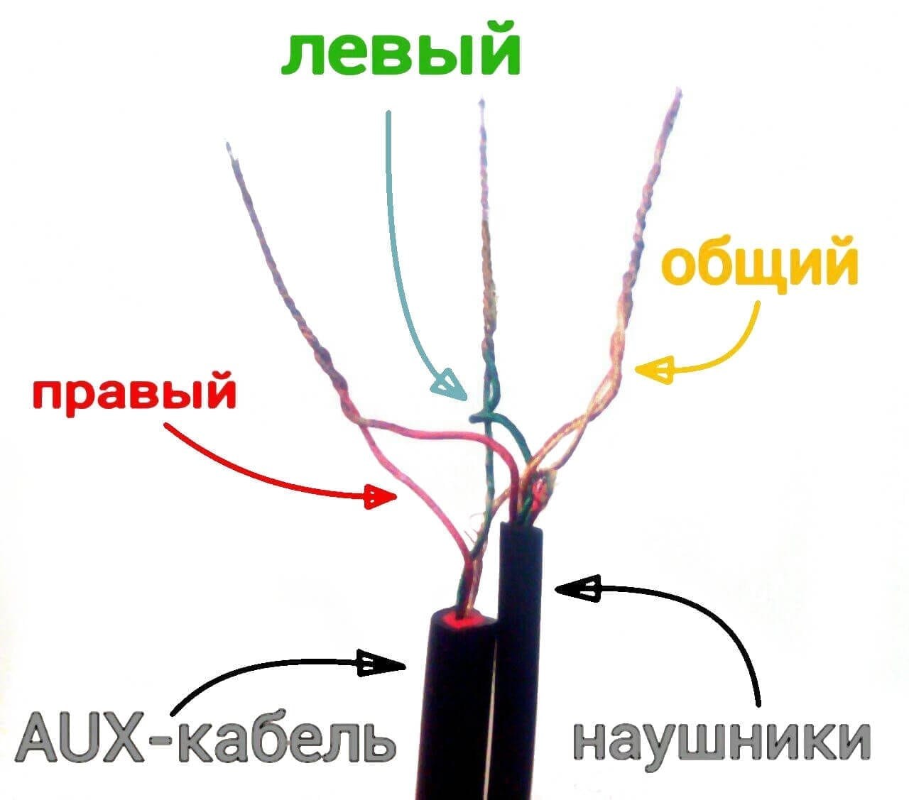
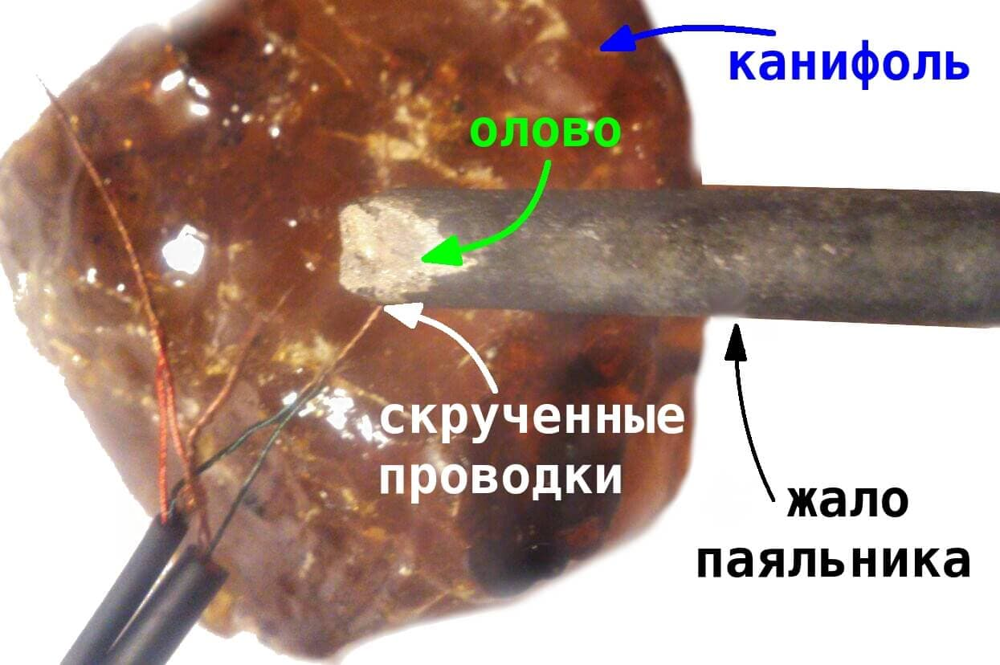
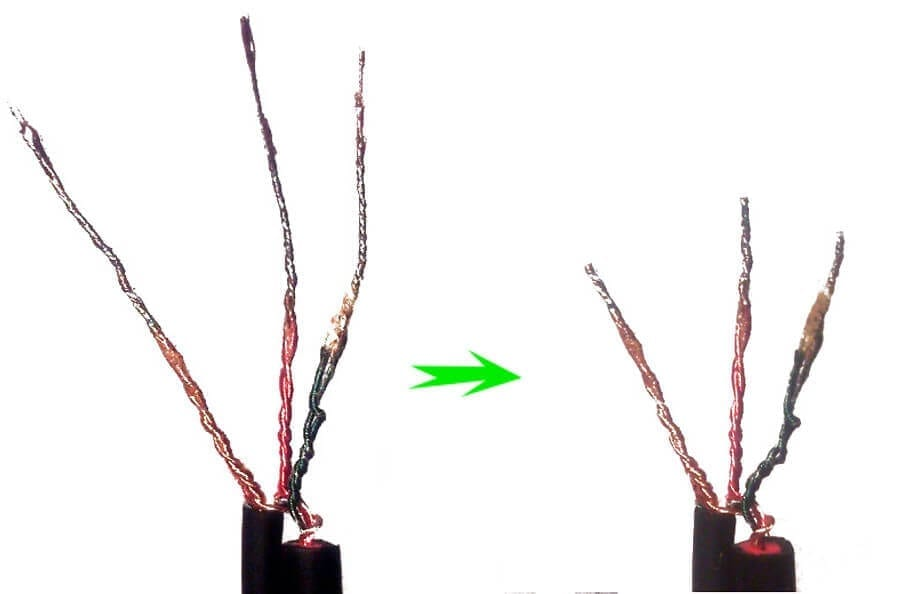
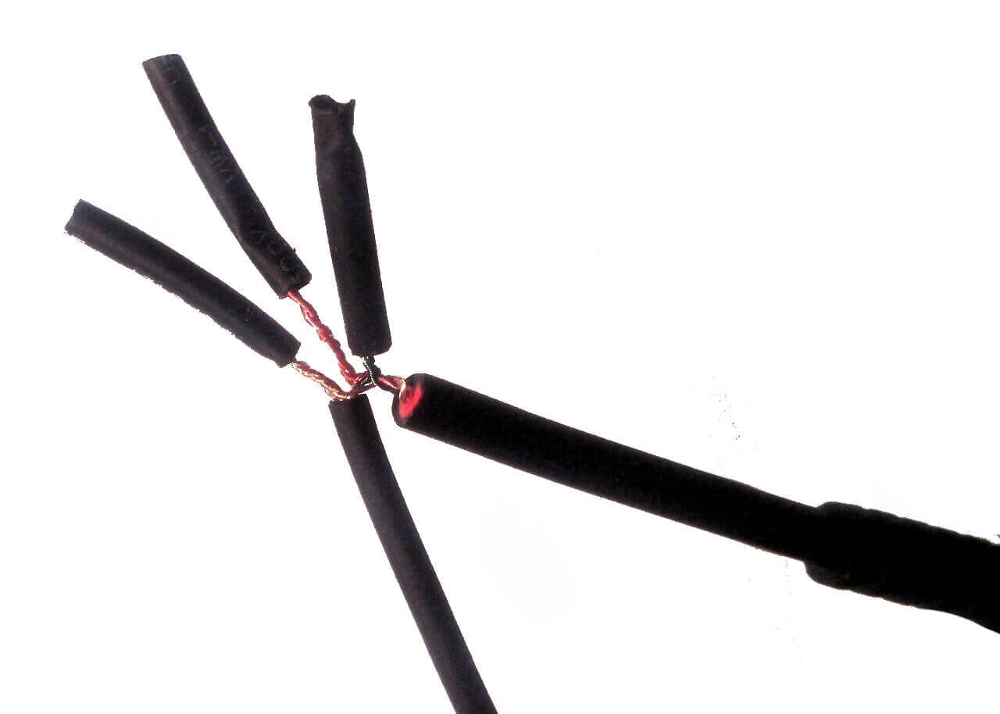
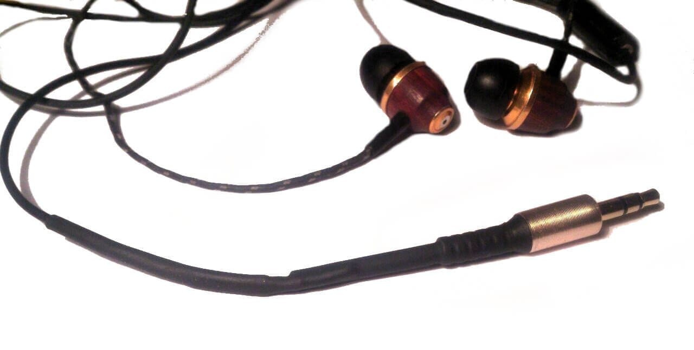
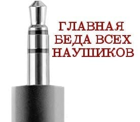

[English](./README.md) | **Русский**

# Как просто научиться правильно паять провода на примере наушников

**Дата:** 2017-03-04  
**Рубрики:** Ремонт и проверка техники, Ремонт наушников  
**Оригинал:** https://audiogeek.ru/kak-nauchitsya-payat-naushniki/

---

Эта статья является небольшим продолжением статьи "Ремонт наушников голыми руками, без паяльника". Если вам всегда хотелось уметь паять, но вы не знали как к этому подойти и с чего начать, то это очень подходящий момент попробовать паять провода и понять, что паять - это просто.

---

**Если Вы еще не читали первую статью:**

**[Ремонт наушников голыми руками, без паяльника!](../remont-naushnikov-bez-payalnika/)**

---

---

## **Нам потребуются:**

- **Сам паяльник**. Я предпочитаю мощностью 40 честных советских ватт. Паяльник такой мощности достаточно универсален и подходит как для пайки тонких проводков, так и для относительно массивных соединений.
- **Припой**, или как говорят в народе - **олово**. На самом деле припой, как правило, оловянно-свинцовый, и от соотношения металлов зависит температура его плавления. При покупке спрашивайте ***легкоплавкий*** и лучше тот, который в виде проволочки ***с канифолью внутри***, паять таким гораздо удобнее.
- **Канифоль****.** Хорошая канифоль имеет равномерный коньячно-янтарный цвет, без мутностей на просвет. Но в принципе подойдет любая.
- **Желание**, но раз Вы уже тут, значит оно есть и это радует!))

## **Только канифоль**

Как видите, в списке нету никаких паяльных кислот и флюсов. Я никогда не использую их при пайке, обходясь только канифолью, чего и вам не советую. При использовании флюса, помимо его токсичности,  проблема еще и в необходимости тщательной промывки места пайки. Даже если останется малейшее его количество, то со временем это неизбежно приведет к растворению. Но так или иначе выбор за вами.

## **Что имеем?**

[**В первой статье**](../remont-naushnikov-bez-payalnika/) было показано как подготовить к скручиванию провода ремонтируемых наушников с проводами AUX-кабеля, а так же то, как их в последствии заизолировать.

Так как у нас все уже подготовлено то, от паяльника потребуется самая малость - спаять провода наушников. Для начала воткнем его в розетку, и дождемся пока он нагреется.

Предлагается, что нужные проводки уже были найдены и скручены, и к этому моменту заготовка выглядит на подобие:

## **Приступим!**

Если паяльник нагрелся, необходимо посадить небольшую капельку олова на конец его жала, т.е. расплавить жалом немного оловянного припоя так, чтобы часть припоя перешла на жало.

Для того, чтобы это произошло, конец жала паяльника необходимо зачистить от нагара и смочить в канифоли, т.е. Ткнуть горячим паяльником в канифоль. Канифоль улучшает смачивание и олово лучше прилипает к меди.

Поэтому кладем скрутку проводков на кусочек канифоли и слегка прижимаем ее жалом паяльника, чтобы она, буквально на мгновенье, окунулось в канифоль.

Далее нужно поводить жалом паяльника по спаиваемому месту так, чтобы капелька олова перешла на медь и обволокла проводки. Стараемся сделать так, чтобы олово равномерно покрыло всю оголенную от лака часть провода.

## **Отрезаем лишнее**

После того как проводки спаянны, отрезаем лишнее, оставляя 2-3 мм покрытых оловом - этого достаточно.

## Изолируем

Ну а дальше проделываем все делишки с термотрубками - надеваем трубки подходящего диаметра (обычно сжимаются вдвое) и получаем отличный во всех смыслах результат.

Как видите, пользоваться паяльником не так сложно, как кажется. Если Вам удалось осилить это, то и ремонт разъема не вызовет никаких трудностей :-)

---

**Перейти к статье:**

[**Не работают наушники? Ремонт разъема наушников своими руками**](../remont-razyoma-naushnikov/)
