[Русский](./README.ru.md) | **English**

# How to quickly and easily process a voice recording in Audacity

**Category:** Audio processing  
**Tags:** Audacity, audio processing  
**Original:** https://audiogeek.ru/kak-obrabotat-golos-audacity/

---

However good your recorder is, a voice recording almost always needs processing afterwards. There may be noise or extraneous sounds in the recording, the voice volume may wander or be too low, and the voice itself may sound muddy. So if you are preparing a recording for later listening or, say, for a YouTube video voiceover, processing the voice is highly desirable.

Here is a quick way to process a voice yourself. The main emphasis is on bringing out speech in the recording. But even if speech is not your only goal, after reading this you should have no trouble improving the quality of any recording.

> The screenshots show the Russian-language interface of Audacity. The English menu names are given in the text.

***It is best to process audio with headphones.*** Preferably not a pair bought at a subway kiosk for pennies. Ideally use ***[monitoring headphones](../monitoring-headphones/)***, but ordinary decent headphones will do.

> If your headphones are broken and need urgent repair, you can do it even without a soldering iron. How? Read the article: [***Fixing headphones with your bare hands, no soldering iron!***](../remont-naushnikov-bez-payalnika/)

## Audacity: a free program for voice processing

Voice processing is audio file editing. So first of all we need a sound editing program. We will work in a free but very capable audio editor, Audacity. It is available for all operating systems and is very easy to use.

> **You can download Audacity for free for any OS from [this page](https://www.fosshub.com/Audacity.html).**

The editor's interface is intuitive, and even by trial and error you can quickly find what you need. ***All that is left is to find out what you actually need.***

## Voice processing: importing the recording

So, we have a recording in some audio format. First open it in Audacity. You can use the ***Import*** command in the editor's ***File*** menu, but I am used to just dragging the file with the mouse from the folder into the editor window.

For the demonstration I took a piece of recording a little over a minute long, short enough to fit on the screen, which makes the demonstration clearer. It has all the faults typical of ordinary voice recorder recordings.

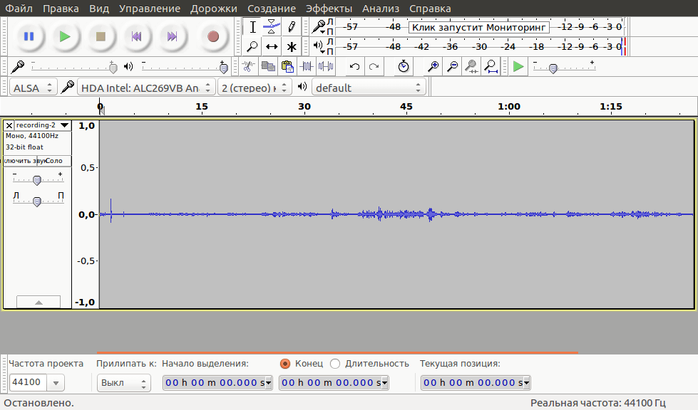

---

## Normalizing the volume

To improve sound quality, first raise the volume of the recording. To do that, double-click the track with the left mouse button (or press ***Ctrl+A***) to select it. Then open the ***Effect*** menu and choose ***Normalize...***

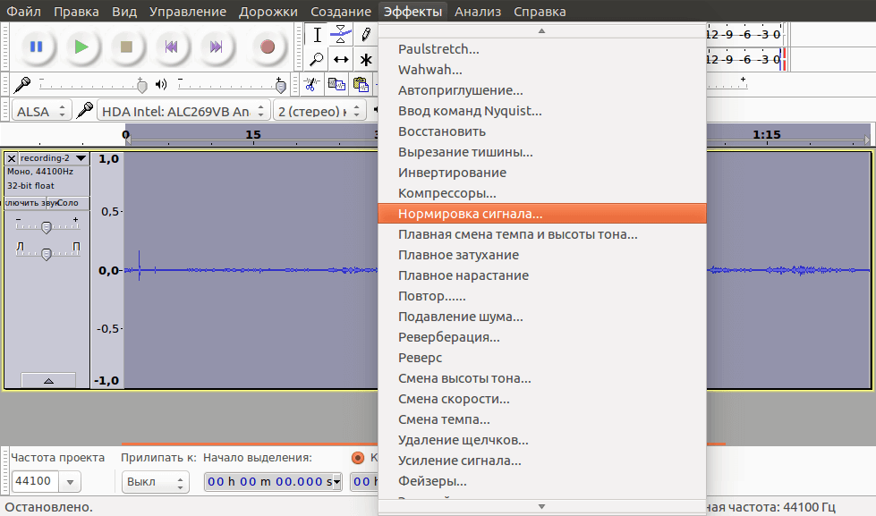

After clicking, the effect settings window opens:

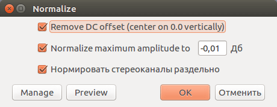

The default settings suit us fine. The window shows the volume value that the loudest peak of your recording will have. Normalizing raises the volume of the recording and affects nothing else.

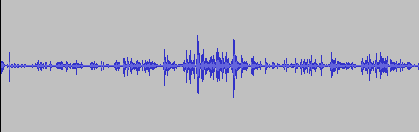

> Every tool in Audacity has a ***Preview*** button. Clicking it plays the first 5 seconds of the selected section with the effect applied.

---

## Removing extra sounds and clicks

The volume has gone up, but it still does not look impressive. The culprit is a click at the very beginning. You can simply silence it. To do that, zoom in and select it:

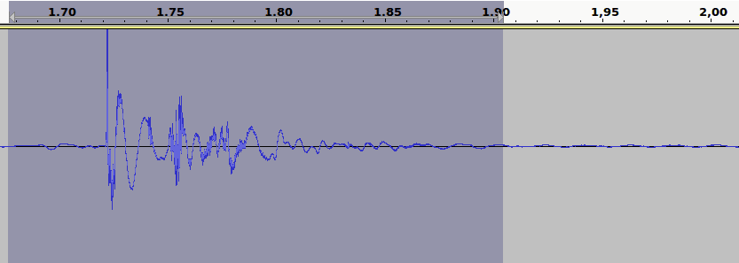

> It is convenient to zoom by holding ***Ctrl*** and turning the mouse wheel, and to move left and right along the recording by holding ***Shift*** while turning the wheel.

I deliberately included the time scale in the picture to show that the peak lasts about **0.1 second**. To silence the selection, click the button on the toolbar (or press ***Ctrl+L***):

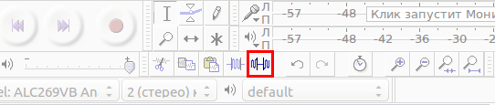

The editor instantly flattens the peak into a perfectly straight line of zero volume:

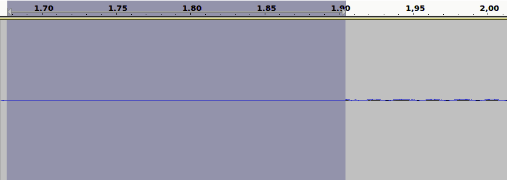

> You can also ***delete*** this piece by pressing ***Delete*** on the keyboard. But then the selected part of the track is removed and the total duration gets shorter. If the recording is being prepared as a voiceover for a ***YouTube video***, deleting with Delete may ***shift the track*** out of sync.

After removing the click, repeat Normalize and you get a more solid result:

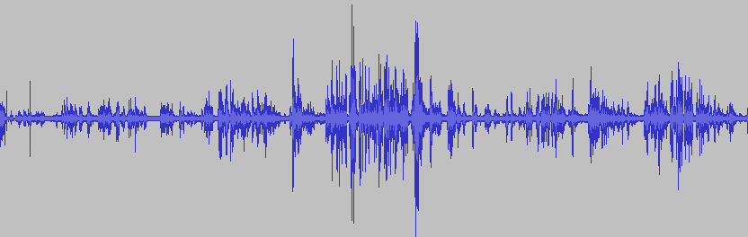

> Audacity has a handy key combination, ***Ctrl+R***, which repeats the last used effect with exactly the same settings.

***Normalization*** is simply ***amplifying*** the signal by a constant amount. The gain is chosen so that the loudest places reach the value you specify. Everything is amplified, both the useful signal and the background noise.

---

## How to remove noise

Voice processing inevitably requires removing noise. This is done in two steps. First you need to create a ***noise profile*** so the program knows what to get rid of. So find a piece of the recording that has no useful content, only what we consider noise, and select it.

The longer it is, the more completely the noise can be removed from the recording.

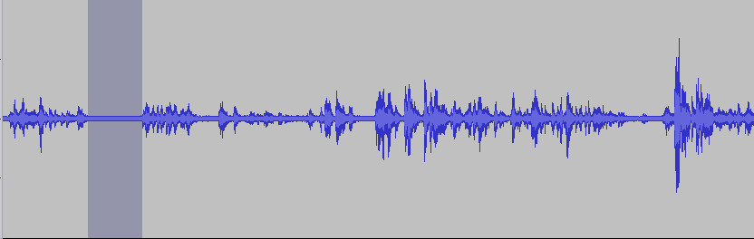

Now in the ***Effect*** menu choose ***Noise Reduction...*** At the top of the window that opens you will see a single button, ***Get Noise Profile***. Click it.

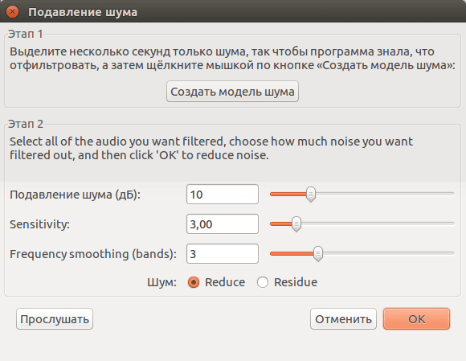

The window will close... **Great!** The noise profile has been created. Now select the whole recording and open ***Effect → Noise Reduction...*** again.

The same window opens, but now you can proceed to ***step 2***. The default settings suit most cases, although it is worth experimenting with the last slider. Click ***OK***, repeat the normalization and admire the result:

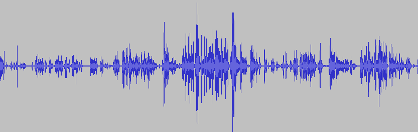

Compared with how the track looked before noise removal, you can easily see that the constant background has almost completely disappeared. All the quiet parts became even quieter, practically zeroed. And by ear it sounds an order of magnitude better.

> For broader understanding, note that every ***6 dB*** of reduction is ***half*** the level, and ***3 dB*** is about ***a third less***. If your recording is very noisy and contains different types of noise in different parts, you can repeat the procedure from creating the noise profile, taking the piece for the noise profile from a different place in the recording, and entering 3 to 6 dB in the Noise reduction (dB) field. Too much reduction can make the sound "smeared". Also, it is often much more effective to reduce noise by ***3 dB*** several times, creating the noise profile from different parts of the recording, than to hit it once with ***15 dB***.

---

## Equalization: bringing out the voice

Since we are interested in speech, we can additionally emphasize it with an equalizer. Go to ***Effect → Equalization...***

> The topic of equalization cannot be covered in two paragraphs, so there is a separate article on it: ***[Equalizing a voice recording in Audacity](../voice-eq-audacity/)***

In a nutshell, speech, both male and female, fits in the range of ***200–7000 Hz***. Most noise usually lies above this range, and hum below it. So the volume of the other frequencies should be reduced, as they are uninformative and even parasitic.

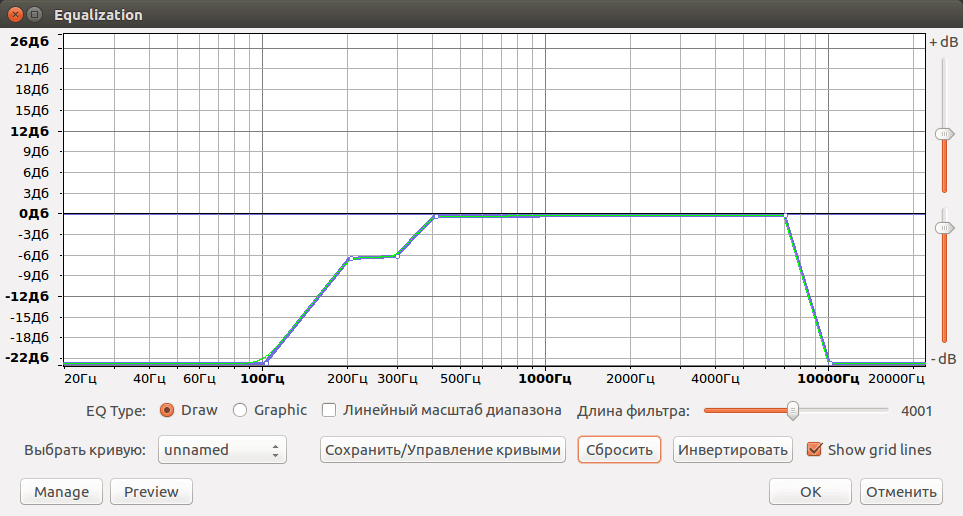

An equalizer curve like this may do for quick processing. But a lot depends on how and with what the recording was made. **So I still recommend looking at the article about equalization.**

---

## Compression

Voice processing always includes leveling the recording's volume. In principle you can select pieces by hand and apply Normalize to each. It is quite effective but takes a long time. And people did not invent a useful thing like the compressor for nothing. So we will use it :-)

Select the whole recording and go to ***Effect → Compressor...***

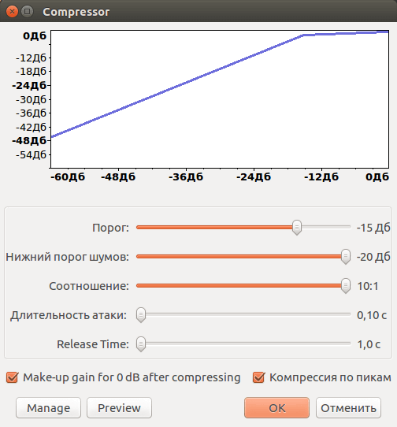

These settings should suit most people. The idea of a compressor is that it amplifies quiet moments and attenuates loud ones, thereby evening out the volume. Let us look at the compressor's result:

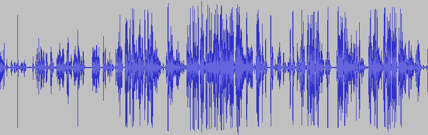

The recording has clearly been transformed. The beginning could be made even louder. Select it separately and repeat compression or normalization, as you prefer.

---

## Export and saving

> To save the processed recording as an audio file, go to ***File → Export***

In the window that opens, enter the ***file name*** and choose its ***format***. You can export the recording to any popular audio format, specifying quality. For most cases ***MP3 at a constant 320 kbit/s*** will do.

If you have not finished processing and need to run off, you can save the project. Use the menu item ***File → Save Project***. A saved project can be opened at any time to continue working. This is especially useful if you have many tracks.

**Back to the original for comparison**

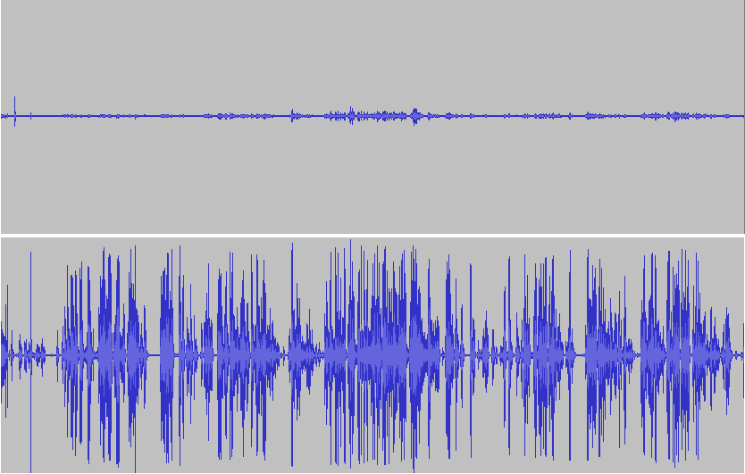

***As they say, find the 10 differences...***

## Conclusion

Of course you can keep torturing the recording: remove again the noise that may have appeared after compression, compress even harder to improve the sound further...

But remember that excessive compression can make the sound constricted and rob it of dynamics. In any case, the decision is yours and your ears'.

*Originally written for [AudioGeek.ru](https://github.com/SkyTrip-13/AudioGeek). Translated from Russian.*
