[English](./README.md) | **Русский**

# Как быстро и просто обработать запись голоса в Audacity

**Дата:** 2017-04-02  
**Рубрики:** Обработка звука  
**Метки:** Audacity, обработка звука  
**Оригинал:** https://audiogeek.ru/kak-obrabotat-golos-audacity/

---

Каким бы качественным не был диктофон, практически всегда требуется последующая обработка голоса. На записи могут присутствовать шум или посторонние звуки, громкость голоса может плавать или быть недостаточной, а сам голос бубнить. Поэтому, если вы готовите запись для последующего прослушивания или, например, для озвучивания ролика на ютубе, то обработка голоса крайне желательна .

Рассмотрим быстрый способ, как может быть осуществлена обработка голоса самостоятельно. Основной акцент будет уделен выделению речи на записи. Но даже если цель не только в речи, после прочтения вам не должно составить труда улучшить качество любой записи.

***Обработку звука лучше производить в наушниках.*** Желательно, чтобы это были не купленные в переходе за 50 рублей наушники. В идеале желательно использовать ***[мониторные наушники](../monitoring-headphones/),*** но подойдут и просто нормальные наушники.
> Если ваши наушники сломались и нужно срочно их починить, то сделать это можно даже без паяльника. Как? -Читаем в статье: [***Ремонт наушников голыми руками, без паяльника!***](../remont-naushnikov-bez-payalnika/)

## Заказать обработку

Если вам не хватает времени или нет желания вникать, то вот отличный сервис - ***[Kwork](https://fas.st/WGeqGx)***. Я и сам им часто пользуюсь. Это проверенная биржа фриланс-услуг. Тут за небольшую плату, Вы можете выбрать профессионального исполнителя для обработки вашей записи или других услуг.

[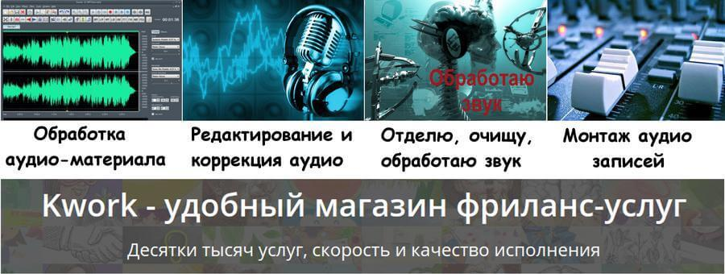](https://fas.st/WGeqGx)

## Audacity - бесплатная программа для обработки голоса

Обработка голоса - это редактирование аудиофайла. Поэтому первым делом обзаведемся программой для работы со звуком. Работать будем в бесплатном, но при этом очень функциональном аудиоредакторе - Audacity. Программа доступна под все операционные системы и очень проста в использовании.
> **Бесплатно скачать Audacity для любой ОС можно** ***[по этой ссылке](https://www.fosshub.com/Audacity.html)***.

Интерфейс редактора интуитивно понятен и даже методом тыка можно очень быстро натыкать то, что вам нужно. ***Осталось только узнать, а что собственно нужно***.
> Если в записи присутствует мат, который нежелателен, то исправить ситуацию поможет статья: ***Запикивание мата в записи***

## Обработка голоса - импорт записи

Итак, имеем запись, в каком либо аудио формате. Первым делом открываем ее в Audacity. Можно сделать это кнопочкой ***Импортировать*** из меню ***Файл*** редактора, но мне как-то привычнее нагло перетащить файл мышкой из папки в окно редактора.
Для демонстраций был взят кусочек записи длительностью чуть более минуты. Такой, чтобы умещался на экране. На нем демонстрация будет нагляднее. При этом ему присущи все недостатки обычных диктофонных записей.

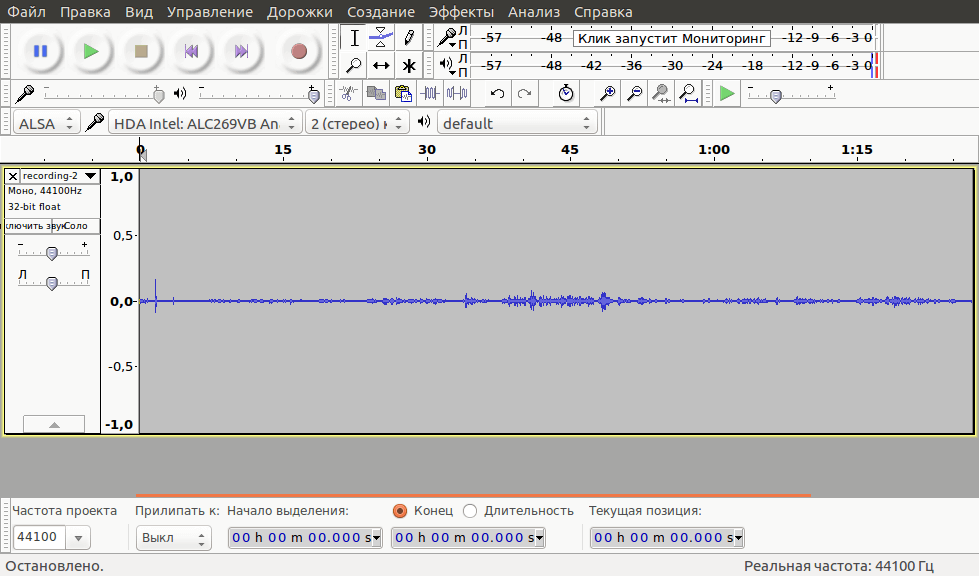

---

## Нормировка уровня громкости

Чтобы повысить качество звука, первым делом необходимо увеличить громкость записи. Для этого двойным щелчком левой кнопки мыши по дорожке (либо комбинацией ***Ctrl+a***) выделяем ее. Затем открываем вкладку меню ***Эффекты*** и выбираем пункт ***Нормировка сигнала...***

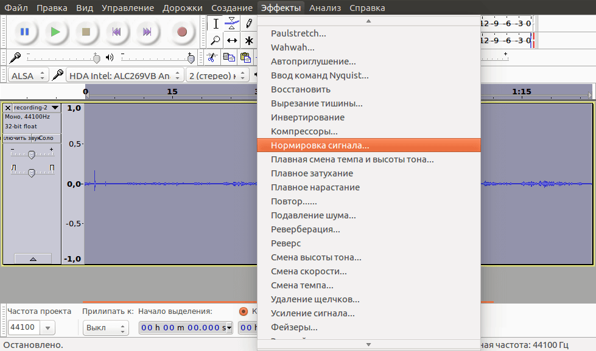

После нажатия, откроется меню настройки эффекта:

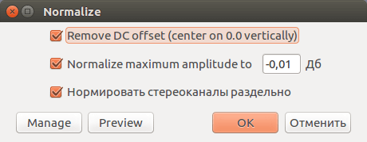

Стандартные настройки нас вполне устроят. В окошке указывается значение громкости, которое будет у самого громкого пика вашей записи. Нормировка повысит уровень громкости записи, никак больше не влияя на запись.

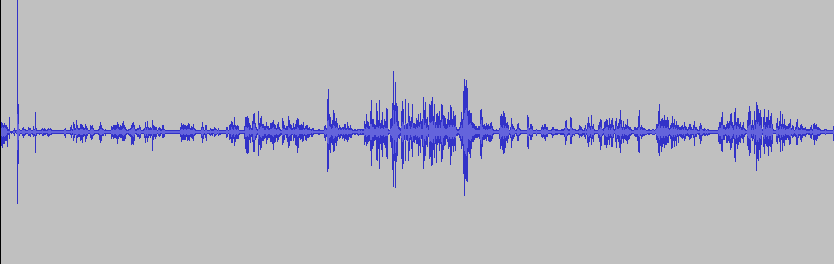

> У всех инструментов редактора Audacity есть кнопка ***Preview***, т.е. ***Предпросмотр***, или скорее ***Предпрослушивание.*** При нажатии на нее воспроизводится первые 5 секунд выделенного участка записи с применением эффекта.

---

## Удаляем лишние звуки и щелчки

Уровень громкости подрос, но как-то не солидно. Виной всему щелчок в самом начале. Можно попросту заглушить его. Для этого приближаем его и выделяем:

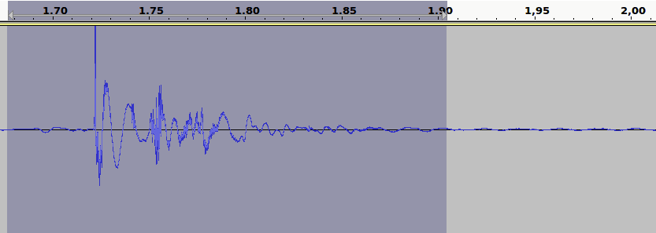

> Удобно менять масштаб зажимая ***Ctrl*** и крутя колесиком мыши, а для перемещения по записи влево-вправо крутя колесиком зажимать ***Shift***.

Я специально захватил на картинке временную шкалу, чтобы показать, что длительность пика около **0.1 секунды**. Для того чтобы заглушить выделенное нажимаем в панели инструментов кнопочку (либо комбинацию ***Ctrl+L***):

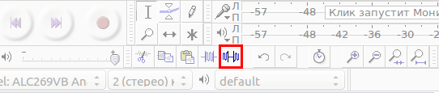

Редактор моментально сровняет пик с землей в идеально прямую линию нулевой громкости:

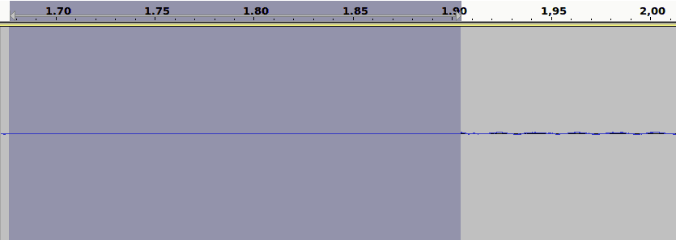

> Можно и ***удалить*** это кусочек просто нажав на клавиатуре ***Delete***. Но в таком случае выделенная часть дорожки удалится, а общая длительность сократится. Если запись готовится для озвучивания ***видео на ютубе***, удаление посредством Delete может привести к ***сдвигу дорожки***.

Удалив щелчок, повторяем Нормировку сигнала и получаем уже более солидный результат:

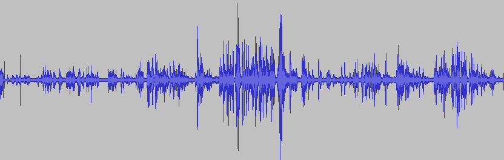

> В Audacity есть удобная комбинация клавиш ***Ctrl+R***, нажатие которой повторяет последний использованный эффект. При этом эффект повторяется с теми же самыми настройками.

***Нормировка сигнала*** это просто его ***усиление*** на одинаковую величину. Усиление подбирается так, чтобы места с максимальной громкостью довести до указанного вами значения. При этом усиливается всё - как полезный сигнал так и фоновый шумок.

---

## Как удалить шум в записи

Обработка голоса неминуемо требует удаление шума. Делается это в два этапа. Сначала нужно создать ***модель шума***, для того чтобы программа знала от чего нужно избавляться. Поэтому находим в записи кусочек, где нет полезной информации, а только то, что мы считаем шумом и выделяем этот участок.
Желательно, чтобы он был как можно длиннее, тогда получится более полно удалить шум из записи.

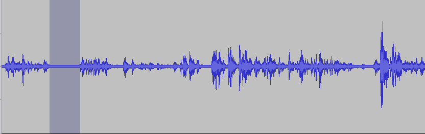

Теперь в меню ***Эффекты*** выбираем ***Подавление шума...*** Вверху открывшегося окошка видим и нажимаем единственную кнопочку - ***Создать модель шума***.

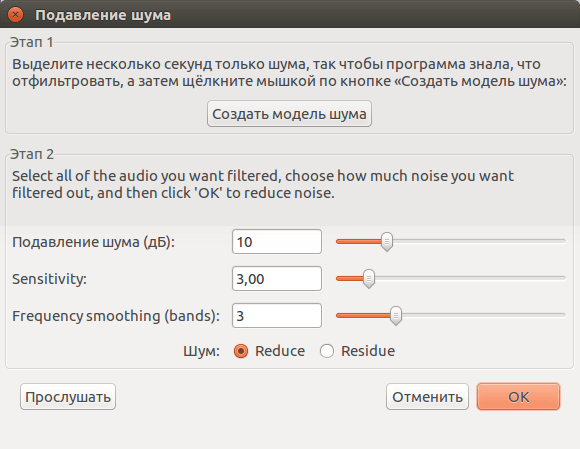

На этом окошко закроется... **Отлично!** Модель шума создана. Теперь выделяем всю запись и вновь заходим в меню ***Эффекты******→******Подавление шума...***
Откроется тоже самое окно, но теперь можно перейти к ***этапу 2***. Настройки по дефолту подойдут для большинства случаев. Хотя с последним ползунком лучше поэкспериментировать. Жмем ***ОК***, повторяем нормировку и любуемся результатом:

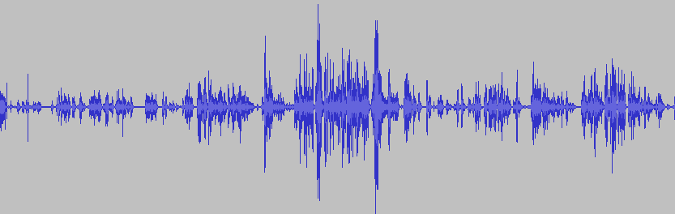

Если сравнить с тем как дорожка выглядела до удаления шума, то можно легко заметить, что постоянная составляющая практически полностью исчезла. Все тихие места стали еще тише, практически занулились. Да и на слух это звучит на порядок лучше.
> Для большего кругозора стоит отметить что подавление на каждые ***6дБ*** это ослабление ***в два раза***., а ***3дБ*** это ***полтора раза***. Если Ваша запись очень шумная и в ней присутствуют разные типы шумов в разных частях, то можно повторить процедуру с момента создания модели шума. При этом кусочек который будет выделен как модель шума взять в другом месте записи. А в окошко Подавление шума(дБ) вписать от 3 до 6дБ. Излишнее подавление может внести ‘*замыленность*’ в звук. Так же, зачастую, гораздо эффективнее несколько раз подавить шум по ***3дБ***, создавая модель шума из разных участков записи, чем один раз бухнут ***15 дБ***.

---

## Эквализация - выделяем голос на записи

Так как нас интересует именно речь, то можно дополнительно выделить ее при помощи эквалайзера. Переходим ***Эффекты→Эквалайзер...***
> Тему эквализации просто невозможно раскрыть двумя абзацами, поэтому по ней была написана отдельная статья: ***[Эквализация записи голоса в Audacity](../voice-eq-audacity/)***

Если уж совсем в двух словах, то речь, как мужская так и женская укладываются в диапазон ***200-7000 Гц***. Большинство шумов, как правило, лежит выше это диапазона, а гудение - ниже. Поэтому громкость остальных частот стоит снизить ввиду их неинформативности и даже паразитности.

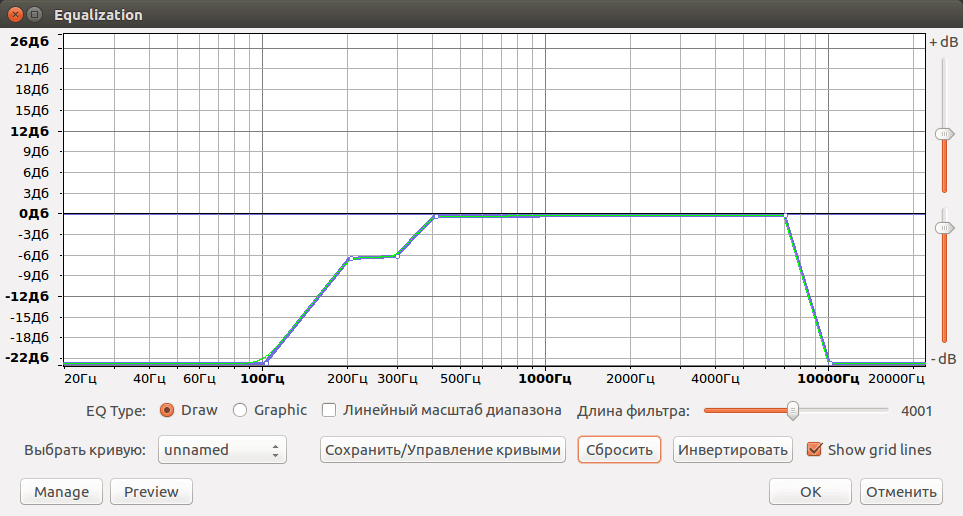

Подобная форма эквалайзера возможно подойдет при обработке на скорую руку. Но все очень сильно зависит от того, как и на что производилась запись. **Поэтому рекомендую все-же заглянуть в статью про эквализацию.**

---

## Компрессия

Обработка голоса всегда включает в себя выравнивание записи по громкости. В принципе можно вручную выделять кусочки и применять к каждому Нормировку. Это достаточно эффективный способ, но весьма долгий. Да и не зря же люди придумали такую полезную штучку, как Компрессор. Им то мы и воспользуемся :-)
Выделяем всю запись и переходим в меню ***Эффекты => Компрессоры...***

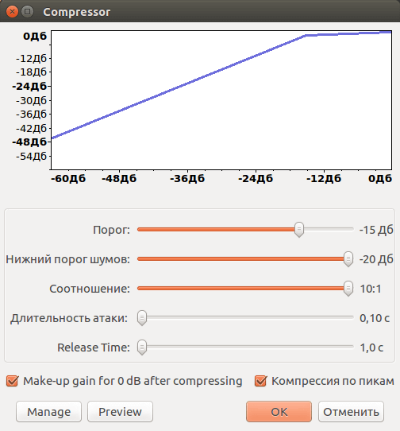

Такие настройки должны подойти большинству. Смысл компрессора в том, что тихие моменты он усиливает а громкие ослабляет и тем самым выравнивает громкость. Посмотрим на результат работы компрессора:

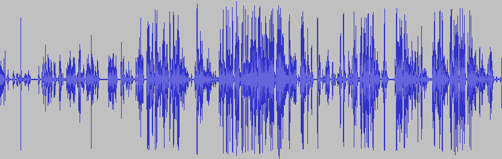

Запись явно преобразилась. Начало записи можно сделать еще громче. Выделим отдельно и повторим компрессию либо нормировку - на Ваш вкус.

---

## Экспорт и сохранение

> Для того чтобы сохранить обработанную запись в виде аудио файла перейдите в ***Файл→Export***

В открывшемся окне следует указать ***название файла*** и выбрать его ***формат***. Можно экспортировать запись в любой популярный аудиоформат, с указанием качества. Для большинства случаев подойдет ***MP3 с постоянным битрейтом 320 Кбит/с.***
Если Вы не успели завершить обработку а вам пора бежать по делам, то можно сохранить проект. Для этого служит пункт меню ***Файл→Сохранить Проект***. Сохраненный проект можно открыть в любое время и продолжить работу. Это особенно актуально, если у вас много дорожек.

**Вернемся к первоисточнику для сравнения**

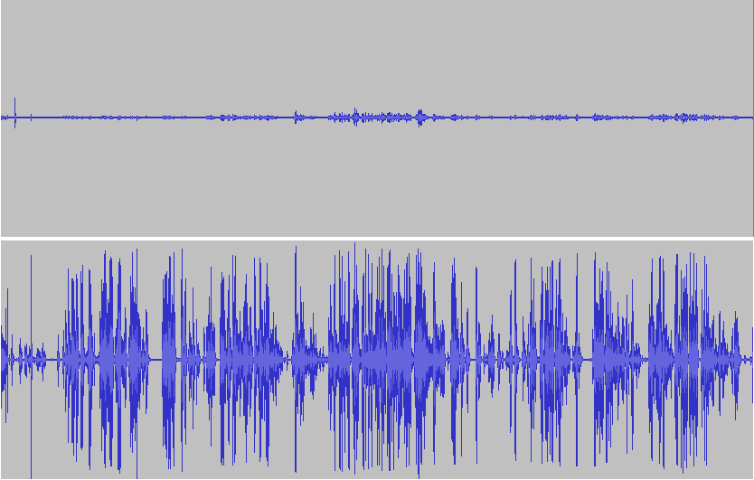

***Как говорится, найдите 10 отличий....***

## **Заключение**

Конечно можно продолжить пытать запись. Еще раз удалить шумы, которые могли вылезти после компрессии, произвести еще большую компрессию чтобы еще улучшить качество звука записи...
Но стоит помнить, что излишняя компрессия может сделать звук зажатым и лишить динамики. Однако решение в любом случае остается за вами и вкусами вашего слухового органа)
> **Если у Вас не получается обработать запись, то вы всегда можете обратиться за помощью на** ***[биржу фриланс услуг](https://fas.st/WGeqGx)***.

***Материал подготовлен исключительно для сайта* [AudioGeek.ru](https://audiogeek.ru)**
